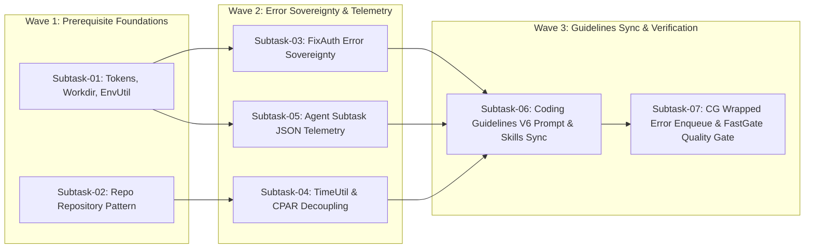

# Master Plan 294: Code Refactoring and Coding Guideline Update

## Status: COMPLETED
- **Plan ID:** 294
- **Slug:** `294-code-refactoring-and-coding-guideline-update`
- **Master Spec Reference:** [01-architecture-spec.md](../../../02-spec/21-app/294-code-refactoring-and-coding-guideline-update/01-architecture-spec.md)
- **Component Spec Reference:** [02-component-spec.md](../../../02-spec/21-app/294-code-refactoring-and-coding-guideline-update/02-component-spec.md)
- **Migration & Verification Spec Reference:** [03-migration-and-verification-spec.md](../../../02-spec/21-app/294-code-refactoring-and-coding-guideline-update/03-migration-and-verification-spec.md)
- **Scope:** 7 Surgical Architectural Refactorings across IDE Constants, Store Repository Pattern, Error Sovereignty, Date-Time Utilities, Agent Subtask JSON Telemetry, Upstream Coding Guidelines Sync, and Wrapped Error Enqueueing
- **Execution Mandate:** Zero-Build, Zero-Test, Zero Git Commands in Subagents, Strictly Relative Lowercase Git Paths

---

## 1. Executive Summary & Wave Organization

This master plan orchestrates the specification, refactoring, and verification of parent task 294 across both `gitmap` and `coding-guidelines`. The execution is partitioned into three staged waves with strict disjoint file box boundaries to eliminate concurrent file modification collisions:

```
┌──────────────────────────────────────────────────────────────────────────────┐
│ Wave 1: Foundations & Store Decoupling (Subtasks 01–02)                      │
│ Spec: 02-spec/21-app/294-code-refactoring-and-coding-guideline-update/01-arch │
├──────────────────────────────────────────────────────────────────────────────┤
│ Wave 2: Error Sovereignty, Utilities & Telemetry (Subtasks 03–05)            │
│ Spec: 02-spec/21-app/294-code-refactoring-and-coding-guideline-update/02-comp │
├──────────────────────────────────────────────────────────────────────────────┤
│ Wave 3: Upstream Sync, Enqueueing & Verification (Subtasks 06–07)            │
│ Spec: 02-spec/21-app/294-code-refactoring-and-coding-guideline-update/03-migr │
└──────────────────────────────────────────────────────────────────────────────┘
```

---

## 2. Complete 7-Subtask Registry & Traceability Matrix

### Wave 1: Foundations & Store Decoupling (Subtasks 01–02)

- [x] **Subtask-01:** [subtask-01.md](../subtasks/294-code-refactoring-and-coding-guideline-update/subtask-01.md)
  - **Targets:** `cli/strutil/strutil.go`, `cli/cmdide/ide_add.go`, `cli/constants/constants_workdir.go`, `cli/envutil/envutil.go`, `cli/cmdpe/pe_target.go`
  - **Objective:** Eliminate magic strings for IDE tokens (`TargetVSCode`, `TargetCursor`, etc.) using `IDETokenType` enums; implement `strutil.JoinCSV`; centralize working directory constants (`EnvWorkdir`, `DefaultWorkdirWorkspace`, `DefaultWorkdirRepos`); create `envutil.GetTrimmed`; document `fallbackWorkdir` path resolution.
  - **Status:** Completed

- [x] **Subtask-02:** [subtask-02.md](../subtasks/294-code-refactoring-and-coding-guideline-update/subtask-02.md)
  - **Targets:** `cli/constants/constants_store.go`, `cli/store/repo_repository.go`, `cli/store/repo.go`, `cli/store/repo_query_filter.go`, `cli/cmdpipeline/pipeline_history_render.go`
  - **Objective:** Decouple direct SQL out of `cli/store/repo.go` and `cli/cmdpipeline/pipeline_history_render.go` into centralized SQL constants; create `RepoRepository` returning `*apperror.AppError`; eliminate swallowed errors (`_ = db.Close()`); refactor `parseFirstVTag` to use string utility helpers.
  - **Status:** Completed

---

### Wave 2: Error Sovereignty, Utilities & Telemetry (Subtasks 03–05)

- [x] **Subtask-03:** [subtask-03.md](../subtasks/294-code-refactoring-and-coding-guideline-update/subtask-03.md)
  - **Targets:** `cli/cmdfixauth/fixauth.go`
  - **Objective:** Replace `checkGitRepo` simple error returns with structured `*apperror.AppError`; extract function invocations outside of `if` statements (`err := setupSSHDirAndKey(...)\n\nif err != nil`); format function calls with $>2$ parameters onto separate lines.
  - **Status:** Completed

- [x] **Subtask-04:** [subtask-04.md](../subtasks/294-code-refactoring-and-coding-guideline-update/subtask-04.md)
  - **Targets:** `cli/timeutil/timeutil.go`, `cli/cmdcpar/cpar.go`
  - **Objective:** Implement centralized date-time helper `timeutil.NowUTCISO()`; refactor `updateCPARTaskQueue` to eliminate ad-hoc `time.Now().UTC().Format(...)`; execute task queue updates through repository helper; eliminate swallowed error in `closeCPARTaskDb` (`_ = db.Close()`).
  - **Status:** Completed

- [x] **Subtask-05:** [subtask-05.md](../subtasks/294-code-refactoring-and-coding-guideline-update/subtask-05.md)
  - **Targets:** `cli/cmdagent/agent_subtask_cli.go`, `cli/cmdagent/agent_subtask_types.go`
  - **Objective:** Implement `--json` flag on `gitmap agent subtask ls` emitting structured machine-readable JSON; implement grouped JSON output on `gitmap agent subtask add` showing the database path once with an array of added subtasks; keep all files strictly <= 300 lines.
  - **Status:** Completed

---

### Wave 3: Upstream Sync, Enqueueing & Verification (Subtasks 06–07)

- [x] **Subtask-06:** [subtask-06.md](../subtasks/294-code-refactoring-and-coding-guideline-update/subtask-06.md)
  - **Targets:** `coding-guidelines/01-prompts/14-execute/02-execute-parent-task-with-n-steps-v6.md`, `coding-guidelines/02-spec/02-coding-guidelines/01-cross-language/37-datetime-and-timeutil-standards.md`, `coding-guidelines/02-spec/02-coding-guidelines/01-cross-language/38-no-inline-function-calls-in-if.md`, `coding-guidelines/02-spec/02-coding-guidelines/01-cross-language/39-multiline-parameter-and-argument-formatting.md`, `coding-guidelines/02-spec/02-coding-guidelines/01-cross-language/40-database-repository-pattern-and-error-sovereignty.md`, `coding-guidelines/02-spec/02-coding-guidelines/readme.md`, `coding-guidelines/.agents/skills/gitmap/skill.md`, `.agents/skills/gitmap/skill.md`
  - **Objective:** Synchronize `coding-guidelines` with new coding standards (centralized `timeutil`, ban on inline `if` calls, multiline argument formatting, database repository pattern & `*apperror.AppError` return sovereignty); update `02-execute-parent-task-with-n-steps-v6.md`; update GitMap skills with `gitmap agent subtask ls --json` examples and AI communication patterns.
  - **Status:** Completed

- [x] **Subtask-07:** [subtask-07.md](../subtasks/294-code-refactoring-and-coding-guideline-update/subtask-07.md)
  - **Targets:** `.ai-memory/plans/pending/295-cg-execute-wrapped-error-remediation.md`, `.ai-memory/plans/readme.md`, `03-ai-scripts/50-fastgate.py`
  - **Objective:** Enqueue Plan 295 (`cg-execute-wrapped-error-remediation`) into pending plans backlog per user mandate; run FastGate static AST verification (`python 03-ai-scripts/50-fastgate.py`) to confirm zero violations; execute atomic hyphen-separated commit via `gitmap cpf`.
  - **Status:** Completed

---

## 3. Disjoint File Box Allocation Matrix

Strict file boundary isolation prevents concurrent write conflicts during multi-agent execution:

| Subtask ID | Exclusive File Box (Assigned File Boundaries) | Overlap Check |
| :--- | :--- | :--- |
| `subtask-01` | `cli/strutil/strutil.go`<br/>`cli/cmdide/ide_add.go`<br/>`cli/constants/constants_workdir.go`<br/>`cli/envutil/envutil.go`<br/>`cli/cmdpe/pe_target.go` | Disjoint (No collision) |
| `subtask-02` | `cli/constants/constants_store.go`<br/>`cli/store/repo_repository.go`<br/>`cli/store/repo.go`<br/>`cli/store/repo_query_filter.go`<br/>`cli/cmdpipeline/pipeline_history_render.go` | Disjoint (No collision) |
| `subtask-03` | `cli/cmdfixauth/fixauth.go` | Disjoint (No collision) |
| `subtask-04` | `cli/timeutil/timeutil.go`<br/>`cli/cmdcpar/cpar.go` | Disjoint (No collision) |
| `subtask-05` | `cli/cmdagent/agent_subtask_cli.go`<br/>`cli/cmdagent/agent_subtask_types.go` | Disjoint (No collision) |
| `subtask-06` | `coding-guidelines/01-prompts/14-execute/02-execute-parent-task-with-n-steps-v6.md`<br/>`coding-guidelines/02-spec/02-coding-guidelines/01-cross-language/37-datetime-and-timeutil-standards.md`<br/>`coding-guidelines/02-spec/02-coding-guidelines/01-cross-language/38-no-inline-function-calls-in-if.md`<br/>`coding-guidelines/02-spec/02-coding-guidelines/01-cross-language/39-multiline-parameter-and-argument-formatting.md`<br/>`coding-guidelines/02-spec/02-coding-guidelines/01-cross-language/40-database-repository-pattern-and-error-sovereignty.md`<br/>`coding-guidelines/02-spec/02-coding-guidelines/readme.md`<br/>`coding-guidelines/.agents/skills/gitmap/skill.md`<br/>`.agents/skills/gitmap/skill.md` | Disjoint (No collision) |
| `subtask-07` | `.ai-memory/plans/pending/295-cg-execute-wrapped-error-remediation.md`<br/>`.ai-memory/plans/readme.md` | Disjoint (No collision) |

---

## 4. Execution Waves & Dependency Graph



---

## 5. Verification & FastGate Invariants

1. **Zero-Build, Zero-Test Mandate:** Neither `go build` nor `go test` may be executed during refactoring. Quality is verified using AST analysis.
2. **FastGate Quality Gate:** `python 03-ai-scripts/50-fastgate.py` must pass with zero errors before Phase 3 completes.
3. **AST Quality Standards:**
   - Functions $\le 15$ lines of executable code.
   - Files $\le 300$ lines.
   - Zero nested `if` statements (guard clauses only).
   - Positive booleans only (`is*`, `has*`).
   - No inline function invocations inside `if` statements.
   - Function arguments with $>2$ parameters placed on dedicated lines.
   - Strictly relative Git paths only (zero absolute paths or URI schemes).

---

## 6. User Request (Verbatim)

The user prompt initiating this task is preserved below with zero omissions:

```text
# Code Refactoring and Coding Guideline Update: high priority instruction, non-negotiable task


In the format registered tokens. The filename is actually cli/cmdide, then ide_at.go file. In this file, I do see that you're using Cursor, VS Code, Antigravity, GitHub Desktop, et cetera, but you are not using the constant or enum to add these strings properly. And there should be a very nice method to convert those strings to a CSV if you follow the utility methods, if you have any. You should have done that using that. And this is how we should actually reduce the duplicated code. The magic string here is unacceptable. We have been discussing this several times, and also the comma, it is also unacceptable. Now coming down, we have the `gitmap`. We have the file cli/store/repo.go file, also has a direct SQL on the top, where all this SQL communication should have been done from a separate repository package, where all the select and things like that would be handled properly. Where each enum would have the database information, database file path, related file path where we're keeping so that the root path will never change, it works automatically. That should have a class that should be injected or be provided in order to deal with that. It is not polite to use data like this. Also, at the same time, you are not using the app error or wrapped result, which is discussed several times. It's very disrespectful that you are doing it. Make sure that you fix that using the app error and wrapped error wrapper in this case. After running and executing this, you should also enqueue the CG execute wrapped error prompt so that it executes afterwards. There are several places that it is not respected. Now, if I go to another example, cli/cmdpe/pe_target.go file. This file has resolve work directory method, and that method has, again, magic string. This magic string should have been coming from util, and this environment thing should also have its own util env related, which is not properly respected. The way that environment variable would work is using the lowercase hyphen segment. You should follow that. Also, the fallback work directories, workspace/repos. This file path, whatever that it is returning, we should have a comment for the fallback work directory function because, whoever is coding later on, they do not know what is the file path that it's going to work on by default. It needs to be mentioned on top and also the workspace and repos that needs to come from constant, even the dot. It is not respected in many places. Then again, we go to the pipeline_history_render.go file, which actually has the SQL inside it, SQL code, which is very wrong. In many cases, it does not handle the error. It actually swallows the error. It does not return the error, what went wrong, or what happened there. I understand that it's trying to return the string, but in cases it should have a repository pattern where we will get this database, what we're trying to access and then get the data, and then from there we should be returning. It is not also correct. Also joining the line, there should be a method that actually joins the line, that we can see in the same file, parse first v tag. That is the method name. Anywhere that is similar is available, try to make sure that it is using util function. Then if we go to check git repo function, which is inside the cli/cmdfixauth/fixauth.go. In that file, we do see that there is an error that we print, and then we are returning a simple error. There should be no simple error. Just remove that function. Everywhere, every time we return, it has to be app error. If it is more than two parameters, use wrapped error. That's pretty much basic, very simple. Update these exact parts in the execute parent tasks-with-n-steps- v6 prompt, in the coding guideline by taking its pull first, and update its skill if required to. That is very crucial that you did not follow the respected coding guideline. In many cases, when the functions really have the multiple parameters, more than two or three, it should be in each line, the arguments, which is not respected in many cases. For example, in the same file. The same file means, again, cli/cmdfixauth/fixauth.go. The execute fix auth pipeline function, that has a line in 67 in the screenshot, which I will provide to you, that has four, let's say, arguments in the function, and it is using inside the if. That is requested not to use anything inside the if. Use it outside the if, so that the statement is very simple. Try to keep each statement very simple, which you did not. Now, coming down, I do see in places you have updateNow command added to find the current date, time. That is a very big question, which I will provide you the screenshot. The file that I'm talking about, or function I'm talking about, it is the updateCpartTaskQueue. Update Cpart task and task queue. That is the method. I hope you find that method. I don't have the file name with me. Oh, it is in the Cpart.go file. I believe so. Now in this file, the problem is, again, you are executing direct SQL. Make sure that it executes through your own package for update. For the date, time, it should coming from one function or one place, so that if we want to change it, we can change it everywhere in one shot. Try to make sure of that. The now time should be coming from a util, where we just call and get the time. That is not respected. You should also update the coding guideline regarding this so that this type of mistake never happen. Where you update, you update in the coding guideline repository, not in the Gitmap. In the same file, we also do see that Database (Database (Db)) tries to close, but also, the error has been swallowed, where it has been mentioned that swallowing error is code red. The coming part is that we can actually save multiple tasks using the Gitmap agent, right? Sub-task and things like that. We should be able to provide a JSON. That would be much more read-friendly, and that JSON should appear after, let's say, providing that. After the completion, the return result should be in a JSON form as well, as short as possible every response. Also combine the commonalities in the JSON. For example, it is showing the database. If it is showing the database, show it once, and show how many tasks it has been actually added and what it looks like. Try to make sure that you have a nice view in terms of JSON. The same thing should be like Gitmap agent subtask LS. That already show a table view. Also, it should have a JSON view, hyphen, hyphen JSON. That JSON example should be inside the Gitmap skills in the coding guideline repository. Subtask section should be able to pass as JSON. JSON should be the way that AI should communicate. Update the Gitmap skills, and Gitmap prompts, in the coding guideline Gitmap skills.


More Screenshots:
https://prnt.sc/0Kwz7jUEa2WS
https://prnt.sc/_PVCnI8rQPQC
https://prnt.sc/jVaCJss0wAop
https://prnt.sc/cFkg_Ad9JG_9

## task: Code Refactoring and Coding Guideline Update
## slug: code-refactoring-and-coding-guideline-update

# Actionable Items Must Follow Non-Negotiable

1. Git pull BEFORE starting any work – first try `gitmap pull <repo path>` (or run `gitmap pull` in repository folder); if that fails, fall back to regular `git pull` and resolve any merge conflicts so the repository is completely up to date and clean before starting.
2. Write spec under 02-spec/21-app/XX-code-refactoring-and-coding-guideline-update/ and enqueue plan task in .ai-memory/plans/pending/XX-code-refactoring-and-coding-guideline-update.md (subtasks in .ai-memory/plans/subtasks/XX-code-refactoring-and-coding-guideline-update/) first, (xx should be figured out by the folder structure and running AI tools, xx is sequence 01, 02)
3. Search codebase exclusively via GitMap (gitmap aum search, gitmap find, gitmap cat, gitmap ps, gitmap py, gitmap llm train); TOTAL BAN on rg, ripgrep, grep, git grep, Select-String
4. Strictly use relative Git paths (02-spec/..., .ai-memory/..., cmd/...); only add the relative paths, never add the absolute path during your work, and ensure this is respected on the release page and in release notes as well
5. Refactor cli/cmdide/ide_at.go to use constants or enums for strings like Cursor, VS Code, Antigravity, GitHub Desktop, etc., and implement a method to convert these strings to CSV using utility methods.
6. Move SQL communication in cli/store/repo.go to a separate repository package and ensure enums contain database information and paths.
7. Replace simple errors with app error or wrapped error in cli/cmdfixauth/fixauth.go and ensure functions with multiple parameters have arguments on separate lines.
8. Ensure updateCpartTaskQueue in Cpart.go uses a utility for date-time retrieval and executes SQL through a package.
9. Implement JSON view for Gitmap agent subtask LS and update Gitmap skills and prompts in the coding guideline repository.

## Must follow and spawn agent using

@[.agents/skills/execute-parent-task-with-n-steps-v6]

## Additional Instructions

- /plan first before doing work for improved work or less friction, faster execution for AI and coding without errors and following Coding Guidelines.
- /learn from @[.agents/skills/gitmap] skill to leverage GitMap high-speed search, toolchain discovery, and caching.
- Track in-flight file touches and prevent write collisions using GitMap RC Heatmap (`gitmap rc heatmap status` / `gitmap rc heatmap tree` / `gitmap rc heatmap live` / `gitmap rc heatmap sync`).
- Only add relative paths, never add absolute paths during work; this must be respected on release page and in release notes as well.
```

> **Closed 2026-10-23 (task 190, subtask 06 drain):** plan complete per its own status record and the spec 02 audit (substantively complete with matching commits); moved from pending/ to completed/ so the pending folder reflects only genuinely open work.
