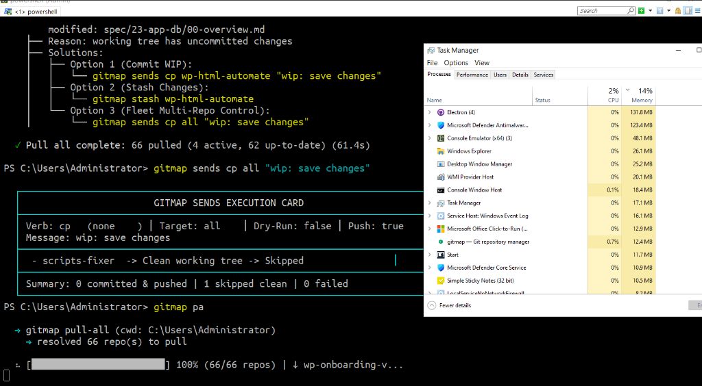

# Plan: GitMap Enhancement and Optimization (Completed)

- **Slug:** `gitmap-enhancement-and-optimization`
- **Spec Reference:** [01-architecture-spec.md](../../../02-spec/21-app/gitmap-enhancement-and-optimization/01-architecture-spec.md)
- **Component Spec:** [02-component-spec.md](../../../02-spec/21-app/gitmap-enhancement-and-optimization/02-component-spec.md)
- **Status:** `completed`
- **Completion Date:** 2026-10-16

---

## User Request (Verbatim)

```text
# GitMap Enhancement and Optimization: high priority instruction, non-negotiable task

Okay, a couple of serious issues. When we are running the `gitmap` PA, the job for this is to fix everything and pull. So if there is an issue, that should be asked directly to the user by prompting after the ignore. And after the, let's say, pull or whatever way that it is resolved, it should actually try to pull and fix everything. Now, there are certain issues now coming to this. Let's say we did not resolve it. So then there would be an option where the pull will try to pull regardless. So pull will always try to pull so that even though there are changes, try to make sure of that. If it cannot, then and only then it could ask to fix. Do you get my point? So this is how it needs to be. Currently, it is not doing how it's supposed to do. And if the processor is not heavily utilized, less than 30%, and no other nodes is running. And let's say other nodes are running, we can also ask, there should be a `gitmap` command to ask the CPU and RAM usages from the other nodes. If the other nodes are not in, let's say, pressure, 30% would be the benchmark. So keep a settings that can be changed from the `gitmap` settings UI. Keep it. And that setting can be configurable. Now, when the `gitmap` is using, let's say, two nodes are running. Now, all of these two nodes have less than 30% of the RAM and CPU usage. On this case, it would consider, and if the `gitmap` PA is only running on the self machine, current machine, not the SSH or nodes pull request, then it'll try to use heavily all the... Not the all, but it'll try to heavily run as much as parallel pulling possible in order to complete this very quick. And also, I want to recall and come to the gitmap pae command, which is the pull all efficient. That would not only take or pull the prompts that has change. That will only pull to the Git repos which have changes in, let's say, last 48 hours. And that would be a settings from the `gitmap` settings that can be changeable from terminal that would have a UI to change it. Remember that. That must be implemented, both of the settings. Now the idea here, the pull all efficient or `gitmap` PAE is that, let's say every time that pull happen, pull all happen or PAE happen, there should be a database. I think it's already there. It should already notify the last time, not the pulling, but last time it has commits. Do you understand? Commits is a different thing than when we pull. So the pull efficient will work based on the commits. So if there is a commit happened in last 48 hours, then `gitmap` pull efficient will know. So this is a recent repository, we should bring the changes in. Do you understand? We need to understand first, write all these cases as a spec. And pull all always run full powered with as many parallel worker possible in order to complete this. And also the progress bar was green when it was completing. It changes color. Now it does not. So try to figure it out why. So a lot of issues I think you need to resolve it. And the commit part, it would ask to the user how you want to resolve it. Do you want to go with each one or all of them together? So if you like the ignore. So if user says all together, so you would say, okay, so which one you would prefer? Send CP all WIP. Now, you do find CP means commit pending. Commit pending all. We should have a SSH version for this as well. Should have. That should be in the help and the help UI. But for here, yeah, I think CP all will try to figure it out the file names and the description a little bit. A little bit. Don't have too many issues. So the automatic `gitmap` should have list of the files and try to write a little bit where the changes are and what that change represents automatically. If we do the `gitmap` send CP all WIP, that will be the title, and the description it will say as a list of items like these are the files, only the file related path. So if one related path had multiple file, that would actually summarize as a heading, and then inside it would list out the files. And also each file will have the markdown linking to that specific file as a related path. Try to follow that. And mention where the changes are a little bit, not in a machine way, but it will try to summarize as little as possible. Not all the files required, probably, but it could also mention what changes are in this folder system. To give you an example, let's say we have the assets avatars. So this is basically images. So it could say avatar images are pending. This is supposed to be saved, something like this. In the description first header, and then the list of files should be there. I hope you understand all these things how I'm trying to say. So try to feel as natural as possible so you have some patterns, like CSS core pattern, the code changes, Boolean changes. It would have some pattern that would actually recognize and try to mention what each case could be. So you find this pattern way of having a segment with a configuration that would actually follow through and do this stuff. Does this make sense? So there are a lot of things that I requested for the `gitmap`. I hope you work on it and make sure you finish it. Is it clear?

## slug: gitmap-enhancement-and-optimization

# Actionable Items Must Follow Non-Negotiable

1. Write spec under 02-spec/21-app/gitmap-enhancement-and-optimization/ and enqueue plan task in .ai-memory/plans/gitmap-enhancement-and-optimization.md (subtasks in .ai-memory/plans/subtasks/gitmap-enhancement-and-optimization/) first
2. Search codebase exclusively via GitMap (gitmap aum search, gitmap find, gitmap cat, gitmap ps, gitmap py, gitmap llm train); TOTAL BAN on rg, ripgrep, grep, git grep, Select-String
3. Strictly use relative Git paths (02-spec/..., .ai-memory/..., cmd/...); only add the relative paths, never add the absolute path during your work, and ensure this is respected on the release page and in release notes as well
4. Use `gitmap` AI agents to enter data
5. Task completion includes committing and pushing to Git
6. Implement a prompt for user input when issues arise during `gitmap` PA execution.
7. Ensure `gitmap` pull attempts to resolve issues automatically and prompts only if unresolved.
8. Add a `gitmap` command to check CPU and RAM usage on other nodes, configurable via settings UI.
9. Implement `gitmap` PAE to pull only recent changes (last 48 hours) and make settings configurable from terminal UI.
10. Investigate and fix the progress bar color change issue during pull operations.
11. Develop SSH version for `gitmap` CP all WIP command and update help UI.
12. Automate file change summaries in `gitmap` CP all WIP with markdown links to related paths.
```

---

## User Uploaded Context



---

## Technical Outcomes & Verified Evidence

### 1. Resilient Pull-First Autostash & Interactive Prompting (`gitmap pa`)
- **Implemented in:** `cli/cmdpull/pull_worker.go`, `cli/cmdpull/pull_prompt.go`, `cli/cmdpull/pull_batch.go`.
- **Outcome:** `runTrackedPullLifecycle` now attempts `cloner.SafePullOneWithProgress` with `--autostash` first instead of prematurely skipping dirty repositories. If autostash pull resolves clean, the repo is marked clean and updated. Only if unresolvable merge conflicts or pull errors occur, the repository is flagged for post-pull remediation.
- **Interactive Prompt:** `PromptPostPullRemediation` triggers in interactive TTY mode if unresolved repositories remain after batch completion, offering Fleet Multi-Repo Control (`gitmap sends cp all "wip: save changes"`), individual step-through, or skip.

### 2. Progress Bar ANSI-Aware Truncation & Green Completion Status
- **Implemented in:** `cli/cmdpull/pull_progress_bar_render.go`, `cli/cmdpull/pull_progress_bar_visual.go`.
- **Outcome:** Root cause identified where `clampLineToTermWidth` was executing `stripANSI(line)` and returning the stripped plain string when terminal width was exceeded. Replaced with ANSI-preserving boundary clamping and restored vibrant green status with a green checkmark `✓` when reaching 100% completion.

### 3. Split-DB PAE Commit-Recency Filtering (48 Hours) & Settings
- **Implemented in:** `cli/cmdpull/pull_efficient.go`, `cli/cmdpull/pull_efficient_types.go`, `cli/store/split_db_pull_activity.go`, `cli/constants/constants_settings.go`.
- **Outcome:** Added `SettingPullActivityWindowHours = "pae_recency_window_hours"` (default: 48h). `gitmap pae` checks commit timestamps (`git -C <repo> log -1 --format=%ct`) against the configurable window rather than pull timestamps. Added CLI flags `--hours <N>` / `--window <N>`.

### 4. Semantic Change Grouping & Multi-Repo Resolution for `gitmap sends cp all`
- **Implemented in:** `cli/cmd/cmd_sends.go`, `cli/cmdsends/sends_grouping.go`.
- **Outcome:** Fixed `executeSendsDispatch` so `target == "all"` queries `store.OpenDefault()` (`gitmap.db`) across all tracked workspace repositories instead of scoping strictly to current working directory (`CWD`). Created `GenerateSemanticWipCommitMessage` to categorize modified files into CSS, Core Code, Booleans, Media/Assets, and Specs with clean markdown links `[file](relative/path)`.

### 5. Multi-Node CPU/RAM Metrics & Dynamic Pull Concurrency Boost
- **Implemented in:** `cli/cmdnodes/nodes_resources.go`, `cli/cmdnodes/nodes_cmd.go`, `cli/cloneconcurrency/pull_concurrency.go`, `cli/constants/constants_settings.go`.
- **Outcome:** Implemented `gitmap nodes resources` (aliases: `nodes top`, `nodes metrics`, `nodes res`) to sample local and remote fleet CPU/RAM usage. Added configurable threshold `SettingNodeResourceThreshold = "node_resource_threshold"` (default: 30%). When local resources are below 30% and only local pulls are executing, `ResolveBoostedPullConcurrency` scales worker pools up to `max(runtime.NumCPU(), 6)` with 2 concurrent worker hands.

### 6. Fleet SSH `nodes cp all` Parity & Documentation Parity
- **Implemented in:** `cli/cmdnodes/nodes_commits.go`, `cli/cmdagy/agy_telegram_email_settings.go`, `src/pages/Settings.tsx`, `src/data/commands.ts`, `cli/helpdoc/sends.md`, `cli/helpdoc/nodes.md`.
- **Outcome:** Registered `gitmap nodes cp all` / `gitmap nodes cm all` to broadcast commits across SSH fleet nodes in parallel. Added settings controls to terminal CLI (`gitmap settings set ...`) and React settings UI. Updated command catalog in `src/data/commands.ts` and CLI help documentation.
