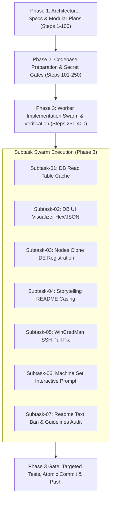

# Master Execution Plan: GitMap Enhancement and Issue Resolution

- **Plan Path:** `.ai-memory/plans/gitmap-enhancement-and-issue-resolution.md`
- **Slug:** `gitmap-enhancement-and-issue-resolution`
- **Specification Overview:** [02-spec/21-app/gitmap-enhancement-and-issue-resolution/00-overview.md](../../02-spec/21-app/gitmap-enhancement-and-issue-resolution/00-overview.md)
- **Consistency Report:** [02-spec/21-app/gitmap-enhancement-and-issue-resolution/99-consistency-report.md](../../02-spec/21-app/gitmap-enhancement-and-issue-resolution/99-consistency-report.md)
- **Status:** Active
- **Lifecycle Budget:** 400 Steps (V6 Swarm Hierarchy: A=3, H=2, Capacity=6)
- **Target Release:** GitMap v6.590.0

---

## 1. Executive Strategy & Architectural Dependencies

This master execution plan coordinates the multi-agent execution swarm to resolve database introspection, UI visualization, SSH fleet pull authentication, remote IDE registration, NTFS case reconciliation, and coding standard adherence.

---

## 2. Comprehensive Subtask Breakdown & File Allocations

Each subtask operates within an exclusive file bounding box. No two subtasks share write ownership of any source file.

| Subtask ID | Subtask Plan Document | Functional Scope | Primary Owner | Exclusive File Bounding Box |
|---|---|---|---|---|
| **Subtask-01** | [.ai-memory/plans/subtasks/gitmap-enhancement-and-issue-resolution/01-subtask-db-read-table-cache.md](subtasks/gitmap-enhancement-and-issue-resolution/01-subtask-db-read-table-cache.md) | Database read bare path introspection, 8s TTL cache, write mutation invalidation | Worker 01 | `cli/cmddb/cmd_read.go`, `cli/cmddb/cmd_read_helpers.go`, `cli/cmddb/cmddb_cache.go`, `cli/cmddb/cmd_add.go`, `cli/cmddb/cmd_edit.go`, `cli/cmddb/cmd_record_del.go`, `cli/cmddb/cmd_rm.go` |
| **Subtask-02** | [.ai-memory/plans/subtasks/gitmap-enhancement-and-issue-resolution/02-subtask-database-ui-visualizer-enhancement.md](subtasks/gitmap-enhancement-and-issue-resolution/02-subtask-database-ui-visualizer-enhancement.md) | Database visualizer overhaul: binary/protobuf cell badge, hex preview, collapsible JSON tree | Worker 01 | `cli/cmddb/rest_visualizer_html.go`, `cli/cmddb/rest_visualizer_js1.go`, `cli/cmddb/rest_visualizer_js2.go`, `src/pages/Database.tsx` |
| **Subtask-03** | [.ai-memory/plans/subtasks/gitmap-enhancement-and-issue-resolution/03-subtask-nodes-clone-ide-registration.md](subtasks/gitmap-enhancement-and-issue-resolution/03-subtask-nodes-clone-ide-registration.md) | Hook `RegisterRemoteIDEs` into `nodes_clone_remote.go` for GitHub Desktop, VS Code, Cursor, Antigravity | Worker 03 | `cli/cmdnodes/nodes_clone_remote.go`, `cli/cmdnodes/nodes_clone_ide_hook.go` |
| **Subtask-04** | [.ai-memory/plans/subtasks/gitmap-enhancement-and-issue-resolution/04-subtask-storytelling-readme-case-normalization.md](subtasks/gitmap-enhancement-and-issue-resolution/04-subtask-storytelling-readme-case-normalization.md) | NTFS case normalization for `README.md` in `gitmap fix-all` and recipe persistence | Worker 02 | `cli/cmdfix/fix_casing.go`, `cli/cmdfix/fix_cmd.go`, `repo-cache/` |
| **Subtask-05** | [.ai-memory/plans/subtasks/gitmap-enhancement-and-issue-resolution/05-subtask-wincredman-ssh-pull-fix.md](subtasks/gitmap-enhancement-and-issue-resolution/05-subtask-wincredman-ssh-pull-fix.md) | Remote SSH pull WinCredMan authentication failure fallback via DPAPI & GitMap tokens | Worker 02 | `cli/gitutil/git_env.go`, `cli/cmdfixauth/fixcredential.go`, `cli/cmdpull/pull_remediation_ssh.go` |
| **Subtask-06** | [.ai-memory/plans/subtasks/gitmap-enhancement-and-issue-resolution/06-subtask-machine-set-interactive-prompt.md](subtasks/gitmap-enhancement-and-issue-resolution/06-subtask-machine-set-interactive-prompt.md) | `gitmap machine set` stdin interactive prompt when machine name is omitted | Worker 02 | `cli/cmdos/os_machine_alias.go` |
| **Subtask-07** | [.ai-memory/plans/subtasks/gitmap-enhancement-and-issue-resolution/07-subtask-readme-text-ban-and-guidelines-audit.md](subtasks/gitmap-enhancement-and-issue-resolution/07-subtask-readme-text-ban-and-guidelines-audit.md) | Universal eradication of `readme.text` & timestamps, plus repository coding guidelines audit | Worker 03 | `.ai-memory/strictly-avoid.md`, `02-spec/`, `.agents/skills/`, and modified Go files |

---

## 3. Architecture Dependencies & Invariants

1. **Subtask-01 & Subtask-02 Dependency:** Subtask-01 provides the underlying cached schema and data types consumed by the REST visualizer in Subtask-02.
2. **Subtask-03 Invariant:** `RegisterRemoteIDEs` (defined in `cli/cmdnodes/nodes_deploy_ide.go:27`) must execute immediately after successful clone completion in `cli/cmdnodes/nodes_clone_remote.go`. If IDE registration encounters an error, it logs a warning without marking the clone as failed.
3. **Subtask-05 Invariant:** In headless SSH sessions (`SSH_CONNECTION` or `SSH_TTY`), `git` commands dispatched by GitMap must set `GCM_CREDENTIAL_STORE=dpapi` or `GIT_TERMINAL_PROMPT=0` to prevent blocking or wincredman vault access failures.
4. **Disjoint Workspace Rule:** Subagents never run `git commit`, `git add`, or `git push`. The Lead Orchestrator alone performs git operations during Phase 3 completion.

---

## 4. Rollback & Contingency Plans

| Failure Point | Detection Mechanism | Automated Rollback Action |
|---|---|---|
| Remote IDE Registration hangs over SSH | 10s SSH context timeout | Terminate remote script, retain cloned files on disk, return `hasError = false` with warning details |
| Table Metadata Cache memory bloat | PRAGMA query size limit | Limit cache capacity to 50 active SQLite database paths with LRU eviction |
| NTFS Casing Rename Collision | Staging collision check | Abort rename if target `readme.md` already exists on disk with differing contents |
| WinCredMan DPAPI fallback fails | Remote exit code 128 | Emit actionable remediation prompt advising user to run `gitmap fix-credential` |

---

## 5. Verification Checkpoints

1. **Checkpoint 1 (Planning Gate):** All 7 subtask plans and 2 specification documents authored under relative paths with zero build/test calls.
2. **Checkpoint 2 (Execution Gate):** Subtasks 01–07 implemented in micro-batches conforming to positive booleans (`is*`, `has*`) and 15-line function caps.
3. **Checkpoint 3 (Targeted Test Gate):** Discrete unit tests executed for `cli/cmddb`, `cli/cmdnodes`, `cli/cmdos`, and `cli/cmdfix`.
4. **Checkpoint 4 (Audit Gate):** Full repository scan verifying zero absolute paths and zero references to `readme.text`.
