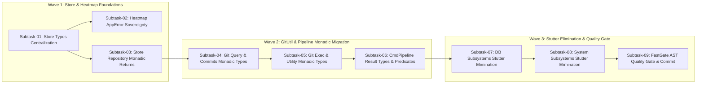

# Master Plan 296: Result Wrapper and AppError Returns

## Status: COMPLETED
- **Plan ID:** 296
- **Slug:** `296-result-wrapper-and-apperror-returns`
- **Master Spec Reference:** [01-architecture-spec.md](../../../02-spec/21-app/296-result-wrapper-and-apperror-returns/01-architecture-spec.md)
- **Component Spec Reference:** [02-component-spec.md](../../../02-spec/21-app/296-result-wrapper-and-apperror-returns/02-component-spec.md)
- **Migration & Verification Spec Reference:** [03-migration-and-verification-spec.md](../../../02-spec/21-app/296-result-wrapper-and-apperror-returns/03-migration-and-verification-spec.md)
- **Scope:** 9 Surgical Subtasks across 3 Waves: Centralizing Domain Types in `types.go`, Eliminating Multi-Value `(T, error)` Tuples, Enforcing Single-Return Monadic Containers (`result.Wrap[T]`, `result.WrapSlice[T]`, `result.WrapMap[K, V]`), Standardizing Structured `*apperror.AppError` Returns, Eradicating `result.Result[...]` Package Stutter across PRDB, PipelineDB, DBEngine, OSUser, OSClean, and CommitTransfer, and Verifying via FastGate AST Quality Gate
- **Execution Mandate:** Zero-Build, Zero-Test, Zero Git Commands in Subagents, Strictly Relative Lowercase Git Paths

---

## 1. Executive Summary & Wave Organization

This master plan orchestrates the architecture specification, component refactoring, and static AST verification of parent task 296 (`296-result-wrapper-and-apperror-returns`). Execution is organized into three staged waves with strict disjoint file box boundaries to eliminate concurrent file modification collisions:

```
┌──────────────────────────────────────────────────────────────────────────────┐
│ Wave 1: Store & Heatmap Foundations (Subtasks 01–03)                         │
│ Spec: 02-spec/21-app/296-result-wrapper-and-apperror-returns/01-arch         │
├──────────────────────────────────────────────────────────────────────────────┤
│ Wave 2: GitUtil & CmdPipeline Monadic Migration (Subtasks 04–06)             │
│ Spec: 02-spec/21-app/296-result-wrapper-and-apperror-returns/02-comp         │
├──────────────────────────────────────────────────────────────────────────────┤
│ Wave 3: Stutter Elimination, FastGate Verification & Release (Subtasks 07–09)│
│ Spec: 02-spec/21-app/296-result-wrapper-and-apperror-returns/03-migr         │
└──────────────────────────────────────────────────────────────────────────────┘
```

---

## 2. Complete 9-Subtask Registry & Traceability Matrix

### Wave 1: Store & Heatmap Foundations (Subtasks 01–03)

- [x] **Subtask-01:** [subtask-01.md](../subtasks/296-result-wrapper-and-apperror-returns/subtask-01.md)
  - **Targets:** `cli/store/types.go` (new), `cli/store/repository_types.go` (modify)
  - **Objective:** Author `cli/store/types.go` centralizing 13 required canonical type aliases (`ScanRecordSlice`, `ScanRecordWrap`, `ScanRecordSliceWrap`, `ScanRecordMapWrap`, `HeatmapActionLogRecordSliceWrap`, `HeatmapExecutionTreeNodeSliceWrap`, `HeatmapStatusSummaryWrap`, `HeatmapTaskSummaryWrap`, `FileTouchCountSliceWrap`, `DuplicateRepoGroupSliceWrap`, `RowsAffectedWrap`, `RepoIDWrap`, `RepoCountWrap`, `RepoPathWrap`); remove duplicate aliases and eliminate banned anti-pattern line 28 `ScanRecordsResult = result.Result[[]model.ScanRecord]` from `cli/store/repository_types.go`.
  - **Status:** Completed

- [x] **Subtask-02:** [subtask-02.md](../subtasks/296-result-wrapper-and-apperror-returns/subtask-02.md)
  - **Targets:** `cli/heatmap/heatmap_tracker.go`, `cli/heatmap/heatmap_tracker_agent.go`
  - **Objective:** Convert `TrackFileTouch`, `TrackBatchFileTouches`, and `TrackAgentAction` from returning bare standard library `error` to returning structured `*apperror.AppError` envelopes; eliminate unhandled errors and format multiline parameters.
  - **Status:** Completed

- [x] **Subtask-03:** [subtask-03.md](../subtasks/296-result-wrapper-and-apperror-returns/subtask-03.md)
  - **Targets:** `cli/store/repo.go`
  - **Objective:** Refactor store repository query methods (`ListRepos`, `FindBySlug`, `FindOneBySlug`, `FindByPath`, `CountRepos`, `DeleteByPath`, `DeleteBySlug`) from legacy multi-value error tuples `(T, error)` to single-return monadic containers (`ScanRecordSliceWrap`, `ScanRecordWrap`, `RepoCountWrap`, `RowsAffectedWrap`).
  - **Status:** Completed

---

### Wave 2: GitUtil & CmdPipeline Monadic Migration (Subtasks 04–06)

- [x] **Subtask-04:** [subtask-04.md](../subtasks/296-result-wrapper-and-apperror-returns/subtask-04.md)
  - **Targets:** `cli/gitutil/types.go` (new), `cli/gitutil/git_repo_query.go`, `cli/gitutil/git_repo_commits.go`
  - **Objective:** Author `cli/gitutil/types.go` defining `CaseCollisionSliceWrap` and `RemoteBranchSliceWrap`; refactor `GetRepoHeadCommitSha`, `GetRepoRemoteURL`, `GetRepoTrackingRemote`, and `GetRepoMergeBase` to `result.StringResult`; refactor `HasUnpushedCommits` and `IsRepoDetached` to `result.BoolResult`; refactor `GetRepoDirtyFiles` to `result.StringSliceResult`; refactor `GetRepoUnpushedCommitCount` to `result.IntResult`.
  - **Status:** Completed

- [x] **Subtask-05:** [subtask-05.md](../subtasks/296-result-wrapper-and-apperror-returns/subtask-05.md)
  - **Targets:** `cli/gitutil/git_cmd_exec.go`, `cli/gitutil/gitutil.go`
  - **Objective:** Refactor `RunGitInDir` and `RunGitCombinedInDir` to return `result.ByteSliceResult`; refactor `GetRepoConfig`, `ReadRemoteOriginURL`, `GetRepoCurrentBranch`, `RemoteURL`, `RepoRoot`, and `CurrentBranch` to return `result.StringResult`; refactor `IsRepoClean` to return `result.BoolResult`.
  - **Status:** Completed

- [x] **Subtask-06:** [subtask-06.md](../subtasks/296-result-wrapper-and-apperror-returns/subtask-06.md)
  - **Targets:** `cli/cmdpipeline/types.go` (new), `cli/cmdpipeline/pipeline_history_render.go`, `cli/cmdpipeline/pipeline_fallback.go`
  - **Objective:** Author `cli/cmdpipeline/types.go` defining `PEFormatProfileSliceWrap` and `PipelineSyncResultWrap`; refactor caller sites in `pipeline_history_render.go` and `pipeline_fallback.go` to use affirmative predicates (`res.IsFailure()`, `res.Items()`, `res.UnwrapOr()`).
  - **Status:** Completed

---

### Wave 3: Stutter Elimination, FastGate Verification & Release (Subtasks 07–09)

- [x] **Subtask-07:** [subtask-07.md](../subtasks/296-result-wrapper-and-apperror-returns/subtask-07.md)
  - **Targets:** `cli/prdb/types.go`, `cli/pipelinedb/types.go`, `cli/dbengine/result_types.go`
  - **Objective:** Eliminate `result.Result[...]` package stutter across database subsystems; replace with canonical `result.Wrap[...]` and `result.WrapSlice[...]`; modernize `EntityResult[T]` and `ListResult[T]` in `dbengine`; preserve backward-compatibility aliases.
  - **Status:** Completed

- [x] **Subtask-08:** [subtask-08.md](../subtasks/296-result-wrapper-and-apperror-returns/subtask-08.md)
  - **Targets:** `cli/osuser/types.go`, `cli/osclean/types.go`, `cli/committransfer/types.go`
  - **Objective:** Modernize `UserWrap` in `osuser` and `CleanWrap` in `osclean`; define `ReplayResultWrap` and `ReplayPlanWrap` in `committransfer` to eliminate multi-value error tuples in replay operations.
  - **Status:** Completed

- [x] **Subtask-09:** [subtask-09.md](../subtasks/296-result-wrapper-and-apperror-returns/subtask-09.md)
  - **Targets:** `.ai-memory/plans/readme.md`, `03-ai-scripts/50-fastgate.py` (runner execution only)
  - **Objective:** Execute static AST pre-commit verification via FastGate (`python 03-ai-scripts/50-fastgate.py`); register Plan 296 in `.ai-memory/plans/readme.md`; execute atomic hyphen-separated commit via `gitmap cpf`.
  - **Status:** Completed

---

## 3. Disjoint File Box Allocation Matrix

Strict file boundary isolation prevents concurrent write conflicts during multi-agent execution:

| Subtask ID | Wave | Exclusive File Box (Assigned File Boundaries) | Overlap Check |
| :--- | :--- | :--- | :--- |
| `subtask-01` | Wave 1 | `cli/store/types.go`<br/>`cli/store/repository_types.go` | Disjoint (No collision) |
| `subtask-02` | Wave 1 | `cli/heatmap/heatmap_tracker.go`<br/>`cli/heatmap/heatmap_tracker_agent.go` | Disjoint (No collision) |
| `subtask-03` | Wave 1 | `cli/store/repo.go` | Disjoint (No collision) |
| `subtask-04` | Wave 2 | `cli/gitutil/types.go`<br/>`cli/gitutil/git_repo_query.go`<br/>`cli/gitutil/git_repo_commits.go` | Disjoint (No collision) |
| `subtask-05` | Wave 2 | `cli/gitutil/git_cmd_exec.go`<br/>`cli/gitutil/gitutil.go` | Disjoint (No collision) |
| `subtask-06` | Wave 2 | `cli/cmdpipeline/types.go`<br/>`cli/cmdpipeline/pipeline_history_render.go`<br/>`cli/cmdpipeline/pipeline_fallback.go` | Disjoint (No collision) |
| `subtask-07` | Wave 3 | `cli/prdb/types.go`<br/>`cli/pipelinedb/types.go`<br/>`cli/dbengine/result_types.go` | Disjoint (No collision) |
| `subtask-08` | Wave 3 | `cli/osuser/types.go`<br/>`cli/osclean/types.go`<br/>`cli/committransfer/types.go` | Disjoint (No collision) |
| `subtask-09` | Wave 3 | `.ai-memory/plans/readme.md` | Disjoint (No collision) |

---

## 4. Execution Waves & Dependency Graph



---

## 5. Verification & FastGate Invariants

1. **Zero-Build, Zero-Test Mandate:** Neither `go build` nor `go test` may be executed during refactoring. Quality is verified using static AST analysis.
2. **FastGate Quality Gate:** `python 03-ai-scripts/50-fastgate.py` must pass with zero errors across all modified files before final commit.
3. **AST Quality Standards:**
   - Functions $\le 15$ lines of executable code.
   - Files $\le 300$ lines.
   - Zero nested `if` statements (guard clauses only).
   - Positive booleans only (`is*`, `has*`).
   - No inline function invocations inside `if` statements.
   - Function arguments with $>2$ parameters placed on dedicated lines.
   - Strictly relative Git paths only (zero absolute paths or URI schemes).

---

## 6. User Request (Verbatim)

The user prompt initiating this task is preserved below with zero omissions:

```text
@[01-prompts/15-cg-execute/19-result-wrapper-and-apperror-returns.md]
```

### Reference Canonical Prompt: `01-prompts/15-cg-execute/19-result-wrapper-and-apperror-returns.md`

```text
Prompt Version: 6.0.0
Runtime: Google Antigravity 2.0 (IDE and CLI)
Invoke: /result-wrapper-and-apperror-returns <task>

Autonomously scan, discover, plan, refactor, and verify all Go functions returning multi-value error tuples (such as (map[K]V, error), ([]T, error), or (T, error)), eliminating raw standard library error returns, centralizing all domain payload structs and Result type aliases into types.go within each package as single reusable types everywhere rather than scattering inline structs or raw generic Result declarations across implementation files, replacing multi-value returns with strongly-typed result wrappers (result.Wrap[T], result.WrapSlice[T], result.WrapMap[K, V]) and structured *apperror.AppError (or *appfault.AppError) returns, guaranteeing a single return object, pointer-attached null safety (*result.Wrap[T], *result.WrapSlice[T], *result.WrapMap[K, V]) with methods attached to pointer receivers that verify if r == nil before dereferencing any fields or checking errors, standardized outer-layer inspection predicates (IsSuccess, IsFailure, HasError, IsEmptyError, IsEmpty, HasRecord, IsDefined, IsCountOtherThan, Data, Items, AppError, Fault, Get, Has, Count), eliminating dual-handling, and replacing verbose if err != nil || len(...) != N or IsFailure() || Count() != N conditions with fluent if res.IsCountOtherThan(N) across the entire codebase.
```
