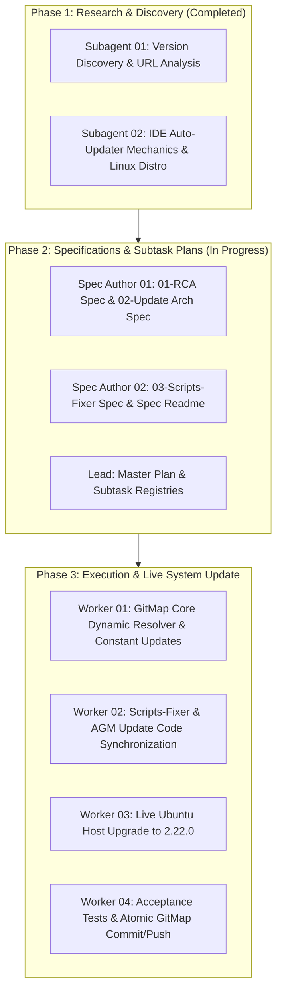

# Master Plan: Antigravity IDE Version Discrepancy Root Cause Analysis & Update Architecture

**Slug:** `root-cause-analysis-and-update-instructions`  
**Parent Task ID:** `root-cause-analysis-and-update-instructions`  
**Status:** `COMPLETED`  
**Version:** `1.0.0`  
**Date:** 2026-10-12  

---


## 1. User Request (Verbatim)

```text
# Root Cause Analysis and Update Instructions: high priority instruction, non-negotiable task

Okay. So here you can see I have given the screenshot from Windows. Windows has 2.22 version, where in Ubuntu it has 2.19 and the Update button does not work. What is the root cause of it? Is it the installation, how we have done it, what we could have done to avoid this? Or what could be the installation? Should we install using the package managers to have the latest updates? What is the right way? The current way that we have installed it is not updating, even after running so many times. The installation still does not update. It is the older version. Please find the root cause and try to fix it and also find these scripts. Update the scripts fixture, give map update, also the Antigravity Manager (Antigravity Manager (AGM)) update code as well. Okay? So currently what you're doing, it's not accepted yet.

## slug: root-cause-analysis-and-update-instructions

# Actionable Items Must Follow Non-Negotiable

1. Write spec under 02-spec/21-app/root-cause-analysis-and-update-instructions/ and enqueue plan task in .ai-memory/plans/root-cause-analysis-and-update-instructions.md (subtasks in .ai-memory/plans/subtasks/root-cause-analysis-and-update-instructions/) first
2. Search codebase exclusively via GitMap (gitmap aum search, gitmap find, gitmap cat, gitmap ps, gitmap py, gitmap llm train); TOTAL BAN on rg, ripgrep, grep, git grep, Select-String
3. Strictly use relative Git paths (02-spec/..., .ai-memory/..., cmd/...); only add the relative paths, never add the absolute path during your work, and ensure this is respected on the release page and in release notes as well
4. Use gitmap AI agents to enter data
5. Task completion includes committing and pushing to Git
6. Find the root cause of the version discrepancy and fix it
7. Update the scripts fixture
8. Provide map update and Antigravity Manager (Antigravity Manager (AGM)) update code

## Must follow and spawn agent using

@[.agents/skills/execute-parent-task-with-n-steps-v6]

## Additional Instructions

- /plan first before doing the work to reduce the credits.
- /learn from @[.agents/skills/gitmap] skill to leverage GitMap high-speed search, toolchain discovery, and caching.
- Only add the relative paths, never add the absolute path during your work; this should be respected on the release page and in release notes as well.
```

---

## 2. Evidence & Visual Context


*Figure 1: Windows installation displaying active Antigravity IDE Version 2.22.0 with functional 'Check for Updates' infrastructure.*

---

## 3. Root Cause Analysis Summary

1. **In-App 'Check for Updates' Failure on Ubuntu Linux**:
   - Google Antigravity Desktop IDE uses `electron-updater` (v6.8.9).
   - On Linux, when no package-type marker (`package-type` indicating `deb` or `rpm`) is found, `electron-updater` defaults to `AppImageUpdater`.
   - In `AppImageUpdater.isUpdaterActive()`, execution requires `process.env["APPIMAGE"] != null`.
   - Because GitMap, scripts-fixer, and manual installations deploy Antigravity as an unpacked `.tar.gz` directory tree into `~/.local/share/antigravity-ide/`, `process.env["APPIMAGE"]` is null.
   - `isUpdaterActive()` returns `false`, causing `checkForUpdates()` to immediately return `Promise.resolve(null)` without dispatching any network requests or UI events.
   - The UI button silently fails with zero feedback.

2. **Why Windows Runs Version 2.22.0**:
   - On Windows, `electron-updater` instantiates `NsisUpdater`.
   - `NsisUpdater` does not require `APPIMAGE`; it queries Google's live Cloud Run updater endpoint (`https://antigravity-hub-auto-updater-974169037036.us-central1.run.app/manifest/latest-x64-win.yml`), discovers version `2.22.0` (Build ID `5446056071266304`), downloads `Antigravity-x64.exe`, and runs a silent background NSIS update on app restart.

3. **Google Linux Distribution Model**:
   - Google does NOT provide an official APT/Debian repository (`deb [arch=amd64] https://...`).
   - Google publishes build artifacts to Google Cloud Storage under `https://storage.googleapis.com/antigravity-public/antigravity-hub/${VERSION}-${BUILD_ID}/${PLATFORM}/${ARTIFACT}`.
   - The verified production download URL for version `2.22.0` on Linux x64 is:
     `https://storage.googleapis.com/antigravity-public/antigravity-hub/2.22.0-5446056071266304/linux-x64/Antigravity.tar.gz` (180,243,767 bytes).

4. **Why Tooling Remained on Version 2.19.1**:
   - Both `gitmap` (`cli/cmdinstall/installantigravity_types.go`) and `scripts-fixer` (`scripts/os/ubuntu/install-antigravity.sh`) statically hardcoded version `2.19.1` and build ID `6046815158665216`.
   - Neither tool queried Google's Cloud Run update manifest endpoint.

---

## 4. Multi-Agent Work Decomposition & Waves



---

## 5. Subtask Inventory

| Subtask ID | Title | Owner | Target Relative Path | Status |
| :--- | :--- | :--- | :--- | :--- |
| `SUB-01` | GitMap Dynamic Version Resolution & Default Constants | Worker 01 | `.ai-memory/plans/subtasks/root-cause-analysis-and-update-instructions/01-gitmap-dynamic-version-resolution.md` | `COMPLETED` |
| `SUB-02` | Scripts-Fixer & AGM Update Code Synchronization | Worker 02 | `.ai-memory/plans/subtasks/root-cause-analysis-and-update-instructions/02-scripts-fixer-and-agm-updates.md` | `COMPLETED` |
| `SUB-03` | Live Ubuntu Host Upgrade to Antigravity IDE 2.22.0 | Worker 03 | `.ai-memory/plans/subtasks/root-cause-analysis-and-update-instructions/03-live-ubuntu-upgrade-to-2-22-0.md` | `COMPLETED` |
| `SUB-04` | Verification, Test Suite & Atomic GitMap Push | Worker 04 | `.ai-memory/plans/subtasks/root-cause-analysis-and-update-instructions/04-verification-and-acceptance.md` | `COMPLETED` |


---

## 6. Non-Negotiable Invariants & Safety Constraints

1. **Total Ban on Absolute Paths**: Every referenced file in specs, plans, and code must use relative Git paths (`02-spec/...`, `.ai-memory/...`, `cli/...`).
2. **Total Ban on Touching User IDE Data**: Never delete, modify, or reset `~/.gemini/` or `~/.config/Antigravity/`.
3. **Preservation of Electron Sandbox Wrapper**: In `~/.local/share/antigravity-ide/`, the launcher wrapper `antigravity-ide.run` must enforce `--no-sandbox` to comply with Ubuntu 24.04/26.04 unprivileged user namespace restrictions.
4. **Atomic GitMap Commit & Push**: Complete with one GitMap atomic call (`gitmap cpf "<module> - <summary>"` or `gitmap cpb "<module> - <summary>"`). Zero raw git commits.
