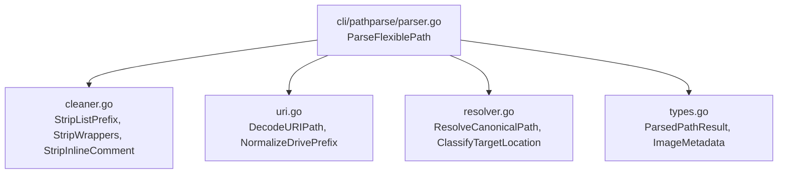

# Subtask 02: Flexible Path Parser Implementation Plan

## Status: PENDING
- **Subtask Slug:** `02-subtask-flexible-path-parser`
- **Parent Plan:** `.ai-memory/plans/pending/328-flexible-path-parsing-and-asset-image-reading.md`
- **Architecture Spec:** `02-spec/21-app/328-flexible-path-parsing-and-asset-image-reading/01-architecture-spec.md`
- **Component Spec:** `02-spec/21-app/328-flexible-path-parsing-and-asset-image-reading/02-component-and-cli-spec.md`
- **Target Package:** `cli/pathparse/`
- **Assigned Implementation Files:**
  - `cli/pathparse/types.go`
  - `cli/pathparse/parser.go`
  - `cli/pathparse/cleaner.go`
  - `cli/pathparse/uri.go`
  - `cli/pathparse/resolver.go`

---

## 1. Objective & Target Formats

Subtask 02 implements the new standalone Go package `cli/pathparse` to deterministically parse and normalize all four required path input styles into canonical file paths:

1. **Format 1 (Bracketed Absolute):**
   `@[C:\Users\Administrator\...\media_1792894009084_45b4893f.png]`
2. **Format 2 (Markdown Image with File URI):**
   ``
3. **Format 3 (Numbered List + Repo Relative + Trailing Comment):**
   `1. @[assets/media_1792894009084_45b4893f.png] # consider the file is relative from the repo`
4. **Format 4 (Numbered List + Parent Relative Traversal + Trailing Comment):**
   `1. @[../repo-cache/assets/media_1792894009084_45b4893f.png] # consider the file is relative from the repo outside of the repo`

---

## 2. Package Architecture & Module Decomposition

### 2.1 File Decomposition
- `cli/pathparse/types.go`: Struct definitions for `ParsedPathResult` and `ImageMetadata`.
- `cli/pathparse/cleaner.go`: String extraction functions for list markers (`1. `, `- `), wrappers (`@[...]`, ``), comments (`#`, `//`), and quotes.
- `cli/pathparse/uri.go`: URI scheme parser, `file:///` stripper, and percent-encoding decoder (`url.PathUnescape`).
- `cli/pathparse/resolver.go`: Filesystem canonicalizer, resolving against `repoRoot`, handling `../` traversals, checking file existence and image extensions.
- `cli/pathparse/parser.go`: Public entry point `ParseFlexiblePath(raw string, repoRoot string) (ParsedPathResult, error)`.

---

## 3. Step-by-Step Implementation Guide

### Step 1: Create `cli/pathparse/types.go`
Define `ParsedPathResult` with strictly positive booleans:
- `hasMarkdownWrapper bool`
- `hasBracketWrapper bool`
- `hasListPrefix bool`
- `hasTrailingComment bool`
- `isAbsolute bool`
- `isInsideRepo bool`
- `isParentRelative bool`
- `isFileExists bool`
- `isDirectory bool`
- `isImage bool`

### Step 2: Implement `cli/pathparse/cleaner.go`
- `StripListPrefix(input string) (string, bool)`: Detects leading digits followed by `.` or `)` and space. Max 12 lines.
- `StripInlineComment(input string) (string, string, bool)`: Checks for `" #"` and `" //"`. Max 10 lines.
- `StripWrappers(input string) (string, bool, bool)`: Extracts Markdown image link or bracket contents. Max 14 lines.

### Step 3: Implement `cli/pathparse/uri.go`
- `DecodeURIPath(input string) (string, error)`: Handles `file:///` and `file://`, runs `url.PathUnescape`, and normalizes leading drive slash. Max 14 lines.
- `NormalizeDrivePrefix(path string) string`: Detects `/C:/` on Windows and trims the leading slash. Max 8 lines.

### Step 4: Implement `cli/pathparse/resolver.go`
- `ResolveCanonicalPath(target, repoRoot string) (string, bool, bool, error)`: Normalizes backslashes to forward slashes, checks for `../`, checks file existence via `os.Stat`. Max 14 lines.
- `DetectImageExtension(path string) (bool, string)`: Matches `.png`, `.jpg`, `.jpeg`, `.gif`, `.webp`, `.bmp`, `.ico`, `.tiff`, `.svg`. Max 10 lines.

### Step 5: Implement `cli/pathparse/parser.go`
- `ParseFlexiblePath(raw string, repoRoot string) (ParsedPathResult, error)`: Glues the stages into a clean pipeline. Max 14 lines.

---

## 4. Verification & Constraints

1. **Strict 15-Line Function Limit:** No function may exceed 15 lines.
2. **Zero Nested Ifs:** All conditionals flattened with early returns.
3. **Strict No-Build, No-Test:** Verified via cognitive review and static structure checks.
