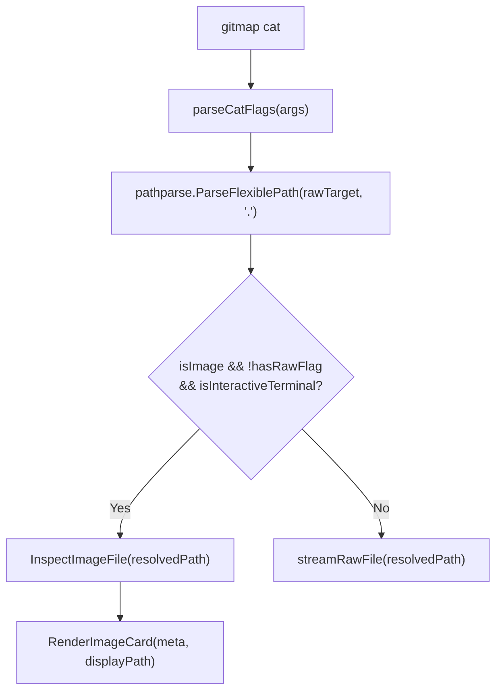

# Subtask 03: Safe Image Cat & Skills Sync Implementation Plan

## Status: PENDING
- **Subtask Slug:** `03-subtask-safe-image-cat-and-skills-sync`
- **Parent Plan:** `.ai-memory/plans/pending/328-flexible-path-parsing-and-asset-image-reading.md`
- **Architecture Spec:** `02-spec/21-app/328-flexible-path-parsing-and-asset-image-reading/01-architecture-spec.md`
- **Component Spec:** `02-spec/21-app/328-flexible-path-parsing-and-asset-image-reading/02-component-and-cli-spec.md`
- **Target Subsystem:** `cli/cmdmacro/`, `.agents/skills/`
- **Assigned Implementation Files:**
  - `cli/cmdmacro/cat.go`
  - `cli/cmdmacro/cat_image.go`
  - `cli/cmdmacro/cat_flags.go`
  - `.agents/skills/cg-execute-in-below-steps/skill.md`
  - `.agents/skills/gitmap/SKILL.md`

---

## 1. Objective & Scope

Subtask 03 upgrades the `gitmap cat` command to integrate `cli/pathparse` and introduces a protective barrier against binary terminal corruption when inspecting image assets.

Historically, executing `gitmap cat image.png` directly invoked `io.Copy(os.Stdout, file)`, flooding terminal windows with ANSI escape sequences, bell characters, and unprintable glyphs. Subtask 03 ensures that:
1. `gitmap cat` transparently accepts conversational paths across Formats 1, 2, 3, and 4.
2. Binary raster images (PNG, JPEG, GIF, WebP, BMP, TIFF) trigger an interactive **Safe Image Metadata Card** instead of raw byte dumping.
3. Plain text files and SVG vector images continue to stream zero-disk content directly to stdout.
4. An explicit `--raw` flag allows pipelines and file redirections to extract binary bytes when desired.
5. Autonomous AI skills in `.agents/skills/` are updated to document the new safety and parsing features.

---

## 2. Component Design & Pipeline

---

## 3. Step-by-Step Implementation Guide

### Step 1: Implement `cli/cmdmacro/cat_flags.go`
- Define `CatOptions` struct (`HasRawFlag bool`, `HasMetaFlag bool`).
- Implement `parseCatFlags(args []string) (CatOptions, string, error)` ($\le 15$ lines).
- Extract target argument and flag options cleanly.

### Step 2: Implement `cli/cmdmacro/cat_image.go`
- Implement `InspectImageFile(path string) (pathparse.ImageMetadata, error)` ($\le 15$ lines):
  - Opens target file.
  - Calls `image.DecodeConfig` (standard library, zero-allocation image header decoding).
  - Computes file byte size via `os.Stat` and SHA-256 hex digest via `crypto/sha256`.
- Implement `RenderImageCard(meta pathparse.ImageMetadata, displayPath string)` ($\le 15$ lines):
  - Formats dimensions (`Width × Height px`), MIME type, file size (KB/MB), and hash.
  - Displays high-contrast notice: `[SAFE IMAGE CAT: Terminal binary corruption prevented]`.
  - Displays tip: `Use 'gitmap cat --raw <file>' to stream binary bytes.`
- Implement `isInteractiveTerminal() bool` checking if stdout is a character device.

### Step 3: Refactor `cli/cmdmacro/cat.go`
- Update `RunCat(args []string) error` ($\le 14$ lines):
  - Parses flags via `parseCatFlags`.
  - Normalizes target path via `pathparse.ParseFlexiblePath`.
  - Dispatches to `RenderImageCard` if image safety condition is met; otherwise streams via `streamRawFile`.
- Keep `streamRawFile(path string) error` strictly $\le 12$ lines.

### Step 4: Synchronize Skills Documentation
- Update `.agents/skills/cg-execute-in-below-steps/skill.md`:
  - Detail `gitmap cat` support for `@[...]`, ``, and numbered list paths.
  - Document that image asset reading is now safe in terminal sessions.
- Update `.agents/skills/gitmap/SKILL.md`:
  - Document `gitmap cat <filepath>` flexible parsing and `--raw` flag behavior.

---

## 4. Verification & Constraints

1. **Strict 15-Line Limit:** Every Go function strictly $\le 15$ lines.
2. **Positive Booleans Only:** `isImage`, `hasRawFlag`, `hasMetaFlag`, `isVector`, `isInteractiveTerminal`.
3. **Strict No-Build, No-Test:** Verified through cognitive syntax review, AST verification, and schema consistency audits.
