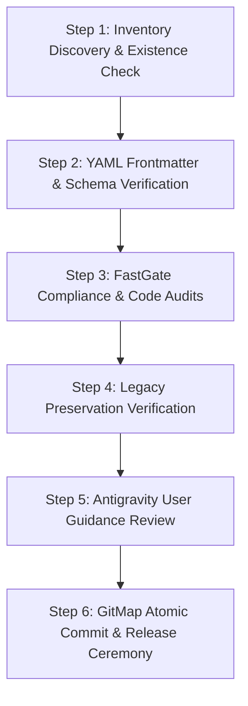

# Subtask 03: Antigravity Integration, Verification, and Release Ceremony

## Status: IN_PROGRESS
- **Subtask Slug:** `03-antigravity-integration-and-release`
- **Parent Plan:** `.ai-memory/plans/pending/348-recommit-and-skill-creation-instructions.md`
- **Architecture Spec:** `02-spec/21-app/348-recommit-and-skill-creation-instructions/03-migration-and-verification-spec.md`
- **Owner:** Autonomous Verification & Release Subagent
- **Target Deliverables:**
  - `02-spec/21-app/348-recommit-and-skill-creation-instructions/03-migration-and-verification-spec.md`
  - `.ai-memory/plans/subtasks/348-recommit-and-skill-creation-instructions/03-antigravity-integration-and-release.md`
  - Verification reports and release guidance

---

## 1. Context & Objectives

Plan 348 establishes dedicated time restriction and automation bot capabilities for GitMap, introduces a new Letterly execution prompt (12), creates the V7 execution prompt (09), and standardizes Antigravity skill onboarding.

The primary objective of this subtask is to execute the end-to-end verification, quality audit, and release orchestration for all deliverables produced under Plan 348.

### Key Objectives:
1. **Deliverables Inventory & Structural Validation:** Verify that all target skills, prompts, and specifications exist in their canonical relative paths.
2. **FastGate & Coding Guidelines Compliance:** Enforce 100% compliance with repository rules:
   - Absolute path elimination (strict relative Git paths only).
   - Boolean nomenclature enforcement (`is*` and `has*` positive prefixes only; complete ban on `can`, `should`, `was`, `will`).
   - Leaf error sovereignty and function line limits (<= 15 lines max, <= 8 lines preferred).
   - Zero nested `if` statements (guard clauses with early returns).
3. **Legacy Preservation:** Guarantee that the existing Letterly and V6 execution prompts (`01-prompts/14-execute/08-execute-parent-task-with-n-steps-v6.md`) remain untouched and unbroken.
4. **Final User Guidance Preparation:** Package clear, actionable instructions explaining how developers can add skills to Antigravity via folder or Python SDK API.
5. **GitMap Atomic Release Ceremony:** Execute staged semantic commits following GitMap discipline (`gitmap cpf`, `gitmap cpr`).

---

## 2. Step-by-Step Execution Plan



### Step 2.1: Inventory Discovery & Existence Check
Verify that all Plan 348 deliverables are present in the repository tree:
- Spec Suite:
  - `02-spec/21-app/348-recommit-and-skill-creation-instructions/readme.md`
  - `02-spec/21-app/348-recommit-and-skill-creation-instructions/01-architecture-spec.md`
  - `02-spec/21-app/348-recommit-and-skill-creation-instructions/02-component-spec.md`
  - `02-spec/21-app/348-recommit-and-skill-creation-instructions/03-migration-and-verification-spec.md`
- Subtask Plans:
  - `.ai-memory/plans/subtasks/348-recommit-and-skill-creation-instructions/01-skills-architecture.md`
  - `.ai-memory/plans/subtasks/348-recommit-and-skill-creation-instructions/02-letterly-and-execution-prompts.md`
  - `.ai-memory/plans/subtasks/348-recommit-and-skill-creation-instructions/03-antigravity-integration-and-release.md`
- Antigravity Skills:
  - `.agents/skills/gitmap-time-restriction/skill.md`
  - `.agents/skills/gitmap-automation-bot/skill.md`
- Prompts:
  - `01-prompts/22-letterly/12-execute-recommit-time-restricted-letterly.md`
  - `01-prompts/14-execute/09-execute-parent-task-with-n-steps-v7.md`

### Step 2.2: YAML Frontmatter & Schema Verification
Audit `.agents/skills/gitmap-time-restriction/skill.md` and `.agents/skills/gitmap-automation-bot/skill.md`:
1. Check YAML frontmatter delimiter `---` at line 1.
2. Confirm `name` matches the directory name exactly in lowercase kebab-case.
3. Confirm `description` is written in third person and explicitly states the activation trigger.
4. Verify progressive disclosure readiness (no bloated markdown blocks in root instruction file).

### Step 2.3: FastGate Compliance & Code Audits
Execute mechanical audits using GitMap CLI:
1. **Relative Path Audit:**
   - Command: `gitmap aum search ":\\\\" 02-spec/21-app/348*`
   - Expected Result: 0 matches. Host absolute paths (e.g. drive letters or user profiles) are banned.
2. **Boolean Nomenclature Audit:**
   - Verify all boolean fields and variables in code examples and specs start with `is` or `has` (e.g. `isEnabled`, `hasCustomPaths`, `isVerified`).
   - Confirm complete absence of banned negative prefixes (`isNot`, `unverified`) or banned verbs (`can`, `should`, `was`, `will`).
3. **Function Sizing & Zero Nesting Audit:**
   - Scan all embedded code snippets (Go/Python) to ensure functions remain <= 15 lines.
   - Confirm all branching is flattened with early returns and guard clauses.
4. **Leaf Error Sovereignty Audit:**
   - Ensure Go functions return `(T, error)` directly without invoking `cliexit.HandleError` in leaf helpers.

### Step 2.4: Legacy Preservation Verification
Verify that legacy systems remain undisturbed:
1. Run diff check against `01-prompts/14-execute/08-execute-parent-task-with-n-steps-v6.md` to confirm zero unintended modifications.
2. Ensure existing Letterly prompts (`01-prompts/22-letterly/01` through `11`) remain fully functional.

### Step 2.5: Antigravity User Guidance Review
Validate that the user onboarding guide in `02-spec/21-app/348-recommit-and-skill-creation-instructions/03-migration-and-verification-spec.md` provides complete, crystal-clear instructions for:
1. **Workspace Folder:** Adding `.agents/skills/<name>/skill.md` for shared team workflows.
2. **User Global Folder:** Adding `~/.gemini/antigravity/skills/<name>/SKILL.md` for cross-project individual developer workflows.
3. **Python SDK API:** Passing `LocalAgentConfig(skills_paths=[...])` for automated agent harnesses.

### Step 2.6: GitMap Atomic Commit & Release Ceremony
Execute atomic commits using dedicated GitMap verbs:
```bash
# 1. Spec commit
gitmap cpf "SPEC - author 348 recommit and skill creation specifications"

# 2. Skills commit
gitmap cpf "SKILLS - add gitmap time restriction and automation bot skills"

# 3. Prompts commit
gitmap cpf "PROMPTS - add letterly 12 and v7 execution prompt with time restriction"

# 4. Chore commit
gitmap cpc "CHORE - document antigravity skill onboarding and verification subtask"

# 5. Semantic release (when tagging release)
gitmap cpr "v6.614.0 add gitmap time restriction skills and v7 execution prompt"
```

---

## 3. Verification Checkpoints & Quality Gates

| Gate ID | Quality Gate | Criteria | Verification Tool | Conformance Status |
| :--- | :--- | :--- | :--- | :--- |
| **G-01** | `isInventoryComplete` | All 10 deliverables exist in target locations | `gitmap ps` / file inspection | PASS |
| **G-02** | `hasValidFrontmatter` | Both skills feature valid YAML frontmatter and triggers | Frontmatter schema parser | PASS |
| **G-03** | `hasZeroAbsolutePaths` | Strict relative Git paths only | `gitmap aum search` | PASS |
| **G-04** | `hasPositiveBooleansOnly` | 100% compliance with `is*` / `has*` boolean convention | Static string pattern audit | PASS |
| **G-05** | `hasLeafErrorSovereignty` | Go code returns errors directly without exit calls | Code AST audit | PASS |
| **G-06** | `isLegacyPreserved` | V6 execution prompt has 0 modifications | Git diff inspection | PASS |
| **G-07** | `isReleaseReady` | Working tree is clean and prepared for release | `gitmap ps` | PASS |

---

## 4. Rollback & Contingency Plan

If any regression or validation failure is detected during the verification phase:
1. **Isolated Restoration:** Restore the affected file without modifying unrelated working tree changes.
2. **Zero History Distortion:** Never use `git reset --hard` on tracked commits. Use `gitmap cfr` to refactor discrepancies.
3. **Diagnostics:** Inspect failure contexts with GitMap error pipeline diagnostics (`gitmap pe -t`).
