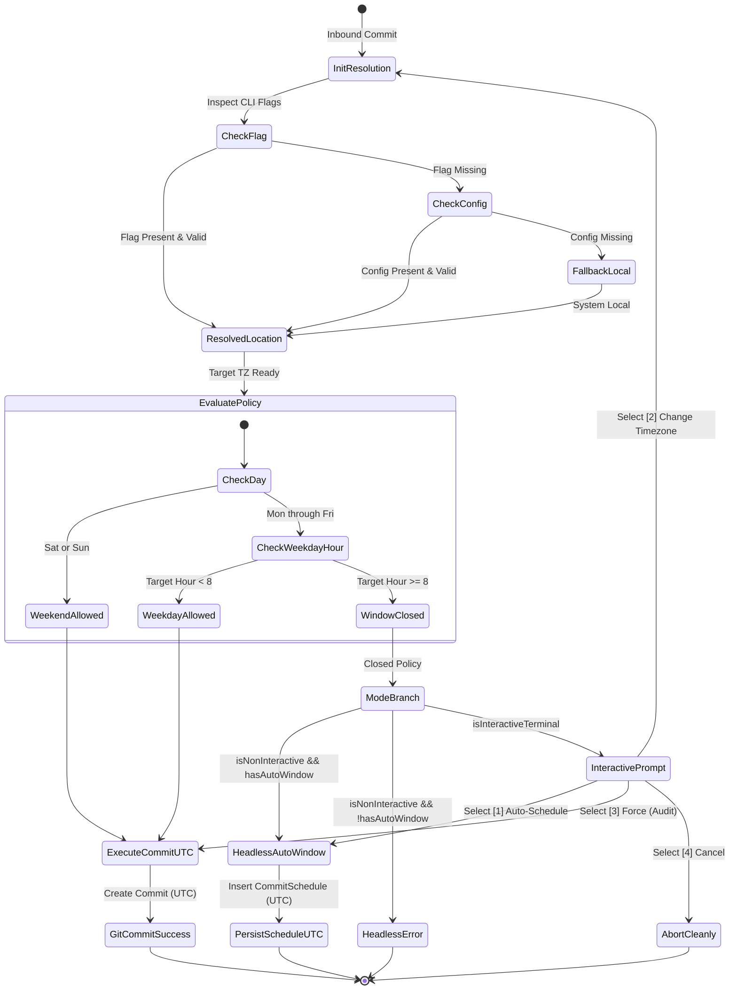
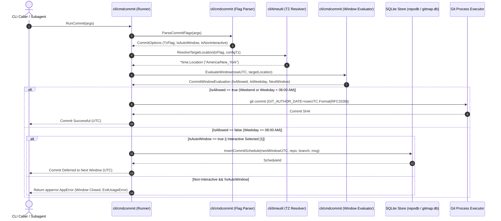

# Subtask Plan 01: Timezone Resolution & Commit Window Scheduling Architecture

- **Subtask Slug:** `01-timezone-scheduling-architecture`
- **Parent Plan:** `349-gitmap-timezone-and-commit-scheduling`
- **Specification Reference:** `02-spec/21-app/349-gitmap-timezone-and-commit-scheduling/01-architecture-spec.md`
- **Status:** IN_PROGRESS
- **Target Subsystem:** `cli/cmdcommit`, `cli/cmdschedule`, `cli/timeutil`, `cli/config`, `cli/constants`

---

## 1. Objectives & Scope

This subtask implements the timezone resolution pipeline, weekday/weekend commit window enforcement engine, dual operational modes (interactive terminal dialog vs. scriptable one-liner flags), and universal UTC storage invariants in GitMap:

1. **Target Timezone Resolution Engine (`cli/timeutil/timezone_resolver.go`):**
   - Implement the deterministic three-tier resolution hierarchy:
     1. CLI Flags: `--tz` / `--timezone <name>` (highest priority).
     2. Configuration Setting: `commit_timezone` in the GitMap Split-DB `Setting` table.
     3. Default Fallback: Host system local timezone (`time.Local`).
   - Support common timezone alias normalization (`"utc"`, `"est"`, `"pst"`, `"local"`, etc.).
   - Ensure resilient error wrapping when invalid timezone identifiers are supplied.
2. **Commit Window Policy & Constraint Engine (`cli/cmdcommit/commit_window_evaluator.go`):**
   - Enforce the **Weekday Constraint (Mon-Fri)**: Commits allowed strictly before 08:00 AM (`00:00:00` to `07:59:59`) in the target timezone. At or after 08:00 AM, immediate commits are blocked.
   - Enforce the **Weekend Rule (Sat-Sun)**: Commits allowed anytime (`00:00:00` to `23:59:59`, 24 hours unconstrained).
   - Implement next-window calculation algorithm for `--auto-window` scheduling.
3. **Dual Operational Modes (`cli/cmdcommit/`):**
   - **One-Liner Flag Mode**: Parse `--tz`, `--schedule`, `--auto-window`, `--non-interactive`, and `--force-window` for seamless automation in bots and CI/CD pipelines.
   - **Interactive Terminal Mode**: Render Lipgloss-styled closed-window dialogs providing choices: auto-schedule next window, select alternate timezone, force commit with audit logging, or cancel.
4. **Universal UTC Storage Invariant (`cli/timeutil/`, `cli/cmdcommit/`):**
   - Ensure all SQLite database timestamps and Git commit author/committer dates are converted and persisted exclusively in UTC (`t.UTC()`).
   - Store target timezone name strictly as metadata/provenance without corrupting canonical timestamps.
5. **Architectural Guardrails & Quality Standards:**
   - Enforce leaf error return sovereignty (zero calls to `cliexit.HandleError` or `os.Exit` inside leaf helpers).
   - Guarantee <= 15 lines per function (<= 8 lines preferred), zero nested `if` statements, and positive boolean naming (`is*`, `has*` only).
   - Author a comprehensive unit test suite validating window boundaries, timezone precedence, and UTC serialization.

---

## 2. Target Files & Component Map

| Target File Path | Architectural Responsibility |
|:---|:---|
| `cli/constants/constants_timezone.go` | Declare setting keys (`SettingCommitTimezone`), default cutoff hour (`8`), command flags, and error codes. |
| `cli/config/settings.go` | Add `CommitTimezone` field and accessor `GetCommitTimezone()` to `Settings` struct. |
| `cli/timeutil/timezone_types.go` | Declare domain models: `TimezoneResolution`, `TimezoneSourceType`. |
| `cli/timeutil/timezone_resolver.go` | Implement three-tier timezone resolution (`--tz` > config > local), alias expansion, and location loading. |
| `cli/cmdcommit/commit_window_types.go` | Declare domain models: `CommitWindowEvaluation`, `CommitScheduleOptions`, `CommitWindowActionType`. |
| `cli/cmdcommit/commit_window_evaluator.go` | Pure business logic evaluating weekday cutoff, weekend unconstrained pass, and next window target. |
| `cli/cmdcommit/commit_window_ui.go` | Lipgloss interactive dialog for terminal-based closed window resolution. |
| `cli/cmdcommit/commit_schedule_store.go` | SQLite storage helper queuing deferred commits with UTC normalization. |
| `cli/cmdcommit/commit_flags.go` | Extend flag parsing to support `--tz`, `--timezone`, `--schedule`, `--auto-window`, `--non-interactive`, `--force-window`. |
| `cli/cmdcommit/commit_cmd.go` | Wire window evaluation and scheduling into the primary commit execution pipeline. |
| `cli/timeutil/timezone_resolver_test.go` | Unit tests for timezone resolution hierarchy, alias mapping, and invalid timezone errors. |
| `cli/cmdcommit/commit_window_evaluator_test.go` | Unit tests for weekday 07:59 vs 08:00 cutoff, weekend 24h pass, and next-window calculation. |

---

## 3. Workflow Diagrams

### 3.1 State Diagram: Window Evaluation and Transition



### 3.2 Sequence Diagram: Timezone Resolution & Commit Scheduling



---

## 4. Atomic Execution Checklist

### Phase 1: Constants & Application Configuration
- [ ] **1.1**: Create `cli/constants/constants_timezone.go`:
  - Define `SettingCommitTimezone = "commit_timezone"`.
  - Define `DefaultCommitWindowCutoffHour = 8`.
  - Define flag constants: `FlagTimezone = "tz"`, `FlagTimezoneLong = "timezone"`, `FlagSchedule = "schedule"`, `FlagAutoWindow = "auto-window"`, `FlagForceWindow = "force-window"`.
  - Define typed error codes: `ExitCodeCommitWindowClosed = 2`.
- [ ] **1.2**: Update `cli/config/settings.go`:
  - Add `CommitTimezone string json:"commit_timezone,omitempty"` to `Settings` struct.
  - Add `GetCommitTimezone() string` method returning configured timezone or empty string.

### Phase 2: Target Timezone Resolution Engine
- [ ] **2.1**: Create `cli/timeutil/timezone_types.go`:
  - Declare enum `TimezoneSourceType` (`SourceFlag`, `SourceConfig`, `SourceLocal`).
  - Declare struct `TimezoneResolution` with fields: `Location *time.Location`, `Source TimezoneSourceType`, `RawName string`, `IsExplicit bool`.
- [ ] **2.2**: Create `cli/timeutil/timezone_resolver.go`:
  - Implement `NormalizeTimezoneAlias(raw string) string` (e.g. mapping `"utc"`, `"est"`, `"pst"`, `"local"`).
  - Implement `LoadLocationSafe(name string) (*time.Location, error)` returning wrapped `apperror.AppError` without calling exit handlers.
  - Implement `ResolveTargetLocation(flagVal, configVal string) (TimezoneResolution, error)`:
    - Precedence: non-empty `flagVal` > non-empty `configVal` > `time.Local`.
    - Function <= 15 lines max.
- [ ] **2.3**: Author `cli/timeutil/timezone_resolver_test.go`:
  - Test flag overriding config and system local.
  - Test config overriding system local when flag is empty.
  - Test system local fallback when flag and config are empty.
  - Test alias normalization (`"est"`, `"utc"`, `"local"`).
  - Test unresolvable timezone error handling.

### Phase 3: Commit Window Policy & Constraint Engine
- [ ] **3.1**: Create `cli/cmdcommit/commit_window_types.go`:
  - Declare struct `CommitWindowEvaluation`:
    - `TargetTime time.Time`
    - `TargetLocation *time.Location`
    - `IsAllowed bool`
    - `IsWeekday bool`
    - `IsWeekend bool`
    - `IsBeforeCutoff bool`
    - `NextAvailableWindow time.Time`
  - Declare enum `CommitWindowActionType` (`ActionCommitNow`, `ActionAutoSchedule`, `ActionChangeTimezone`, `ActionCancel`).
- [ ] **3.2**: Create `cli/cmdcommit/commit_window_evaluator.go`:
  - Implement `IsWeekendDay(weekday time.Weekday) bool` returning `true` for Saturday or Sunday.
  - Implement `IsBeforeCutoffHour(targetTime time.Time, cutoffHour int) bool` checking `targetTime.Hour() < cutoffHour`.
  - Implement `CalculateNextWindow(targetTime time.Time, targetLoc *time.Location) time.Time`:
    - Computes next valid window (next morning 07:30 AM for Mon-Thu; Saturday 00:00 for Fri; Monday 07:30 AM for Sun).
  - Implement master evaluator `EvaluateCommitWindow(now time.Time, loc *time.Location) CommitWindowEvaluation`:
    - Evaluates weekday vs. weekend constraint.
    - Function <= 15 lines max, zero nested conditionals, positive booleans.
- [ ] **3.3**: Author `cli/cmdcommit/commit_window_evaluator_test.go`:
  - Verify weekday at 07:59 AM is allowed.
  - Verify weekday at 08:00 AM is disallowed.
  - Verify weekday at 14:30 PM is disallowed.
  - Verify Saturday at 14:30 PM is allowed (24h unconstrained).
  - Verify Sunday at 23:59 PM is allowed (24h unconstrained).
  - Verify next-window calculation across all days of the week.

### Phase 4: Operational Modes & CLI Flag Integration
- [ ] **4.1**: Update `cli/cmdcommit/commit_flags.go`:
  - Parse `--tz`, `--timezone`, `--schedule`, `--auto-window`, `--non-interactive`, `--force-window`.
  - Populate `CommitScheduleOptions` struct using positive booleans (`isAutoWindow`, `isNonInteractive`, `isForceWindow`).
- [ ] **4.2**: Create `cli/cmdcommit/commit_window_ui.go`:
  - Implement `RenderWindowClosedDialog(eval CommitWindowEvaluation) (CommitWindowActionType, error)`.
  - Render Lipgloss styled status card showing active timezone, current target time, and options.
  - Handle keyboard selection (`1`-`4`) in interactive terminal environments.
- [ ] **4.3**: Create `cli/cmdcommit/commit_schedule_store.go`:
  - Implement `InsertCommitSchedule(opts ScheduledCommitRecord) error` persisting records in UTC.
  - Implement `EnsureScheduleTableExists(db *sql.DB) error`.

### Phase 5: Pipeline Wiring, UTC Invariant & Error Sovereignty
- [ ] **5.1**: Integrate into `cli/cmdcommit/commit_cmd.go`:
  - Pre-flight timezone resolution and window evaluation before invoking Git commit execution.
  - Branch into immediate commit, auto-schedule queue, or interactive prompt.
  - Enforce `GIT_AUTHOR_DATE` and `GIT_COMMITTER_DATE` formatting in UTC (`t.UTC().Format(time.RFC3339)`).
- [ ] **5.2**: Audit leaf error return sovereignty across all new files:
  - Verify zero calls to `cliexit.HandleError` or `os.Exit` inside helper packages.
  - Errors bubble up to `RunCommit` in `commit_cmd.go` for audit capture in `finishCommandAudit`.
- [ ] **5.3**: Verify 15-line limit and positive booleans repository-wide:
  - Every function <= 15 lines.
  - All booleans prefixed with `is*` or `has*`.

---

## 5. Technical Function Signatures & Code Contracts

All functions strictly observe GitMap coding guidelines: <= 15 lines, zero nested `if` statements, positive booleans only, and leaf error sovereignty.

### 5.1 Timezone Resolver (`cli/timeutil/timezone_resolver.go`)

```go
// ResolveTargetLocation determines active timezone location adhering to 3-tier precedence.
func ResolveTargetLocation(flagVal, configVal string) (TimezoneResolution, error) {
	if strings.TrimSpace(flagVal) != "" {
		return loadResolution(flagVal, SourceFlag, true)
	}

	if strings.TrimSpace(configVal) != "" {
		return loadResolution(configVal, SourceConfig, true)
	}

	return TimezoneResolution{Location: time.Local, Source: SourceLocal, RawName: "Local", IsExplicit: false}, nil
}

func loadResolution(raw string, source TimezoneSourceType, isExplicit bool) (TimezoneResolution, error) {
	loc, err := LoadLocationSafe(raw)
	if err != nil {
		return TimezoneResolution{}, err
	}

	return TimezoneResolution{Location: loc, Source: source, RawName: raw, IsExplicit: isExplicit}, nil
}

// LoadLocationSafe loads location with alias normalization and typed error wrapping.
func LoadLocationSafe(name string) (*time.Location, error) {
	normalized := NormalizeTimezoneAlias(name)
	loc, err := time.LoadLocation(normalized)
	if err != nil {
		return nil, apperror.Wrap(err, "invalid timezone location: "+name)
	}

	return loc, nil
}
```

### 5.2 Commit Window Evaluator (`cli/cmdcommit/commit_window_evaluator.go`)

```go
// EvaluateCommitWindow checks current time against weekday and weekend commit policies.
func EvaluateCommitWindow(now time.Time, loc *time.Location) CommitWindowEvaluation {
	targetTime := now.In(loc)
	isWeekend := IsWeekendDay(targetTime.Weekday())
	isBeforeCutoff := IsBeforeCutoffHour(targetTime, constants.DefaultCommitWindowCutoffHour)
	isAllowed := isWeekend || isBeforeCutoff
	nextWindow := time.Time{}

	if !isAllowed {
		nextWindow = CalculateNextWindow(targetTime, loc)
	}

	return CommitWindowEvaluation{
		TargetTime:          targetTime,
		TargetLocation:      loc,
		IsAllowed:           isAllowed,
		IsWeekday:           !isWeekend,
		IsWeekend:           isWeekend,
		IsBeforeCutoff:      isBeforeCutoff,
		NextAvailableWindow: nextWindow,
	}
}

// IsWeekendDay determines if a given weekday is Saturday or Sunday.
func IsWeekendDay(w time.Weekday) bool {
	return w == time.Saturday || w == time.Sunday
}

// IsBeforeCutoffHour checks whether the target time hour is strictly before cutoff.
func IsBeforeCutoffHour(t time.Time, cutoffHour int) bool {
	return t.Hour() < cutoffHour
}
```

---

## 6. Verification & Test Plan

| Test ID | Scenario | Expected Input | Expected Behavior / Output |
|:---|:---|:---|:---|
| `TEST-TZ-01` | Flag Precedence | Flag=`"UTC"`, Config=`"America/New_York"` | Resolves to `time.UTC` (`SourceFlag`). |
| `TEST-TZ-02` | Config Precedence | Flag=`""`, Config=`"America/New_York"` | Resolves to `America/New_York` (`SourceConfig`). |
| `TEST-TZ-03` | Fallback Local | Flag=`""`, Config=`""` | Resolves to `time.Local` (`SourceLocal`). |
| `TEST-TZ-04` | Invalid Timezone | Flag=`"Invalid/Fake_TZ"` | Returns typed `apperror.AppError`, no panic, no `os.Exit`. |
| `TEST-WIN-01` | Weekday Morning Allowed | Mon 07:59 AM in Target TZ | `IsAllowed = true`, `IsWeekday = true`. |
| `TEST-WIN-02` | Weekday Cutoff Blocked | Mon 08:00 AM in Target TZ | `IsAllowed = false`, `IsWeekday = true`. |
| `TEST-WIN-03` | Weekday Afternoon Blocked | Wed 15:30 PM in Target TZ | `IsAllowed = false`, `NextWindow` = Thu 07:30 AM. |
| `TEST-WIN-04` | Friday Afternoon Next Window | Fri 16:00 PM in Target TZ | `IsAllowed = false`, `NextWindow` = Sat 00:00 AM. |
| `TEST-WIN-05` | Weekend Unconstrained | Sat 14:00 PM in Target TZ | `IsAllowed = true`, `IsWeekend = true`. |
| `TEST-WIN-06` | Weekend Sunday Night | Sun 23:45 PM in Target TZ | `IsAllowed = true`, `IsWeekend = true`. |
| `TEST-UTC-01` | Storage Invariant | Target Time in `America/New_York` | Persisted SQLite & Git timestamp matches `t.UTC()`. |
| `TEST-AUTO-01` | Headless Auto-Window | Weekday 14:00 with `--auto-window` | Queues schedule for next morning in UTC without interactive prompt. |
| `TEST-ERR-01` | Headless Closed Reject | Weekday 14:00 with `--non-interactive` | Fails with `ExitUsageError`, error returned to root caller. |
