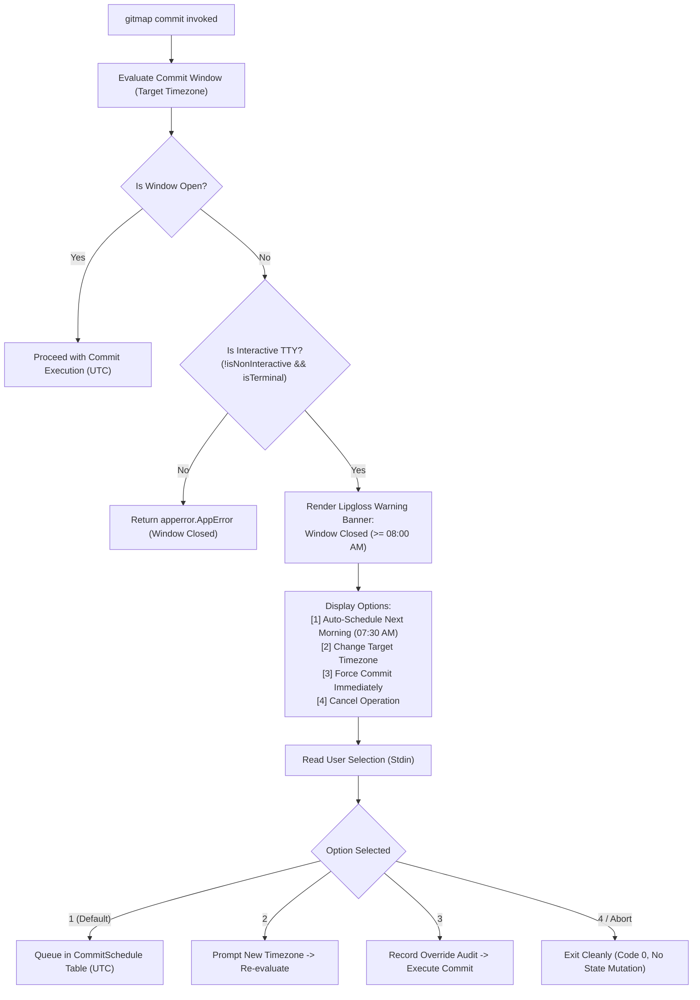
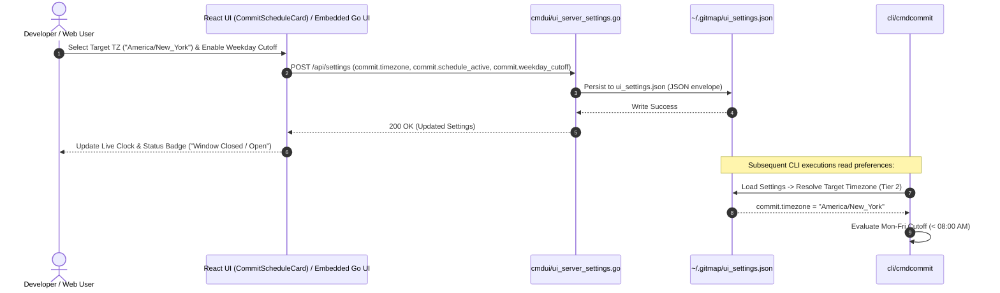

# Subtask Plan 02: UI, Help Documentation, and Settings Integration

- **Subtask Slug:** `02-ui-help-and-settings`
- **Parent Plan:** `349-gitmap-timezone-and-commit-scheduling`
- **Specification References:**
  - `02-spec/21-app/349-gitmap-timezone-and-commit-scheduling/01-architecture-spec.md`
  - `02-spec/21-app/349-gitmap-timezone-and-commit-scheduling/02-component-spec.md`
- **Status:** READY
- **Target Subsystem:** `cli/cmdcommit`, `cli/cmdui`, `src/components/settings`, `src/pages`, `cli/helpdoc`

---

## 1. Objectives & Scope

This subtask defines the comprehensive implementation plan for the user interface, terminal interaction, and documentation layers of the GitMap Timezone and Commit Scheduling system. It encompasses interactive terminal prompting, embedded Go UI settings, React dashboard settings, and rich ANSI terminal help:

1. **Interactive Terminal Prompting (`cli/cmdcommit/commit_prompt.go`):**
   - Provide interactive console prompts when a commit message is omitted in an interactive TTY session (`PromptCommitMessage`).
   - Support interactive timezone querying or verification (`PromptTargetTimezone`).
   - Render a structured Lipgloss dialog when an attempted commit falls within a closed weekday window (`PromptWindowResolution`).
   - Offer 4 discrete user resolution pathways:
     1. Schedule commit for next morning window (07:30 AM).
     2. Select a different target timezone.
     3. Force commit immediately (recording an audit log override).
     4. Cancel the commit cleanly without workspace mutations.
2. **Terminal Rich Help & Reference Docs (`cli/cmdcommit/commit_help_menu.go` and `cli/helpdoc/commit.md`):**
   - Extend `buildCommitFooterFlags` in `commit_help_menu.go` to document `--timezone` / `-tz`, `--schedule` / `-sc`, and `--auto-window`.
   - Update `buildCommitUsageLines` and `buildCommitTips` with scheduling examples and workflow advice.
   - Expand `cli/helpdoc/commit.md` with complete documentation of the weekday morning policy (< 08:00 AM), weekend 24h pass, flag syntax, and copy-pasteable CLI commands.
3. **Embedded Go Settings UI Markup (`cli/cmdui/`):**
   - Define and wire application configuration attributes:
     - `commit.timezone`: Target canonical IANA timezone identifier (default `"Local"`).
     - `commit.schedule_active`: Boolean string (`"true"` / `"false"`) controlling weekday restriction enforcement.
     - `commit.weekday_cutoff`: Integer hour string (default `"8"` for 08:00 AM).
   - Author HTML markup template in `cli/cmdui/ui_assets_markup_settings_b.go`.
   - Author frontend JavaScript state hydration and save listeners in `cli/cmdui/ui_assets_js_settings.go`.
   - Ensure seamless serialization and extraction through `cli/cmdui/ui_server_settings.go` and `ui_settings.json`.
4. **React Web Dashboard Settings (`src/components/settings/CommitScheduleCard.tsx` and `src/pages/Settings.tsx`):**
   - Create `CommitScheduleCard.tsx` in `src/components/settings/` displaying:
     - Live target timezone clock previewing current time in the selected timezone.
     - Status badge indicating whether the commit window is currently open or closed.
     - Searchable / selectable IANA timezone dropdown with popular regional zones.
     - Toggle switch for weekday morning restriction enforcement.
     - Numerical / slider selector for weekday cutoff hour.
   - Wire `CommitScheduleCard` into `src/pages/Settings.tsx` under the Git configuration section, connecting it with API settings persistence.
5. **Architectural Guardrails & Compliance:**
   - Strict relative Git paths only (`02-spec/...`, `.ai-memory/...`, `cli/...`, `src/...`). Total ban on absolute paths.
   - Positive booleans only (`is*`, `has*` only; no negative booleans or banned prefixes `can`, `should`, `was`, `will`).
   - Function limit: strictly <= 15 lines per function (<= 8 lines preferred).
   - Leaf error sovereignty: leaf helpers return `error` or typed results directly, with zero calls to `os.Exit` or `cliexit.HandleError`.

---

## 2. Target Files & Component Map

| Target File Path | Subsystem | Architectural Responsibility |
|:---|:---|:---|
| `cli/cmdcommit/commit_prompt.go` | CLI / Interactive TUI | Interactive prompts for omitted commit message, timezone selection, and closed window resolution dialogs. |
| `cli/cmdcommit/commit_prompt_test.go` | Unit Tests | Unit tests with mock readers verifying prompt choices, empty input validation, and cancellation. |
| `cli/cmdcommit/commit_help_menu.go` | CLI / Help Rendering | Register `-tz, --timezone`, `-sc, --schedule`, and `--auto-window` in ANSI help menus, usage lines, and tips. |
| `cli/helpdoc/commit.md` | Documentation | Comprehensive markdown documentation of timezone scheduling, window policies, and flags. |
| `cli/cmdui/ui_assets_markup_settings_b.go` | Embedded Go UI | HTML template markup for the Commit Timezone & Schedule configuration card. |
| `cli/cmdui/ui_assets_js_settings.go` | Embedded Go UI | JavaScript hydration and save listeners for `commit.timezone`, `commit.schedule_active`, and `commit.weekday_cutoff`. |
| `src/components/settings/CommitScheduleCard.tsx` | React Web Dashboard | Interactive React component card with live target timezone clock, window status indicator, and settings controls. |
| `src/pages/Settings.tsx` | React Web Dashboard | Register `CommitScheduleCard` in the settings view and bind to API persistence. |

---

## 3. Workflow Diagrams

### 3.1 Interactive Terminal Closed-Window Prompt Workflow

### 3.2 Settings Propagation Flow (React & Embedded Go UI)

---

## 4. Step-by-Step Execution Plan

### Phase 1: Interactive Terminal Prompting (`cli/cmdcommit/commit_prompt.go`)
- **Step 1.1**: Define domain types `WindowResolutionChoice` and constants (`ChoiceAutoSchedule`, `ChoiceChangeTimezone`, `ChoiceForceCommit`, `ChoiceCancel`).
- **Step 1.2**: Implement `PromptCommitMessage(initialMsg string) (string, error)`:
  - If `initialMsg` is non-empty, return immediately.
  - Read trimmed input from `os.Stdin`.
  - Validate non-empty result; return `apperror.AppError` on error under leaf sovereignty.
- **Step 1.3**: Implement `PromptTargetTimezone(defaultTz string) (string, error)`:
  - Print prompt with default timezone hint.
  - Read trimmed input, defaulting to `defaultTz` if blank.
- **Step 1.4**: Implement `PromptWindowResolution(eval timeutil.CommitWindowEvaluation) (WindowResolutionChoice, error)`:
  - Render Lipgloss rounded warning card showing target timezone and calculated next morning window.
  - Display numbered options [1-4].
  - Read input line and map to `WindowResolutionChoice` (defaulting to `ChoiceAutoSchedule` on enter).
- **Step 1.5**: Implement unit tests in `cli/cmdcommit/commit_prompt_test.go` utilizing `strings.NewReader` to mock stdin inputs for all choices.

### Phase 2: Terminal Rich Help & Markdown Documentation
- **Step 2.1**: Update `cli/cmdcommit/commit_help_menu.go`:
  - Add `-tz, --timezone <tz>`, `-sc, --schedule <time>`, and `--auto-window` to `buildCommitFooterFlags()`.
  - Add usage line for scheduling in `buildCommitUsageLines()`.
  - Add scheduling tips in `buildCommitTips()`.
- **Step 2.2**: Update `cli/helpdoc/commit.md`:
  - Document the timezone and commit scheduling feature.
  - Add section on the Weekday Policy (`< 08:00 AM`) and Weekend Policy (`24h unconstrained`).
  - Document flags `-tz, --timezone`, `-sc, --schedule`, `--auto-window`, and `--non-interactive`.
  - Add copy-pasteable command line examples.

### Phase 3: Embedded Go Settings UI Markup (`cli/cmdui/`)
- **Step 3.1**: Update `cli/cmdui/ui_assets_markup_settings_b.go`:
  - Author the `Commit Timezone & Schedule` HTML card layout.
  - Include input fields for target timezone, checkbox for weekday morning restriction, and cutoff hour selector.
- **Step 3.2**: Update `cli/cmdui/ui_assets_js_settings.go`:
  - Implement `loadCommitScheduleSettings(settings)` to extract `commit.timezone`, `commit.schedule_active`, and `commit.weekday_cutoff` from `settings.attributes`.
  - Implement `collectCommitScheduleSettings(settings)` to write updated values back into `settings.attributes` before dispatching save requests.
- **Step 3.3**: Verify serialization in `cli/cmdui/ui_server_settings.go` and test settings import/export roundtrip.

### Phase 4: React Settings Card Component & Page Integration
- **Step 4.1**: Author `src/components/settings/CommitScheduleCard.tsx`:
  - Implement `CommitScheduleCardProps` interface and state hooks.
  - Add live target timezone clock with real-time second ticks using `Intl.DateTimeFormat`.
  - Add status badge reflecting current window status (Open vs Closed) based on selected timezone and cutoff hour.
  - Render searchable timezone dropdown with popular regional timezones.
  - Render checkbox toggle for schedule restriction active state.
  - Follow repository styling patterns with Tailwind CSS, Lucide icons, and Slate color palette.
- **Step 4.2**: Integrate into `src/pages/Settings.tsx`:
  - Import `CommitScheduleCard`.
  - Insert card into the Git/Commit configuration section of the settings page.
  - Bind card callbacks to settings update state handler.

### Phase 5: Quality Audit & Coding Guideline Conformance
- **Step 5.1**: Verify leaf error sovereignty across all newly introduced functions: zero calls to `os.Exit` or `cliexit.HandleError`.
- **Step 5.2**: Audit all function line lengths to verify <= 15 lines limit (<= 8 lines preferred).
- **Step 5.3**: Audit all boolean variables and functions to ensure positive naming with `is*` or `has*` prefixes only.
- **Step 5.4**: Confirm that all path references are relative repository paths.

---

## 5. Atomic Execution Checklist

### Phase 1: Interactive Terminal Prompting
- [ ] **1.1**: Author `cli/cmdcommit/commit_prompt.go` declaring `WindowResolutionChoice` enum.
- [ ] **1.2**: Implement `PromptCommitMessage(initialMsg string) (string, error)`.
- [ ] **1.3**: Implement `PromptTargetTimezone(defaultTz string) (string, error)`.
- [ ] **1.4**: Implement `renderWindowClosedBanner(eval timeutil.CommitWindowEvaluation)`.
- [ ] **1.5**: Implement `renderWindowChoices()`.
- [ ] **1.6**: Implement `parseResolutionChoice(in string) WindowResolutionChoice`.
- [ ] **1.7**: Implement `PromptWindowResolution(eval timeutil.CommitWindowEvaluation) (WindowResolutionChoice, error)`.
- [ ] **1.8**: Author `cli/cmdcommit/commit_prompt_test.go` with mock stdin test cases.

### Phase 2: Terminal Rich Help & Documentation
- [ ] **2.1**: Update `buildCommitFooterFlags()` in `cli/cmdcommit/commit_help_menu.go` with `--timezone`, `--schedule`, and `--auto-window`.
- [ ] **2.2**: Update `buildCommitUsageLines()` in `cli/cmdcommit/commit_help_menu.go` with scheduling commands.
- [ ] **2.3**: Update `buildCommitTips()` in `cli/cmdcommit/commit_help_menu.go` with timezone tips.
- [ ] **2.4**: Update `cli/helpdoc/commit.md` with policy details, flag reference, and examples.

### Phase 3: Embedded Go Settings UI
- [ ] **3.1**: Author `card-commit-schedule` HTML template in `cli/cmdui/ui_assets_markup_settings_b.go`.
- [ ] **3.2**: Add `loadCommitScheduleSettings` in `cli/cmdui/ui_assets_js_settings.go`.
- [ ] **3.3**: Add `collectCommitScheduleSettings` in `cli/cmdui/ui_assets_js_settings.go`.
- [ ] **3.4**: Verify persistence of `commit.timezone`, `commit.schedule_active`, and `commit.weekday_cutoff` in `ui_settings.json`.

### Phase 4: React Settings UI Dashboard
- [ ] **4.1**: Create `src/components/settings/CommitScheduleCard.tsx` with live timezone clock.
- [ ] **4.2**: Implement timezone selector with popular IANA zones.
- [ ] **4.3**: Implement window open/closed status badge computation.
- [ ] **4.4**: Implement schedule enforcement toggle switch.
- [ ] **4.5**: Integrate `CommitScheduleCard` into `src/pages/Settings.tsx`.

### Phase 5: Quality Audit & Conformance
- [ ] **5.1**: Run code hygiene scan checking function length <= 15 lines.
- [ ] **5.2**: Audit for zero nested if statements and positive boolean naming.
- [ ] **5.3**: Audit for leaf error return sovereignty.
- [ ] **5.4**: Confirm strict relative Git paths across all authored files.

---

## 6. Verification & Test Plan

1. **Terminal Help Output Verification:**
   - Execute `gitmap commit --help` and verify presence of `-tz, --timezone`, `-sc, --schedule`, and `--auto-window`.
2. **Interactive Prompt Unit Tests:**
   - Run unit test suite in `cli/cmdcommit/commit_prompt_test.go` verifying stdin simulation for choices 1, 2, 3, 4, and invalid inputs.
3. **Embedded UI Settings Verification:**
   - Validate that `SettingsData.Attributes` stores and retrieves `commit.timezone`, `commit.schedule_active`, and `commit.weekday_cutoff` without data corruption.
4. **React Component Validation:**
   - Verify that `CommitScheduleCard.tsx` correctly renders the live clock in the selected timezone and accurately flips the window status badge depending on weekday hour vs weekend.
