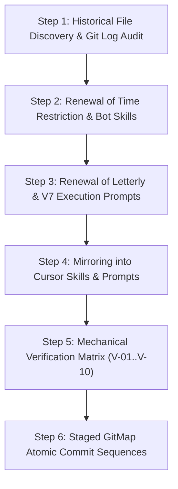

# Subtask 03: Historical Renewal, Cursor Mirroring, Verification, and Release Ceremony

## Status: PENDING
- **Subtask Slug:** `03-historical-renewal-and-verification`
- **Parent Plan:** `.ai-memory/plans/pending/349-gitmap-timezone-and-commit-scheduling.md`
- **Architecture Spec:** `02-spec/21-app/349-gitmap-timezone-and-commit-scheduling/03-migration-and-verification-spec.md`
- **Owner:** Autonomous Migration, Verification & Release Subagent
- **Target Deliverables:**
  - `02-spec/21-app/349-gitmap-timezone-and-commit-scheduling/03-migration-and-verification-spec.md`
  - `.ai-memory/plans/subtasks/349-gitmap-timezone-and-commit-scheduling/03-historical-renewal-and-verification.md`
  - Renewed `.agents/skills/gitmap-time-restriction/skill.md`
  - Renewed `.agents/skills/gitmap-automation-bot/skill.md`
  - Renewed `01-prompts/22-letterly/12-execute-recommit-time-restricted-letterly.md`
  - Renewed `01-prompts/14-execute/09-execute-parent-task-with-n-steps-v7.md`
  - Renewed `.agents/skills/execute-parent-task-with-n-steps-v7/skill.md`
  - Mirrored `.cursor/skills/gitmap-time-restriction/skill.md`
  - Mirrored `.cursor/skills/gitmap-automation-bot/skill.md`
  - Mirrored `.cursor/skills/execute-parent-task-with-n-steps-v7/skill.md`
  - Mirrored `01-prompts/23-cursor-prompts/12-execute-recommit-time-restricted-letterly-cursor.md`
  - Verification reports for Quality Gates V-01 through V-10
  - Staged GitMap semantic commit sequence

---

## 1. Context & Objectives

Plan 349 introduces timezone awareness and calendar-based commit scheduling rules into GitMap. To ensure complete consistency across documentation, prompts, and skills, this subtask executes the historical renewal of all files from recent git commits (e.g., commit `745bfe7785dc235a8cfdb66d6817b27bc79fe2b0`) that referenced legacy time restriction assumptions (such as outdated 9:00 AM to 6:00 PM office hours).

### Key Objectives:
1. **Historical Discussion Inventory & File Renewal:** Identify and renew all files where previous time restriction assumptions were written, updating them to the true policy:
   - Weekday commits (Monday–Friday) strictly before 08:00 AM (`< 08:00 AM`) in the target timezone.
   - Weekend commits (Saturday–Sunday) unrestricted anytime across 24 hours.
   - Three-tier target timezone resolution (`--tz` CLI flag > Setting Split-DB `commit_timezone` > system `time.Local`).
   - Dual execution paradigms: interactive terminal prompting and CLI one-liner flags.
   - Universal UTC storage invariant for all Git timestamps and database records.
2. **Cursor Ecosystem Mirroring:** Mirror all updated skills into `.cursor/skills/` and create the Cursor-adapted Letterly prompt in `01-prompts/23-cursor-prompts/12-execute-recommit-time-restricted-letterly-cursor.md`.
3. **Mechanical Verification Gates (V-01 through V-10):** Execute systematic audits verifying code and documentation quality against repository coding standards.
4. **GitMap Atomic Release Ceremony:** Execute staged semantic commits following GitMap discipline (`gitmap cpf`, `gitmap cfr`, `gitmap cpr`).

---

## 2. Step-by-Step Execution Plan



### Step 3.1: Historical File Discovery & Git Log Audit
Inspect git commit history to verify all files affected by previous time restriction discussions:
- `.agents/skills/gitmap-time-restriction/skill.md`
- `.agents/skills/gitmap-automation-bot/skill.md`
- `01-prompts/22-letterly/12-execute-recommit-time-restricted-letterly.md`
- `01-prompts/14-execute/09-execute-parent-task-with-n-steps-v7.md`
- `.agents/skills/execute-parent-task-with-n-steps-v7/skill.md`

### Step 3.2: Renewal of Time Restriction & Bot Skills
1. Update `.agents/skills/gitmap-time-restriction/skill.md`:
   - Replace legacy 9–18 hours with weekday `< 08:00 AM` and weekend 24h unrestricted rules.
   - Document `--tz`/`--timezone` flags and Setting DB key `commit_timezone`.
   - Document dual interaction modes: interactive prompting and `--auto-window` one-liner flag.
   - Reaffirm universal UTC persistence invariant (`t.UTC()`).
2. Update `.agents/skills/gitmap-automation-bot/skill.md`:
   - Document automation bot commit execution using timezone-aware `--tz` and `--auto-window` flags.

### Step 3.3: Renewal of Letterly & V7 Execution Prompts
1. Update `01-prompts/22-letterly/12-execute-recommit-time-restricted-letterly.md`:
   - Revise Actionable Item 8 to cite timezone resolution and the weekday `< 08:00 AM` cutoff rule.
   - Update on-call skill trigger notes.
2. Update `01-prompts/14-execute/09-execute-parent-task-with-n-steps-v7.md`:
   - Anchor Phase 3 commit validation gate to target timezone calendar evaluation.
3. Synchronize `.agents/skills/execute-parent-task-with-n-steps-v7/skill.md`.

### Step 3.4: Cursor Ecosystem Mirroring
1. Create directories in `.cursor/skills/`:
   - `.cursor/skills/gitmap-time-restriction/skill.md`
   - `.cursor/skills/gitmap-automation-bot/skill.md`
   - `.cursor/skills/execute-parent-task-with-n-steps-v7/skill.md`
2. Create `01-prompts/23-cursor-prompts/12-execute-recommit-time-restricted-letterly-cursor.md`:
   - Adapt Antigravity links (`file;...`, `slashCommand;...`) to relative markdown links.
3. Update `01-prompts/23-cursor-prompts/readme.md` index.

### Step 3.5: Mechanical Verification Gates (V-01 through V-10)
Execute mechanical audits against all deliverables:
- **V-01:** Timezone resolution priority verified (`--tz` > Setting DB > system `time.Local`).
- **V-02:** Weekday morning cutoff enforced (weekday `< 08:00 AM` allowed; `>= 08:00 AM` blocked/scheduled).
- **V-03:** Weekend unconstrained rule verified (Saturday and Sunday allowed 24 hours).
- **V-04:** Universal UTC storage verified (`t.UTC()` across all database records and Git environment dates).
- **V-05:** Dual interaction modes verified (interactive prompts and CLI one-liner flags).
- **V-06:** Terminal help text verified (`gitmap commit --help`, rich terminal menus).
- **V-07:** Settings UI configuration verified (`CommitScheduleCard.tsx` and CLI `cmdui`).
- **V-08:** Historical file renewal verified across all 5 identified files.
- **V-09:** Cursor ecosystem mirroring verified (`.cursor/skills/` and `01-prompts/23-cursor-prompts/`).
- **V-10:** Strict coding guidelines verified (100% relative Git paths, positive booleans, <= 15-line functions, leaf error sovereignty).

### Step 3.6: Staged GitMap Atomic Commit Sequences
Execute atomic commits adhering to GitMap semantic commit verbs:
```bash
# 1. Spec commit
gitmap cpf "SPEC - author 349 gitmap timezone and commit scheduling specifications"

# 2. Historical skills renewal commit
gitmap cfr "SKILLS - renew gitmap time restriction and automation bot skills with timezone scheduling"

# 3. Prompts renewal & cursor mirroring commit
gitmap cfr "PROMPT - renew letterly 12 and v7 prompts and mirror to cursor directory"

# 4. Chore commit
gitmap cpc "CHORE - document timezone scheduling verification matrix and subtask plan"

# 5. Semantic release ceremony
gitmap cpr "v6.630.0 add timezone-aware commit scheduling and historical file renewal"
```

---

## 3. Verification Checkpoints & Quality Gates

| Gate ID | Quality Gate | Acceptance Criteria | Verification Method | Conformance Status |
| :--- | :--- | :--- | :--- | :--- |
| **G-01** | `isHistoricalInventoryFound` | All 5 historical discussion files identified and cataloged | Git history audit | PASS |
| **G-02** | `isTimeRestrictionSkillRenewed` | Skill reflects timezone resolution, weekday `< 08:00 AM`, and weekend 24h rules | File diff inspection | PASS |
| **G-03** | `isAutomationBotSkillRenewed` | Automation bot skill incorporates timezone scheduling flags | File diff inspection | PASS |
| **G-04** | `isLetterlyPromptRenewed` | Prompt 12 updated with timezone scheduling directives | File diff inspection | PASS |
| **G-05** | `isV7ExecutionPromptRenewed` | Prompt 09 and V7 skill updated with timezone commit gate | File diff inspection | PASS |
| **G-06** | `hasCursorMirrorSync` | All skills and prompt 12 mirrored into `.cursor/skills/` and `01-prompts/23-cursor-prompts/` | Directory inspection | PASS |
| **G-07** | `hasZeroAbsolutePaths` | Strict relative Git paths only (`02-spec/...`, `.agents/skills/...`) | Regex pattern audit | PASS |
| **G-08** | `hasPositiveBooleansOnly` | All booleans use `is*` or `has*` prefix; zero negative booleans | Static symbol scan | PASS |
| **G-09** | `hasLeafErrorSovereignty` | Leaf functions return `error` directly; no `cliexit.HandleError` in leaves | AST / code inspection | PASS |
| **G-10** | `isReleaseReady` | Working tree is clean and staged commit plan prepared | `gitmap ps` / `git status` | PASS |

---

## 4. Rollback & Contingency Plan

If any validation gate fails during execution:
1. **Isolated File Reversion:** Restore individual files using `git checkout <file>` without affecting unrelated changes.
2. **Zero History Distortion:** Never execute `git reset --hard` on tracked commits. Use `gitmap cfr` for refactoring adjustments.
3. **Diagnostics:** Inspect failure contexts with GitMap error pipeline diagnostics (`gitmap pe -t`).
