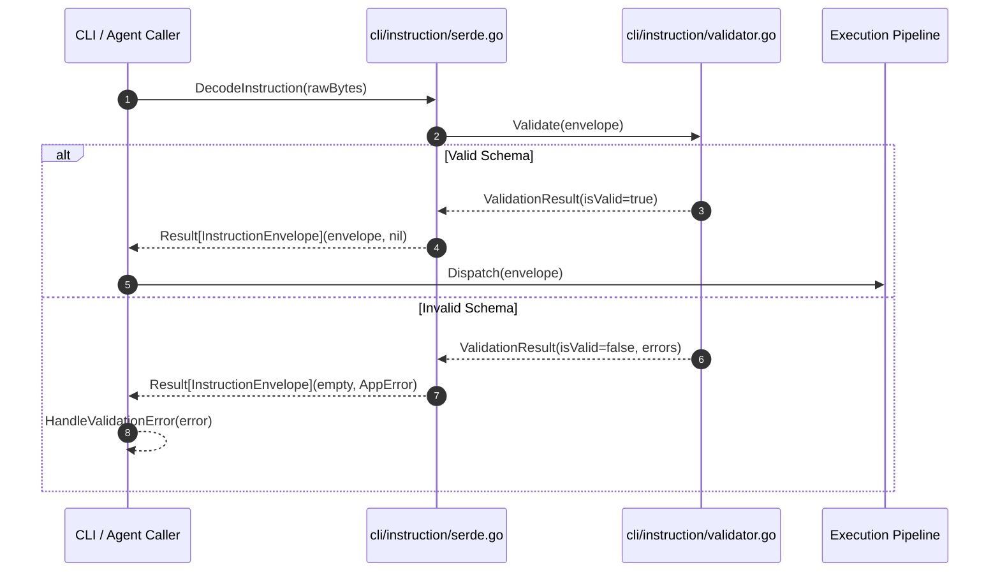

# Subtask Plan 01: Canonical JSON Instruction Format & Validation Architecture

- **Subtask Slug:** `01-json-instruction-format`
- **Parent Plan:** `351-json-instruction-and-cli-integration`
- **Specification Reference:** `02-spec/21-app/351-json-instruction-and-cli-integration/01-architecture-spec.md`
- **Status:** PENDING
- **Target Subsystem:** `cli/instruction`, `cli/schema`, `cli/types`

---

## 1. Objectives & Scope

This subtask architects and implements the canonical JSON instruction envelope, schema validation engine, and serialization pipelines across GitMap and autonomous developer workflows:

1. **Canonical Schema Definition:**
   - Define a strongly-typed Go model and JSON schema for instruction files and payloads.
   - Core fields:
     - `schema_version`: String SemVer format (e.g. `"1.0.0"`).
     - `task_id`: Deterministic unique identifier (`<sequence>-<slug>`, e.g. `"351-json-instruction-and-cli-integration"`).
     - `task_title`: Human-readable task subject.
     - `slug`: Normalized lowercase-hyphenated identifier.
     - `author`: Identifier of issuing user or agent.
     - `created_at`: ISO 8601 UTC timestamp string.
     - `actionable_items`: Ordered list of actionable directives with status, non-negotiable flag, and priority.
     - `options`: Key-value configuration dictionary (e.g. `is_time_restricted`, `target_timezone`, `auto_window`).
     - `metadata`: Extensible metadata envelope for execution telemetry.
2. **Schema Validator Engine (`cli/instruction/validator.go`):**
   - Validate incoming JSON payloads against strict schema constraints.
   - Detect missing required fields, illegal values, or malformed timestamps.
   - Provide human-readable, targeted error diagnostics without crashing or masking errors.
3. **Serialization & Deserialization Helpers (`cli/instruction/serde.go`):**
   - Pure functions for encoding and decoding instruction objects.
   - Strictly adhere to value semantics and leaf error sovereignty.
4. **Architectural Guardrails:**
   - Functions <= 15 lines (<= 8 lines preferred).
   - Zero nested `if` statements (guard clauses only).
   - Positive boolean naming (`is*`, `has*`).
   - 100% relative path references.

---

## 2. Target Files & Component Map

| Target File Path | Architectural Responsibility |
| :--- | :--- |
| `cli/instruction/types.go` | Declare domain structs: `InstructionEnvelope`, `ActionableItem`, `InstructionOptions`, `ValidationResult`. |
| `cli/instruction/validator.go` | Validation functions inspecting required fields, slug formatting, and UTC timestamp standards. |
| `cli/instruction/serde.go` | JSON encoder/decoder with clean error handling and pretty-printing support. |
| `cli/instruction/validator_test.go` | Comprehensive unit tests for valid schemas, malformed inputs, missing keys, and invalid types. |
| `cli/instruction/serde_test.go` | Unit tests verifying round-trip JSON serialization and deserialization. |

---

## 3. Workflow Diagram

---

## 4. Implementation Steps

1. **Step 1: Domain Models (`cli/instruction/types.go`)**
   - Author `InstructionEnvelope` struct with JSON tags.
   - Author `ActionableItem` struct with fields: `id` (int), `description` (string), `is_non_negotiable` (bool), `status` (string).
   - Author `InstructionOptions` struct with fields: `is_time_restricted` (bool), `target_timezone` (string), `is_dry_run` (bool).
2. **Step 2: Validation Logic (`cli/instruction/validator.go`)**
   - Implement `ValidateInstruction(env InstructionEnvelope) error`.
   - Validate non-empty `schema_version`, valid `slug` regex, and at least 1 `actionable_item`.
   - Validate UTC adherence for `created_at`.
3. **Step 3: Serde Helpers (`cli/instruction/serde.go`)**
   - Implement `ParseInstruction(data []byte) (InstructionEnvelope, error)`.
   - Implement `ToJSON(env InstructionEnvelope, isPretty bool) ([]byte, error)`.
4. **Step 4: Unit Testing Suite**
   - Author test cases for empty JSON, invalid slugs, missing non-negotiables, and valid round-trip payloads.

---

## 5. Verification Matrix (V-01 through V-05)

| ID | Gate / Acceptance Criteria | Target Deliverable | Verification Command |
| :--- | :--- | :--- | :--- |
| **V-01** | Strict Schema Validation: Rejects malformed JSON with descriptive error | `cli/instruction/validator.go` | `go test -v ./cli/instruction/ -run TestValidate_Malformed` |
| **V-02** | Valid Payload Acceptance: Successfully validates valid instruction envelopes | `cli/instruction/validator.go` | `go test -v ./cli/instruction/ -run TestValidate_Valid` |
| **V-03** | Round-trip Serde: Exact parity between serialization and deserialization | `cli/instruction/serde.go` | `go test -v ./cli/instruction/ -run TestSerde_RoundTrip` |
| **V-04** | Coding Guidelines: All functions <= 15 lines, positive booleans, early guards | All files in `cli/instruction/` | Static AST audit |
| **V-05** | Leaf Error Sovereignty: Direct error returns without exit handler invocation | All files in `cli/instruction/` | Code inspection |
