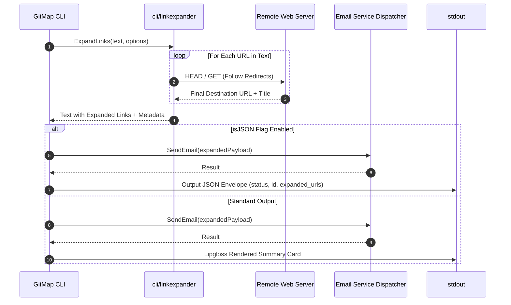

# Subtask Plan 02: GitMap CLI Integration & Link Expansion Pipeline

- **Subtask Slug:** `02-gitmap-cli-integration`
- **Parent Plan:** `351-json-instruction-and-cli-integration`
- **Specification Reference:** `02-spec/21-app/351-json-instruction-and-cli-integration/02-component-spec.md`
- **Status:** PENDING
- **Target Subsystem:** `cli/cmdspace`, `cli/linkexpander`, `cli/cmdemail`

---

## 1. Objectives & Scope

This subtask integrates link expansion and machine-readable JSON output into the GitMap CLI command tree:

1. **Link Expansion Engine (`cli/linkexpander/`):**
   - Provide high-performance HTTP unshortening and title/metadata extraction for shortened or redirected URLs.
   - Support concurrent link expansion with configurable HTTP timeout (default 5s) and user-agent impersonation.
   - Cache resolved targets to avoid redundant network calls.
2. **GitMap Space Send-Email Command Enhancement (`cli/cmdspace/send_email.go`, `cli/cmdspace/send_email_file.go`):**
   - Add `--json` flag to emit structured JSON responses to stdout.
   - Add `--expand` flag to automatically expand links present in email subjects or bodies before transmission.
   - Support `--file` argument accepting a JSON instruction file conforming to Subtask 01.
3. **GitMap Email Expand Command (`cli/cmdspace/space_email.go`):**
   - Provide a dedicated subcommand `gitmap space email expand <url>` to resolve links interactively or in automation pipelines.
4. **Architectural Guardrails & Error Discipline:**
   - Enforce leaf error return sovereignty: all helpers in `cli/linkexpander` and command execution funcs must return `error` or wrapped `AppError`.
   - Never call `cliexit.HandleError` inside leaf functions.
   - Use strongly-typed exit codes ending in `Type` (e.g. `constants.ExitGeneralError`, `constants.ExitUsageError`).
   - Functions <= 15 lines, early returns, positive booleans (`isJSON`, `hasExpansion`).

---

## 2. Target Files & Component Map

| Target File Path | Architectural Responsibility |
| :--- | :--- |
| `cli/linkexpander/types.go` | Data structs: `ExpandedLink`, `ExpanderOptions`, `LinkExpanderResult`. |
| `cli/linkexpander/expander.go` | Core URL resolver following HTTP 3xx redirects, extracting title, and returning clean canonical URLs. |
| `cli/linkexpander/expander_test.go` | Unit tests for redirect following, circular redirect guards, and invalid URLs. |
| `cli/cmdspace/send_email.go` | Update `sendEmailCmd` flag parsing for `--json`, `--expand`, and response formatting. |
| `cli/cmdspace/send_email_file.go` | Ingestion of JSON instruction files for programmatic email dispatch. |
| `cli/cmdspace/space_email.go` | Register `email expand` subcommand and wire link expansion. |
| `cli/cmdspace/send_email_test.go` | Unit tests for `--json` flag output envelope and error formatting. |

---

## 3. Workflow Diagram

---

## 4. Implementation Steps

1. **Step 1: Link Expander Module (`cli/linkexpander/`)**
   - Verify `cli/linkexpander/types.go` and `cli/linkexpander/expander.go`.
   - Ensure timeout safety with `http.Client{Timeout: 5 * time.Second}`.
   - Add unit tests validating redirect expansion and error handling.
2. **Step 2: CLI Flags & JSON Dispatcher (`cli/cmdspace/send_email.go`)**
   - Add `isJSON` and `hasExpand` boolean flags.
   - Author JSON response struct: `SendEmailResponse{IsSuccess: bool, MessageID: string, Timestamp: string, Links: []string}`.
   - Render stdout as formatted JSON when `isJSON` is active.
3. **Step 3: Dedicated Subcommand (`cli/cmdspace/space_email.go`)**
   - Author `runSpaceEmailExpand` handler.
   - Wire into `space` command tree.
4. **Step 4: Quality & Guidelines Audit**
   - Audit function line lengths (<= 15 lines).
   - Audit booleans (`is*`, `has*`).
   - Audit error handling.

---

## 5. Verification Matrix (V-01 through V-05)

| ID | Gate / Acceptance Criteria | Target Deliverable | Verification Command |
| :--- | :--- | :--- | :--- |
| **V-01** | Link Expander Unit Tests: Resolves redirected URLs and handles timeouts | `cli/linkexpander/` | `go test -v ./cli/linkexpander/...` |
| **V-02** | CLI `--json` Output: Valid JSON emitted to stdout on successful send | `cli/cmdspace/` | `gitmap space send-email --help` and dry-run tests |
| **V-03** | CLI Link Expansion: `gitmap space email expand <url>` prints expanded URL | `cli/cmdspace/space_email.go` | Command execution test |
| **V-04** | Leaf Error Sovereignty: No exit handlers in `linkexpander` | `cli/linkexpander/` | AST audit |
| **V-05** | Zero Absolute Paths: All paths in docs and tests are relative | All files | Regex audit |
