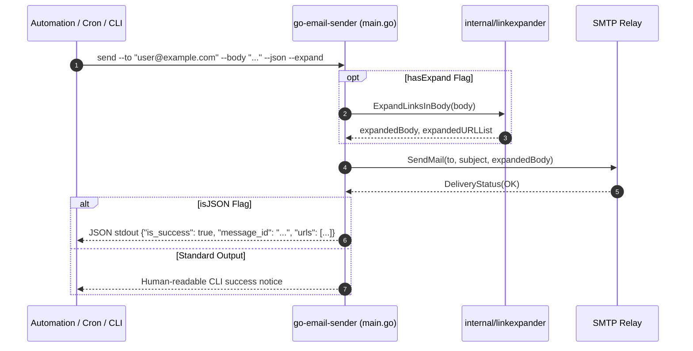

# Subtask Plan 03: Go-Email-Sender Cross-Repository Integration & Parity

- **Subtask Slug:** `03-go-email-sender-integration`
- **Parent Plan:** `351-json-instruction-and-cli-integration`
- **Specification Reference:** `02-spec/21-app/351-json-instruction-and-cli-integration/02-component-spec.md`
- **Status:** PENDING
- **Target Subsystem:** `d:\work\go-email-sender` (`internal/linkexpander/`, `main.go`, `internal/warmup/`)

---

## 1. Objectives & Scope

This subtask achieves cross-repository parity in the standalone `go-email-sender` binary and service, ensuring identical link expansion capabilities and structured JSON stdout responses:

1. **Expander Module Parity (`internal/linkexpander/` in `go-email-sender`):**
   - Maintain `internal/linkexpander/expander.go` and `internal/linkexpander/expander_test.go` with identical behavior to GitMap's engine.
   - Support unshortening HTTP/HTTPS URLs with timeout handling and redirect safety.
2. **CLI Command & Flag Integration (`main.go` in `go-email-sender`):**
   - Provide `--json` flag across `send` and `expand` subcommands.
   - Format command outputs as machine-readable JSON envelopes when `--json` is supplied:
     - `{"is_success": true, "status": "sent", "recipient": "...", "subject": "...", "links_expanded": [...]}`.
   - Provide dedicated `expand` CLI subcommand: `go-email-sender expand <url> [--json]`.
3. **Warmup & Health Check Integrity (`internal/warmup/`):**
   - Ensure SMTP warmup and background tasks operate without interference from link expansion routines.
4. **Architectural Guardrails:**
   - 100% relative paths in documentation and test configurations.
   - Clean error wrapping and positive boolean predicates.
   - Comprehensive unit testing in `go-email-sender`.

---

## 2. Target Files & Component Map

| Target File Path | Architectural Responsibility |
| :--- | :--- |
| `d:\work\go-email-sender/internal/linkexpander/expander.go` | Canonical URL resolver and link extractor for email bodies. |
| `d:\work\go-email-sender/internal/linkexpander/expander_test.go` | Unit test suite for redirect resolution and timeout behavior. |
| `d:\work\go-email-sender/main.go` | Top-level CLI flag parsing, JSON stdout formatting, and subcommand routing (`send`, `expand`). |
| `d:\work\go-email-sender/internal/warmup/web.go` | HTTP health check server and background worker verification. |

---

## 3. Workflow Diagram

---

## 4. Implementation Steps

1. **Step 1: Expander Verification in `go-email-sender`**
   - Audit `internal/linkexpander/expander.go` for <= 15-line functions and positive booleans.
   - Validate error return discipline.
2. **Step 2: Subcommand & Flag Parsing (`main.go`)**
   - Author `runExpandCommand(args []string)` and `runSendCommand(args []string)`.
   - Wire `--json` flag to emit structured JSON responses to `os.Stdout`.
   - Handle errors with JSON error envelopes when `--json` is active: `{"is_success": false, "error": "..."}`.
3. **Step 3: Test Verification**
   - Execute `go test ./internal/linkexpander/...` within `go-email-sender`.
   - Verify CLI dry-run execution with `--json`.

---

## 5. Verification Matrix (V-01 through V-04)

| ID | Gate / Acceptance Criteria | Target Deliverable | Verification Command |
| :--- | :--- | :--- | :--- |
| **V-01** | Go-Email-Sender Link Expander: Unit tests pass 100% | `internal/linkexpander/` | `go test -v ./internal/linkexpander/...` (in `go-email-sender`) |
| **V-02** | CLI Expand Subcommand: Prints canonical expanded URL | `main.go` | `go-email-sender expand https://bit.ly/example --json` |
| **V-03** | JSON Output Envelope: Valid JSON on stdout | `main.go` | CLI invocation test |
| **V-04** | Coding Guidelines: Relative paths, positive booleans, <= 15 lines | `main.go`, `linkexpander` | Code inspection |
