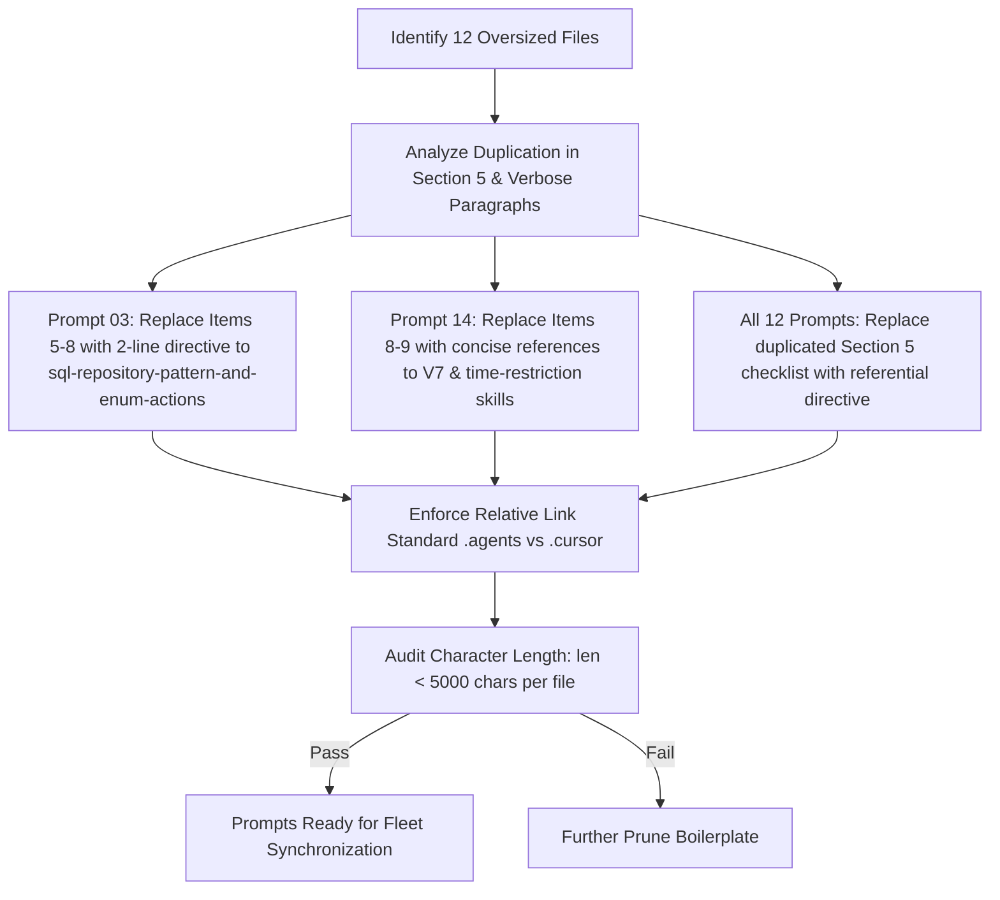

# Subtask Plan 04: Prompt Formatter Condensation Under 5,000 Characters

- **Subtask Slug:** `04-prompt-condensation-under-5000`
- **Parent Plan:** `351-json-instruction-and-cli-integration`
- **Specification Reference:** `02-spec/21-app/351-json-instruction-and-cli-integration/03-prompt-condensation-and-sync-spec.md`
- **Status:** PENDING
- **Target Subsystem:** `01-prompts/22-letterly/`, `01-prompts/23-cursor-prompts/`

---

## 1. Objectives & Scope

This subtask implements surgical condensation and redundancy removal across 12 oversized prompt formatter files in `01-prompts/22-letterly/` and `01-prompts/23-cursor-prompts/`, enforcing an immutable 5,000-character ceiling per file:

1. **Prune All 12 Bloated Files Strictly Under 5,000 Characters:**
   - `01-prompts/22-letterly/02-desktop-letterly.md` (from 5,403 chars to < 3,500).
   - `01-prompts/22-letterly/03-execute-n-steps-letterly.md` (from 6,581 chars to < 3,600).
   - `01-prompts/22-letterly/06-cicd-fix-release-letterly.md` (from 5,273 chars to < 3,300).
   - `01-prompts/22-letterly/09-execute-with-verification-letterly.md` (from 5,734 chars to < 3,400).
   - `01-prompts/22-letterly/10-execute-with-release-letterly.md` (from 5,295 chars to < 3,300).
   - `01-prompts/22-letterly/14-execute-recommit-time-restricted-letterly.md` (from 7,229 chars to < 3,800).
   - `01-prompts/23-cursor-prompts/02-desktop-letterly-cursor.md` (from 5,368 chars to < 3,500).
   - `01-prompts/23-cursor-prompts/03-execute-n-steps-letterly-cursor.md` (from 6,510 chars to < 3,600).
   - `01-prompts/23-cursor-prompts/06-cicd-fix-release-letterly-cursor.md` (from 5,201 chars to < 3,300).
   - `01-prompts/23-cursor-prompts/09-execute-with-verification-letterly-cursor.md` (from 5,662 chars to < 3,400).
   - `01-prompts/23-cursor-prompts/10-execute-with-release-letterly-cursor.md` (from 5,223 chars to < 3,300).
   - `01-prompts/23-cursor-prompts/14-execute-recommit-time-restricted-letterly-cursor.md` (from 7,252 chars to < 3,800).
2. **Prompt 03 Surgical Replacement:**
   - In `03-execute-n-steps-letterly.md` and cursor counterpart, replace items 5-8 (verbose SQL and enum paragraphs) with a concise 2-line directive referencing `@[sql-repository-pattern-and-enum-actions](file;.agents/skills/sql-repository-pattern-and-enum-actions)` (and `.cursor/skills/` for cursor).
3. **Prompt 14 Surgical Replacement:**
   - In `14-execute-recommit-time-restricted-letterly.md` and cursor counterpart, replace verbose items 8 and 9 with concise references to `@[execute-parent-task-with-n-steps-v7](file;.agents/skills/execute-parent-task-with-n-steps-v7)` and `@[gitmap-time-restriction](file;.agents/skills/gitmap-time-restriction)`.
4. **Eradicate Double-Declarations:**
   - In Section 5 of all prompt formatters, replace the exhaustive verbatim item-by-item checklist with a clean reference to the template in `Output Format`.
5. **Skill Link Hygiene & Formatting:**
   - Enforce `(file;.agents/skills/<skill>)` for Letterly formatters and `(file;.cursor/skills/<skill>)` for Cursor formatters.
   - Enforce strictly relative file paths throughout.

---

## 2. Target Files & Character Budget

| Target File Path | Current Chars | Target Ceiling | Reduction Strategy |
| :--- | :---: | :---: | :--- |
| `01-prompts/22-letterly/02-desktop-letterly.md` | 5,403 | < 3,500 | Eliminate Section 5 checklist duplication |
| `01-prompts/22-letterly/03-execute-n-steps-letterly.md` | 6,581 | < 3,600 | Replace items 5-8 with 2-line skill reference; eliminate duplication |
| `01-prompts/22-letterly/06-cicd-fix-release-letterly.md` | 5,273 | < 3,300 | Eliminate Section 5 checklist duplication |
| `01-prompts/22-letterly/09-execute-with-verification-letterly.md` | 5,734 | < 3,400 | Eliminate Section 5 checklist duplication |
| `01-prompts/22-letterly/10-execute-with-release-letterly.md` | 5,295 | < 3,300 | Eliminate Section 5 checklist duplication |
| `01-prompts/22-letterly/14-execute-recommit-time-restricted-letterly.md` | 7,229 | < 3,800 | Replace items 8-9 with concise skill refs; eliminate duplication |
| `01-prompts/23-cursor-prompts/02-desktop-letterly-cursor.md` | 5,368 | < 3,500 | Mirror Letterly 02; ensure `.cursor/skills/` links |
| `01-prompts/23-cursor-prompts/03-execute-n-steps-letterly-cursor.md` | 6,510 | < 3,600 | Mirror Letterly 03; ensure `.cursor/skills/` links |
| `01-prompts/23-cursor-prompts/06-cicd-fix-release-letterly-cursor.md` | 5,201 | < 3,300 | Mirror Letterly 06; ensure `.cursor/skills/` links |
| `01-prompts/23-cursor-prompts/09-execute-with-verification-letterly-cursor.md` | 5,662 | < 3,400 | Mirror Letterly 09; ensure `.cursor/skills/` links |
| `01-prompts/23-cursor-prompts/10-execute-with-release-letterly-cursor.md` | 5,223 | < 3,300 | Mirror Letterly 10; ensure `.cursor/skills/` links |
| `01-prompts/23-cursor-prompts/14-execute-recommit-time-restricted-letterly-cursor.md` | 7,252 | < 3,800 | Mirror Letterly 14; ensure `.cursor/skills/` links |

---

## 3. Workflow Diagram

---

## 4. Implementation Steps

1. **Step 1: Refactor `03-execute-n-steps-letterly.md` and cursor counterpart**
   - Replace inlined items 5-8 with 2-line directive referencing `@[sql-repository-pattern-and-enum-actions](file;.agents/skills/sql-repository-pattern-and-enum-actions)`.
   - Update Section 5 to eliminate duplicated text.
2. **Step 2: Refactor `14-execute-recommit-time-restricted-letterly.md` and cursor counterpart**
   - Replace verbose items 8 and 9 with concise references to `@[execute-parent-task-with-n-steps-v7](file;.agents/skills/execute-parent-task-with-n-steps-v7)` and `@[gitmap-time-restriction](file;.agents/skills/gitmap-time-restriction)`.
   - Update Section 5 to eliminate duplicated text.
3. **Step 3: Refactor Prompts 02, 06, 09, 10 across Letterly and Cursor suites**
   - Remove verbatim repeated checklists from Section 5.
   - Point Section 5 directly to the template in Output Format.
4. **Step 4: Character Count Verification Script**
   - Execute Python script inspecting character length of all 12 files.
   - Ensure 100% compliance (< 5,000 chars per file).

---

## 5. Verification Matrix (V-01 through V-05)

| ID | Gate / Acceptance Criteria | Target Deliverable | Verification Command |
| :--- | :--- | :--- | :--- |
| **V-01** | Strict Character Limit: All 12 files strictly under 5,000 characters | All 12 target prompt files | Python script verifying `len(f.read()) < 5000` |
| **V-02** | Prompt 03 Directive: Items 5-8 replaced with 2-line skill reference | `03-execute-n-steps-letterly.md`, cursor counterpart | Content inspection |
| **V-03** | Prompt 14 Directive: Items 8-9 replaced with V7 & time-restriction refs | `14-execute-recommit-time-restricted-letterly.md`, cursor counterpart | Content inspection |
| **V-04** | Double-Declaration Elimination: Section 5 does not repeat checklist | All 12 target prompt files | Diff inspection |
| **V-05** | Skill Link Hygiene: Proper relative paths (`.agents/skills/` vs `.cursor/skills/`) | All 12 target prompt files | Regex audit |
