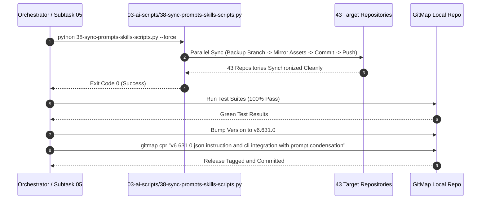

# Subtask Plan 05: Multi-Repository Fleet Synchronization & Release Ceremony

- **Subtask Slug:** `05-fleet-sync-and-release`
- **Parent Plan:** `351-json-instruction-and-cli-integration`
- **Specification Reference:** `02-spec/21-app/351-json-instruction-and-cli-integration/03-prompt-condensation-and-sync-spec.md`
- **Status:** PENDING
- **Target Subsystem:** `03-ai-scripts/38-sync-prompts-skills-scripts.py`, 43 Connected Repositories, GitMap Release Pipeline

---

## 1. Objectives & Scope

This subtask executes the automated multi-repository fleet synchronization across all 43 connected repositories, validates fleet boundary protections, conducts terminal verification, and performs the GitMap release ceremony:

1. **Fleet Synchronization Execution (`03-ai-scripts/38-sync-prompts-skills-scripts.py --force`):**
   - Execute the canonical Python synchronizer with the `--force` flag.
   - Concurrently mirror condensed prompt formatters (`01-prompts/22-letterly/` and `01-prompts/23-cursor-prompts/`), shared skills, and specifications.
   - Enforce non-negotiable boundary protections:
     - Boundary 1: Spec 21 Exclusion (never sync `02-spec/21-*` through `02-spec/25-*`).
     - Boundary 2: Additive-Only AI Scripts (never overwrite repository-specific script modifications).
     - Boundary 3: Bump Script Protection (preserve repository bump scripts).
     - Boundary 4: Memory & Plans Protection (never touch `.ai-memory/memory/` or `.ai-memory/plans/`).
     - Boundary 5: Archive & History Exclusion (never mirror archive or deprecated directories).
2. **Pre-Sync & Post-Sync Safety Controls:**
   - Auto-create and push pre-sync backup branch (`backup/sync-<timestamp>`) on every target repo.
   - Verify post-sync Git status across target repositories to ensure clean commits and zero untracked debris.
3. **End-to-End Verification Matrix (V-01 through V-10):**
   - Validate character counts, link formats, and CLI flags.
   - Run unit test suites to 100% green pass.
4. **GitMap Semantic Release Ceremony:**
   - Minor version bump: `python 03-ai-scripts/37-bump-version.py -t minor -s "v6.631.0 json instruction and cli integration with prompt condensation"`.
   - Update `changelog.md`.
   - Semantic commit: `gitmap cpr "v6.631.0 json instruction and cli integration with prompt condensation"`.
   - Push release tag to remote tracking branch.

---

## 2. Target Files & Component Map

| Target File Path | Architectural Responsibility |
| :--- | :--- |
| `03-ai-scripts/38-sync-prompts-skills-scripts.py` | Multi-repository parallel synchronizer with backup branch creation and boundary guards. |
| `43 Connected Repositories` | Workspaces under `d:\work\` receiving mirrored prompts and skills. |
| `changelog.md` | Release history log documenting v6.631.0 enhancements. |
| `version.txt` / `package.json` | Project version manifests updated during release ceremony. |

---

## 3. Workflow Diagram

---

## 4. Implementation Steps

1. **Step 1: Pre-Sync Validation**
   - Verify that all 12 prompt files in the `gitmap-v28` repo are strictly under 5,000 characters.
   - Verify that all unit tests in GitMap pass.
2. **Step 2: Execute Fleet Synchronization**
   - Run: `python 03-ai-scripts/38-sync-prompts-skills-scripts.py --force`.
   - Monitor console output for any repository failures, conflicts, or permission issues.
3. **Step 3: Boundary Guard Audit**
   - Inspect sample target repositories (e.g. `go-email-sender`, `alim-cv`) to verify that `02-spec/21-*` and `.ai-memory/` remained untouched.
4. **Step 4: Release Ceremony**
   - Execute minor version bump script.
   - Commit via `gitmap cpr` adhering strictly to commit standards.
   - Push commit and tags to remote origin.

---

## 5. Verification Matrix (V-01 through V-05)

| ID | Gate / Acceptance Criteria | Target Deliverable | Verification Command |
| :--- | :--- | :--- | :--- |
| **V-01** | Fleet Sync Script Completion: Exit code 0 across all 43 repositories | `03-ai-scripts/38-sync-prompts-skills-scripts.py` | `python 03-ai-scripts/38-sync-prompts-skills-scripts.py --force` |
| **V-02** | Boundary Protection: Spec 21 and `.ai-memory` excluded from sync | Target repositories | Sample directory inspection |
| **V-03** | Prompt Parity in Fleet: Sample target repositories have condensed prompts | Target repositories `01-prompts/` | File size check on target repo |
| **V-04** | Local Test Suite Pass: 100% pass across all GitMap unit tests | GitMap repo | `go test ./...` |
| **V-05** | Release Tag & Commit: Valid v6.631.0 tag and semantic commit created | GitMap repo | `git tag -l "v6.631.0"` |
