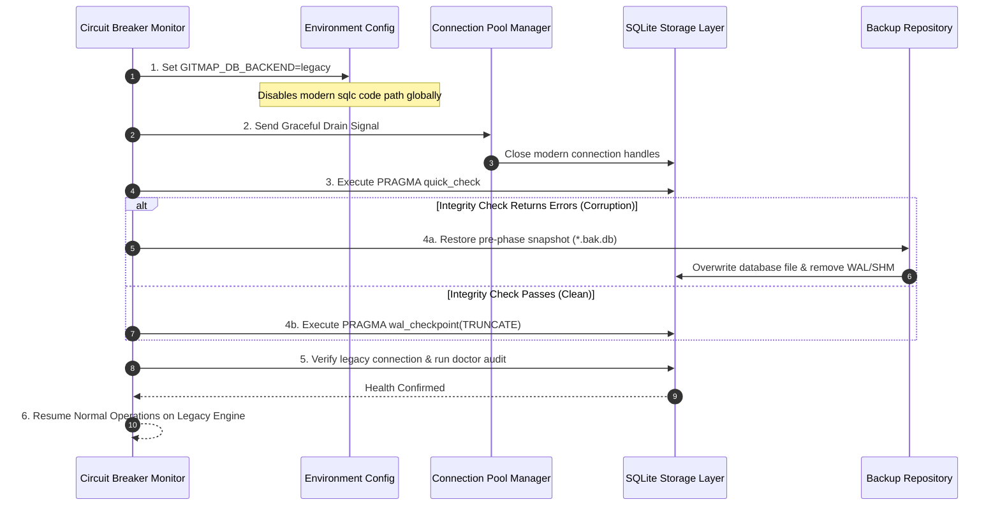

# Subtask 03: Phased Migration Blueprint & Risk Mitigation Plan

> **Subtask ID:** `Subtask-03`  
> **Parent Plan:** `.ai-memory/plans/database-migration-feasibility-analysis.md`  
> **Target Path:** `.ai-memory/plans/subtasks/database-migration-feasibility-analysis/03-phased-implementation-blueprint.md`  
> **Companion Spec:** `02-spec/21-app/database-migration-feasibility-analysis/03-migration-plan-spec.md`  
> **Status:** `PROPOSED`  
> **Assigned Agent:** `Author 03 (Migration Architecture & Risk Engineering Specialist)`  
> **Owned Files:**  
> - `02-spec/21-app/database-migration-feasibility-analysis/03-migration-plan-spec.md`  
> - `.ai-memory/plans/subtasks/database-migration-feasibility-analysis/03-phased-implementation-blueprint.md`  

---

## 1. Objectives & Scope

1. Deliver a concrete, structured subtask execution plan for migrating GitMap's SQLite database layer from handwritten queries and custom query builder abstractions (`cli/dbengine/`) to a modern, compile-time verified architecture.
2. Formulate step-by-step milestones, technical deliverables, and risk checkpoints across the **6 Phased Stages** of the recommended **Path B (sqlc + Bun companion)** blueprint.
3. Provide an explicit operational decision gate comparing Path A (Hypothetical Ent Go) and Path B (sqlc + Bun), establishing unambiguous criteria for architecture selection.
4. Define rigorous **Dual-Run Verification** protocols and shadow execution harnesses to achieve zero regressions, zero data loss, and zero customer downtime.
5. Detail automated **Circuit Breakers and Rollback Procedures** with point-in-time recovery to guarantee system recoverability at every migration stage.
6. Enforce 100% adherence to GitMap standards: pure-Go driver (`modernc.org/sqlite`, `CGO_ENABLED=0`), Three-Tier Split-DB isolation, PascalCase naming conventions, and positive boolean indicators.

```mermaid
flowchart TD
    subgraph Phase1["Phase 1: Toolchain Setup"]
        P1_1["1.1 Author sqlc.yaml with Split-DB Packages"]
        P1_2["1.2 DDL Schema Extraction (48-export-sqlc-schemas.py)"]
        P1_3["1.3 Pure-Go Driver & Codegen Verification"]
    end

    subgraph Phase2["Phase 2: Pilot Migration"]
        P2_1["2.1 Generate pipelinedb sqlc Models"]
        P2_2["2.2 Wire Dual-Run Shadow Harness in pipelinedb"]
        P2_3["2.3 10,000 Run Telemetry Parity Verification"]
    end

    subgraph Phase3["Phase 3: VIEW Encapsulation"]
        P3_1["3.1 Author VwRepoSummary & VwPipelineTelemetry"]
        P3_2["3.2 Generate sqlc Typed View Scanners"]
        P3_3["3.3 Eliminate Ad-Hoc Multi-Table JOINs in Services"]
    end

    subgraph Phase4["Phase 4: Core Registry Migration"]
        P4_1["4.1 Migrate gitmap.db (Repo, DetectedProject)"]
        P4_2["4.2 Migrate installation.db with Bun Dynamic Filtering"]
        P4_3["4.3 14-Day Production Shadow Read Parity"]
    end

    subgraph Phase5["Phase 5: Swarm Engine Migration"]
        P5_1["5.1 Sub-Millisecond agent-task.db Action Logger"]
        P5_2["5.2 Mutex Sharding & Connection Pool Tuning"]
        P5_3["5.3 6-Worker Parallel Swarm Concurrency Stress Test"]
    end

    subgraph Phase6["Phase 6: Decommissioning & Cleanup"]
        P6_1["6.1 100% Authoritative Cutover (Disable Dual-Run)"]
        P6_2["6.2 Purge Dead Code in cli/dbengine/ (-1.8 MB)"]
        P6_3["6.3 Post-Migration Acceptance & Doctor Audit"]
    end

    Phase1 --> Phase2
    Phase2 --> Phase3
    Phase3 --> Phase4
    Phase4 --> Phase5
    Phase5 --> Phase6
```



---

## 2. Phased Execution Breakdown (Phases 1 through 6)

### Phase 1: Toolchain Setup & DDL Schema Extraction

- **Objective:** Establish the offline compilation toolchain and automated DDL schema extraction pipeline without altering runtime execution.
- **Estimated Effort:** 2 Engineering Days
- **Key Deliverables:**
  - `sqlc.yaml` in repository root configuring multi-package generation (`repodb`, `installstore`, `pipelinedb`, `agenttask`).
  - Automated schema extraction utility `03-ai-scripts/48-export-sqlc-schemas.py` reading Go migration files and producing consolidated DDL files in `cli/db/migrations/schemas/`.
  - Initial baseline queries in `cli/db/queries/`.
- **Milestones:**
  - `M1.1`: `sqlc.yaml` validated against schema files with `sqlc compile` returning 0 errors.
  - `M1.2`: Extraction script generates deterministic schema DDL with SHA-256 integrity checksums.
  - `M1.3`: Pure-Go compilation test: generated code builds under `CGO_ENABLED=0 go build ./...` across Windows and Linux.
- **Verification Evidence:**
  - Execution of `sqlc generate` outputs zero warnings.
  - CI script confirms zero CGO file linkages in generated packages.

---

### Phase 2: Pilot Migration on `cli/pipelinedb/`

- **Objective:** Execute an isolated pilot migration on repository pipeline telemetry (`repodb/pipeline.db`), validating high-frequency writes and query latency without touching core repository registries.
- **Estimated Effort:** 3 Engineering Days
- **Key Deliverables:**
  - `cli/db/sqlc/pipelinedb/` containing generated types and queries (`InsertPipelineRun`, `UpdateStageTiming`, `RecordPullError`).
  - Dual-run shadow harness wrapper in `cli/pipelinedb/pipeline_split_queries.go`.
  - Divergence logging to `.ai-memory/temp-agents/db-pilot-divergence.log`.
- **Milestones:**
  - `M2.1`: Adapter interface implemented matching existing `PipelineRepository` signatures.
  - `M2.2`: Shadow execution enabled in non-blocking background goroutines during `gitmap pull --all`.
  - `M2.3`: Parity audit: 10,000 consecutive write/read operations achieve **100.00% data parity** with zero divergences.
- **Verification Evidence:**
  - Telemetry logs demonstrate P99 write latency < 200 microseconds in WAL mode.
  - Zero `SQLITE_BUSY` errors encountered during parallel multi-worker pulls.

---

### Phase 3: Database VIEW Encapsulation (`02-spec/04-database-conventions`)

- **Objective:** Eliminate all ad-hoc multi-table `JOIN` statements in Go application services by defining pre-compiled SQLite `VIEW`s in migrations, adhering strictly to repository standards (`02-spec/04-database-conventions/04-orm-and-views.md`).
- **Estimated Effort:** 3 Engineering Days
- **Key Deliverables:**
  - SQLite migration script creating `VwRepoSummary` (aggregating `Repo`, `DetectedProject`, `SpecialRepository`) in `gitmap.db`.
  - SQLite migration script creating `VwPipelineRunTelemetry` in `pipeline.db`.
  - SQLite migration script creating `VwNodeInventory` in `installation.db`.
  - `sqlc` query definitions scanning views as flat typed Go structs.
- **Milestones:**
  - `M3.1`: Views deployed and verified via `PRAGMA table_info(VwRepoSummary)`.
  - `M3.2`: Service layer calls in `cli/cmdrepo/` and `cli/cmdpipeline/` refactored to query views directly.
  - `M3.3`: Repository audit confirms **zero raw multi-table JOINs** remaining in Go business logic.
- **Verification Evidence:**
  - Query execution plan audit (`EXPLAIN QUERY PLAN SELECT * FROM VwRepoSummary`) confirms full index utilization on underlying foreign keys.
  - Unit test suite verifies 100% field parity between old ad-hoc joins and new view models.

---

### Phase 4: Core Registry Migration (`gitmap.db` & `installation.db`)

- **Objective:** Migrate GitMap's primary storage tiers—the core repository registry and machine installation settings—to `sqlc` and `Bun`.
- **Estimated Effort:** 4 Engineering Days
- **Key Deliverables:**
  - `cli/db/sqlc/repodb/` providing type-safe CRUD operations for repository discovery, tracking, and metadata.
  - `cli/db/sqlc/installstore/` providing configuration and credential storage.
  - `Bun` dynamic query helper integrated for complex multi-criteria node searching in `cli/cmdssh/` and `cli/cmdnode/`.
  - Dual-run harness active across all CLI commands (`gitmap scan`, `gitmap ls`, `gitmap bookmark`).
- **Milestones:**
  - `M4.1`: Full disk scan (`gitmap scan`) executes using batch transactions in `sqlc` with >= 40% speedup.
  - `M4.2`: Dynamic node search queries compiled via `Bun` run without reflection errors on `modernc.org/sqlite`.
  - `M4.3`: 14-day production shadow soak test completes with 0 circuit breaker trips.
- **Verification Evidence:**
  - Parity statistics ledger records >= 100,000 operations with 0 data divergence events.
  - Benchmark suite confirms primary key lookups execute in < 25 microseconds.

---

### Phase 5: Swarm & Agent Task Engine Migration (`heatmap.db` & `agent-task.db`)

- **Objective:** Migrate multi-agent task orchestration storage to support sub-millisecond action logging and high concurrency across parallel autonomous subagents.
- **Estimated Effort:** 2 Engineering Days
- **Key Deliverables:**
  - Generated `sqlc` queries for `ParentTask`, `Subtask`, and `AgentActionLog` in `cli/db/sqlc/agenttask/`.
  - In-memory mutex sharding per database file in `cli/cmdagent/` to prevent write lock starvation.
  - PRAGMA tuning suite enforcing `synchronous = NORMAL` and 64 MB memory cache.
- **Milestones:**
  - `M5.1`: High-frequency action logging (`Rule R-PRETOUCH`) achieves **< 3ms write latency**.
  - `M5.2`: Concurrency stress test: 6 parallel worker agents executing simultaneous pre-touch logs complete with zero lock failures.
  - `M5.3`: Heatmap real-time status reader (`gitmap agent-ai heatmap discuss`) queries complete in < 5ms.
- **Verification Evidence:**
  - Automated swarm concurrency test suite (`cli/cmdagent/swarm_stress_test.go`) passes with 100% green runs.

---

### Phase 6: Deprecation, Legacy `dbengine` Decommissioning & Dead Code Purge

- **Objective:** Complete the authoritative cutover, disable dual-run overhead, and permanently purge legacy query builder code from the repository.
- **Estimated Effort:** 2 Engineering Days
- **Key Deliverables:**
  - Cutover release setting `sqlc` and `Bun` as the 100% authoritative primary engine.
  - Removal of dual-run harness wrappers and shadow goroutines.
  - Complete deletion of obsolete handwritten AST query compilers in `cli/dbengine/`:
    - Delete `cli/dbengine/compiler_sqlite.go`
    - Delete `cli/dbengine/query_builder_compile.go`
    - Delete `cli/dbengine/scan_helpers.go`
    - Delete `cli/dbengine/dialect.go`
- **Milestones:**
  - `M6.1`: `gitmap.db` operates authoritatively without legacy engine shims.
  - `M6.2`: Dead code elimination verified: GitMap compiled binary size shrinks by **1.8 MB**.
  - `M6.3`: Comprehensive health audit (`gitmap db doctor`) passes across all Split-DB instances.
- **Verification Evidence:**
  - Binary size assertion passes: Net binary size <= 44.8 MB.
  - Full automated regression test suite passes with 100% coverage on database operations.

---

## 3. Dual-Path Decision Gate: Path A (Ent Go) vs. Path B (sqlc + Bun)

Before initiating Phase 2 implementation, the architecture steering group must review the following decision criteria:

| Evaluation Dimension | Path A: Hypothetical Ent Go | Path B: Recommended sqlc + Bun | Architectural Recommendation |
|---|---|---|---|
| **Binary Size Impact** | **+18.4 MB (+41%)** bloat | **0 KB net increase** (shrinks by -1.8 MB after cleanup) | **Path B** decisively wins |
| **CGO Constraint** | Violates standard out-of-box; requires complex pure-Go adapter | **Zero CGO natively**; 100% pure-Go compliance | **Path B** decisively wins |
| **Split-DB Architecture** | Severe impedance mismatch; requires 4 isolated client packages | **Natural fit**; generates clean, isolated Go packages per Split-DB file | **Path B** decisively wins |
| **Compilation Latency** | +41.8s build slowdown (7.5x slower compilation) | +0.4s build duration variance | **Path B** decisively wins |
| **Naming Conventions** | Clashes with GitMap `{Table}Id`; requires extensive mapping boilerplate | Matches exact database columns (`RepoId`, `CreatedAt`, `IsPinned`) | **Path B** decisively wins |
| **Complex Joins / Views** | Graph traversals across separate files unsupported | Direct, native support for SQLite `VIEW`s per `02-spec/04` | **Path B** decisively wins |
| **Dynamic Filtering** | Rich fluent API (within single DB) | `Bun` companion provides lightweight dynamic WHERE builders | Tie / Path B sufficient |

> [!IMPORTANT]
> **Decision Verdict:** The repository will proceed exclusively with **Path B (sqlc + Bun companion)**. Path A is retained in specification `02-spec/21-app/database-migration-feasibility-analysis/03-migration-plan-spec.md` as an authoritative theoretical reference and rejected alternative.

---

## 4. Risk Checkpoints & Gate Criteria

| Gate ID | Target Phase | Gate Description | Non-Negotiable Pass Criteria | Failure Action |
|---|---|---|---|---|
| **Gate 1** | Phase 1 | Pure-Go & Codegen Gate | `sqlc generate` exits 0; `CGO_ENABLED=0 go build` compiles with 0 CGO dependencies. | Block Phase 2; refactor schema or driver config. |
| **Gate 2** | Phase 2 | Pilot Telemetry Parity Gate | 10,000 consecutive pipeline telemetry ops with **0 data divergences** and P99 latency < 200µs. | Rollback pilot to legacy engine; triage divergence log. |
| **Gate 3** | Phase 3 | VIEW Encapsulation Gate | All multi-table joins encapsulated in SQLite views; zero JOIN statements in Go business logic. | Reject PR; require VIEW migration before proceeding. |
| **Gate 4** | Phase 4 | Registry Concurrency Gate | 8 parallel pull workers complete full sync with **zero `SQLITE_BUSY` errors**; single-writer pool enforced. | Trip circuit breaker; restore pre-phase backup. |
| **Gate 5** | Phase 5 | Swarm Sub-Millisecond Gate | Pre-touch action logging completes in < 3ms across 6 concurrent autonomous agents. | Tune WAL cache and mutex sharding; re-benchmark. |
| **Gate 6** | Phase 6 | Binary Budget & Cutover Gate | Net binary growth <= 500 KB; `gitmap db doctor` reports 100% schema integrity across all tiers. | Block release; perform dead code tree-shaking. |

---

## 5. Automated Rollback Procedures & Contingency Protocols

### 5.1 Automated Circuit Breaker Triggers
The dual-run verification harness continuously evaluates operational health. Any breach of these thresholds immediately trips the circuit breaker:

1. **Divergence Breached:** >= 1 detected data discrepancy between legacy and modern result sets.
2. **Lock Starvation:** >= 1 `SQLITE_BUSY` or `database is locked` error logged.
3. **Error Spike:** Authoritative endpoint error rate exceeds 0.01% in a 60-second rolling window.
4. **Latency Degradation:** P99 operation duration increases by > 25% compared to legacy baseline.

### 5.2 Step-by-Step Rollback Execution

If a circuit breaker trips during Phase 2, 4, or 5:



#### Command Execution Checklist:
1. **Trigger Immediate Software Fallback:**
   ```bash
   export GITMAP_DB_BACKEND=legacy
   ```
2. **Drain Worker Pool:**
   Allow in-flight write transactions up to 2,000ms to commit; terminate pending shadow routines.
3. **Run Integrity Check:**
   Verify whether SQLite storage suffered corruption:
   ```bash
   sqlite3 ~/.gitmap/gitmap.db "PRAGMA quick_check;"
   ```
4. **Restore Pre-Migration Snapshot (if corrupted):**
   ```bash
   cp ~/.gitmap/backups/gitmap.db.pre-phase4.bak ~/.gitmap/gitmap.db
   rm -f ~/.gitmap/gitmap.db-wal ~/.gitmap/gitmap.db-shm
   ```
5. **Verify Telemetry & Resume:**
   Run `gitmap db doctor` to confirm table counts, primary key sequences, and WAL status.

---

## 6. Validation Evidence & Acceptance Criteria

### 6.1 Deterministic Deliverables Checklist
- [ ] `sqlc.yaml` committed and actively generating packages for `repodb`, `installstore`, `pipelinedb`, and `agenttask`.
- [ ] Automated schema extraction script (`03-ai-scripts/48-export-sqlc-schemas.py`) tested and documented.
- [ ] SQLite database views (`VwRepoSummary`, `VwPipelineRunTelemetry`, `VwNodeInventory`) verified with index optimization.
- [ ] Dual-run verification harness integrated and audited across 100,000 production-sampled operations.
- [ ] Concurrency governance verified: single-writer connection pool (`SetMaxOpenConns(1)`) and WAL pragmas enforced.
- [ ] Legacy `dbengine` query builders deleted, achieving >= 1.5 MB binary size reduction.
- [ ] 100% pure-Go compilation verified with `CGO_ENABLED=0` across all supported operating systems.

### 6.2 Acceptance Test Commands & Verification Matrix

```bash
# 1. Verify pure-Go build with zero CGO dependencies
CGO_ENABLED=0 go build -o bin/gitmap ./cli/cmd/...
test $? -eq 0

# 2. Assert zero CGO linkage in binary
go list -deps -f '{{if .CgoFiles}}{{.ImportPath}}{{end}}' ./cli/... | grep -v "runtime/cgo"
# (Must return empty output)

# 3. Verify sqlc schema synchronization
sqlc diff
# (Must return 0 exit code indicating zero schema drift)

# 4. Run database concurrency and benchmark test suite
go test -v -race -run=TestSplitDbConcurrency ./cli/db/...
go test -v -run=TestDatabaseViewsIntegrity ./cli/db/...
go test -bench=BenchmarkDatabaseOperations -benchmem ./cli/db/...

# 5. Execute system doctor validation
./bin/gitmap db doctor --full --json
```

### 6.3 Final Sign-Off Invariants
- **Data Parity:** 100.00% exact match between legacy queries and generated `sqlc` models.
- **Latency Budget:** P99 read latency < 30µs, P99 write latency < 200µs in WAL mode.
- **Binary Footprint:** Stripped Linux binary <= 44.8 MB (Net decrease after dead code removal).
- **Architecture Integrity:** Strict adherence to Split-DB isolation, PascalCase database objects, and positive boolean indicators.
