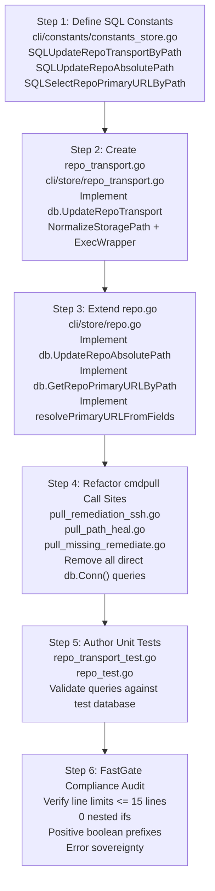

# Subtask 03: DB Repository Pattern Encapsulation & Schema Drift Fix

- **Subtask ID:** `03-db-repository-pattern-encapsulation.md`
- **Parent Task:** `git-dry-url-consts-db-repository`
- **Spec Reference:** `02-spec/21-app/git-dry-url-consts-db-repository/03-migration-and-verification-spec.md`
- **Status:** `PENDING`
- **Owner:** Database & Core Architecture Worker
- **Owned Files:**
  - `cli/constants/constants_store.go`
  - `cli/store/repo_transport.go`
  - `cli/store/repo_transport_test.go`
  - `cli/store/repo.go`
  - `cli/store/repo_test.go`
  - `cli/cmdpull/pull_remediation_ssh.go`
  - `cli/cmdpull/pull_path_heal.go`
  - `cli/cmdpull/pull_missing_remediate.go`

---

## 1. Objectives & Scope

1. **Encapsulate Repository Operations on `*store.DB`:**
   - Implement `UpdateRepoTransport` in `cli/store/repo_transport.go` to safely update `SshUrl`, `IdentifiedTransport`, and `UpdatedAt` by absolute path.
   - Implement `UpdateRepoAbsolutePath` in `cli/store/repo.go` to migrate repository file paths while maintaining database index integrity.
   - Implement `GetRepoPrimaryURLByPath` in `cli/store/repo.go` to resolve the active remote URL and repository ID by querying valid columns (`HttpsUrl`, `SshUrl`, `IdentifiedTransport`).

2. **Remediate Silent Schema Drift:**
   - Eliminate all references to the non-existent `DiscoveredUrl` column across `cli/cmdpull/pull_remediation_ssh.go` and `cli/cmdpull/pull_missing_remediate.go`.
   - Ensure 100% schema alignment with the canonical `Repo` table defined in `cli/store/sql/repos.sql`.

3. **Migrate Direct SQL Call Sites in `cli/cmdpull/`:**
   - Refactor `updateRepoTransportInDB` in `cli/cmdpull/pull_remediation_ssh.go` to consume `db.UpdateRepoTransport`.
   - Refactor `HealRepoPathInDB` in `cli/cmdpull/pull_path_heal.go` to consume `db.UpdateRepoAbsolutePath`.
   - Refactor `LookupRepoRemoteAndID` in `cli/cmdpull/pull_missing_remediate.go` to consume `db.GetRepoPrimaryURLByPath`.

4. **Deliver Test Automation:**
   - Author unit tests in `cli/store/repo_transport_test.go` and `cli/store/repo_test.go` verifying transaction execution, path normalization, and edge case handling with in-memory SQLite instances.

---

## 2. Detailed Implementation Steps



### Step 1: SQL Query Constants (`cli/constants/constants_store.go`)

Add three parameterized queries to `cli/constants/constants_store.go`:

```go
// SQLUpdateRepoTransportByPath updates SSH URL and transport classification by absolute path.
const SQLUpdateRepoTransportByPath = `UPDATE Repo
SET SshUrl = ?, IdentifiedTransport = ?, UpdatedAt = CURRENT_TIMESTAMP
WHERE AbsolutePath = ?`

// SQLUpdateRepoAbsolutePath updates the stored AbsolutePath for a repository.
const SQLUpdateRepoAbsolutePath = `UPDATE Repo
SET AbsolutePath = ?, UpdatedAt = CURRENT_TIMESTAMP
WHERE AbsolutePath = ?`

// SQLSelectRepoPrimaryURLByPath retrieves repo identity, URLs, and transport classification.
const SQLSelectRepoPrimaryURLByPath = `SELECT
	RepoId,
	COALESCE(HttpsUrl, ''),
	COALESCE(SshUrl, ''),
	COALESCE(IdentifiedTransport, '')
FROM Repo
WHERE AbsolutePath = ?`
```

### Step 2: Encapsulate `UpdateRepoTransport` (`cli/store/repo_transport.go`)

Create `cli/store/repo_transport.go`:
- Package: `store`
- Function: `func (db *DB) UpdateRepoTransport(absPath, sshURL, identifiedTransport string) error`
- Implementation requirements:
  - Canonicalize `absPath` using `NormalizeStoragePath(absPath)`.
  - Trim `sshURL` using `strings.TrimSpace(sshURL)`.
  - Normalize `identifiedTransport` to lowercase; fallback to `constants.TransportSSH` if empty.
  - Execute via `ExecWrapper(db.conn, constants.SQLUpdateRepoTransportByPath, cleanURL, cleanTransport, cleanPath).Destruct()`.
  - Return error directly (`return err`).
  - Total function length: strictly <= 15 lines.

### Step 3: Encapsulate Methods in `cli/store/repo.go`

Extend `cli/store/repo.go` with two new repository receiver methods:

1. **`UpdateRepoAbsolutePath(oldPath, newPath string) error`**
   - Canonicalize both paths via `NormalizeStoragePath`.
   - Guard clause: return `nil` if either path is empty or both are identical.
   - Execute via `ExecWrapper(db.conn, constants.SQLUpdateRepoAbsolutePath, cleanNew, cleanOld).Destruct()`.
   - Return error directly (`return err`).
   - Function length: <= 12 lines.

2. **`GetRepoPrimaryURLByPath(absPath string) (int64, string, error)`**
   - Canonicalize `absPath` via `NormalizeStoragePath`.
   - Guard clause: return `(0, "", nil)` if path is empty.
   - Execute `db.conn.QueryRow(constants.SQLSelectRepoPrimaryURLByPath, cleanPath)`.
   - Scan into `repoID (int64)`, `httpsURL (string)`, `sshURL (string)`, `transport (string)`.
   - If `err != nil`, return `(0, "", err)`.
   - Delegate URL selection to helper `resolvePrimaryURLFromFields(httpsURL, sshURL, transport)`.
   - Return `(repoID, primaryURL, nil)`.
   - Function length: <= 15 lines.

3. **Helper `resolvePrimaryURLFromFields(httpsURL, sshURL, transport string) string`**
   - Guard: if `isSSH := strings.EqualFold(transport, constants.TransportSSH); isSSH && sshURL != ""` return `sshURL`.
   - Guard: if `httpsURL != ""` return `httpsURL`.
   - Return `sshURL`.
   - Function length: <= 10 lines.

### Step 4: Refactor Presentation Call Sites in `cli/cmdpull/`

1. **In `cli/cmdpull/pull_remediation_ssh.go`:**
   - Update `updateRepoTransportInDB(repoPath, sshURL string) error`:
     - Open default database via `store.OpenDefault()`.
     - Guard: early return error if open fails.
     - Defer `db.Close()`.
     - Return `db.UpdateRepoTransport(repoPath, sshURL, constants.TransportSSH)`.
     - Delete obsolete raw `db.Conn().Exec("UPDATE Repo SET SshUrl = ?, DiscoveredUrl = ...")`.
   - Update `applySSHTransportRemediation(repoPath string)`:
     - Check error returned by `updateRepoTransportInDB`.
     - Log diagnostic message if update fails instead of silently dropping.

2. **In `cli/cmdpull/pull_path_heal.go`:**
   - Update `HealRepoPathInDB(oldPath, newPath string) error`:
     - Guard: early return `nil` if paths are empty or identical.
     - Open default database via `store.OpenDefault()`.
     - Defer `db.Close()`.
     - Return `db.UpdateRepoAbsolutePath(oldPath, newPath)`.
     - Delete obsolete `db.Conn().Exec("UPDATE Repo SET AbsolutePath = ...")`.

3. **In `cli/cmdpull/pull_missing_remediate.go`:**
   - Update `LookupRepoRemoteAndID(repoPath string) (int64, string)`:
     - Guard: early return `(0, "")` if `repoPath == ""`.
     - Open default database via `store.OpenDefault()`.
     - Defer `db.Close()`.
     - Call `repoID, remoteURL, err := db.GetRepoPrimaryURLByPath(repoPath)`.
     - Guard: return `(0, "")` on error.
     - Return `(repoID, remoteURL)`.
     - Delete obsolete raw `db.Conn().QueryRow("SELECT ... DiscoveredUrl ...")`.

### Step 5: Unit Test Implementation (`cli/store/repo_transport_test.go` & `cli/store/repo_test.go`)

1. **`cli/store/repo_transport_test.go`:**
   - Test `TestUpdateRepoTransport_Success`:
     - Create test database using `store.OpenTestDB(t)` or in-memory sqlite instance.
     - Upsert a test repository with initial HTTPS URL.
     - Call `db.UpdateRepoTransport(absPath, "git@github.com:test/repo.git", "ssh")`.
     - Query repository and assert `SshUrl` equals `"git@github.com:test/repo.git"`, `IdentifiedTransport` equals `"ssh"`.
   - Test `TestUpdateRepoTransport_PathNormalization`:
     - Upsert repo with forward-slash path `/work/test-repo`.
     - Call `UpdateRepoTransport` with backslash path `\work\test-repo`.
     - Assert update successfully matches the indexed row.

2. **`cli/store/repo_test.go`:**
   - Test `TestUpdateRepoAbsolutePath`:
     - Upsert repo at path A.
     - Call `db.UpdateRepoAbsolutePath(pathA, pathB)`.
     - Assert repo now accessible at path B and not at path A.
   - Test `TestGetRepoPrimaryURLByPath`:
     - Test case 1: HTTPS only -> returns HTTPS URL.
     - Test case 2: SSH only -> returns SSH URL.
     - Test case 3: Both populated, `IdentifiedTransport == "ssh"` -> returns SSH URL.
     - Test case 4: Non-existent path -> returns `(0, "", sql.ErrNoRows)` or `(0, "", nil)`.

---

## 3. FastGate & Coding Guideline Checkpoints

| Rule | Requirement | Verification Target |
| :--- | :--- | :--- |
| **Max Function Length** | <= 15 lines per function | All functions in `repo_transport.go`, `repo.go`, `pull_remediation_ssh.go`, `pull_path_heal.go`, `pull_missing_remediate.go` |
| **Condition Flattening** | Zero nested `if` statements | All branches converted to early return guards |
| **Boolean Naming** | Prefix with `is` or `has` ONLY | `isSSH`, `hasChanged`, `isFound` |
| **Error Return Sovereignty** | Direct `return err` | No swallowed `_, _ =` errors; return errors or log |
| **Whitespace Styling** | Blank line after `}` and before `return` | 100% compliant across all touched files |
| **Path Hygiene** | Relative Git paths only | No absolute filesystem paths or file schema URIs |

---

## 4. Definition of Done

- [ ] `cli/constants/constants_store.go` defines `SQLUpdateRepoTransportByPath`, `SQLUpdateRepoAbsolutePath`, and `SQLSelectRepoPrimaryURLByPath`.
- [ ] `cli/store/repo_transport.go` created with `UpdateRepoTransport`.
- [ ] `cli/store/repo.go` extended with `UpdateRepoAbsolutePath` and `GetRepoPrimaryURLByPath`.
- [ ] All direct `db.Conn()` calls in `cli/cmdpull/pull_remediation_ssh.go`, `cli/cmdpull/pull_path_heal.go`, and `cli/cmdpull/pull_missing_remediate.go` removed.
- [ ] Zero references to `DiscoveredUrl` remaining in the repository.
- [ ] Unit tests pass in `cli/store/` with 0 failures.
- [ ] FastGate AST check passes with 0 violations.
