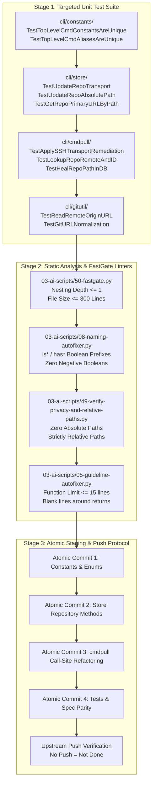
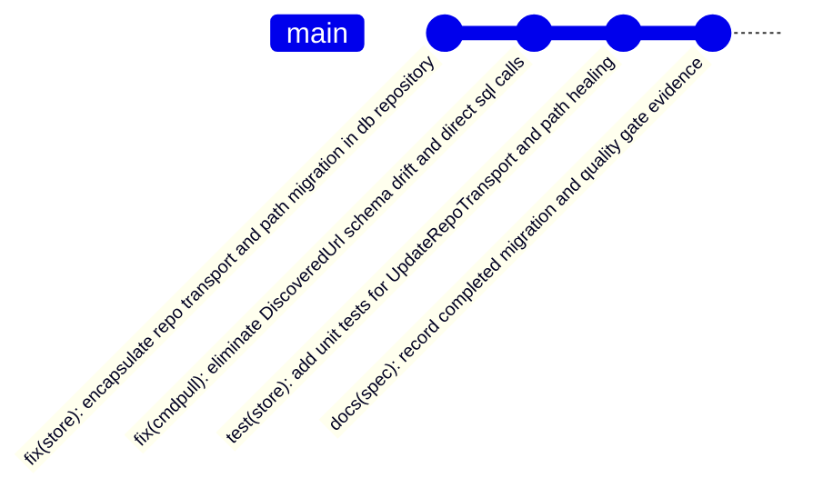

# Subtask 05: Quality Gate Linters, Targeted Test Suite & Verification

- **Subtask ID:** `05-quality-lint-and-verification.md`
- **Parent Task:** `git-dry-url-consts-db-repository`
- **Spec Reference:** `02-spec/21-app/git-dry-url-consts-db-repository/03-migration-and-verification-spec.md`
- **Status:** `PENDING`
- **Owner:** Quality Assurance & Testing Worker
- **Owned Scope:**
  - Automated test execution across `cli/cmdpull`, `cli/gitutil`, `cli/store`, `cli/constants`
  - Constants collision verification
  - AST quality gate execution (FastGate, nested-if, boolean naming, relative paths)
  - Atomic commit staging and push verification protocol

---

## 1. Objectives & Scope

1. **Verify Functional Parity & Bug Elimination:**
   - Execute targeted Go unit tests verifying the fix for the silent `DiscoveredUrl` schema drift defect.
   - Verify that all three direct SQL migrations in `cli/cmdpull/` correctly delegate to `*store.DB` repository methods.
   - Verify centralized URL constants, git provider typing, and sanitized Git subprocess helpers.

2. **Execute Static Analysis & Linter Gates:**
   - Validate constants uniqueness and alias safety to prevent namespace collisions.
   - Enforce repository coding guidelines: maximum function length (<= 15 lines), zero nested `if` statements (nesting depth <= 1), and strictly positive boolean naming (`is*`, `has*`).
   - Enforce repository relative path hygiene: zero absolute filesystem paths or file protocol URIs.

3. **Orchestrate Atomic Commit & Push Protocol:**
   - Define exact, granular atomic commit units adhering to Gitmap standards.
   - Enforce the "No Push = Not Done" completion invariant.

---

## 2. Verification Protocol Flow



---

## 3. Targeted Test Execution Plan

### 3.1 Package `cli/constants` (Collision & Parity Verification)

- **Test Target:** `cli/constants/cmd_constants_test.go` and `cli/constants/cmd_constants_parity_test.go`
- **Purpose:** Ensure that adding new URL, provider, or query constants introduced zero naming or value collisions.
- **Execution Command:**
  ```bash
  go test -v ./cli/constants/... -run "TestTopLevelCmd"
  ```
- **Assertion Criteria:**
  - `TestTopLevelCmdConstantsAreUnique`: Confirms every top-level constant has a distinct value across the global command catalog.
  - `TestTopLevelCmdAliasesAreUnique`: Confirms that short aliases (length <= 2) remain 100% collision-free.
  - Constant type assertions: Verifies `GitProviderType` and `GitHostType` comply with typed enum requirements.

---

### 3.2 Package `cli/store` (Repository Method Verification)

- **Test Target:** `cli/store/repo_transport_test.go` and `cli/store/repo_test.go`
- **Purpose:** Validate repository persistence methods without requiring disk-persisted state.
- **Execution Command:**
  ```bash
  go test -v ./cli/store/... -run "TestUpdateRepo|TestGetRepoPrimaryURL"
  ```
- **Specific Test Cases:**
  1. `TestUpdateRepoTransport_Success`:
     - Upsert test repo with initial HTTPS URL.
     - Call `db.UpdateRepoTransport(absPath, "git@github.com:owner/repo.git", "ssh")`.
     - Verify updated `SshUrl` and `IdentifiedTransport` fields.
     - Verify `UpdatedAt` timestamp was refreshed.
  2. `TestUpdateRepoTransport_Normalization`:
     - Test that forward slashes and backslashes resolve to the same indexed record via `NormalizeStoragePath`.
  3. `TestUpdateRepoAbsolutePath_Migration`:
     - Test renaming an existing repository record from `oldPath` to `newPath`.
     - Verify the old record is updated and queryable under `newPath`.
  4. `TestGetRepoPrimaryURLByPath_Resolution`:
     - Verify priority order: if `IdentifiedTransport == "ssh"` and `SshUrl != ""`, SSH URL is returned.
     - Verify fallback: if transport is unspecified, HTTPS URL is preferred when present.
     - Verify non-existent path returns `(0, "", nil)` or expected error without crashing.
  5. `TestSchemaParity_RepoColumns`:
     - Query `PRAGMA table_info(Repo)` on test database.
     - Assert `DiscoveredUrl` column is absent.
     - Assert `HttpsUrl`, `SshUrl`, and `IdentifiedTransport` columns are present.

---

### 3.3 Package `cli/cmdpull` (Presentation Layer Verification)

- **Test Target:** `cli/cmdpull/pull_remediation_test.go` and `cli/cmdpull/pull_path_heal_test.go`
- **Purpose:** Verify that presentation logic now cleanly routes data access through `*store.DB`.
- **Execution Command:**
  ```bash
  go test -v ./cli/cmdpull/... -run "TestRemediate|TestHeal|TestLookup"
  ```
- **Specific Test Cases:**
  1. `TestLookupRepoRemoteAndID_NoSchemaError`:
     - Seed a test repository in `gitmap.db`.
     - Execute `LookupRepoRemoteAndID(repoPath)`.
     - Assert return values `repoID > 0` and non-empty `remoteURL`.
     - Assert zero `no such column: DiscoveredUrl` errors occur.
  2. `TestApplySSHTransportRemediation_StoreIntegration`:
     - Mock `ApplyTransportFlag` to return `(true, "https://...", "git@...")`.
     - Call `applySSHTransportRemediation(repoPath)`.
     - Assert that `db.UpdateRepoTransport` was invoked and the database record holds the SSH URL.
  3. `TestHealRepoPathInDB_StoreIntegration`:
     - Seed repo at `oldPath`.
     - Call `HealRepoPathInDB(oldPath, newPath)`.
     - Assert `db.UpdateRepoAbsolutePath` migrated the path without direct SQL errors.

---

### 3.4 Package `cli/gitutil` (Centralized Git Engine Verification)

- **Test Target:** `cli/gitutil/git_cmd_exec_test.go` and `cli/gitutil/url_test.go`
- **Purpose:** Validate centralized, safe subprocess execution and URL prefix normalization.
- **Execution Command:**
  ```bash
  go test -v ./cli/gitutil/...
  ```
- **Specific Test Cases:**
  1. `TestReadRemoteOriginURL`:
     - Execute in a mock git directory.
     - Verify output is trimmed and sanitized.
  2. `TestSafeGitSubprocessEnv`:
     - Verify subprocess commands are injected with `GIT_TERMINAL_PROMPT=0` and non-interactive environment flags.

---

## 4. Static Analysis & AST Linter Execution Protocol

Run the following quality linters in sequence:

### 4.1 Gate 1: FastGate AST & Complexity Linter
```bash
python 03-ai-scripts/50-fastgate.py
```
- **Checks:**
  - Files <= 300 lines maximum.
  - Nesting depth <= 1 across all functions.
  - Zero nested conditionals (`if` inside `if`).
- **Enforcement:** Fails build if any modified file violates AST constraints.

### 4.2 Gate 2: Boolean Naming & Positive Polarity Check
```bash
python 03-ai-scripts/08-naming-autofixer.py --check
```
- **Checks:**
  - All booleans start with `is` or `has`.
  - Zero negative boolean naming (`isNot*`, `disable*`, `no*`).
- **Enforcement:** Zero naming rule infractions.

### 4.3 Gate 3: Relative Path Hygiene & Privacy Verification
```bash
python 03-ai-scripts/49-verify-privacy-and-relative-paths.py
```
- **Checks:**
  - Zero hardcoded drive letters (`C:`, `D:`).
  - Zero hardcoded user directories (`/Users/`, `/home/`).
  - Zero absolute URI schemes in source, specifications, or plans.
- **Enforcement:** 100% relative path cleanliness.

### 4.4 Gate 4: Function Length & Spacing Guidelines
```bash
python 03-ai-scripts/05-guideline-autofixer.py --check
```
- **Checks:**
  - Functions <= 15 lines max (<= 8 lines preferred).
  - Blank line after closing curly brace `}`.
  - Blank line before `return` statements.
- **Enforcement:** 100% style compliance.

---

## 5. Atomic Commit & Push Ceremony Plan

Once all unit tests and quality gates pass with zero warnings, execute atomic commits in the following sequence during the execution phase:



### 5.1 Commit Sequence Specifications

1. **Commit 1: Store Repository Pattern & SQL Constants**
   - **Scope:** `cli/constants/constants_store.go`, `cli/store/repo_transport.go`, `cli/store/repo.go`
   - **Message:** `fix(store): encapsulate repo transport and path migration in db repository`
   - **Summary:** Adds `UpdateRepoTransport`, `UpdateRepoAbsolutePath`, and `GetRepoPrimaryURLByPath` methods to `*store.DB`. Centralizes parameterized queries in `constants_store.go`.

2. **Commit 2: Command Layer Migration & Schema Drift Fix**
   - **Scope:** `cli/cmdpull/pull_remediation_ssh.go`, `cli/cmdpull/pull_path_heal.go`, `cli/cmdpull/pull_missing_remediate.go`
   - **Message:** `fix(cmdpull): eliminate DiscoveredUrl schema drift and direct sql calls`
   - **Summary:** Replaces raw SQL with `*store.DB` repository calls. Removes all references to non-existent `DiscoveredUrl` column, resolving silent SSH transport update failure.

3. **Commit 3: Targeted Unit Tests**
   - **Scope:** `cli/store/repo_transport_test.go`, `cli/store/repo_test.go`, `cli/cmdpull/pull_remediation_test.go`
   - **Message:** `test(store): add unit tests for UpdateRepoTransport and path healing`
   - **Summary:** Adds comprehensive unit tests for new store repository methods and cmdpull remediation integration.

4. **Commit 4: Specifications & Quality Evidence**
   - **Scope:** `02-spec/21-app/git-dry-url-consts-db-repository/`, `.ai-memory/plans/subtasks/git-dry-url-consts-db-repository/`
   - **Message:** `docs(spec): record completed migration and quality gate evidence`
   - **Summary:** Authors architectural specs and updates subtask plans with verification outcomes.

### 5.2 Mandatory Invariant: Upstream Completion
- **Rule:** "No Push = Not Done".
- Every atomic commit must be staged cleanly, committed with strong descriptive metadata, and verified against remote tracking branches.

---

## 6. Definition of Done & Sign-Off Checklist

- [ ] All 4 package test suites pass (`go test ./cli/constants/... ./cli/store/... ./cli/cmdpull/... ./cli/gitutil/...`).
- [ ] Constants collision test passes with 0 duplicate values or short alias collisions.
- [ ] `03-ai-scripts/50-fastgate.py` reports 0 AST nesting depth or line count violations.
- [ ] `03-ai-scripts/49-verify-privacy-and-relative-paths.py` reports 0 absolute path infractions.
- [ ] `03-ai-scripts/08-naming-autofixer.py` reports 0 boolean naming violations.
- [ ] Working tree clean of temporary test databases or artifacts.
- [ ] Subtask status marked as `COMPLETED` in `.ai-memory/` ledger.
