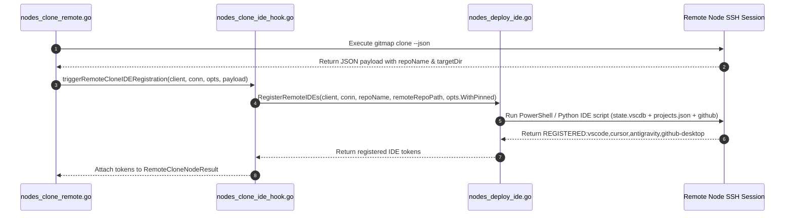

# Subtask 06: Remote Node Clone IDE & GitHub Desktop Registration

## Status: READY
- **Parent Plan**: `.ai-memory/plans/gitmap-enhancement-and-issue-resolution.md`
- **Specification Reference**: `02-spec/21-app/gitmap-enhancement-and-issue-resolution/03-migration-and-verification-spec.md`
- **Target Subsystem**: `cli/cmdnodes`
- **Owned Files**:
  - `cli/cmdnodes/nodes_clone_remote.go`
  - `cli/cmdnodes/nodes_deploy_ide.go`
  - `cli/cmdnodes/nodes_clone_ide_hook.go` (new helper file)
  - `cli/cmdnodes/nodes_clone_ide_hook_test.go` (new unit test file)
  - `cli/cmdnodes/nodes_deploy_ide_test.go` (extended test file)

---

## 1. Context & Objectives

When a user executes `gitmap nodes clone <repo>` across the SSH node fleet:
1. The remote worker executes `gitmap clone` successfully and places the repository on disk.
2. Currently, `cli/cmdnodes/nodes_clone_remote.go` finishes execution without registering the newly cloned repository with remote IDE configurations.
3. On the local machine, `gitmap clone` registers with GitHub Desktop and IDEs, but remote hosts miss:
   - GitHub Desktop repository registration (`github <repoPath>`).
   - VS Code native SQLite recent workspaces (`state.vscdb` -> `ItemTable` -> `history.recentlyOpenedPathsList`).
   - Cursor native SQLite recent workspaces (`state.vscdb`).
   - Project Manager extension (`projects.json`).
   - Antigravity project descriptors (`.gemini/config/projects/<uuid>.json`).

### Core Objectives
1. Connect `RegisterRemoteIDEs` into `cli/cmdnodes/nodes_clone_remote.go` via a decoupled hook helper `nodes_clone_ide_hook.go`.
2. Enhance `RegisterRemoteIDEs` in `cli/cmdnodes/nodes_deploy_ide.go` to update native VS Code and Cursor `state.vscdb` SQLite databases on both Windows and Linux.
3. Verify that GitHub Desktop registration is triggered on the remote machine.
4. Ensure non-blocking failure isolation: any IDE registration issue must log a warning and not fail a successful clone.
5. Strict adherence to GitMap coding guidelines: functions `<= 15` lines (`<= 8` lines preferred), zero nested `if` statements, positive booleans (`is*`, `has*`), and relative paths only.

---

## 2. Technical Architecture & Data Flow



---

## 3. Step-by-Step Implementation Plan

### Step 3.1: Enhance `RegisterRemoteIDEs` for VS Code `state.vscdb` (`cli/cmdnodes/nodes_deploy_ide.go`)

1. **Windows Script Update (`windowsIDEScriptBody`)**:
   Add a dedicated PowerShell script block to update VS Code and Cursor `state.vscdb`:
   ```powershell
   $vscStatePaths = @(
     (Join-Path $appdata 'Code\User\globalStorage\state.vscdb'),
     (Join-Path $appdata 'Cursor\User\globalStorage\state.vscdb')
   )
   foreach ($db in $vscStatePaths) {
     if (Test-Path $db) {
       $pyCode = "import sqlite3, json, sys`nconn = sqlite3.connect(sys.argv[1])`nc = conn.cursor()`nc.execute(\"SELECT value FROM ItemTable WHERE key='history.recentlyOpenedPathsList'\")`nrow = c.fetchone()`ndata = json.loads(row[0]) if row else {'entries': []}`nentry = {'folderUri': sys.argv[2], 'label': sys.argv[3]}`nentries = [e for e in data.get('entries', []) if e.get('folderUri') != sys.argv[2]]`nentries.insert(0, entry)`nc.execute(\"INSERT OR REPLACE INTO ItemTable (key, value) VALUES ('history.recentlyOpenedPathsList', ?)\", (json.dumps({'entries': entries}),))`nconn.commit()`nconn.close()"
       try {
         python -c $pyCode $db $fileUri $name 2>$null
       } catch {}
     }
   }
   ```
2. **Linux Script Update (`linuxPythonScriptTemplate`)**:
   Add SQLite `state.vscdb` update inside the existing Python payload in `nodes_deploy_ide.go`:
   ```python
   import sqlite3
   vsc_dbs = [
       os.path.join(home, ".config/Code/User/globalStorage/state.vscdb"),
       os.path.join(home, ".config/Cursor/User/globalStorage/state.vscdb")
   ]
   for vdb in vsc_dbs:
       if os.path.exists(vdb):
           try:
               conn = sqlite3.connect(vdb)
               cur = conn.cursor()
               cur.execute("SELECT value FROM ItemTable WHERE key='history.recentlyOpenedPathsList'")
               row = cur.fetchone()
               data = json.loads(row[0]) if (row and row[0]) else {"entries": []}
               entries = [e for e in data.get("entries", []) if e.get("folderUri") != file_uri]
               entries.insert(0, {"folderUri": file_uri, "label": name})
               cur.execute("INSERT OR REPLACE INTO ItemTable (key, value) VALUES ('history.recentlyOpenedPathsList', ?)", (json.dumps({"entries": entries}),))
               conn.commit()
               conn.close()
           except Exception:
               pass
   ```
3. **Verify Helper Line Lengths**:
   Ensure all Go generator functions in `nodes_deploy_ide.go` stay within the 15-line limit.

---

### Step 3.2: Create IDE Hook Helper (`cli/cmdnodes/nodes_clone_ide_hook.go`)

Create `cli/cmdnodes/nodes_clone_ide_hook.go` with small, single-purpose functions:

1. **Model Extension in `RemoteCloneNodeResult`**:
   Add `RegisteredIDEs []string` field to `RemoteCloneNodeResult` in `nodes_clone_remote.go` or `nodes_clone_types.go`.
2. **Define `triggerRemoteCloneIDERegistration`**:
   ```go
   func triggerRemoteCloneIDERegistration(client *ssh.Client, conn db.SSHConnection, opts NodesCloneOptions, repoName, repoPath string) []string {
       if !opts.HasIDERegistration && !isAutoRegisterEnabled(opts) {
           return nil
       }
       ides, err := RegisterRemoteIDEs(client, conn, repoName, repoPath, opts.WithPinned)
       if err != nil {
           return nil
       }
       return ides
   }
   ```
3. **Define `resolveClonedRepoNameAndPath`**:
   Extract repository name and remote filesystem path from `DirectCloneJSONResponse` or fallback parameters:
   ```go
   func resolveClonedRepoNameAndPath(opts NodesCloneOptions, payload cmdclone.DirectCloneJSONResponse, isWin bool) (string, string) {
       repoName := resolveRepoNameFromArgs(opts.PassArgs)
       targetDir := resolveTargetDirForOS(isWin, opts)
       if payload.Path != "" {
           return filepath.Base(payload.Path), payload.Path
       }
       return repoName, filepath.Join(targetDir, repoName)
   }
   ```
4. **Define `isAutoRegisterEnabled`**:
   ```go
   func isAutoRegisterEnabled(opts NodesCloneOptions) bool {
       return !opts.IsNoIDE
   }
   ```

---

### Step 3.3: Wire Hook into `cli/cmdnodes/nodes_clone_remote.go`

1. In `runRemoteExecOverSSH`:
   After calling `secrets.RunCommand` and obtaining `out`:
   ```go
   if payload, hasJSON := cmdclone.ParseCloneJSONResponse(out); hasJSON && payload.Success {
       repoName, remotePath := resolveClonedRepoNameAndPath(opts, payload, isWin)
       res.RegisteredIDEs = triggerRemoteCloneIDERegistration(client, conn, opts, repoName, remotePath)
   }
   ```
2. In fallback path for legacy responses (`extractLegacyCloneDetails`):
   If `res.Status == "success"`, attempt registration using parsed arguments.
3. Verify that all functions modified in `nodes_clone_remote.go` remain `<= 15` lines with zero nested `if` statements.

---

### Step 3.4: Unit Tests & Verification (`cli/cmdnodes/nodes_clone_ide_hook_test.go`)

1. Test `resolveClonedRepoNameAndPath` with Windows and Unix path layouts.
2. Test `isAutoRegisterEnabled` honoring `--no-ide` flag.
3. Test `triggerRemoteCloneIDERegistration` gracefully handling nil client or SSH errors without crashing.
4. Verify VS Code `state.vscdb` SQL script generation syntax in `nodes_deploy_ide_test.go`.

---

## 4. Acceptance Criteria

- **AC-01:** When `gitmap nodes clone` executes successfully on a remote Windows node, `RegisterRemoteIDEs` is called with the remote repository path.
- **AC-02:** VS Code `state.vscdb` on the remote node contains the cloned repository folder URI in `history.recentlyOpenedPathsList`.
- **AC-03:** GitHub Desktop registration (`github <repoPath>`) is triggered on the remote machine.
- **AC-04:** If IDE registration fails on the remote host, the clone status remains `success` and the error is logged non-destructively.
- **AC-05:** All modified and newly authored Go functions conform to `<= 15` lines, positive booleans (`is*`, `has*`), and relative paths only.
