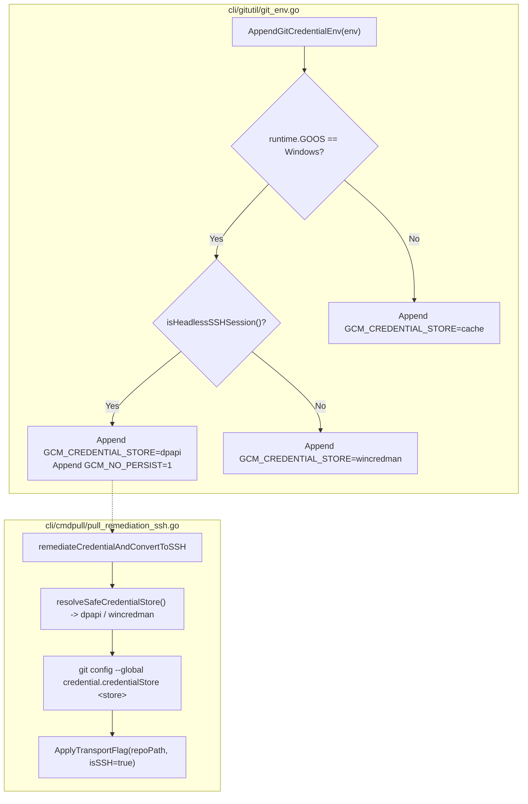

# Subtask 07: Headless OpenSSH WinCredMan Session Resolution & Credential Remediation

## Status: READY
- **Parent Plan**: `.ai-memory/plans/gitmap-enhancement-and-issue-resolution.md`
- **Specification Reference**: `02-spec/21-app/gitmap-enhancement-and-issue-resolution/03-migration-and-verification-spec.md`
- **Target Subsystem**: `cli/gitutil`, `cli/cmdfixauth`, `cli/cmdpull`
- **Owned Files**:
  - `cli/gitutil/git_env.go`
  - `cli/gitutil/git_env_ssh.go` (new helper file)
  - `cli/gitutil/git_env_test.go` (extended unit test)
  - `cli/cmdfixauth/fixcredential.go`
  - `cli/cmdfixauth/fixcredential_test.go` (new unit test)
  - `cli/cmdpull/pull_remediation_ssh.go`
  - `cli/cmdpull/pull_remediation_ssh_test.go` (extended unit test)

---

## 1. Context & Objectives

During multi-node operations (`gitmap pa --ssh` and remote SSH workers), remote Windows machines running under OpenSSH Server (`sshd.exe`) operate as non-interactive Network Logons (Logon Type 3). In this headless environment:
1. Windows blocks calls to Windows Credential Manager (`wincredman`) APIs (`CredWriteW` / `CredReadW`).
2. Git Credential Manager aborts with:
   ```text
   fatal: credential-manager-core: wincredman failed to persist credentials
   error: exit status 128
   ```
3. In `cli/gitutil/git_env.go:21`, GitMap hardcodes `GCM_CREDENTIAL_STORE=wincredman` on Windows, causing headless Git pull and clone commands to fail.
4. Furthermore, `cli/cmdfixauth/fixcredential.go` and `cli/cmdpull/pull_remediation_ssh.go` force `wincredman` into the global Git config without checking for headless SSH sessions.

### Core Objectives
1. Implement headless SSH session detection (`isHeadlessSSHSession() bool`) in `cli/gitutil/git_env_ssh.go`.
2. Refactor `AppendGitCredentialEnv` in `cli/gitutil/git_env.go` to switch to `GCM_CREDENTIAL_STORE=dpapi` and `GCM_NO_PERSIST=1` when executing in headless SSH sessions on Windows.
3. Update `cli/cmdfixauth/fixcredential.go` to detect headless SSH sessions, default to `dpapi`, and support explicit `--dpapi` or `--wincredman` flags.
4. Update `cli/cmdpull/pull_remediation_ssh.go` to use `dpapi` for headless SSH remediation and prioritize converting repositories to SSH transport (`git@github.com:...`).
5. Guarantee 100% compliance with GitMap coding standards: all functions `<= 15` lines (`<= 8` lines preferred), zero nested `if` statements, positive booleans (`is*`, `has*`), and relative paths only.

---

## 2. Technical Architecture & State Transition



---

## 3. Step-by-Step Implementation Plan

### Step 3.1: Implement Headless SSH Detection (`cli/gitutil/git_env_ssh.go`)

Create `cli/gitutil/git_env_ssh.go` with concise helper functions `<= 15` lines:

1. **Implement `isHeadlessSSHSession`**:
   ```go
   func isHeadlessSSHSession() bool {
       if os.Getenv("GITMAP_HEADLESS_SSH") == "1" {
           return true
       }
       if hasSSHSessionEnv() {
           return true
       }
       return false
   }
   ```
2. **Implement `hasSSHSessionEnv`**:
   ```go
   func hasSSHSessionEnv() bool {
       if os.Getenv("SSH_CONNECTION") != "" || os.Getenv("SSH_CLIENT") != "" {
           return true
       }
       return os.Getenv("SSH_TTY") != ""
   }
   ```
3. **Implement `resolveWindowsCredentialStore`**:
   ```go
   func resolveWindowsCredentialStore() string {
       if isHeadlessSSHSession() {
           return "dpapi"
       }
       return "wincredman"
   }
   ```

---

### Step 3.2: Refactor `cli/gitutil/git_env.go`

Update `AppendGitCredentialEnv` in `cli/gitutil/git_env.go`:

1. **Refactor Function**:
   ```go
   func AppendGitCredentialEnv(env []string) []string {
       if runtime.GOOS != constants.PlatformWindows {
           return append(env, "GCM_CREDENTIAL_STORE=cache")
       }
       if isHeadlessSSHSession() {
           return append(env, "GCM_CREDENTIAL_STORE=dpapi", "GCM_NO_PERSIST=1")
       }
       return append(env, "GCM_CREDENTIAL_STORE=wincredman")
   }
   ```
2. **Preserve Subprocess Purity**:
   `BuildSafeGitEnvWithBase` automatically receives the sanitized environment with zero caller changes required.

---

### Step 3.3: Update `cli/cmdfixauth/fixcredential.go`

1. **Detect Store Type from Environment & Flags**:
   Decompose `RunFixCredential` into focused helpers:
   ```go
   func resolveTargetCredentialStore(args []string) string {
       for _, arg := range args {
           if arg == "--dpapi" {
               return "dpapi"
           }
           if arg == "--wincredman" {
               return "wincredman"
           }
       }
       return resolveWindowsCredentialStore()
   }
   ```
2. **Execute Git Config Updates**:
   - Helper 1: `unsetLegacyCacheHelper() error`
   - Helper 2: `setCredentialManagerHelper() error`
   - Helper 3: `setCredentialStoreType(storeType string) error`
3. **Check Function Line Limits**:
   Each helper is <= 8 lines, and `RunFixCredential` coordinates them in <= 15 lines.

---

### Step 3.4: Update `cli/cmdpull/pull_remediation_ssh.go`

1. **Refactor `remediateCredentialAndConvertToSSH`**:
   ```go
   func remediateCredentialAndConvertToSSH(repoPath, repoName string) {
       storeType := resolveWindowsCredentialStore()
       _ = exec.Command("git", "config", "--global", "credential.helper", "manager").Run()
       _ = exec.Command("git", "config", "--global", "credential.credentialStore", storeType).Run()

       changed, oldURL, newURL, err := ApplyTransportFlag(repoPath, true, false)
       if err == nil && changed {
           fmt.Printf("    %s Converted remote to SSH: %s -> %s\n", constants.TreeBranch, oldURL, newURL)
           updateRepoTransportInDB(repoPath, newURL)
       }
   }
   ```
2. **Ensure Non-Nested Conditionals**:
   Guard clauses isolate database updates and log outputs cleanly.

---

### Step 3.5: Comprehensive Unit Testing

1. **`cli/gitutil/git_env_test.go`**:
   - `TestHeadlessSSHDetection`: Set `SSH_CONNECTION` and verify `isHeadlessSSHSession()` is true.
   - `TestAppendGitCredentialEnv_Windows_Interactive`: Verify `GCM_CREDENTIAL_STORE=wincredman` when SSH vars are clear.
   - `TestAppendGitCredentialEnv_Windows_HeadlessSSH`: Verify `GCM_CREDENTIAL_STORE=dpapi` and `GCM_NO_PERSIST=1` when SSH vars are set.
2. **`cli/cmdfixauth/fixcredential_test.go`**:
   - `TestResolveTargetCredentialStore`: Verify CLI flags `--dpapi` and `--wincredman` override default environment detection.
3. **`cli/cmdpull/pull_remediation_ssh_test.go`**:
   - Verify `remediateCredentialAndConvertToSSH` selects `dpapi` in simulated SSH session.

---

## 4. Acceptance Criteria

- **AC-01:** On Windows, when `SSH_CONNECTION`, `SSH_CLIENT`, or `GITMAP_HEADLESS_SSH=1` is set, `AppendGitCredentialEnv` appends `GCM_CREDENTIAL_STORE=dpapi` and `GCM_NO_PERSIST=1`.
- **AC-02:** When running outside SSH on Windows (interactive console), `AppendGitCredentialEnv` retains `GCM_CREDENTIAL_STORE=wincredman` for native user session compatibility.
- **AC-03:** `gitmap fix-credential` detects headless SSH sessions and sets `credential.credentialStore` to `dpapi` unless overridden by explicit flags.
- **AC-04:** `remediateCredentialAndConvertToSSH` no longer forces `wincredman` in headless SSH sessions, preventing persistent pull error exit code 128.
- **AC-05:** All modified functions conform to `<= 15` lines, zero nested `if` statements, positive booleans (`is*`, `has*`), and relative paths only.
