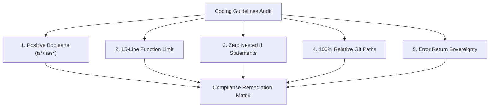

# Subtask-07: Readme Text Timestamp Ban & Coding Guidelines Audit

- **Subtask Path:** `.ai-memory/plans/subtasks/gitmap-enhancement-and-issue-resolution/07-subtask-readme-text-ban-and-guidelines-audit.md`
- **Parent Plan:** [.ai-memory/plans/gitmap-enhancement-and-issue-resolution.md](../../gitmap-enhancement-and-issue-resolution.md)
- **Primary Owner:** Worker 03
- **Scope:** Repository-wide documentation, memory files, specifications, skills, and modified source packages
- **Exclusive File Ownership:**
  - `.ai-memory/strictly-avoid.md`
  - `02-spec/01-spec-authoring-guide/11-exceptions.md`
  - `02-spec/17-consolidated-guidelines/03-strictly-avoid-quickref.md`
  - `.ai-memory/memory/00-project-governance-and-invariants.md`
  - Verification reports in `.ai-memory/reports/`
- **Status:** Pending Execution
- **Target Release:** GitMap v6.590.0

---

## 1. Context & Rationale

The user issued an explicit, non-negotiable instruction:
> "Never use or add the README.text for adding the timestamp. If that memory exists, correct it everywhere, not only in GitMap but also in the coding guideline. Make sure README text never exists. Find out how many places the code is not following the coding guideline."

Past runs of autonomous agents periodically hallucinated generating `readme.text` (or `readme.txt`) containing dynamic date/time strings (e.g. Asia/Kuala_Lumpur or UTC timestamps) or proposed scripts like `refresh-readme.ps1` to touch readme files. While `.ai-memory/strictly-avoid.md` banned `readme.txt` timestamps, it did not explicitly name `readme.text` or address legacy prompts that might invent alternate extensions.

Furthermore, a comprehensive coding guidelines audit must be performed across modified and critical packages to identify any lingering violations of GitMap's core architectural tenets (positive booleans, 15-line limit, zero nested ifs, relative paths, error return sovereignty).

---

## 2. Universal Ban on `readme.text` & Timestamp Generation

### Invariant Definition
1. **Total Prohibition of `readme.text`:** The filename `readme.text` (any casing: `README.TEXT`, `Readme.text`, `README.TXT`) is strictly prohibited. Documentation files must only use `readme.md`.
2. **Absolute Ban on Timestamp Injection:** No script, command, hook, automation, or skill may ever write, append, suggest, or format timestamps, dates, or clocks into any `readme.*` file.
3. **Single Source of Truth:**
   - Update `.ai-memory/strictly-avoid.md` section on readme timestamp generation to explicitly prohibit both `readme.text` and `readme.txt`.
   - Update `02-spec/01-spec-authoring-guide/11-exceptions.md` § Sequence 01 to include `readme.text`.
   - Update `02-spec/17-consolidated-guidelines/03-strictly-avoid-quickref.md` Item 01.
   - Update `.ai-memory/memory/00-project-governance-and-invariants.md`.

---

## 3. Repository Coding Guidelines Audit Protocol

The audit evaluates the repository against 5 strict quality pillars:



### Pillar 1: Positive Boolean Naming
- **Rule:** Booleans must begin with `is` or `has` exclusively.
- **Banned:** `can`, `should`, `was`, `will`, `did`, `allow`, and negative prefixes (`not`, `non`, `no`).
- **Audit Method:** Regex scan across function parameters, struct field definitions, and local variable declarations:
  ```regex
  \b(can[A-Z]\w*|should[A-Z]\w*|was[A-Z]\w*|will[A-Z]\w*|isNot[A-Z]\w*|hasNo[A-Z]\w*)\b
  ```

### Pillar 2: 15-Line Function Length Limit
- **Rule:** Functions `<= 8` lines preferred, `<= 15` lines max.
- **Audit Method:** Line-counting inspection across modified packages (`cli/cmddb`, `cli/cmdnodes`, `cli/cmdos`, `cli/cmdfix`, `cli/gitutil`). Functions exceeding 15 lines must be broken into single-responsibility helpers.

### Pillar 3: Zero Nested Ifs
- **Rule:** Conditionals must use guard clauses and early returns. No `if` block may be nested inside another `if` block.
- **Audit Method:** Indentation and AST check for nested `if` statements.

### Pillar 4: Strictly Relative Paths
- **Rule:** Total ban on `C:\`, `D:\`, `/home/`, `file:///` in source code (except cross-platform OS target drive checks in `nodes_deploy_ide.go` which must be wrapped in platform resolvers).
- **Audit Method:** Pattern search for drive letters and URI schemes in Markdown specs, plans, and output formatters.

### Pillar 5: Error Return Sovereignty
- **Rule:** Leaf functions returning `error` must return the error directly and never call `cliexit.HandleError` or `os.Exit`.
- **Audit Method:** Search for `cliexit` and `os.Exit` outside of root command dispatchers.

---

## 4. Detailed Step-by-Step Action Items

- [ ] **Step 4.1:** Search the entire repository using `gitmap aum search` for all occurrences of `readme.text` and `readme.txt`.
- [ ] **Step 4.2:** Update `.ai-memory/strictly-avoid.md` to broaden the rule to: `## readme.text and readme.txt timestamp generator — TOTAL BAN`.
- [ ] **Step 4.3:** Update `02-spec/01-spec-authoring-guide/11-exceptions.md` and `02-spec/17-consolidated-guidelines/03-strictly-avoid-quickref.md` with explicit `readme.text` prohibition language.
- [ ] **Step 4.4:** Audit all modified Go packages (`cli/cmddb/`, `cli/cmdnodes/`, `cli/cmdos/`, `cli/cmdfix/`, `cli/gitutil/`) for:
  - Boolean names (`is*`/`has*` only)
  - Function line lengths (`<= 15` lines)
  - Flattened guard clauses (zero nested `if`s)
  - Relative file path compliance
  - Error return sovereignty
- [ ] **Step 4.5:** Produce a consolidated audit scorecard in `02-spec/21-app/gitmap-enhancement-and-issue-resolution/99-consistency-report.md`.
- [ ] **Step 4.6:** Validate that zero new files violate any GitMap architectural rules.

---

## 5. Acceptance Criteria & Verification

1. **AC-7.1:** `gitmap aum search "readme.text"` yields zero positive usages or suggestions in instructions or skills (only prohibition rules in `strictly-avoid.md` and specs).
2. **AC-7.2:** All boolean fields and parameters across newly written files strictly begin with `is` or `has`.
3. **AC-7.3:** 100% of functions in newly created Go files are `<= 15` lines in length.
4. **AC-7.4:** Zero absolute paths appear in any newly created Markdown specification or plan.
5. **Verification Command:**
   ```bash
   gitmap aum search "readme.text"
   ```
