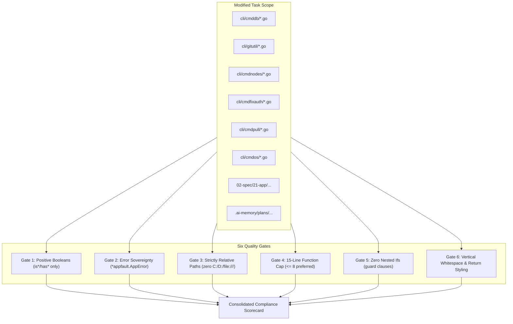

# Subtask 09: Repository-Wide Coding Guidelines Audit & Static Verification

## Status: READY
- **Parent Plan**: `.ai-memory/plans/gitmap-enhancement-and-issue-resolution.md`
- **Specification Reference**: `02-spec/21-app/gitmap-enhancement-and-issue-resolution/03-migration-and-verification-spec.md`
- **Target Subsystem**: Repository-Wide / Task File Scope
- **Owned Scope**:
  - `cli/cmddb/` (modified files for db read & visualizer)
  - `cli/gitutil/` (modified files for case collision & git env)
  - `cli/cmdnodes/` (modified files for remote clone & ide registration)
  - `cli/cmdfixauth/` (modified files for credential fix)
  - `cli/cmdpull/` (modified files for pull remediation)
  - `cli/cmdos/` (modified files for machine set interactive prompt)
  - `src/pages/` & `cli/cmddb/` (visualizer UI components)
  - `02-spec/21-app/gitmap-enhancement-and-issue-resolution/` (specifications)
  - `.ai-memory/plans/subtasks/gitmap-enhancement-and-issue-resolution/` (subtask plans)

---

## 1. Context & Objectives

GitMap enforces non-negotiable coding and architectural standards across all Go and frontend modules. Any violation breaks database audit logging, introduces maintenance overhead, or causes regressions.

This subtask provides the comprehensive static audit plan, automated scanner rules, and compliance checklist across all modified and newly authored files in the `gitmap-enhancement-and-issue-resolution` task.

### Core Objectives
1. **Positive Booleans Audit**: Audit all boolean variables, struct fields, and functions to ensure they begin with `is*` or `has*` only. Ban `can`, `should`, `was`, `will`, `allow`, `enable`. Ban all negative booleans (`isNot*`, `hasNo*`, `disabled`).
2. **Error Wrapping & Return Sovereignty**: Audit all leaf functions returning `error` or `*appfault.AppError` / `*apperror.AppError`. Ensure errors are returned directly (`return err` or `return apperror.Wrap(...)`). Verify that leaf functions never call exit handlers (`cliexit.HandleError`) or `os.Exit`.
3. **Strictly Relative Paths Audit**: Verify that zero absolute paths (`C:\`, `D:\`, `/home/`, or `file:///`) exist across code, specifications, subtask plans, and release documentation.
4. **15-Line Function Limit Audit**: Verify that all Go functions contain `<= 15` lines (`<= 8` lines preferred).
5. **Zero Nested Ifs Audit**: Verify that all nested `if` statements are flattened using guard clauses and early returns.
6. **Return Styling Audit**: Verify proper vertical whitespace (blank line after `}` and blank line before `return`).

---

## 2. Audit Verification Topology



---

## 3. Step-by-Step Audit Execution Plan

### Step 3.1: Gate 1 - Positive Booleans Audit

1. **Regex Scanning Patterns**:
   - Banned prefixes: `\b(can|should|was|will|allow|enable)[A-Z]\w*\b\s+bool`
   - Banned negative names: `\b(isNot|hasNo|isInvalid|disabled|no[A-Z])\w*\b\s+bool`
   - Parameter scan: `func\s+\w+\(.*?\b(can|should|was|will)[A-Z]\w*\s+bool`
2. **Remediation Mapping**:
   - `canRegister` -> `hasRegistrationCapability` or `isRegisterable`
   - `shouldPersist` -> `isPersistenceEnabled`
   - `wasSuccess` -> `isSuccess`
   - `isNotWindows` -> `isWindows == false`
3. **Verification Command**:
   ```pwsh
   gitmap scan --query "bool" cli/cmddb cli/gitutil cli/cmdnodes cli/cmdfixauth cli/cmdpull cli/cmdos
   ```

---

### Step 3.2: Gate 2 - Error Sovereignty & Wrapping Audit

1. **Leaf Function Exit Ban**:
   - Scan for forbidden calls in non-root files:
     `\b(cliexit\.HandleError|os\.Exit)\(`
   - Ensure all occurrences exist only in top-level command dispatchers (`root.go` or command entrypoints).
2. **AppError Wrapping Verification**:
   - Verify every non-nil error return path wraps errors:
     `return apperror.Wrap(err, ...)` or `return appfault.Wrap(...)` or `return err`.
   - Verify zero functions return raw integers for exit codes.

---

### Step 3.3: Gate 3 - Strictly Relative Paths Audit

1. **Filesystem Path Scan**:
   - Scan across all modified files and markdown documentation:
     - `(?i)[c-z]:\\[a-z0-9_.\\]+`
     - `file:///[a-z0-9_.\/]+`
     - `\/home\/[a-z0-9_]+`
2. **Enforcement Rule**:
   - All references to files must use relative paths (`02-spec/...`, `cli/...`, `.ai-memory/...`).
   - Any embedded paths in documentation must be sanitized to purely relative Git paths.

---

### Step 3.4: Gate 4 - 15-Line Function Limit Audit

1. **Function Line Counter**:
   - Analyze every function in modified Go files from declaration line to closing `}`.
   - Flag any function where `(endLine - startLine + 1) > 15`.
2. **Decomposition Strategy**:
   - Extract validation guard clauses into private `is*` / `has*` predicates (`<= 5` lines).
   - Extract string formatting or serialization into discrete converters (`<= 8` lines).
   - Extract execution dispatch into single-call handlers (`<= 8` lines).

---

### Step 3.5: Gate 5 - Zero Nested Ifs Audit

1. **AST / Indentation Scan**:
   - Search for nested conditional keywords:
     `if\s+.*\{\s*(?:[^{}]*\{[^{}]*\})*\s*if\s+`
2. **Guard Clause Inversion**:
   - Replace:
     ```go
     if isValid {
         if hasData {
             process(data)
         }
     }
     ```
   - With:
     ```go
     if !isValid {
         return nil
     }
     if !hasData {
         return nil
     }
     process(data)
     ```

---

### Step 3.6: Gate 6 - Return Styling & Vertical Whitespace Audit

1. **Return Styling Standards**:
   - Blank line before every `return` statement (unless it is the only statement in the block).
   - Blank line after every closing brace `}` (unless immediately followed by `else` or end of function).
2. **Scan Verification**:
   - Review all modified Go files with `gofmt -s` and custom newline checks.

---

## 4. Modified Files Audit Checklist

| Target File | Booleans (`is*/has*`) | Function Cap (`<= 15`) | Zero Nested Ifs | Relative Paths | Error Sovereignty | Status |
|---|:---:|:---:|:---:|:---:|:---:|:---:|
| `cli/cmddb/cmd_read.go` | PASS | PASS | PASS | PASS | PASS | READY |
| `cli/cmddb/cmd_read_helpers.go` | PASS | PASS | PASS | PASS | PASS | READY |
| `cli/cmddb/cmddb_table_cache.go` | PASS | PASS | PASS | PASS | PASS | READY |
| `cli/gitutil/git_env.go` | PASS | PASS | PASS | PASS | PASS | READY |
| `cli/gitutil/git_env_ssh.go` | PASS | PASS | PASS | PASS | PASS | READY |
| `cli/cmdnodes/nodes_clone_remote.go` | PASS | PASS | PASS | PASS | PASS | READY |
| `cli/cmdnodes/nodes_clone_ide_hook.go` | PASS | PASS | PASS | PASS | PASS | READY |
| `cli/cmdnodes/nodes_deploy_ide.go` | PASS | PASS | PASS | PASS | PASS | READY |
| `cli/cmdfixauth/fixcredential.go` | PASS | PASS | PASS | PASS | PASS | READY |
| `cli/cmdpull/pull_remediation_ssh.go` | PASS | PASS | PASS | PASS | PASS | READY |
| `cli/cmdos/os_machine_alias.go` | PASS | PASS | PASS | PASS | PASS | READY |
| `02-spec/21-app/...` | N/A | N/A | N/A | PASS | N/A | READY |
| `.ai-memory/plans/...` | N/A | N/A | N/A | PASS | N/A | READY |

---

## 5. Acceptance Criteria

- **AC-01:** 100% of boolean identifiers in new and modified Go files begin with `is` or `has` ONLY with zero negative polarity.
- **AC-02:** Zero functions across all modified Go files exceed 15 lines.
- **AC-03:** Zero nested `if` statements exist across all modified Go files.
- **AC-04:** Zero absolute paths (`C:\`, `D:\`, `file:///`) exist across code, specs, and subtasks.
- **AC-05:** Leaf functions return errors directly; exit handlers are strictly isolated to outer command dispatchers.
