# Subtasks 04 & 05: Repository Creation Automation, Canonical Folder Scaffolding & Multi-IDE Registration

> **Document ID:** `.ai-memory/plans/subtasks/repository-creation-and-folder-structure-instructions/03-repo-creation-and-ide-registration.md`  
> **Parent Plan:** `.ai-memory/plans/repository-creation-and-folder-structure-instructions.md`  
> **Architecture Spec:** `02-spec/21-app/repository-creation-and-folder-structure-instructions/02-ide-ecosystem-and-execution-spec.md`  
> **Target Subsystems:** `cli/workspacesync`, `cli/cmdvscode`, `cli/vscodepm`, `cli/cmdcursor`, `cli/cmddesktopsync`, `cli/desktop`, `cli/cmdinstall`  
> **Subtasks Covered:** Task-04 & Task-05  
> **Status:** PENDING  

---

## 1. Task-04: Repository Creation Automation, Git Initialization & Canonical Folder Scaffolding

### 1.1 Objective & Scope
Automate the end-to-end creation, initialization, and scaffolding of new repositories according to the authoritative standards defined in `.ai-memory/folder-structure.md` and `01-prompts/00-folder-structure/01-canonical-folder-structure.md`. Ensure that every new workspace begins with a fully initialized Git repository on branch `main`, an immutable canonical directory hierarchy, core governance files, and automatic linkage to workspace companion repositories (`repo-secrets` and `repo-cache`).

### 1.2 Detailed Implementation Steps

#### Step 4.1: Git Repository Initialization & Branch Enforcement
1. **Initialize Git Tracking:** Execute `git init -b main <target-dir>`. If running on older Git versions where `-b` is unrecognised, execute `git init <target-dir>` followed by `git checkout -b main`.
2. **Standard `.gitignore` Generation:** Scaffold standard root `.gitignore` preventing accidental commits of temporary binaries, split SQLite databases, and OS caches:
   ```text
   # Binaries & build artifacts
   bin/
   dist/
   *.exe
   *.dll
   *.so
   *.dylib

   # Operating system & editor caches
   .DS_Store
   Thumbs.db
   .vscode/*
   !.vscode/settings.json
   !.vscode/extensions.json
   .cursor/
   .idea/

   # Ephemeral agent caches & databases
   .ai-memory/temp-agents/
   *.db-wal
   *.db-shm
   ```

#### Step 4.2: Root Governance Files Scaffolding
Create the mandatory top-level root files with standardized templates:
- **`readme.md`:** Repository title, mission overview, quickstart instructions, and navigation router.
- **`changelog.md`:** Standard Keep-a-Changelog structure initialized with `[Unreleased]` and `[0.1.0]`.
- **`version.json`:** Structured machine-readable version manifest:
  ```json
  {
    "version": "0.1.0",
    "releaseDate": "2026-10-11",
    "isPrerelease": false
  }
  ```
- **Execution Runners (`run.ps1` and `run.sh`):** Cross-platform script drivers reading `run.config.json` with pre-flight dependency validation.

#### Step 4.3: Canonical Layered Specification Hierarchy (`02-spec/`)
Scaffold standard layered specification folders:
- `02-spec/01-spec-authoring-guide/`: Guidelines for authoring and maintaining specs.
- `02-spec/02-coding-guidelines/`: Language-specific coding rules, sizing rules, and positive booleans.
- `02-spec/03-error-manage/`: Structured error management and appfault envelopes.
- `02-spec/21-app/`: Business specifications, schemas, and domain component models.

#### Step 4.4: Cognitive Memory Hierarchy Scaffolding (`.ai-memory/`)
Scaffold the complete `.ai-memory/` taxonomy adhering strictly to singular/plural naming conventions:
```text
.ai-memory/
├── readme.md                        # Master repository index & agent router
├── folder-structure.md              # Authoritative mirror of canonical layout
├── 03-strictly-avoid.md             # Universal prohibitions & CODE RED constraints
├── 04-suggestions.md                # Architectural backlog
├── 05-plan.md                       # Active milestone tracker
├── 06-what-to-read.md               # Entrypoint priority list
├── plans/                           # Execution plans (PLURAL)
│   ├── readme.md
│   ├── pending/
│   ├── subtasks/
│   └── completed/
├── memory/                          # Institutional cognitive memory (SINGULAR)
│   ├── readme.md
│   ├── architecture/
│   ├── constraints/
│   ├── features/
│   ├── issues/
│   └── standards/
└── question-and-ambiguity/          # Ambiguity logs and counter
    ├── readme.md
    └── task-counter.md
```

#### Step 4.5: Companion Repository Linkage (`repo-secrets` & `repo-cache`)
Establish automatic linking and configuration for companion workspaces:
- Verify accessibility of `repo-secrets` (`rs`) in workspace root for zero-secret Git safety.
- Verify accessibility of `repo-cache` (`rc`) for reusable diagnostic scripts and test runners.

### 1.3 Task-04 Acceptance Criteria & Verification Matrix

| Verification ID | Check Description | Verification Command | Expected Outcome |
|---|---|---|---|
| **V-04-01** | Git Initialization | `git -C <new-repo> branch --show-current` | Returns `main` with exit code 0. |
| **V-04-02** | Root Files Existence | Test files exist: `readme.md`, `changelog.md`, `version.json`, `.gitignore` | All 4 files present with non-zero size. |
| **V-04-03** | Spec Directory Layout | Verify `02-spec/01-spec-authoring-guide/` through `02-spec/21-app/` | Layered folders exist with lowercase naming. |
| **V-04-04** | AI Memory Layout | Verify `.ai-memory/plans/` and `.ai-memory/memory/` | Strict plural/singular convention satisfied. |
| **V-04-05** | Monotonic Prefix Rule | Inspect directory listings in `.ai-memory/` and `02-spec/` | Zero unpadded numbers; all use monotonic `XX-`. |

---

## 2. Task-05: Multi-IDE Ecosystem Registration & Fallback Tool Installation Engine

### 2.1 Objective & Scope
Orchestrate simultaneous, automated registration of target repositories across all four primary developer IDEs—**Visual Studio Code**, **Google Antigravity**, **Cursor IDE**, and **GitHub Desktop**—while providing deterministic, self-healing fallback installations for any tool missing on the workstation.

### 2.2 Detailed Implementation Steps

#### Step 5.1: Multi-IDE Registration Pipeline (`workspacesync.SyncAll`)
1. **VS Code Project Manager Registration:**
   - Call `vscodepm.SyncMode` with `MergeModeUnion`.
   - Update `projects.json` in user global storage with repo name, relative root path, and affirmative tags (`["gitmap", "<detected-language>"]`).
2. **Google Antigravity Registration:**
   - Scan `~/.gemini/config/projects/*.json` for matching folder path.
   - If missing, allocate UUIDv4 and write `<uuid>.json` with `executionMode: "TURBO"` and `unattendedExecution: true`.
3. **Cursor IDE Registration:**
   - Update Cursor's `projects.json` in Cursor global storage.
   - Mirror tags and workspace bookmarks for developer continuity.
4. **GitHub Desktop Registration:**
   - Probe executable via `desktop.ResolveCLI()`.
   - Execute `github <repo-relative-path>` to add the repository into the visual desktop client.
   - Guard against `GITMAP_NO_DESKTOP=1` and `GITMAP_SKIP_DESKTOP=1`.
5. **Unified Status Line Rendering:**
   - Output consolidated ANSI block:
     ```text
       → sync: [vsc: ok] [desktop: ok] [agy: ok] [cursor: ok]
     ```

#### Step 5.2: Sub-Point 3 Fallback Tool Installation Engine
When a pre-flight probe reports a missing tool (`isInstalled == false`), GitMap executes or displays the deterministic fallback command sequence:

1. **Visual Studio Code Fallback:**
   - **Primary:** `gitmap install vscode`
   - **Fallback:** `winget install Microsoft.VisualStudioCode --force --accept-source-agreements --accept-package-agreements`
   - **Settings Sync:** `gitmap install vscode-settings` (hydrates bundled configs).
2. **Google Antigravity Fallback:**
   - **Primary:** `gitmap install antigravity`
   - **Fallback Script:** `install.ps1 --tool antigravity` (or `tools/install-antigravity.ps1`)
   - **Silent NSIS Execution:** Launches installer with `/S` and `/D=<installDir>`.
3. **Cursor IDE Fallback:**
   - **Primary:** `gitmap cursor install`
   - **Fallback:** `winget install Anysphere.Cursor --silent --accept-source-agreements --accept-package-agreements`
   - **Linux Provisioner:** `python3 repo-secrets/05-scripts/setup-cursor-ubuntu.py`
4. **GitHub Desktop Fallback:**
   - **Primary:** `gitmap gd --install` or `gitmap install github-desktop`
   - **Fallback:** `winget install GitHub.GitHubDesktop --force --accept-source-agreements --accept-package-agreements`

#### Step 5.3: Graceful Degradation & Non-Blocking Resilience
- Individual IDE registration failures or missing binaries MUST NOT abort repository creation.
- If a binary is missing, report `[tool: skipped]`, output the corresponding fallback command, and continue gracefully with the remaining IDE targets.

### 2.3 Task-05 Acceptance Criteria & Verification Matrix

| Verification ID | Check Description | Verification Command | Expected Outcome |
|---|---|---|---|
| **V-05-01** | VS Code Registration | `gitmap vscode sync` | `projects.json` records target workspace under Project Manager. |
| **V-05-02** | Antigravity Registration | `gitmap agy projects ls` | Project registered under `~/.gemini/config/projects/` with `executionMode: TURBO`. |
| **V-05-03** | Cursor Registration | `gitmap cursor sync` | Cursor Project Manager descriptor contains workspace relative path. |
| **V-05-04** | GitHub Desktop Registration | `gitmap gd` | Repository registered in GitHub Desktop with exit code 0. |
| **V-05-05** | VS Code Fallback Test | `gitmap install vscode --dry-run` | Emits `winget install Microsoft.VisualStudioCode` command. |
| **V-05-06** | Antigravity Fallback Test | `gitmap install antigravity --dry-run` | Emits NSIS `/S` installer command with target directory. |
| **V-05-07** | Cursor Fallback Test | `gitmap cursor install --dry-run` | Emits `winget install Anysphere.Cursor` command. |
| **V-05-08** | GitHub Desktop Fallback Test | `gitmap gd --install --dry-run` | Emits `winget install GitHub.GitHubDesktop` command. |
| **V-05-09** | Resilient Multi-IDE Sync | `go test -v ./cli/workspacesync/...` | 100% test pass; missing tools return `skipped` without panic. |

---

## 3. Implementation Dependency & Execution Order

```mermaid
flowchart LR
    T4_GIT["Task-04.1\nGit Init on main"] --> T4_FILES["Task-04.2\nRoot Governance Files"]
    T4_FILES --> T4_SPEC["Task-04.3\n02-spec/ Layering"]
    T4_SPEC --> T4_MEMORY["Task-04.4\n.ai-memory/ Hierarchy"]
    T4_MEMORY --> T4_COMPANION["Task-04.5\nrs & rc Linkage"]
    T4_COMPANION --> T5_PROBE["Task-05.1\nIDE Capability Probing"]
    T5_PROBE --> T5_SYNC["Task-05.2\nMulti-IDE Registration"]
    T5_SYNC --> T5_FALLBACK["Task-05.3\nFallback Installation Engine"]
```


