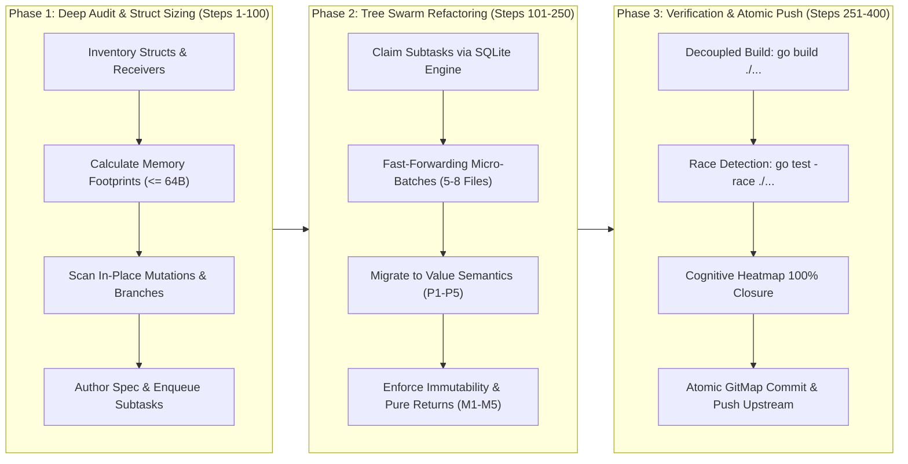

# Skill: Golang Pointers Reduction & Mutation Reduction (cg-golang-pointers-and-mutation-reduction)

> [!IMPORTANT]
> **Skill Identifier:** `.cursor/skills/cg-golang-pointers-and-mutation-reduction/skill.md`  
> **Master Prompt:** `01-prompts/15-cg-execute/39-golang-pointers-and-mutation-reduction.md`  
> **Specification Reference:** `02-spec/21-app/06-cg-execute-golang-pointers-and-mutation-reduce/02-component-spec.md`  
> **Invoke Command:** `> Invoke: /golang-pointers-and-mutation-reduction <task>`  
> **IDE Link Syntax:** [`cg-golang-pointers-and-mutation-reduction`](file;.cursor/skills/cg-golang-pointers-and-mutation-reduction)  
> **Invocation:** `@[cg-golang-pointers-and-mutation-reduction](file;.cursor/skills/cg-golang-pointers-and-mutation-reduction)`  

This skill governs autonomous execution for eliminating excessive pointer indirection (`*T`), heap escapes, CPU cache line thrashing, nil-dereference panics, and in-place variable mutations across Golang repositories and connected fleet tools.

---

## 1. When to Use

### 1.1 Trigger Keywords & Phrasing
Activate this skill whenever the user or system prompts include any of the following triggers:
- `golang-pointers-and-mutation-reduction`
- `cg-golang-pointers`
- `reduce-pointers-and-mutation`
- `golang-value-semantics-and-immutability`
- `fix-pointer-mutation`

### 1.2 Common Invocation Scenarios
- **Memory Profiling & Escape Analysis Remediation:** Profiling reveals heavy garbage collector pause times or unnecessary heap allocations caused by small structs escaping to the heap via pointer returns.
- **Nil-Pointer Panic Elimination:** Codebase contains defensive `if s == nil` boilerplate or crashes due to nil-pointer receiver invocations.
- **State Volatility & Concurrency Hardening:** Functions mutate receiver state or parameters in place, leading to data races, inconsistent intermediate states, or temporal coupling.
- **Branch Mutation Cleanup:** Complex `if`/`else` or `switch` statements declare zero-value variables and re-assign them across branches instead of returning pure immutable values.
- **Reference Type Pointer Redundancy:** Functions pass or return pointers to slices (`*[]T`) or maps (`*map[K]V`), creating unnecessary double indirection.

---

## 2. Concurrency Invariants & Header Parameters

The skill enforces the canonical V6 Tree Swarm execution parameters:

```text
N = 400 (Total self-loop steps budget — editable top-header parameter, default: 400)
A = 3   (MANDATORY number of spawned autonomous subagents running concurrently via invoke_subagent, default: 3)
H = 2   (Operational hands per agent: dual-task batch capacity & parallel tool dispatch, default: 2)
C = 30  (Tool calls per worker before it must report, default: 30)

System Concurrency Capacity = A × H = 3 agents × 2 hands = 6 concurrent subtask operations
Tree Hierarchy = Lead Orchestrator (Root Node) -> Branch Coordinators (Subtask Owners) -> Leaf Workers & Dynamic Joining Assistants
PHASE_1_BUDGET = 100     (Steps 1 .. 100: Planning, Discovery Subagents, Up-Front Brain & Roadmap Creation, Lean Subtasks)
PHASE_2_BUDGET = 150     (Steps 101 .. 250: Fast-Forwarding Micro-Batches, NO-BUILD/NO-TEST Execution, Surgical Value & Immutability Refactoring)
PHASE_3_BUDGET = 150     (Steps 251 .. 400: Consolidation, Decoupled Terminal Verification Gate, Secrets Gate, Atomic Push)
WAVES = ceil(subtasks / (A x H))
```

### 2.1 Fast-Forwarding Execution Rules (NO-BUILD / NO-TEST)
- **Zero Full Builds in Phase 2:** NEVER run full repository build commands (`go build ./...`, `npm run build`) during intermediate refactoring micro-batches.
- **Zero Test Runs in Phase 2:** NEVER execute test suites (`go test ./...`, `pytest`) while refactoring files.
- **Targeted File Linting Only:** Verify individual files locally using targeted linters or syntax autofixers (`exit 0`) to preserve maximum agent velocity.
- **Separated Terminal Gate:** Comprehensive compilation, unit tests, and race detection are deferred strictly to Phase 3.

---

## 3. The 400-Step 3-Phase Architecture



### 3.1 Phase 1: Deep Audit & Struct Sizing (Steps 1–100)
1. **Catalog Structs & Types:** Scan all `.go` files across target packages using high-speed GitMap streaming (`gitmap aum search`, `gitmap find`).
2. **Byte Sizing & Escapes Classification:** Calculate field alignments and memory footprints for every struct. Partition structs into Value Candidates ($\le 64$ bytes) vs. Pointer Retainers (whitelist).
3. **Mutation & Branch Inventory:** Locate mutable variable declarations, post-construction field mutations (`obj.Field = val`), and branch re-assignment ladders.
4. **Author Specifications:** Write the canonical audit spec in `02-spec/21-app/06-cg-execute-golang-pointers-and-mutation-reduce/` and populate pending subtasks in `.ai-memory/plans/subtasks/`.

### 3.2 Phase 2: Tree Swarm Refactoring (Steps 101–250)
1. **Swarm Dispatch:** Maintain 3 active subagents ($A=3$) running 2 hands ($H=2$) concurrently for 6-way operational capacity.
2. **Bounded Micro-Batches:** Refactor in isolated waves of 5–8 files per subtask.
3. **Surgical Value Migration:** Convert small structs to value parameters and value returns; switch query methods to value receivers; remove slice and map pointers.
4. **Surgical Immutability Enforcement:** Replace delayed field assignments with complete struct literals and pure constructors; eliminate intermediate variable re-assignment in branch ladders; introduce copy-on-write `WithXxx()` methods.

### 3.3 Phase 3: Consolidation & Decoupled Verification Gate (Steps 251–400)
1. **Ledger Reconciliation:** Verify all subtasks in SQLite task engine report `HasCompleted = 1`.
2. **Decoupled Terminal Gate:** Run `go build ./...` and `golangci-lint run`. Run test suites with race detection: `go test -race ./...`.
3. **Cognitive Heatmap Audit:** Ensure 100% action closure via `gitmap heatmap status --task <task-slug>`.
4. **Atomic GitMap Release:** Commit all changes using semantic hyphen syntax (`gitmap cpf "<module> - <summary>"`) and push upstream (`gitmap push`). Under Section 13, "No Push = Not Done".

---

## 4. The 5 Core Pointer Reduction Rules & Whitelist Table

### 4.1 Core Pointer Reduction Rules (P1–P5)
- **P1 Stack Value Sizing:** Structs with memory footprints $\le 64$ bytes (the standard 64-bit CPU cache line) must always be passed as values `T` and returned as values `T`. Never return `*T` unless explicitly justified by the whitelist.
- **P2 Value Receivers for Queries:** Methods that inspect, calculate, format, or query struct state without modifying fields must use a value receiver `func (s MyStruct) Query()`. Pointer receivers on query methods are strictly banned.
- **P3 Slice & Map Value Semantics:** Slices (`[]T`, 24 bytes) and maps (`map[K]V`, 8 bytes) are already lightweight descriptor headers. Never pass or return pointers to slices (`*[]T`) or maps (`*map[K]V`).
- **P4 Value Parameter Structs:** Parameter structs (`Params`) grouping arguments to avoid signature bloat must be passed by value when their size is $\le 64$ bytes, eliminating nil checks and allowing register-based calling conventions.
- **P5 Whitelist Justification:** Pointers (`*T`) are permitted only under strict architectural necessity as defined in the Whitelist Table.

### 4.2 Pointer Justification Whitelist Table

| Whitelist Criterion | Technical Rationale | Permitted Syntax | Prohibited Alternative |
| :--- | :--- | :--- | :--- |
| **1. Concurrency Primitives** | Structs embedding `sync.Mutex`, `sync.RWMutex`, or `sync.WaitGroup` must never be copied after first use. | `func (m *SafeCache) Read() Val` | `func (m SafeCache) Read()` |
| **2. Stateful Mutation Methods** | Methods whose intentional purpose is mutating the internal state of the receiver struct. | `func (b *Buffer) Write(p []byte)` | In-place field mutation via value receiver |
| **3. Large Structs (> 64 Bytes)** | Structs containing large buffers or arrays where value copying overhead exceeds pointer dereference cost. | `func ProcessBuffer(buf *LargeFrame)` | Passing large arrays by value |
| **4. Tri-State Nilability** | Optional parameters or JSON payloads where `nil` denotes "unset / omitted" distinct from zero value. | `type PatchRequest struct { Name *string }` | Overloading zero value for unprovided field |
| **5. Standard Error Types** | Structured Go errors conforming to the `*appfault.AppError` standard. | `func Run() *appfault.AppError` | Returning unboxed error values |

---

## 5. The 5 Core Mutation Reduction Rules & Immutability Patterns

### 5.1 Core Mutation Reduction Rules (M1–M5)
- **M1 Single-Assignment Immutability:** Variables must be declared and initialized in a single atomic assignment (`:=`). Re-assigning a variable after initialization is prohibited unless accumulating inside an explicit loop.
- **M2 Pure Construction:** Post-construction field mutation (`obj := New(); obj.Field = val`) is strictly banned. Objects must be fully initialized at construction time using struct literals or pure constructors accepting all required fields.
- **M3 Branch Immutability:** Banned mutable intermediate variables across `switch` statements or `if-else if` ladders. Return values directly from each branch arm or delegate to pure mapper functions.
- **M4 Copy-on-Write Transformations:** When an existing immutable configuration or record requires modification, methods must return a new copy with the updated field (`WithXxx()`) rather than mutating the receiver in place.
- **M5 Synchronized Mutex Encapsulation:** Unavoidable mutable state (e.g. shared caches, write streamers) must be private and encapsulated behind mutexes, providing paired public locked accessors and private unlocked helpers.

---

## 6. Before & After Code Transformation Reference

### 6.1 Small Struct Values (P1)
```go
// ❌ WRONG: Pointer to small struct escapes to heap; requires nil check
type Point struct {
    X int64
    Y int64
} // 16 bytes <= 64 bytes

func NewPoint(x, y int64) *Point {
    return &Point{X: x, Y: y}
}

func Distance(p1, p2 *Point) float64 {
    if p1 == nil || p2 == nil {
        return 0.0
    }
    dx := float64(p1.X - p2.X)
    dy := float64(p1.Y - p2.Y)
    return math.Sqrt(dx*dx + dy*dy)
}
```

```go
// ✅ CORRECT: Stack-allocated value semantics; zero nil hazards
type Point struct {
    X int64
    Y int64
}

func NewPoint(x, y int64) Point {
    return Point{
        X: x,
        Y: y,
    }
}

func Distance(p1, p2 Point) float64 {
    dx := float64(p1.X - p2.X)
    dy := float64(p1.Y - p2.Y)

    return math.Sqrt(dx*dx + dy*dy)
}
```

### 6.2 Query Value Receivers (P2)
```go
// ❌ WRONG: Pointer receiver on a read-only query method
type TokenClaims struct {
    Subject   string
    ExpiresAt int64
    Issuer    string
}

func (c *TokenClaims) IsExpired(now int64) bool {
    if c == nil {
        return true
    }
    return now > c.ExpiresAt
}
```

```go
// ✅ CORRECT: Value receiver on pure query method
type TokenClaims struct {
    Subject   string
    ExpiresAt int64
    Issuer    string
}

func (c TokenClaims) IsExpired(now int64) bool {
    return now > c.ExpiresAt
}
```

### 6.3 Pure Slice and Map Value Passing (P3)
```go
// ❌ WRONG: Pointers to slice and map introduce double indirection
func FilterPrefix(items *[]string, prefix string) *[]string {
    if items == nil {
        return nil
    }
    result := make([]string, 0, len(*items))
    for _, item := range *items {
        if strings.HasPrefix(item, prefix) {
            result = append(result, item)
        }
    }
    return &result
}
```

```go
// ✅ CORRECT: Slices passed and returned directly by value
func FilterPrefix(items []string, prefix string) []string {
    result := make([]string, 0, len(items))

    for _, item := range items {
        if strings.HasPrefix(item, prefix) {
            result = append(result, item)
        }
    }

    return result
}
```

### 6.4 Single-Assignment Immutability (M1)
```go
// ❌ WRONG: Empty variable declared and mutated across conditional statements
var formatted string
if isVerbose {
    formatted = fmt.Sprintf("[DEBUG] %s", msg)
} else {
    formatted = fmt.Sprintf("[INFO] %s", msg)
}
```

```go
// ✅ CORRECT: Single-assignment immutability via immediate initialization
prefix := formatPrefix(isVerbose)
formatted := fmt.Sprintf("[%s] %s", prefix, msg)

// ✅ ALSO CORRECT: Pure helper returning complete value
formatted := buildFormattedMessage(isVerbose, msg)
```

### 6.5 Pure Construction & Zero Post-Construction Field Mutation (M2)
```go
// ❌ WRONG: Empty object creation followed by post-construction mutation
func InitServer(port int, host string) ServerConfig {
    cfg := NewDefaultConfig()
    cfg.Port = port
    cfg.Host = host
    cfg.IsActive = true
    return cfg
}
```

```go
// ✅ CORRECT: Direct complete struct literal
func InitServer(port int, host string) ServerConfig {
    return ServerConfig{
        Port:     port,
        Host:     host,
        IsActive: true,
        Timeout:  30 * time.Second,
    }
}
```

### 6.6 Zero Intermediate Variable Mutation Across Branches (M3)
```go
// ❌ WRONG: Intermediate variable mutated across switch cases
func DetermineHandler(kind string) Handler {
    var selected Handler

    switch kind {
    case "json":
        selected = NewJSONHandler()
    case "yaml":
        selected = NewYAMLHandler()
    default:
        selected = NewDefaultHandler()
    }

    return selected
}
```

```go
// ✅ CORRECT: Direct immediate return from each branch arm
func DetermineHandler(kind string) Handler {
    switch kind {
    case "json":
        return NewJSONHandler()

    case "yaml":
        return NewYAMLHandler()

    default:
        return NewDefaultHandler()
    }
}
```

### 6.7 Copy-on-Write Functional Transformations (M4)
```go
// ❌ WRONG: Method mutates caller's instance in place
type RequestOptions struct {
    Timeout time.Duration
    Headers map[string]string
}

func (o *RequestOptions) SetTimeout(t time.Duration) {
    o.Timeout = t
}
```

```go
// ✅ CORRECT: Copy-on-write returns a fresh immutable instance
type RequestOptions struct {
    Timeout time.Duration
    Headers map[string]string
}

func (o RequestOptions) WithTimeout(t time.Duration) RequestOptions {
    o.Timeout = t

    return o
}

func (o RequestOptions) WithHeader(key, val string) RequestOptions {
    newHeaders := make(map[string]string, len(o.Headers)+1)
    for k, v := range o.Headers {
        newHeaders[k] = v
    }
    newHeaders[key] = val
    o.Headers = newHeaders

    return o
}
```

---

## 7. SQLite Task Engine & Cognitive Heatmap Telemetry

All subtask operations, status checks, and worker synchronization must use native compiled GitMap commands.

### 7.1 SQLite Task Engine Preflight
```bash
# Initialize master task tracking
gitmap agent task init --name "cg-golang-pointers-and-mutation-reduction" --budget 400

# Inspect DDL schema and active state
gitmap agent task status --ddl
gitmap agent task status --json

# Subtask lifecycle
gitmap agent subtask add --task "cg-golang-pointers-and-mutation-reduction" --name "refactor-package-config"
gitmap agent subtask claim --task "cg-golang-pointers-and-mutation-reduction" --subtask "refactor-package-config" --agent "worker-01"
gitmap agent subtask complete --task "cg-golang-pointers-and-mutation-reduction" --subtask "refactor-package-config"
```

### 7.2 Cognitive Heatmap Action Logging
Before reading or editing source files, log cognitive intent to avoid multi-agent collisions and provide crash autopsy trails:

```bash
# Pre-edit contention and lease check
gitmap heatmap discuss --window 15m --threshold 2 --json

# Intent logging before exploration
gitmap heatmap log -t cg-golang-pointers-and-mutation-reduction -a "READ" -f "pkg/config/options.go" -s "EXPLORATION" --expected "Assess struct size and identify pointer receivers"

# Action logging during execution
gitmap heatmap log -t cg-golang-pointers-and-mutation-reduction -a "EDIT" -f "pkg/config/options.go" -s "EXECUTION" --expected "Migrate ClientOptions to value receiver and copy-on-write WithXxx methods"

# Post-action closure
gitmap heatmap update --id <action-id> --outcome "ClientOptions migrated to stack value semantics; zero pointer escapes" --met true

# Continuous activity audit
gitmap heatmap tree -t cg-golang-pointers-and-mutation-reduction
gitmap heatmap status -t cg-golang-pointers-and-mutation-reduction
```

### 7.3 3-Tier Database Location Transparency Table

| Database Tier | Physical File Location | Access Mode & Concurrency Protocol | Data Retained & Ownership |
| :--- | :--- | :--- | :--- |
| **Tier 1: Machine-Local Root Database** | `~/.gitmap/agent-root.db` | Machine sessions, cross-repo leases | Machine Sessions & Cross-Repo Leases |
| **Tier 2: Repo-Cache Companion Storage** | `repo-cache/.heatmap/<ai-slug>/<repo-slug>/heatmap.db` | Isolated Split-DB with periodic sync (`gitmap heatmap rc sync`) | Cross-repository multi-agent actions, tool usage traces, commit checkpoints |
| **Tier 3: In-Flight Local Run Database** | `.ai-memory/temp-agents/<slug>/agent-task.db` | WAL Mode (`PRAGMA journal_mode=WAL; busy_timeout=5000`) | Task status, worker claims, subtasks, in-flight action logs (<1ms Go engine) |
| **Tier 3: Local Heatmap Cache** | `.ai-memory/heatmap.db` | WAL Mode + Read-Only Queries (`mode=ro`) | Cognitive action telemetry, file exploration reads/edits, contention leases |

---

## 8. Related Skills Link Syntax for Cursor IDE

- [`cg-golang-pointer-reduction-and-value-semantics`](file;.cursor/skills/cg-golang-pointer-reduction-and-value-semantics) — Dedicated pointer reduction and struct sizing engine.
- [`cg-branch-immutability-and-clean-construction`](file;.cursor/skills/cg-branch-immutability-and-clean-construction) — Branch mutation elimination and pure constructor helper patterns.
- [`execute-parent-task-with-n-steps-v6`](file;.cursor/skills/execute-parent-task-with-n-steps-v6) — Tree Swarm V6 orchestration architecture.
- [`go-appwriter-and-result`](file;.cursor/skills/go-appwriter-and-result) — Enterprise Go packages using Result wrappers and AppError.
- [`result-wrapper-and-apperror-returns`](file;.cursor/skills/result-wrapper-and-apperror-returns) — Structured error return type migration standards.
- [`function-signatures-and-return-types`](file;.cursor/skills/function-signatures-and-return-types) — Function signature optimization and parameter structs.
- [`coding-guidelines`](file;.cursor/skills/coding-guidelines) — Master coding guideline auditing and enforcement.
- [`style-guidelines`](file;.cursor/skills/style-guidelines) — Spacing, blank lines, and formatting invariants.

---

## 9. Deterministic Acceptance & Verification Criteria

Every execution under this skill must satisfy the following deterministic acceptance criteria:

| Check ID | Verification Assertion | Pass Requirement |
| :--- | :--- | :--- |
| **AC-01** | Small Struct Value Sizing | All structs $\le 64$ bytes are passed and returned as values `T`, unless on the P5 whitelist. |
| **AC-02** | Query Value Receivers | All read-only query methods use value receiver `func (s Struct) Method()`. Zero pointer receivers on queries. |
| **AC-03** | Slice & Map Direct Values | Slices and maps are passed and returned by value directly. Zero `*[]T` or `*map[K]V` parameters or returns. |
| **AC-04** | Single-Assignment Compliance | Variables are assigned once upon declaration (`:=`). Zero re-assignments outside accumulation loops. |
| **AC-05** | Pure Object Construction | Structs are fully initialized at construction. Zero post-construction field mutations (`obj.Field = val`). |
| **AC-06** | Branch Immutability | Branches return immediately or call pure helpers. Zero intermediate variable mutation across `if`/`switch` cases. |
| **AC-07** | Copy-on-Write State Updates | State evolution uses `WithXxx()` methods returning cloned instances. |
| **AC-08** | Fast-Forwarding Discipline | Zero `go test` and zero `go build` executions during Phase 2 micro-batches. |
| **AC-09** | Decoupled Terminal Gate | `go build ./...`, `golangci-lint`, and `go test -race ./...` pass 100% green at Phase 3 terminal gate. |
| **AC-10** | Heatmap Closure & Atomic Push | 100% heatmap action closure. Final semantic hyphen commit (`gitmap cpf "<module> - <summary>"`) pushed upstream. |
