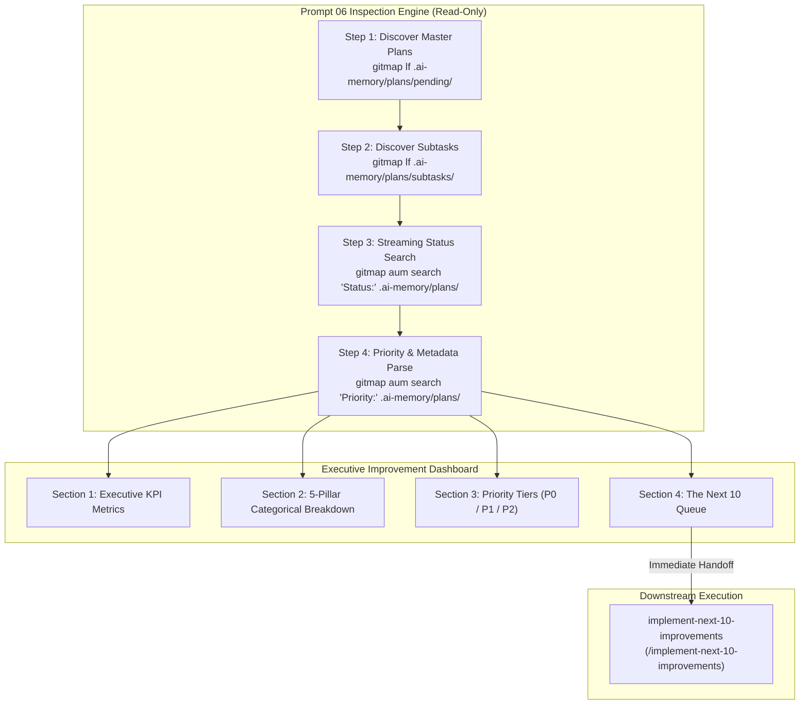

# Check Pending Improvements (Cursor IDE)

Source Prompt: `01-prompts/30-improvements/06-check-pending-improvements.md`

> [!IMPORTANT]
> **Skill Name:** `check-pending-improvements`  
> **Environment:** Cursor IDE  
> **Canonical Prompt:** `01-prompts/30-improvements/06-check-pending-improvements.md`  
> **IDE Link Syntax:** [`check-pending-improvements`](file;.cursor/skills/check-pending-improvements)  
> **Invocation:** `@[check-pending-improvements](file;.cursor/skills/check-pending-improvements)`  

This skill governs the systematic, autonomous scanning, status aggregation, and real-time visualization of all pending improvement plans and subtasks across the repository. It queries `.ai-memory/plans/` using GitMap high-speed commands, producing an executive health dashboard, category-by-category breakdown across the 5 improvement pillars, priority tier distribution (P0/P1/P2), and the deterministic Next 10 Queue for immediate execution handoff to [`implement-next-10-improvements`](file;.cursor/skills/implement-next-10-improvements).

---

## When to Use

- When the user asks:
  - `/check-pending-improvements`
  - `check pending improvements`
  - `how many improvements are pending`
  - `improvements dashboard`
  - `list pending improvements`
  - `improvements status`
- Before starting a refactoring sprint to inspect the current backlog and identify high-priority targets.
- Between batches of [`implement-next-10-improvements`](file;.cursor/skills/implement-next-10-improvements) to review updated metrics, completion percentages, and queue state.
- When conducting backlog triage across UI, codebase, system ergonomics, detailing, and ideation plans.

---

## Core Architecture

The inspection engine operates with a lightweight, read-only operational profile:



### Execution Parameters Matrix

| Parameter | Canonical Value | Operational Purpose |
|:---|:---:|:---|
| **Total Step Budget ($N$)** | `50` | Streamlined inspection budget (Phase 1: 20 Scan, Phase 2: 20 Triage, Phase 3: 10 Render) |
| **Active Subagents ($A$)** | `3` | Parallel read-only discovery workers scanning subtask partitions |
| **Hierarchy Depth ($H$)** | `2` | Lead Orchestrator $\rightarrow$ Read-Only Discovery Workers |
| **Agent Pool Capacity** | `6` | Maximum concurrent background subagent slots |
| **Execution Mode** | `READ-ONLY` | Strictly zero source code mutations; renders dashboard to chat |
| **Search Engine** | `GitMap AUM` | Exclusively `gitmap lf`, `gitmap find`, `gitmap aum search`, `gitmap cat` |
| **Build & Test Runs** | `STRICTLY BANNED` | Zero `go build`, `npm run build`, `pytest`, `go test` |

---

## Tool Primacy: GitMap High-Speed Search

The inspection engine enforces **GitMap High-Speed Search Primacy**. All file listings, status checks, and metadata parses must use GitMap commands:

| Operation | Primary GitMap Command | Advantage over Shell Tools |
|:---|:---|:---|
| **Scan Master Plans** | `gitmap lf .ai-memory/plans/pending/` | Zero process spawn overhead, instant directory listing |
| **Scan Subtasks** | `gitmap lf .ai-memory/plans/subtasks/` | Fast recursive inventory across subtask folders |
| **Search Status Values** | `gitmap aum search "Status:" .ai-memory/plans/` | Streaming multi-core search across pending plan files |
| **Search Priority Tiers** | `gitmap aum search "Priority:" .ai-memory/plans/` | Rapid identification of P0/P1/P2 tagged subtasks |
| **Stream Subtask Content** | `gitmap cat <filepath>` | Direct memory streaming without disk writes |

> [!CAUTION]
> **TOTAL BAN ON SHELL SEARCH TOOLS:**  
> Never use `Get-ChildItem` (all variants), `dir`, `ls`, `rg`, `ripgrep`, `grep`, `git grep`, `Select-String`, or `findstr`. Doing so violates repository rules and causes unnecessary latency.

---

## Executive Improvement Dashboard Schema

The output generated by this skill must adhere strictly to the following 4-section schema:

```markdown
# 📊 Continuous Improvement Status Dashboard

**Generated At:** [ISO-8601 Timestamp]  
**Scan Scope:** `.ai-memory/plans/pending/` and `.ai-memory/plans/subtasks/`  
**Total Identified Improvements:** `NNN`  
**Pending Execution Backlog:** `NNN` (`XX.X%` of total)  
**Completed & Verified:** `NNN` (`XX.X%` of total)  

---

### 1. Executive Summary & Health Metrics

| Metric | Count | Percentage | Status Indicator |
|:---|:---:|:---:|:---|
| **Total Improvements Cataloged** | `NNN` | 100.0% | 📦 Complete Registry |
| **Pending Implementation** | `NNN` | `XX.X%` | ⏳ Ready for Prompt 07 |
| **In-Flight / Active** | `NNN` | `XX.X%` | 🔄 Work in Progress |
| **Completed & Verified** | `NNN` | `XX.X%` | ✅ Upstream Verified |

---

### 2. Categorical Breakdown (The 5 Improvement Pillars)

| Category / Domain | Master Plan | Pending | Active | Done | Total | Completion % |
|:---|:---|:---:|:---:|:---:|:---:|:---:|
| **UI Materiality & Tokens** | `01-next-100-ui-improvements` | `NN` | `NN` | `NN` | `100` | `XX%` |
| **Codebase Guidelines & Typing** | `02-next-100-code-improvements` | `NN` | `NN` | `NN` | `100` | `XX%` |
| **Whole System Ergonomics** | `03-next-100-whole-system-improvements` | `NN` | `NN` | `NN` | `100` | `XX%` |
| **Multi-Step Plan Detailing** | `04-next-detail-out-100-improvements` | `NN` | `NN` | `NN` | `100` | `XX%` |
| **Generative Innovation Ideas** | `05-next-100-ideas-for-improvements` | `NN` | `NN` | `NN` | `100` | `XX%` |
| **Custom / Task-Specific Plans** | `XX-[custom-slug]` | `NN` | `NN` | `NN` | `NN` | `XX%` |
| **TOTALS** | — | **`NNN`** | **`NNN`** | **`NNN`** | **`NNN`** | **`XX%`** |

---

### 3. Priority Tier Distribution

| Priority Tier | Criteria & Blast Radius | Pending Count | Target Turnaround |
|:---|:---|:---:|:---|
| **P0 (Critical)** | Security leaks, panic regressions, broken contracts, data corruption risk | `NN` | Immediate Next Batch |
| **P1 (High)** | Performance bottlenecks, missing AppError wrappers, parameter bloat, unhandled errors | `NN` | Priority Wave |
| **P2 (Normal)** | Design token alignment, string constants extraction, function line reduction, docs polish | `NN` | Standard Micro-Batch |

---

### 4. 🚀 The Next 10 Queue (Immediate Handoff to Prompt 07)

The following 10 items are prioritized for immediate fast-forward implementation:

| Queue # | Item Identifier | Category | Priority | Target Subsystem / File | Summary Description |
|:---:|:---|:---|:---:|:---|:---|
| 01 | `[ID-001]` | `[Category]` | `P0/P1` | `[file/path]` | [Concise description] |
| 02 | `[ID-002]` | `[Category]` | `P0/P1` | `[file/path]` | [Concise description] |
| 03 | `[ID-003]` | `[Category]` | `P0/P1` | `[file/path]` | [Concise description] |
| 04 | `[ID-004]` | `[Category]` | `P1/P2` | `[file/path]` | [Concise description] |
| 05 | `[ID-005]` | `[Category]` | `P1/P2` | `[file/path]` | [Concise description] |
| 06 | `[ID-006]` | `[Category]` | `P1/P2` | `[file/path]` | [Concise description] |
| 07 | `[ID-007]` | `[Category]` | `P2` | `[file/path]` | [Concise description] |
| 08 | `[ID-008]` | `[Category]` | `P2` | `[file/path]` | [Concise description] |
| 09 | `[ID-009]` | `[Category]` | `P2` | `[file/path]` | [Concise description] |
| 10 | `[ID-010]` | `[Category]` | `P2` | `[file/path]` | [Concise description] |

> [!TIP]
> **To execute this exact batch immediately, invoke:**  
> `> /implement-next-10-improvements`
```

---

## Sorting Algorithm for the Next 10 Queue

When assembling Section 4 (The Next 10 Queue), items are selected and sorted using a deterministic 3-tier algorithm:

1. **Priority Ordering:** All pending `P0 (Critical)` items are queued first, followed by `P1 (High)`, then `P2 (Normal)`.
2. **Subsystem Clustering:** Within the same priority tier, group items by subsystem or target directory to maximize worker focus and reduce context switching.
3. **Sequential Plan Order:** Within the same tier and subsystem, order by task sequence number (`01`, `02`, ...).
4. **Capacity Cap:** Exactly 10 items are surfaced for the immediate execution turn.

---

## Verification Criteria

- [ ] Scanned `.ai-memory/plans/pending/` and `.ai-memory/plans/subtasks/` exclusively via GitMap commands.
- [ ] Strictly zero source file modifications during the inspection turn.
- [ ] Strictly zero builds, test suites, or CI/CD runner executions.
- [ ] Rendered all 4 sections of the Executive Improvement Dashboard completely.
- [ ] Categorical breakdown accurately reflects pending vs active vs done counts.
- [ ] Exactly 10 prioritized items populated in The Next 10 Queue with target paths and summaries.
- [ ] All file paths and links use strictly relative Git paths (zero absolute paths, zero `file:///` URIs).

---

## Related Skills

- [implement-next-10-improvements](file;.cursor/skills/implement-next-10-improvements)
- [next-100-code-improvements](file;.cursor/skills/next-100-code-improvements)
- [next-100-ui-improvements](file;.cursor/skills/next-100-ui-improvements)
- [next-100-whole-system-improvements](file;.cursor/skills/next-100-whole-system-improvements)
- [next-detail-out-100-improvements](file;.cursor/skills/next-detail-out-100-improvements)
- [next-100-ideas-for-improvements](file;.cursor/skills/next-100-ideas-for-improvements)
- [gitmap](file;.cursor/skills/gitmap)
- [execute-parent-task-with-n-steps-v6](file;.cursor/skills/execute-parent-task-with-n-steps-v6)
