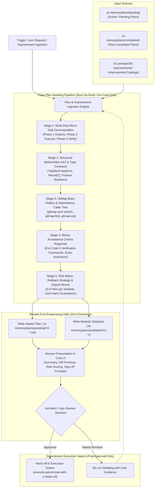

# Detail Plans and Improvements for Review

Source Prompt: `01-prompts/30-improvements/04-detail-plans-and-improvements-for-review.md`

This skill governs the systematic, autonomous detailing of active, pending, and completed plans as well as discovered improvement vectors into exhaustive, multi-step execution blueprints. It enforces a strict **Review-First & No-Immediate-Execution Gate**: improvements and plans must be deeply elaborated, bounded into isolated subtasks, verified with concrete code contracts, and presented in an interactive Review Docket for explicit human review and sign-off before any code modification, build, or test execution is permitted.

---

## When to Use

- When tasked with detailing out plans or improvements into actionable multi-step roadmaps so that any AI can follow through with minimal friction and maximum precision.
- When an AI agent needs to prepare plans and improvements for human or architectural review prior to implementation.
- When triggered by natural language requests such as:
  - `"detail-plans-and-improvements"`
  - `"detail-improvements-for-review"`
  - `"Can you please detail out all the plans that you have done and improvements so that it can be improved by any AI easily?"`
  - `"detail out improvements for review"`
  - `"detail plans and improvements"`
  - `"review-first plan detailing"`
- When transforming catalogued improvement proposals (such as those generated by `[find-100-improvements-in-code-base](file;.cursor/skills/find-100-improvements-in-code-base)`, `[find-100-improvements-in-ui-level](file;.cursor/skills/find-100-improvements-in-ui-level)`, or `[find-100-improvements-in-whole-system](file;.cursor/skills/find-100-improvements-in-whole-system)`) into granular, reviewable plans.
- When ingesting pending plans in `.ai-memory/plans/pending/` or completed plans in `.ai-memory/plans/completed/` to expand them with deep architectural contracts.

---

## Core Architecture

The detailing engine operates under the canonical `execute-parent-task-with-n-steps-v6` architecture adapted for strict review gating:

- **Concurrency Budget:** `N = 400` steps, `A = 3` concurrent subagents (`invoke_subagent`), `H = 2` operational hands per agent (Capacity = 6 concurrent operations).
- **Tree Swarm Hierarchy:** Root Lead Orchestrator $\rightarrow$ Branch Coordinators (Archetype / Domain Owners) $\rightarrow$ Leaf Workers & Dynamic Joining Assistants.
- **Bounded Micro-Tasking:** All detailed plans partition work into discrete subtasks of strictly **5–8 files maximum** with disjoint, non-overlapping file ownership to eliminate context exhaustion and file-lock collisions.
- **Decoupled Execution:** Detailing is strictly isolated to planning artifacts in `.ai-memory/plans/pending/XX-<slug>.md` and `.ai-memory/plans/subtasks/XX-<slug>/`. Execution occurs in subsequent dedicated turns using `[execute-parent-task-with-n-steps-v6](file;.cursor/skills/execute-parent-task-with-n-steps-v6)` or `[cg-execute](file;.cursor/skills/cg-execute)` only after explicit human approval.



---

## The Review-First & No-Immediate-Execution Gate

> [!IMPORTANT]
> **Strict Review-First & Zero Immediate Execution Mandate:**
> Plans and improvements detailed by this skill MUST NEVER be executed, implemented, built, or tested immediately during the detailing run.
> All detailing outputs are strictly enqueued into `.ai-memory/plans/pending/XX-<slug>.md` with companion subtasks in `.ai-memory/plans/subtasks/XX-<slug>/` and presented in chat for explicit user or architect review.
> Implementation may only occur after explicit human sign-off through subsequent, dedicated execution prompts (e.g. `[execute-parent-task-with-n-steps-v6](file;.cursor/skills/execute-parent-task-with-n-steps-v6)` or `[cg-execute](file;.cursor/skills/cg-execute)`).

### Prohibited Actions During Detailing Turn:
1. **NO Code Modifications:** Never edit application source code, configuration files, or scripts outside `.ai-memory/plans/`.
2. **NO Compilations or Builds:** Never run `go build`, `pnpm build`, `npm run build`, `cargo build`, etc.
3. **NO Test Suite Executions:** Never run `go test`, `pytest`, `npm test`, etc.
4. **NO Version Bumps or Tagging:** Never touch version files, changelogs, or release tags.
5. **NO Git Mutations:** Never run `git add`, `git commit`, `git push`, or `git status`.
6. **Mandatory Stop-Turn:** Present the Review Docket at the end of the detailing turn and halt immediately. Do not proceed with implementation without explicit user instruction.

---

## The 8-Field Detailed Plan Specification Schema

Every detailed improvement and multi-stage plan must strictly adhere to the standardized 8-Field Schema:

| Field Number | Field Name | Requirement & Grounded Standards |
|:---:|:---|:---|
| **Field 1** | **Plan/Improvement Identifier & Canonical Slug** | Unique ID (`CB-DET-XXX`, `SYS-DET-XXX`, `UI-DET-XXX`), lowercase hyphenated slug (`xx-canonical-slug`), priority rating, and estimated micro-batch size (5–8 files max). |
| **Field 2** | **High-Level Strategic Intent & Systems Reasoning** | Architectural justification, user/developer friction resolved, system stability impact, and eradicated anti-patterns. |
| **Field 3** | **Current State / Friction / Defect Analysis** | Verbatim source excerpt, strictly relative Git path (`path/to/file.ext`), exact line range (`L12-L34`), and grounded Root Cause Analysis (RCA). |
| **Field 4** | **Step-by-Step Multi-Stage Execution Blueprint** | Discrete subtasks across Phase 1 (Explore), Phase 2 (Micro-Batch Execute), and Phase 3 (Verify), with explicit file bounding boxes and target symbols. |
| **Field 5** | **Structural Code Contracts & Type Definitions** | Exact drop-in code definitions: structured `*appfault.AppError`, monadic `result.Result[T]`, value-based `*Params` structs, affirmative booleans (`is`/`has`), and vertical line spacing. |
| **Field 6** | **Blast Radius, Downstream Callers & Concurrency Boundaries** | Exhaustive caller inventory discovered via `gitmap aum search`, caller migration snippets, and file-lock/concurrency isolation models. |
| **Field 7** | **Zero Harm & Regression Safety Verification** | Backward-compatibility guarantees, deprecated alias forwarders, deterministic rollback steps, and zero-storage CI compliance. |
| **Field 8** | **Review Docket & Go/No-Go Decision Gate** | Formatted review checklist, state `⏳ PENDING HUMAN REVIEW`, and explicit turn halt awaiting human approval. |

---

## Review Docket Template & Human Review Protocol

At the conclusion of the detailing turn, the AI renders the standardized Review Docket directly in chat and in the plan header:

```markdown
### 📋 Review Docket & Go/No-Go Decision Gate
**Plan Identifier:** `[DOMAIN-DET-XXX]` — `[Title]`  
**Status:** `⏳ PENDING HUMAN REVIEW`  
**Execution Clearance:** `BLOCKED` until explicit user sign-off.

| Checkpoint | Verification Description | Status |
|:---|:---|:---:|
| 1. Strategic Intent | Solves grounded defect without architectural drift | `[x]` Verified |
| 2. File Bounding Box | Constrained to 5–8 files; zero unbounded edits | `[x]` Verified |
| 3. Code Contracts | Enforces `*appfault.AppError`, `*Params`, affirmative booleans | `[x]` Verified |
| 4. Blast Radius | Downstream callers identified; migration steps provided | `[x]` Verified |
| 5. Zero Harm | Backward-compatible shims included; zero breaking changes | `[x]` Verified |
| 6. Binary Verification | Pass/fail commands provided; zero build/test runs in planning | `[x]` Verified |

> [!IMPORTANT]
> **Action Required from Reviewer:**  
> Review the detailed blueprint below. If acceptable, reply with **"Approved"** or execute `[/plan](slashCommand;plan)` to initiate execution in a dedicated execution turn. Code will **NOT** be modified until approval is granted.
```

---

## Concrete Production-Grade Detailed Plan Cards

### 1. Code Base Detailed Improvement: `[CB-DET-001]`
- **Title:** Monolithic Session Token Validator to Structured AppError & Monadic Result
- **Slug:** `01-session-validator-apperror-refactor`
- **Domain:** Code Base (`04-code/golang/pkg/session/`)
- **Friction Identified:** Legacy validator returns untyped `(bool, error)` with `errors.New`, contains explicit `token.Valid == true` checks (violating Rule 1), and features 3 levels of nested `if` branching without guard clauses.
- **Structural Contract:** Replaces signature with `func (v *Validator) ValidateToken(params ValidateTokenParams) result.Result[SessionClaims]`, returning structured `*appfault.AppError`, affirmative `is`/`has` booleans, and providing a backward-compatible deprecated forwarder `ValidateTokenLegacy`.
- **Bounding Box:** 3 files (`pkg/session/validator.go`, `pkg/session/types.go`, `cmd/api/auth_handler.go`).

### 2. System Architecture Detailed Improvement: `[SYS-DET-001]`
- **Title:** Non-Blocking SQLite Split-DB Agent Task Engine with CAS Locking
- **Slug:** `02-sqlite-split-db-agent-task-engine`
- **Domain:** System Architecture (`pkg/agenttask/`, `src-tauri/src/modules/repo_db/`)
- **Friction Identified:** Single-threaded SQLite connection without WAL mode triggers `database is locked` errors during concurrent subagent task claiming and heatmap telemetry logging; task claim update lacks atomic status check.
- **Structural Contract:** Configures `_journal_mode=WAL`, `_busy_timeout=5000`, single writer (`MaxOpenConns=1`), multi-reader pool (`MaxOpenConns=16`), and atomic Compare-And-Swap query (`WHERE id = ? AND status = 'PENDING'`).
- **Bounding Box:** 4 files (`pkg/agenttask/db.go`, `pkg/agenttask/queue.go`, `pkg/agenttask/types.go`, `cmd/gitmap/agent.go`).

### 3. UI-Level Detailed Improvement: `[UI-DET-001]`
- **Title:** 72px Glassmorphic Sticky Header with Safe-Region Corridor & Contrast Ramp
- **Slug:** `03-sticky-header-and-safe-region-navigation`
- **Domain:** User Interface & Design System (`src/components/navigation/`, `src/styles/`)
- **Friction Identified:** Navigation uses arbitrary `py-4` height, harsh non-translucent borders, missing scroll physics, WCAG contrast failure (`3.8:1` vs `4.5:1`), and lacks safe-region corridor causing diagonal mega-menu collapse.
- **Structural Contract:** Enforces fixed `h-[72px]`, `window.scrollY > 12` scroll elevation transition, 14px safe hover corridor with 150ms debounce, tactile `md` button tier (`h-11`, `px-5`, `rounded-[12px]`), and WCAG 2.2 AAA contrast token `#17368B` (`9.88:1`).
- **Bounding Box:** 4 files (`src/components/navigation/site-header.tsx`, `src/components/navigation/mega-menu.tsx`, `src/styles/tokens.css`, `src/styles/animations.css`).

---

## Workflow & GitMap Execution

```
+-------------------------------------------------------------------------------+
|             Workflow Sequence: Detail Plans & Improvements for Review         |
+-------------------------------------------------------------------------------+
| Step 1: Preflight & Working Tree Check                                        |
|   - Inspect cognitive heatmap: gitmap heatmap status                          |
|   - Verify clean workspace state; confirm no untracked colliding edits        |
+-------------------------------------------------------------------------------+
| Step 2: Phase 1 Deep Codebase Inspection (GitMap Primacy)                    |
|   - Discover symbols & callers: gitmap aum search "<symbol>" [dir] -e <.ext>  |
|   - Stream file contents: gitmap cat <filepath>                               |
|   - Inventory directories: gitmap lf <dir>                                    |
|   - TOTAL BAN on shell searches: NEVER use rg, ripgrep, grep, dir, or ls      |
+-------------------------------------------------------------------------------+
| Step 3: Phase 2 Plan Detailing & 8-Field Schema Assembly                     |
|   - Decompose into 3 phases: Phase 1 Explore, Phase 2 Micro-Batch, Phase 3 Verify |
|   - Define exact Before/After code contracts (*appfault.AppError, Result[T])  |
|   - Bound each subtask to strictly 5-8 files maximum                           |
|   - Formulate binary acceptance criteria (exit code 0 commands)               |
+-------------------------------------------------------------------------------+
| Step 4: Enqueue Plans to .ai-memory/plans/pending/                            |
|   - Write Master Plan: .ai-memory/plans/pending/XX-<slug>.md                  |
|   - Write Subtasks: .ai-memory/plans/subtasks/XX-<slug>/YY-subtask-<name>.md   |
+-------------------------------------------------------------------------------+
| Step 5: Review Docket Presentation & Turn Halt (Review Gate)                 |
|   - Render Review Docket with state ⏳ PENDING HUMAN REVIEW                   |
|   - STOP TURN. Do not modify code. Await human operator approval              |
+-------------------------------------------------------------------------------+
| Step 6: Post-Approval Execution Handoff (Separate Turn)                      |
|   - Once approved, invoke execute-parent-task-with-n-steps-v6 to execute      |
+-------------------------------------------------------------------------------+
```

---

## Enqueueing Plans to `.ai-memory/plans/pending/`

All detailed plans generated by this skill must be persisted following strict naming and directory conventions:

1. **Master Plan Location:**
   `.ai-memory/plans/pending/XX-<slug>.md`
   - `XX`: Zero-padded sequential number matching the pending sequence (e.g. `02`, `03`).
   - `<slug>`: Lowercase hyphen-separated descriptive identifier.

2. **Modular Subtasks Location:**
   `.ai-memory/plans/subtasks/XX-<slug>/YY-subtask-<name>.md`
   - `YY`: Zero-padded subtask sequence (`01`, `02`, `03`...).
   - Each subtask must be bounded to strictly 5–8 files.

3. **Subtask Document Structure:**
   Every subtask file must contain:
   - Section 1: Task Details (Parent Task, Code, Slug, Specification, Status: `PENDING`, Plan Motto).
   - Section 2: Owned Deliverables & Scope (Disjoint Bounding Box: 5–8 files max).
   - Section 3: Action Checklist (Phase 1 Explore, Phase 2 Micro-Batch, Phase 3 Verify).
   - Section 4: Verification Evidence & Quality Gates (Exit code 0 GitMap checks).

---

## Verification Criteria

To confirm that plan detailing was executed flawlessly:

1. **Review-First Verification:** Zero application source files, config files, or scripts were modified; zero builds or tests were run during the detailing run.
2. **Schema Completeness:** Every detailed plan provides all 8 fields of the schema without placeholders (`TODO`, `...`, `[N]`).
3. **Bounding Box Isolation:** Each subtask is strictly constrained to 5–8 files with zero file overlaps across subtasks.
4. **Code Contracts Compliance:** Uses structured `*appfault.AppError`, `result.Result[T]`, affirmative `is`/`has` booleans, and value-based `*Params` structs.
5. **Path Hygiene:** Strictly relative Git paths only (`02-spec/...`, `.ai-memory/...`, `01-prompts/...`). Zero absolute paths or `file:///` URIs.
6. **Lowercase Naming:** All paths, files, and directories are strictly lowercase.
7. **GitMap Primacy:** All symbol and file discovery utilized GitMap commands; zero shell search tools were invoked.

---

## Related Skills & Instructions

- `[find-100-improvements-in-code-base](file;.cursor/skills/find-100-improvements-in-code-base)` — Autonomous discovery of 100 code improvements.
- `[find-100-improvements-in-ui-level](file;.cursor/skills/find-100-improvements-in-ui-level)` — Autonomous discovery of 100 UI improvements.
- `[find-100-improvements-in-whole-system](file;.cursor/skills/find-100-improvements-in-whole-system)` — Autonomous discovery of 100 whole-system improvements.
- `[plan-spec-steps-v2](file;.cursor/skills/plan-spec-steps-v2)` — Specification planning engine.
- `[execute-parent-task-with-n-steps-v6](file;.cursor/skills/execute-parent-task-with-n-steps-v6)` — Post-approval execution engine.
- `[coding-guidelines](file;.cursor/skills/coding-guidelines)` — Repository coding standards.
- `[cg-execute](file;.cursor/skills/cg-execute)` — Coding guidelines execution engine.
- `[ai-verification](file;.cursor/skills/ai-verification)` — Retrospective quality and audit gate.
- Plan Directive: `[/plan](slashCommand;plan) first before doing work for improved work or less friction, faster work and more pure and effective work.`
