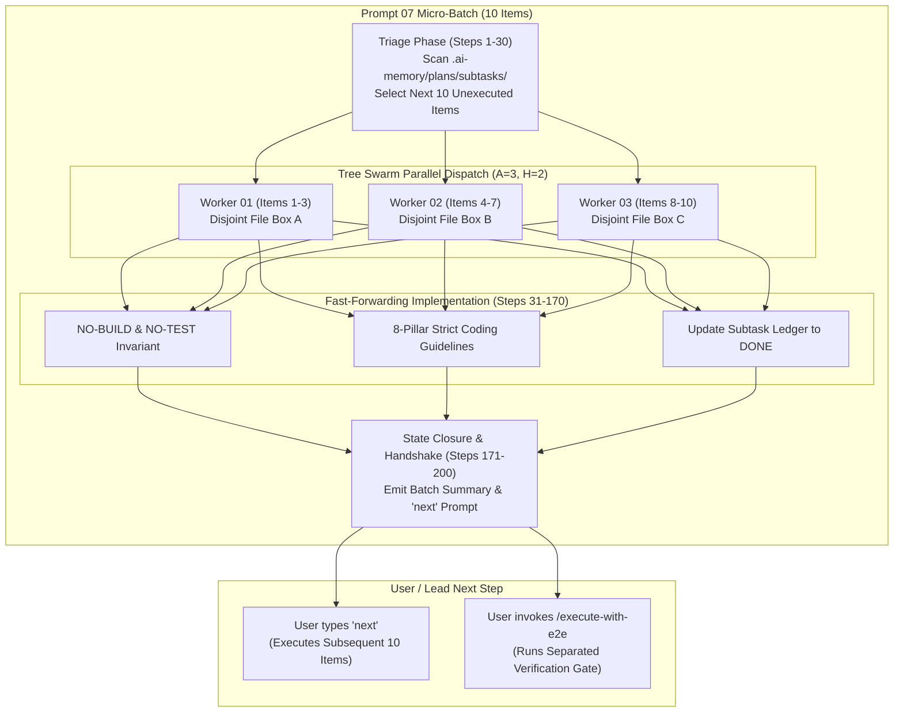
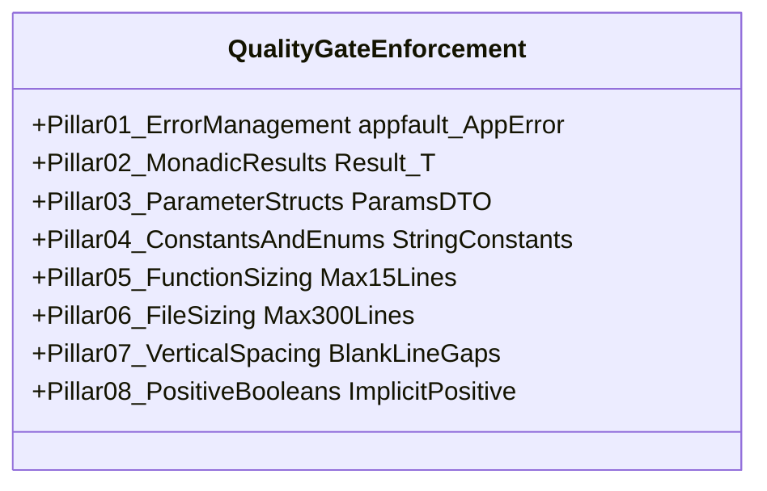
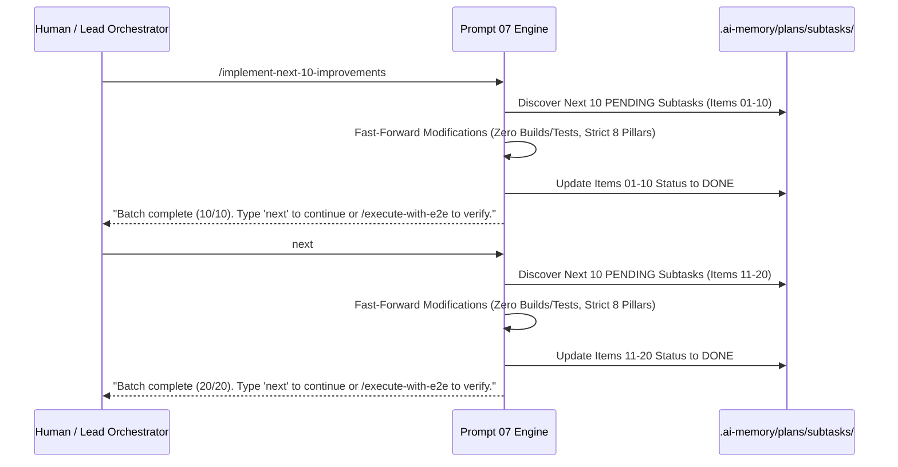

# Implement Next 10 Improvements (Cursor IDE)

Source Prompt: `01-prompts/30-improvements/07-implement-next-10-improvements.md`

> [!IMPORTANT]
> **Skill Name:** `implement-next-10-improvements`  
> **Environment:** Cursor IDE  
> **Canonical Prompt:** `01-prompts/30-improvements/07-implement-next-10-improvements.md`  
> **IDE Link Syntax:** [`implement-next-10-improvements`](file;.cursor/skills/implement-next-10-improvements)  
> **Invocation:** `@[implement-next-10-improvements](file;.cursor/skills/implement-next-10-improvements)`  

This skill governs the autonomous, high-velocity implementation of exactly 10 pending improvements from `.ai-memory/plans/subtasks/`. It operates under the **Fast-Forwarding Protocol**, which enforces a strict ban on intermediate compilations and test suite runs during editing turns, while mandating 100% adherence to the **8-Pillar Strict Coding Guideline Enforcement Matrix**. Execution is repeatable via the command `"next"` and concludes with a handoff to the decoupled terminal End-to-End Verification Gate.

---

## When to Use

- When invoked via slash command or alias:
  - `/implement-next-10-improvements`
  - `implement-next-10-improvements`
  - `implement-improvements`
  - `implement-next-10`
  - `next-10-improvements`
  - `next`
  - `run-next-10`
  - `fast-forward-improvements`
- Immediately following [`check-pending-improvements`](file;.cursor/skills/check-pending-improvements) to execute the prioritized Next 10 Queue.
- When systematically chewing through extensive backlogs in rapid, bounded 10-item micro-batches without getting blocked by compile/test latency.
- When iteratively refactoring legacy codebases to comply with repository coding guidelines (`*appfault.AppError`, `Result[T]`, parameter structs, enums, function sizing).

---

## Core Architecture

Execution is organized around the canonical multi-agent tree swarm architecture with high-velocity bounded micro-batches:



### Execution Parameters Matrix

| Parameter | Canonical Value | Operational Purpose |
|:---|:---:|:---|
| **Total Step Budget ($N$)** | `200` | Micro-batch budget (Phase 1: 30 Triage, Phase 2: 140 Fast-Forward Edits, Phase 3: 30 State Closure) |
| **Active Subagents ($A$)** | `3` | Concurrent worker subagents (`TypeName: "self"`) operating in disjoint file boundaries |
| **Hierarchy Depth ($H$)** | `2` | Lead Orchestrator $\rightarrow$ Worker Subagents |
| **Agent Pool Capacity** | `6` | Maximum concurrent background subagent slots |
| **Batch Size** | `10 items` | Strictly bounded to the next 10 unexecuted items from the backlog |
| **Intermediate Builds & Tests** | `STRICTLY BANNED` | **TOTAL BAN on `go build`, `npm run build`, `pytest`, `go test`** |
| **Repeat Trigger** | `"next"` | User can enter `"next"` to immediately advance to subsequent 10 items |
| **Verification Gate** | `DEFERRED TO E2E` | Verification runs as a separate end-to-end prompt/step at the end of the session |

---

## Fast-Forwarding Protocol Mechanics

Traditional agent execution loops waste enormous time running repetitive builds and tests after every minor file modification. Prompt 07 eliminates this latency through the **Fast-Forwarding Protocol**:

1. **Total Ban on Intermediate Compilations:** Never run `go build`, `npm run build`, `vite build`, `cargo build`, or equivalent compilers during implementation turns.
2. **Total Ban on Intermediate Test Runners:** Never run `go test`, `npm test`, `pytest`, `vitest`, `cargo test`, or `playwright` during implementation turns.
3. **Pure Code Quality by Construction:** Correctness is achieved by strictly adhering to type signatures, interface contracts, and the 8-Pillar Coding Guideline Matrix, rather than relying on compile-error trial-and-error loops.
4. **Subtask State Closure:** As each item in the 10-batch is modified, the worker updates the corresponding subtask file in `.ai-memory/plans/subtasks/` from `Status: PENDING` to `Status: DONE`.
5. **Continuous Loop Handoff:** Upon finishing the 10th item, the engine outputs the batch summary and prompts:
   `"Batch complete (10/10 items implemented). Type 'next' to implement the next 10 improvements, or invoke /execute-with-e2e to run the separated verification gate."`

---

## The 8-Pillar Strict Coding Guideline Enforcement Matrix

Every code modification executed during fast-forwarding turns MUST strictly satisfy the following 8 non-negotiable pillars:



### Pillar 1: Error Management & AppError Standard
- **Total Ban on Orphaned Errors:** Blank identifier error discarding (`_ = err`, `_ = fn()`) is strictly prohibited. Every returned error must be checked and wrapped or explicitly propagated.
- **Structured AppError Return Type:** In Go packages, all functions returning structured error metadata must return `*appfault.AppError`.
- **Eliminate Package Stutter:** Use package `appfault` (`04-code/golang/pkg/appfault`) with struct `AppError`. Never introduce `apperror.AppError`.
- **Constructor Helpers:** Construct structured errors exclusively via `appfault.New(code, message)` or `appfault.Wrap(err, code, message)`.

### Pillar 2: Monadic Result Envelopes
- **Unified Result Containers:** Functions returning data with potential failure must return `Result[T]`, `ResultSlice[T]`, or `ResultMap[K, V]` from `04-code/golang/pkg/appfault` or language-equivalent envelopes (`Result<T, AppError>` in TypeScript/Rust).
- **No Bare Tuples:** Replace legacy multi-value return tuples like `(Data, error)` with monadic envelopes:
  ```go
  // WRONG:
  func FetchProfile(id string) (*Profile, error)

  // CORRECT:
  func FetchProfile(params *FetchProfileParams) Result[*Profile]
  ```
- **Error Accessors:** Monadic containers provide `.AppError()` and `.Fault()` returning `*appfault.AppError`.

### Pillar 3: Parameter Structs (The 3-Parameter Cap)
- **Threshold Rule:** Functions accepting more than 2–3 loose parameters MUST encapsulate them into a dedicated value-based parameter struct (`*<FunctionName>Params` or `<FunctionName>Params`).
- **Zero Primitives Smuggling:** Never pass 4+ bare string or integer arguments across package boundaries:
  ```go
  // WRONG:
  func UpdateRecord(ctx context.Context, id string, name string, role string, isActive bool) *appfault.AppError

  // CORRECT:
  type UpdateRecordParams struct {
      Ctx      context.Context
      ID       string
      Name     string
      Role     UserRoleType
      IsActive bool
  }
  func UpdateRecord(params *UpdateRecordParams) *appfault.AppError
  ```

### Pillar 4: String Constants & Strongly-Typed Enums
- **Zero Raw String Literals:** Magic strings in conditionals, map lookups, error codes, and configuration keys are strictly banned.
- **PascalCase Enums with Type Suffix:** Define strongly-typed string enums using PascalCase naming with the mandatory `Type` suffix:
  ```go
  type ImprovementPriorityType string

  const (
      ImprovementPriorityP0 ImprovementPriorityType = "P0_CRITICAL"
      ImprovementPriorityP1 ImprovementPriorityType = "P1_HIGH"
      ImprovementPriorityP2 ImprovementPriorityType = "P2_NORMAL"
  )
  ```
- **HasEnumHelpers Pattern:** Companion validation methods (e.g. `IsValid() bool`, `Values() []string`) must be attached to enum types.

### Pillar 5: Function Sizing (8–15 Line Target)
- **Strict Bounding:** Function bodies must not exceed 15 lines (optimal target is 8–10 lines).
- **Decomposition Pattern:** Decompose larger routines into discrete single-responsibility helper functions. Use guard clauses and early returns to eliminate nested indentation blocks.
- **Whitespace Exemption:** Function line counts are measured by executable statements; maintain standard vertical blank line spacing without artificially cramming lines.

### Pillar 6: File Sizing (150–300 Line Limit)
- **Strict File Ceiling:** Production source files must remain bounded between 150 and 300 lines.
- **Component Ceiling:** React UI components must not exceed 100 lines.
- **Separation Strategy:**
  - Extract struct, interface, and enum definitions into dedicated `types.go` or `models.go`.
  - Extract pure utilities and string operations into `<module>_helpers.go` or `utils/`.
  - Extract table-driven dispatch logic into dedicated handler maps.

### Pillar 7: Vertical Line Gaps (Mandatory Spacing)
- **Pre-Condition Gap:** Mandatory blank line immediately before any `if` condition.
- **Post-Block Gap:** Mandatory blank line immediately after any closing brace `}` (unless followed by `else`).
- **Return Gap:** Mandatory blank line immediately before any `return` statement.
- **Multiline Struct Gap:** Mandatory blank lines surrounding multiline struct instantiations.

### Pillar 8: Positive Boolean Standards
- **Implicit Evaluation:** NEVER evaluate a boolean explicitly against `true` (TOTAL BAN on `if isReady == true`). Positive booleans MUST ALWAYS be evaluated implicitly: `if isReady { ... }`.
- **Approved Prefixes Only:** Booleans must strictly use affirmative prefixes: `is*` or `has*` (e.g. `isEnabled`, `hasAccess`). Prefixes such as `can`, `should`, `was`, `did` are strictly banned.
- **No Mixed Polarity:** NEVER combine a positive check and a negative check in the same `if` condition (e.g., `if isA && !isB`). Split into discrete guard clauses or evaluate independently.

---

## Repeatable "Next" Cadence

Prompt 07 is engineered for frictionless continuous execution. The workflow operates as follows:



At any point, the user can inspect progress via [`check-pending-improvements`](file;.cursor/skills/check-pending-improvements) or advance with `"next"`.

---

## Decoupled Terminal End-to-End Verification Gate

Testing is decoupled from editing waves and runs as an independent verification gate once all desired batches are complete:

1. **Triggering the Gate:** The user or orchestrator invokes:
   `> /execute-with-e2e`
   or runs Phase 3 of [`execute-parent-task-with-n-steps-v6`](file;.cursor/skills/execute-parent-task-with-n-steps-v6).

2. **Sequential Verification Protocol:**
   - **Step 1 (Build Verification):** Run compiler checks in quiet mode (`go build ./...`, `pnpm build`).
   - **Step 2 (Static Coding Guideline Linters):** Run repo linter scripts:
     - `python .agents/scripts/07-relative-path-fixer.py --check-only`
     - `python .agents/scripts/04-newline-fixer.py --check-only`
     - `python .agents/scripts/13-file-size-guard.py`
   - **Step 3 (Targeted Unit & Regression Tests):** Execute isolated, non-destructive test suites (`go test -v -race ./...`, `pnpm test`).
   - **Step 4 (Atomic GitMap Commit & Push):** Once 100% green:
     `gitmap cpf "improvements - implement next 10 improvements batch"` (using hyphen format without colons).

---

## Tool Primacy: GitMap High-Speed Search

During implementation turns, code search and inspection MUST use GitMap commands:
- **Code & Symbol Search:** `gitmap aum search "<pattern>" [dir] [-e <.ext>] [-r] [-i]`
- **Subtask Inventory:** `gitmap lf .ai-memory/plans/subtasks/`
- **File Streaming:** `gitmap cat <filepath>`
- **TOTAL BAN on Shell Tools:** Never use `rg`, `ripgrep`, `grep`, `dir`, `ls`, or `Get-ChildItem`.
- **Worker Git Ban:** Subagents NEVER execute git commands (`git add`, `git commit`, `git push`, `git status`).

---

## Verification Criteria

- [ ] Exactly 10 pending improvement items triaged and implemented from `.ai-memory/plans/subtasks/`.
- [ ] Strictly zero intermediate builds (`go build`, `npm run build`) or test executions during implementation.
- [ ] 100% compliance with the 8-Pillar Coding Guideline Matrix across all modified files:
  - Structured `*appfault.AppError` returns, zero orphaned errors.
  - Monadic `Result[T]` returns for fallible data methods.
  - Dedicated parameter structs for functions with >2–3 parameters.
  - Strongly-typed PascalCase enums with `Type` suffix.
  - Function sizes strictly <=15 lines (target 8–10 lines).
  - File sizes bounded within 150–300 lines (UI components <= 100 lines).
  - Vertical spacing before `if`, after `}`, before `return`.
  - Positive booleans (`is*`/`has*`), implicit evaluation, zero mixed polarity.
- [ ] All 10 subtasks marked `Status: DONE` in `.ai-memory/plans/subtasks/`.
- [ ] Next-loop handoff message clearly emitted prompting for `"next"` or `/execute-with-e2e`.
- [ ] All file paths and links use strictly relative Git paths (zero absolute paths, zero `file:///` URIs).

---

## Related Skills

- [check-pending-improvements](file;.cursor/skills/check-pending-improvements)
- [execute-parent-task-with-n-steps-v6](file;.cursor/skills/execute-parent-task-with-n-steps-v6)
- [execute-with-e2e](file;.cursor/skills/execute-with-e2e)
- [coding-guidelines](file;.cursor/skills/coding-guidelines)
- [cg-error-management](file;.cursor/skills/cg-error-management)
- [cg-boolean-and-naming](file;.cursor/skills/cg-boolean-and-naming)
- [gitmap](file;.cursor/skills/gitmap)
- [ai-verification](file;.cursor/skills/ai-verification)
