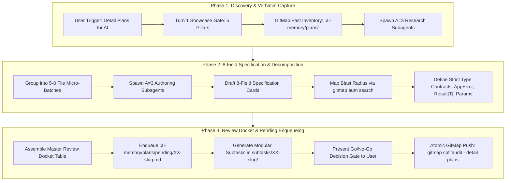

# Detail Plans and Improvements for Review

```text
N = 400 (Total self-loop steps budget — editable top-header parameter, default: 400)
A = 3   (MANDATORY number of spawned autonomous subagents running concurrently via invoke_subagent, default: 3)
H = 2   (Operational hands per agent: dual-task batch capacity & parallel tool dispatch, default: 2)
C = 30  (Tool calls per worker before it must report, default: 30)

System Concurrency Capacity = A × H = 3 agents × 2 hands = 6 concurrent subtask operations
Tree Hierarchy = Lead Orchestrator (Root Node) -> Branch Coordinators (Subtask Owners) -> Leaf Workers & Dynamic Joining Assistants
PHASE_1_BUDGET = 100     (Steps 1 .. 100: Planning, GitMap Inventory & Plan Discovery, Discovery Subagents, Up-Front Brain & Roadmap Creation)
PHASE_2_BUDGET = 150     (Steps 101 .. 250: 8-Field Detailed Plan Specification Card Authoring, Micro-Batching Waves, Review Docket Assembly, Pending Plan Enqueueing)
PHASE_3_BUDGET = 150     (Steps 251 .. 400: Retrospective Quality Verification, Relative Path Hygiene, Review Presentation, Dynamic Join Saturation, Atomic Push Gate)
WAVES = ceil(subtasks / (A x H))
```

> [!IMPORTANT]
> Prompt Version: 1.0.0
> Runtime: Google Antigravity 2.0 (IDE and CLI)
> Invoke: `/detail-plans-and-improvements <target-scope-or-plan>`
>
> **Trigger Keywords & Aliases:**
> `detail-plans-and-improvements`, `detail-improvements-for-review`, `detail-plans-for-ai`, `detail-plan-review`, `detail-all-plans`
>
> **Canonical User Trigger Quote:**
> > *"Can you please detail out all the plans that you have done and improvements so that it can be improved by any AI easily? Okay? So detail out as much as"*
>
> **Top-Instruction Priority Mandate (Above Precedence / Preamble Precedence):**
> Whatever directives, constraints, checklists, or user instructions are given ABOVE this prompt (including in the user preamble, header blocks, or incoming user request above) are HIGHEST PRIORITY and MUST BE FOLLOWED as strictly NON-NEGOTIABLE. They supersede and strictly override any conflicting general advice, default conventions, or lower-level guidelines below. The agent MUST inspect and follow the instructions above with absolute precedence.

[/goal](slashCommand;goal) Autonomously inventory, expand, decompose, and detail out all existing and completed plans, architectural improvements, and candidate refactorings into exhaustive, production-grade 8-field specification cards, assemble a comprehensive Review Docket & Go/No-Go Decision Gate for human/architect review, enqueue execution-ready pending plans into `.ai-memory/plans/pending/XX-<slug>.md` with modular subtasks in `.ai-memory/plans/subtasks/XX-<slug>/`, and format every single artifact so that ANY downstream AI agent can immediately execute the work with zero ambiguity, zero missing types, and zero guesswork.

[/learn](slashCommand;learn) Enforce the STRICT REVIEW-FIRST & NO-IMMEDIATE-EXECUTION MANDATE: the improvements and detailed plans generated by this prompt MUST NOT be executed, implemented, built, or tested right away before human/architect review! The entire purpose of this workflow is exhaustive detailing, plan enhancement, decomposition, and review presentation. Every plan proposal must provide complete copy-paste ready refactored code contracts, exact parameter structs, affirmative booleans, mapped caller blast radius via `gitmap aum search`, backward compatibility shims, and a concrete verification contract.

[/plan](slashCommand;plan) Execute thorough step-by-step planning in the repository before execution for improved work or less friction, faster work and more pure and effective work. Ensure all existing plans in `.ai-memory/plans/`, pending backlogs, and recent architectural changes are thoroughly inventoried, expanded into structured 8-field specification cards, partitioned across 5–8 file micro-batches, and assembled into the Review Docket before concluding.

---

### 🚨 MANDATORY SUBAGENT SPAWNING GATE (A = 3, H = 2, CAPACITY = 6 — TREE SWARM & DYNAMIC JOIN)

- **ACTUAL TOOL CALL REQUIRED:** You must ACTUALLY CALL the `invoke_subagent` tool via your tool-calling API. Do NOT just print the text `"Dispatched Worker..."` and stop. If you only print text, the subagents will not spawn and the task will fail! You must execute the `invoke_subagent` JSON tool payload.
- **TREE-STRUCTURED SWARM HIERARCHY:** Organize execution as an operational tree:
  1. **Root Orchestrator (Lead Agent):** Owns the overarching audit roadmap, the Master Review Docket, parent plan registration, and final GitMap commit. Never executes file discoveries solo.
  2. **Branch Coordinators (Domain Subtask Owners):** Own designated domain clusters (Worker 01 owns Code Base Architecture, Worker 02 owns System Architecture & Daemons, Worker 03 owns UI/UX & Design Tokens) and manage decomposition waves.
  3. **Leaf Workers & Dynamic Joining Assistants:** Assist branch coordinators with GitMap AST/symbol caller scanning, type contract authoring, caller blast radius tracing via `gitmap aum search`, and specification card proofreading.
- **3-STAGE MANDATORY DISPATCH:** You must invoke `A = 3` agents (`invoke_subagent`) at EVERY stage of the workflow:
  1. **Discovery Step (A = 3 `research` subagents):** Spawn 3 read-only discovery subagents (`TypeName: "research"`) to scan existing plans in `.ai-memory/plans/`, recent commits, and active subsystems using GitMap high-speed streaming commands, returning concrete candidate plans and code locations to the lead orchestrator.
  2. **Card Authoring Step (A = 3 `self` authoring subagents):** Spawn 3 authoring subagents (`TypeName: "self"`) to author modular, disjoint 8-field detailed plan specification cards and subtask files (never writing to the same file path).
  3. **Verification & Enqueueing Step (A = 3 `self` worker subagents):** Spawn 3 worker subagents (`TypeName: "self"`) to validate relative path hygiene, check against banned rules, compile pending subtasks, and register the Review Docket in `.ai-memory/plans/pending/`.
- **MANDATORY 3 SUBAGENTS IN SINGLE TOOL CALL:** Every call to `invoke_subagent` MUST contain an array of EXACTLY 3 subagent objects: `"Subagents": [agent1, agent2, agent3]`. Calling `invoke_subagent` with fewer than 3 subagents, or executing solo without calling `invoke_subagent`, is an immediate protocol violation and auto-reject failure.
- **DYNAMIC AGENT JOIN & IMMEDIATE RESPAWN (NO IDLE WORKERS):** Worker capacity `A` must remain pinned at 3 active agents (System Concurrency Capacity = 6) throughout execution. As soon as ANY single worker completes, the lead immediately spawns a replacement worker for the next pending batch, or commands the worker to dynamically join an active subtask in collaborative assistance mode (parallel pattern searching, caller discovery, card proofreading).
- **SOLO EXECUTION IS AN AUTO-REJECT FAILURE:** The lead orchestrator is **STRICTLY FORBIDDEN** from performing all inventorying, plan detailing, or specification writing solo without calling the `invoke_subagent` tool.

---

## Phase 0: Antigravity Skill Bootstrap (Memory Optimization)

Before executing the tasks below, check if this prompt is already installed as a native Antigravity Skill.

1. If `.agents/skills/detail-plans-and-improvements-for-review/skill.md` does not exist in the workspace, create it now.
2. Mirror the skill into `.cursor/skills/detail-plans-and-improvements-for-review/skill.md` using Cursor skill link syntax (`[detail-plans-and-improvements-for-review](file;.cursor/skills/detail-plans-and-improvements-for-review)`).
3. Extract the core instructions of this prompt and save it into that `skill.md` using the standard YAML frontmatter (with `name` and `description`).
4. Once installed, rely on progressive disclosure for future runs. Do not keep the entire prompt in active memory if not needed.

---

## STRICT REVIEW-FIRST & NO-IMMEDIATE-EXECUTION MANDATE (NON-NEGOTIABLE)

> [!CAUTION]
> **ABSOLUTE BAN ON PREMATURE CODE EXECUTION, BUILD RUNS, AND TEST RUNS:**
> Under this prompt, the AI agent is **STRICTLY PROHIBITED** from executing code refactoring, compiling packages, running builds, running tests, or applying invasive modifications to production source files right away!
>
> 1. **Purpose of this Prompt:** This prompt is dedicated purely to **EXHAUSTIVE DETAILING, ARCHITECTURAL DECOMPOSITION, AND REVIEW PRESENTATION**.
> 2. **Review Docket Presentation:** The primary output is a structured Review Docket & Go/No-Go Decision Gate presented to the human user or architect.
> 3. **Downstream AI Handoff Readiness:** Every plan is detailed with such rigorous structural contracts, type definitions, and step-by-step blueprints that ANY downstream AI coding agent can pick up the pending subtask and execute it with 100% precision and zero ambiguity.
> 4. **No-Build / No-Test Invariant:** Never run `go build`, `npm run build`, `vite build`, `cargo build`, or any test suites (`go test`, `pytest`, `npm test`) during this detailing workflow.



---

## The Unified Master Pipeline (Atomic Numbered Steps)

Execute this task via a strict 3-Phase pipeline. Do not skip steps.

### Phase 1A: Verbatim Capture, Task Extraction & Chat Output Gate (Step 0)

Before executing any file searches, scans, spec writing, or plan authoring, you must execute Phase 1A:

1. **Top-Instruction Priority Verification:** Whatever directives, constraints, checklists, or instructions are given before this section or prompt (user preamble, header constraints, prior instructions) must be verified as highest priority and non-negotiable.
2. **Extreme "Understood" Turn-1 Showcase (Turn 1 Action):** In your VERY FIRST response turn upon receiving the prompt, you MUST output a comprehensive, in-depth understanding block directly in visible chat before any background tool execution. Any generic boilerplate or superficial 1-sentence summaries (e.g. `Understood: [YES] — I will detail plans`) are protocol auto-reject failures. Turn 1 MUST display the top-level mandate containing all 5 Mandatory Pillars followed by the confirmed task breakdown using the 6-part verification schema:
   * **Pillar 1: Strategic Intent & Systems Reasoning:** Articulate overarching architectural goal, user intent, operational rationale, and systems integration mechanics. Explain *why* detailing plans with strict structural contracts enables downstream AI agents to execute with zero drift, zero hallucination, and full adherence to repository guidelines.
   * **Pillar 2: Explicit Scope Boundaries:** Strict two-column partition defining In-Scope vs. strictly Excluded or Deferred items. Explicitly state that immediate code refactoring, building, and testing are strictly Excluded/Deferred until review approval.
   * **Pillar 3: Non-Negotiable Constraints & Negative Guardrails Ingestion:** Explicit recitation of active constraints: raw search ban (`rg`, `ripgrep`, `Select-String`, `git grep`, `Get-ChildItem`, `dir`, `ls`), worker git ban (no git commands in subagents), zero builds/tests (never run all tests locally or full build unless explicitly asked; every time code is written, do not build the code; only do end-to-end testing if explicitly asked), strict relative Git paths, lowercase naming, zero secrets in repo (`repo-secrets` offloading), GitMap hyphen-separated commit format without colons.
   * **Pillar 4: Blast Radius & Dependency Topology:** Map impacted subsystems, target files, downstream callers, and prompt/skill indexes with explicit risk containment strategies.
   * **Pillar 5: Multi-Agent Concurrency Topology:** Detail swarm structure (`A = 3`, `H = 2`, Capacity = 6), disjoint file assignments, and immediate dynamic respawn.
   * **Task Comprehension & Model Runtime Invariants:** In the task breakdown, every single task MUST explicitly state `- **Understood / AI Comprehension:** [YES] — [1–2 concise sentences proving deep understanding of intent, scope, and verified constraints]` and `- **Azure AI / Model Runtime Context:** [Document Azure AI, Azure OpenAI, or local model endpoint context, or state 'N/A — Local CLI/GitMap']`.
3. **Lossless Verbatim Capture:** Store incoming prompt losslessly under `## User Request (Verbatim)` in canonical spec and parent plan.
4. **Discrete Deliverables Extraction:** Break down requirements into discrete, actionable items with ordered traceable IDs (`Task-01`, `Task-02`, ...).
5. **Mandatory Same-Turn Tool Chaining (TOTAL BAN ON TURNING OFF):** Emit the comprehension mandate and breakdown in chat with clean vertical formatting, and in the **EXACT SAME TURN**, invoke your first tool call (e.g. `write_file` to initialize ledger/spec, or run preflight). NEVER emit text alone (which ends the turn prematurely), and never ask "Should I proceed?".

```markdown
### 🧠 Deep Comprehension & Understood Mandate

#### Pillar 1: Strategic Intent & Systems Reasoning
- [Articulate architectural goal, detail depth across plans and improvements, structural contract drafting, and preparation for downstream AI execution with zero friction.]

#### Pillar 2: Explicit Scope Boundaries (In-Scope vs. Excluded / Deferred)
- **In-Scope:** [Strict enumeration of existing plans, pending improvements, 8-field specification card authoring, Review Docket compilation, and pending subtask enqueueing.]
- **Excluded / Deferred:** [STRICTLY EXCLUDED: Direct code modification, implementation, package compilation (go build, npm run build), and test suite execution. All execution is deferred until human/architect review approval.]

#### Pillar 3: Non-Negotiable Constraints & Negative Guardrails Ingestion
- [Explicit recitation of active constraints: raw search ban (no rg/ripgrep/Select-String), worker git ban (no git in subagents), zero builds/tests (no go build, npm run build, full test suites), strict relative Git paths, lowercase naming, zero secrets in repo, GitMap hyphen-separated commit format without colons.]

#### Pillar 4: Blast Radius & Dependency Topology
- **Impacted Subsystems & Files:** [Existing plans in .ai-memory/plans/, candidate files in cmd/, pkg/, src/, and downstream callers mapped via gitmap aum search.]
- **Containment & Risk Mitigation:** [Disjoint file ownership per subagent; non-destructive plan specification authoring; review gate preservation.]

#### Pillar 5: Multi-Agent Concurrency Topology & Wave Orchestration
- **Swarm Structure:** Lead Orchestrator (Root Node) -> Branch Coordinators (Domain Owners) -> Leaf Workers & Dynamic Assistants
- **Capacity:** A = 3 agents × H = 2 hands = 6 concurrent operations, WAVES = ceil(subtasks / 6)
- **Disjoint Bounding Boxes:** Zero file overlap; immediate dynamic respawn on worker completion
```

---

## 1. Precedence Hierarchy & Scope (Highest First)

1. **User Instructions & Preamble:** Directives and parameters ABOVE this prompt outrank everything below.
2. **Platform Limits:** Native tools, Artifact Review Policy, permission prompts, hooks. Never claim to override them.
3. **Repo Rules:** `agents.md`, `.ai-memory/strictly-avoid.md`, and `coding-guidelines.md`.
4. **This Prompt.**

If sources conflict, follow the stricter one and record under `Conflicts:` in ledger.

### Scope Control Rules
- **Turn 1 Task Showcase:** In your very first response turn, showcase the given task in visible chat.
- **Review-First Enforcement:** Author specifications and plans ONLY. Do not apply refactoring to production code in this turn.
- **Read budget:** Read only requested paths, search hits, and Step 0 context via GitMap.
- **History read-only:** Never edit past events, changelogs, completed plans, release notes, or archive directories.
- **Out-of-scope:** Log under `Follow-ups:` in plan; never fix in this run.
- **Minimal diff:** Modify only target files required for plan documentation, subtask authoring, and plan enqueueing.
- **Indexes:** Update `01-prompts/readme.md` and `.ai-memory/prompts.md` when adding/modifying prompts. Update `.ai-memory/plans/readme.md` and `.ai-memory/what-to-read.md`.
- **Mandatory Multi-Agent Partitioning:** Work MUST be partitioned across A workers (`A = 3`). Solo execution is strictly banned.
- **Finish early:** When all detailed plans are documented, verified, and enqueued, proceed directly to consolidation.
- **Zero releases:** Never bump versions or edit changelogs unless requested (R10).

---

## 2. Core Operational Rules (Cite by ID)

- **R1 Zero Builds, Test Suites & CI/CD Verification Ban (TOTAL BAN).** NEVER run `go build`, `npm run build`, `vite build`, `cargo build`, `go test ./...`, `pytest`, `npm test`, or `03-ai-scripts/06-cicd-local-runner.py`. Every time you write code, you do not build the code. Never run all tests locally or full build unless explicitly asked by the user. Only do end-to-end (E2E) testing based on mentioned test cases if explicitly asked. Do CI/CD verification (e.g. `gitmap pe`, `gitmap pipeline-ai`, GitHub Actions) only if asked; if not asked explicitly, don't do it.
- **R2 Targeted Checks Only.** Run only fast, file-scoped checks on specifically modified files (see Section 8). A check scanning 0 files is a **FAIL**.
- **R3 Evidence or It Did Not Happen.** Every `DONE`, `PASS`, or "verified" claim MUST cite a concrete file path, line number, git diffstat, or command exit code (`exit 0`). Vague assurances are auto-rejected.
- **R4 Never Invent Commands, Flags, or Paths.** Verify commands with a harmless call (`gitmap lf readme.md`), not `--help`. Use documented fallbacks and log in ledger.
- **R5 Mandatory Subagents (`invoke_subagent`), Concurrency Scaling & Immediate Dynamic Respawn.** Spawning subagents via `invoke_subagent` (`A = 3`, `H = 2`, System Concurrency Capacity = 6 concurrent operations) is an **ABSOLUTE MUST** (`research` for discovery in Phase 1, `self` for card authoring and plan enqueueing in Phase 2/3). Solo execution without calling `invoke_subagent` is an auto-reject failure.
- **R6 One Owner Per File (Disjoint Bounding Boxes).** Within every worker wave, each file has exactly one owner. Shared indexes (`.ai-memory/plans/readme.md`, `.ai-memory/prompts.md`, `.ai-memory/what-to-read.md`) belong exclusively to lead.
- **R7 Git Safety & Isolation (Worker Git Ban).** Subagents NEVER run git commands (`git add`, `git commit`, `git push`, `git status`, `git diff`, `git checkout`). In shared workspaces (`Workspace: "inherit"`), worker git calls create `.git/index.lock` collisions that immediately crash parallel agents.
- **R8/R9 Atomic Commit & Push via GitMap (TOTAL BAN ON RAW GIT COMMITS).** The run ends with ONE GitMap call:
  - For features/detailing: `gitmap cpf "<module> - <feature summary>"` (e.g. `gitmap cpf "plans - detail improvements for review wave 01"`). GitMap automatically prepends `Feature: `, so format with a hyphen `-`; there is NO need to provide a colon in the GitMap argument. DO NOT provide a colon; use a hyphen `-` to separate module/scope from summary. NEVER include `feat(...)` or `feature:` in your message.
  - For bug fixes: `gitmap cpb "<module> - <fix summary>"`.
  TOTAL BAN on raw git commits (`git commit`, `git add -A`, raw `git push`), colons inside the GitMap message argument, and conventional prefixes (`docs(...)`, `feat(...)`, `fix(...)`, `chore(...)`). ZERO intermediate commits during Phase 1 or Phase 2; all files must be committed together at the final step of Phase 3.
- **R10 Zero Unauthorized Releases.** Never bump versions, edit `version.json`, update changelogs, or trigger release scripts unless user explicitly requested release.
- **R11 Strict Relative Git Paths & Lowercase Hygiene.** Strict ban on absolute paths (`C:\...`, `/home/...`) and `file:///` URIs. Only add relative paths starting from git root. All filenames, documentation, and specs strictly lowercase (e.g. `readme.md`, `agents.md`, `skill.md`).
- **R12 No Polling / Immediate Turn Yielding.** When calling `invoke_subagent`, make it the sole tool action at turn end, print progress line (`Dispatched Worker 01 .. Worker <A> (wave k / WAVES); waiting for their results.`) and **STOP CALLING TOOLS**. Never poll in loop. Check `manage_subagents` once if wave runs long.
- **R13 Two-Strike Retry Cap & Anti-Looping.** Tool failing twice: worker replies `STATUS: BLOCKED` with exact error and stops. Lead takes over and logs `LEAD_FALLBACK: <reason>`.
- **R14 100% Ambiguity & Decision Boundaries.** Non-blocking: choose conservative option, log in ledger `Assumptions:`, proceed. Blocking: `ask_question` once, log in `.ai-memory/ambiguous-questions/01-new-ambiguity/`, continue unblocked tasks.
- **R15 Zero Generated Artifacts Committed.** Never commit build caches, logs, temp scripts, or newly generated binaries unless repository already tracked them.
- **R16 Zero Secrets in Standard Repos.** Never write credentials, tokens, passwords, or `.env` contents into tracked files, commits, ledger, plans, specs, or prompts (`agents.md` section 9).

---

## 3. GitMap High-Speed Command Primacy (Run Everything Faster)

GitMap is your **PRIMARY** acceleration engine. Banned ALL variants of `Get-ChildItem` (with or without flags/parameters), `dir`, `ls` in shell, `rg`, `ripgrep`, `grep`, `git grep`, `Select-String`, and `findstr`. Execute all searches and operations through GitMap:

| Operation | Primary GitMap Command | High-Speed Alias | Purpose & Advantage |
| :--- | :--- | :--- | :--- |
| **Live Streaming Search** | `gitmap aum search "<pattern>" [dir] [-e <.ext>] [-r] [-i]` | `gitmap aum grep "<pat>"` | Multi-core streaming live file search (replaces `Select-String`, `git grep`) |
| **Indexed Symbol Search** | `gitmap search "<query>" [--limit <n>]` | `gitmap search` | Instant SQLite cached keyword/symbol search across indexed repos |
| **Wildcard File Search** | `gitmap find "<pattern>" [-ext <ext>]` | `gitmap f "<pat>"` | Index-accelerated multi-core glob filename finder |
| **Directory Inventory** | `gitmap lf <dir>` / `gitmap find "*.*" <dir>` | `gitmap lf [pat]` | Instant indexed repository inventory (replaces `Get-ChildItem`, `dir`, `ls`) |
| **Substring File Search** | `gitmap find-files-any "<substring>"` | `gitmap ffa "<str>"` | High-speed partial filename matcher |
| **Stream File** | `gitmap cat <filepath>` | `gitmap cat` | Direct zero-disk memory streaming to stdout (replaces `cat`, `type`, `Get-Content`) |
| **PowerShell Runner** | `gitmap pwsh "<command>"` | `gitmap ps "<cmd>"` | High-speed PowerShell execution with `-NoProfile` |
| **Bash Runner** | `gitmap bash "<command>"` | `gitmap sh "<cmd>"` | Standard cross-platform Bash command execution |
| **Offload Secrets** | `gitmap rs file <filepath>` / `folder` / `text` | `gitmap rs` | Auto-commits into `repo-secrets` in work directory |
| **Offload Scripts** | `gitmap rc file <file.ps1>` / `text` | `gitmap rc` | Auto-commits reusable scripts into `repo-cache` |
| **Atomic Commits** | `gitmap cpf "<module> - <msg>"` (Feature) / `cpb` (Bug) | `gitmap cpf` | Stages, formats with prefix, and pushes atomically. Format as hyphen `-` (no colons in GitMap arguments). |
| **Heatmap Action Log** | `gitmap heatmap log --task <task> --action <READ\|EDIT\|CREATE\|DELETE> --file <path> --state <STATE> --expected "<goal>"` | `gitmap heatmap log` | Concurrency-safe cognitive action & reasoning telemetry into `.ai-memory/heatmap.db` |
| **Contention & Leases** | `gitmap agent heatmap [--json]` / `gitmap heatmap status` | `gitmap agent heatmap` | Pre-edit file lease conflict & contention hotspot analysis across active agents |
| **RC Heatmap Suite** | `gitmap rc heatmap <status\|tables\|query\|view\|tree\|live\|sync>` | `gitmap rc heatmap` | Unified RC heatmap commands with automatic vault auto-provisioning |

### 🔍 Code & Symbol Search Protocol (TOTAL BAN ON `rg`, `ripgrep`, `Select-String`, `git grep`, `Get-ChildItem`, `dir`, `ls`)
- **Directory file inventory:** `gitmap lf <dir>` or `gitmap find "*.*" <dir>`
- **Live streaming code/symbol search:** `gitmap aum search "<pattern>" [dir] [-e <.ext>] [-r] [-i]`
- **Finding files:** `gitmap find "<pattern>" [dir]`
- **Stream file:** `gitmap cat <filepath>`
- **TOTAL BAN (AUTO-REJECT FAILURE):** Banned ALL variants of `Get-ChildItem` (with or without flags/parameters), `dir`, `ls` in shell, `rg`, `ripgrep`, `grep`, `git grep`, `Select-String`, and `findstr`. Running raw grep, ripgrep, or slow shell search pipelines wastes execution steps, causes Windows process hangs, and violates GitMap primacy.

---

## 4. The 8-Field Detailed Plan Specification Schema

Every single detailed plan and improvement item MUST be specified using the exhaustive 8-field schema below. This schema is specifically engineered to eliminate all ambiguity so that any downstream AI agent can execute the task with mathematical precision and zero hallucinations:

```markdown
### [IDENTIFIER]: [Descriptive Improvement or Plan Title]

1. **Identifier & Canonical Slug:**
   - **ID:** `[CB-DET-XXX | SYS-DET-XXX | UI-DET-XXX]`
   - **Canonical Slug:** `[kebab-case-plan-slug]`
   - **Target File(s):** `[strictly/relative/path/to/target.ext]`
   - **Primary Scope:** `[PackageName.SymbolName | ComponentName | Architecture Subsystem]`

2. **Strategic Intent & Systems Reasoning:**
   - **Architectural Objective:** [In-depth articulation of why this improvement exists, the system failure or debt it eliminates, and how it elevates repository health.]
   - **Operational Rationale:** [How this accelerates developer velocity, eliminates runtime crashes, or enforces guideline compliance.]
   - **Downstream AI Handoff Value:** [Why this explicit blueprint allows any autonomous AI agent to implement the change without hesitation or guessing.]

3. **Current State / Friction / Defect Analysis:**
   - **Root Cause Analysis (RCA):** [Precise technical explanation of the deficiency, citing violated rule IDs from 02-spec/02-coding-guidelines/.]
   - **Verbatim Offending Code Context (with line numbers):**
   ```<lang>
   // Exact code extracted directly via gitmap cat
   ```

4. **Step-by-Step Multi-Stage Execution Blueprint:**
   - **Stage 1 (Isolated Construction & Type Scaffolding):** [Subtask 01 details, new types declared in types.go, constructor helpers.]
   - **Stage 2 (Implementation & Handler Refactoring):** [Subtask 02 details, replacement of legacy functions with new contracts.]
   - **Stage 3 (Caller Migration & Shim Deprecation):** [Subtask 03 details, updating call sites via gitmap aum search.]
   - **Stage 4 (Verification & Dead Code Elimination):** [Subtask 04 details, linter execution, evidence capture.]

5. **Structural Code Contracts & Type Definitions:**
   - **Mandatory Types & Result Envelopes:**
   ```<lang>
   // Exact structs, *appfault.AppError integration, Result[T] containers, and parameter DTOs
   ```
   - **Predicate Standards:** Affirmative booleans ONLY (`is...`, `has...`). Banned negative flags and loose parameters.
   - **Vertical Line Spacing Mandate:** Blank line before `if`, blank line after `}`, blank line before `return`.

6. **Blast Radius, Downstream Callers & Concurrency Boundaries:**
   - **Callers Mapped via `gitmap aum search`:**
     * `[path/to/caller1.ext:L12]`: `CallerFunctionOne()`
     * `[path/to/caller2.ext:L45]`: `CallerFunctionTwo()`
   - **Blast Radius Severity:** `[Low | Medium | High]` — [Explanation of module boundaries.]
   - **Concurrency & File Locks:** [Disjoint file ownership to prevent .git/index.lock collisions.]

7. **Zero Harm & Regression Safety Verification:**
   - **Backward Compatibility Guarantee:** [Deprecation shims, type aliases, or non-breaking wrapper functions preserved.]
   - **Zero Breaking Changes Invariant:** [Existing public API signatures maintained via forwarders.]
   - **Rollback Protocol:** [Exact instructions to revert cleanly if validation fails.]

8. **Review Docket & Go/No-Go Decision Gate:**
   - **Review Item 1:** [ ] Architectural alignment with `02-spec/02-coding-guidelines/` verified.
   - **Review Item 2:** [ ] Parameter struct and monadic Result envelope contracts confirmed.
   - **Review Item 3:** [ ] Blast radius callers verified via `gitmap aum search`.
   - **Review Item 4:** [ ] Zero breaking changes & backward compatibility shims verified.
   - **Review Item 5:** [ ] Strict relative Git paths and lowercase filenames verified.
   - **Decision Status:** `[PENDING_REVIEW | APPROVED | REJECTED]`
```

---

## 5. Concrete Production Examples (3 Detailed Domain Cards)

To anchor the standard across all architectural layers, three exhaustive production examples are provided below covering **Code Base**, **System Architecture**, and **UI / Design**:

### Domain Card 1: Code Base Architecture (`CB-DET-001`)

```markdown
### CB-DET-001: Session Validator Monadic Result & Parameter Struct Refactoring

1. **Identifier & Canonical Slug:**
   - **ID:** `CB-DET-001`
   - **Canonical Slug:** `session-validator-monadic-result`
   - **Target File(s):** `pkg/auth/session.go`, `pkg/auth/types.go`
   - **Primary Scope:** `auth.ValidateSessionToken`

2. **Strategic Intent & Systems Reasoning:**
   - **Architectural Objective:** Eradicate multi-value error tuples `(Claims, error)`, loose parameter bloat (>3 arguments), negative boolean flags (`isNotExpired`), and missing vertical spacing in the authentication hot-path.
   - **Operational Rationale:** Transitioning to `Result[Claims]` with structured `*appfault.AppError` ensures zero swallowed auth faults and gives API handlers a single, monadic inspection envelope (`res.IsDefined()`, `res.AppError()`).
   - **Downstream AI Handoff Value:** Downstream AI agents can implement this immediately because the exact struct definitions, method signatures, and caller refactoring patterns are fully specified below.

3. **Current State / Friction / Defect Analysis:**
   - **Root Cause Analysis (RCA):**
     * Violates `02-spec/02-coding-guidelines/01-cross-language/25-generic-return-types.md` (multi-value tuple `(Claims, error)`).
     * Violates `02-spec/02-coding-guidelines/01-cross-language/04-code-style/05-function-and-type-size.md` (loose 4-parameter signature).
     * Violates `02-spec/02-coding-guidelines/01-cross-language/12-no-negatives.md` (negative flag `isNotExpired`).
     * Violates `02-spec/02-coding-guidelines/01-cross-language/04-code-style/04-blank-lines-and-spacing.md` (missing blank line before `if`).
   - **Verbatim Offending Code Context (`pkg/auth/session.go:L28-L45`):**
   ```go
   // OFFENDING CODE: Loose parameters, bare tuple return, negative booleans, no blank line
   func ValidateSessionToken(rawToken string, issuer string, isNotExpired bool, clock time.Time) (Claims, error) {
       if rawToken == "" {
           return Claims{}, errors.New("empty token")
       }
       parsed, err := jwt.Parse(rawToken, issuer)
       if err != nil {
           return Claims{}, err
       }
       if !isNotExpired && parsed.Expired(clock) {
           return Claims{}, errors.New("token expired")
       }
       return parsed.Claims, nil
   }
   ```

4. **Step-by-Step Multi-Stage Execution Blueprint:**
   - **Stage 1 (Types Extraction in `pkg/auth/types.go`):** Declare `ValidateTokenParams` struct and type alias `SessionResult = result.Result[Claims]`.
   - **Stage 2 (Core Refactoring in `pkg/auth/session.go`):** Implement `ValidateSessionToken(params ValidateTokenParams) SessionResult` using affirmative booleans (`isEnforceExpiry`), guard clauses, and vertical line gaps.
   - **Stage 3 (Backward Compatibility Shim):** Provide legacy wrapper `ValidateSessionTokenLegacy` marked `// Deprecated: use ValidateSessionToken with ValidateTokenParams`.
   - **Stage 4 (Caller Migration via `gitmap aum search`):** Update `cmd/server/handlers/auth.go` and `pkg/middleware/auth.go` to use the new parameter struct.

5. **Structural Code Contracts & Type Definitions:**
   ```go
   // pkg/auth/types.go
   package auth

   import (
       "time"
       "github.com/project/pkg/appfault"
       "github.com/project/pkg/result"
   )

   type ValidateTokenParams struct {
       RawToken        string
       Issuer          string
       IsEnforceExpiry bool
       EvaluationClock time.Time
   }

   type SessionResult = result.Result[Claims]
   ```
   ```go
   // pkg/auth/session.go
   package auth

   import (
       "time"
       "github.com/project/pkg/appfault"
       "github.com/project/pkg/result"
   )

   func ValidateSessionToken(params ValidateTokenParams) SessionResult {
       if params.RawToken == "" {
           fault := appfault.New("ErrEmptyToken", "session token string cannot be empty")

           return result.Err[Claims](fault)
       }

       parsed, err := jwt.Parse(params.RawToken, params.Issuer)
       if err != nil {
           fault := appfault.Wrap(err, "ErrTokenParseFailed", "failed to parse jwt session token")

           return result.Err[Claims](fault)
       }

       if params.IsEnforceExpiry {
           if parsed.IsExpired(params.EvaluationClock) {
               fault := appfault.New("ErrTokenExpired", "session token has expired")

               return result.Err[Claims](fault)
           }
       }

       return result.Ok[Claims](parsed.Claims)
   }
   ```

6. **Blast Radius, Downstream Callers & Concurrency Boundaries:**
   - **Callers Mapped via `gitmap aum search "ValidateSessionToken"`:**
     * `cmd/server/handlers/auth.go:L54`: `handleLoginCallback()`
     * `pkg/middleware/session.go:L31`: `SessionAuthMiddleware()`
   - **Blast Radius Severity:** Low-Medium. Downstream callers are strictly within internal HTTP middleware.
   - **Concurrency Boundary:** File boundaries strictly isolated to `pkg/auth/session.go`, `pkg/auth/types.go`, and caller middleware.

7. **Zero Harm & Regression Safety Verification:**
   - **Backward Compatibility Shim:**
   ```go
   // Deprecated: use ValidateSessionToken with ValidateTokenParams
   func ValidateSessionTokenLegacy(rawToken, issuer string, isExpiredAllowed bool, clock time.Time) (Claims, error) {
       res := ValidateSessionToken(ValidateTokenParams{
           RawToken:        rawToken,
           Issuer:          issuer,
           IsEnforceExpiry: !isExpiredAllowed,
           EvaluationClock: clock,
       })
       if res.IsEmpty() {
           return Claims{}, res.AppError()
       }

       return res.Value(), nil
   }
   ```
   - **Rollback Protocol:** Revert `pkg/auth/` git changes in one operation; legacy shim prevents broken external callers.

8. **Review Docket & Go/No-Go Decision Gate:**
   - [ ] Type contracts defined in `pkg/auth/types.go` without generic leaks.
   - [ ] Affirmative booleans (`isEnforceExpiry`) replace negative flags.
   - [ ] Mandatory blank lines placed before `if`, after `}`, and before `return`.
   - [ ] Downstream callers mapped and verified via `gitmap aum search`.
   - [ ] Review Status: `PENDING_HUMAN_APPROVAL`
```

---

### Domain Card 2: System Architecture & Agent Telemetry (`SYS-DET-001`)

```markdown
### SYS-DET-001: SQLite Split-DB Agent Task Engine & CAS Contention Locking

1. **Identifier & Canonical Slug:**
   - **ID:** `SYS-DET-001`
   - **Canonical Slug:** `sqlite-split-db-task-engine-cas`
   - **Target File(s):** `cmd/gitmap/agent/task_engine.go`, `cmd/gitmap/agent/types.go`
   - **Primary Scope:** `agent.ClaimSubtaskAtomic`

2. **Strategic Intent & Systems Reasoning:**
   - **Architectural Objective:** Eliminate multi-agent race conditions, database lock timeouts, and file lease collisions during concurrent swarm operations (`A = 3`, `H = 2`, Capacity = 6).
   - **Operational Rationale:** Migrating from file-based task JSON manifests to a dedicated Split-DB SQLite engine (`tasks.db`) operating with WAL pragmas and single-writer Compare-And-Swap (CAS) claiming guarantees sub-millisecond subtask dispatch with zero deadlock.
   - **Downstream AI Handoff Value:** An autonomous agent implementing this task can follow the exact SQLite pragmas, SQL DDL migrations, and CAS Go methods without guessing concurrency semantics.

3. **Current State / Friction / Defect Analysis:**
   - **Root Cause Analysis (RCA):**
     * Violates `02-spec/02-coding-guidelines/01-cross-language/18-database-split-sqlite.md` (unbounded shared file operations without CAS).
     * Multi-agent execution causes `.git/index.lock` collisions or file contention when multiple subagents attempt to update `.ai-memory/plans/` concurrently.
     * Database lock errors occur when WAL mode is omitted.
   - **Verbatim Offending Code Context (`cmd/gitmap/agent/task_engine.go:L84-L102`):**
   ```go
   // OFFENDING CODE: Read-modify-write race condition, no atomic CAS, bare error return
   func ClaimSubtask(db *sql.DB, subtaskId string, workerId string) error {
       var status string
       err := db.QueryRow("SELECT status FROM subtasks WHERE id = ?", subtaskId).Scan(&status)
       if err != nil {
           return err
       }
       if status == "PENDING" {
           _, err = db.Exec("UPDATE subtasks SET status = 'IN_PROGRESS', worker = ? WHERE id = ?", workerId, subtaskId)
           return err
       }
       return errors.New("subtask already claimed")
   }
   ```

4. **Step-by-Step Multi-Stage Execution Blueprint:**
   - **Stage 1 (Pragma & Schema Initialization):** Configure SQLite connection pool with mandatory WAL pragmas (`journal_mode=WAL`, `busy_timeout=5000`, `synchronous=NORMAL`).
   - **Stage 2 (Types & Result Envelopes):** Define `ClaimParams` struct and `ClaimResult = result.Result[SubtaskRecord]`.
   - **Stage 3 (Atomic CAS Query Implementation):** Refactor `ClaimSubtaskAtomic` into a single SQL statement checking rows affected:
     `UPDATE subtasks SET status = 'IN_PROGRESS', worker_id = :worker, claimed_at = :now WHERE id = :id AND status = 'PENDING' RETURNING *;`
   - **Stage 4 (Contention Telemetry Integration):** Record lease metrics via `gitmap heatmap log`.

5. **Structural Code Contracts & Type Definitions:**
   ```go
   // cmd/gitmap/agent/types.go
   package agent

   import (
       "time"
       "github.com/project/pkg/appfault"
       "github.com/project/pkg/result"
   )

   type ClaimSubtaskParams struct {
       SubtaskID   string
       WorkerID    string
       LeaseExpiry time.Duration
       ClaimTime   time.Time
   }

   type SubtaskRecord struct {
       ID        string
       TaskID    string
       Status    string
       WorkerID  string
       ClaimedAt time.Time
   }

   type ClaimResult = result.Result[SubtaskRecord]
   ```
   ```go
   // cmd/gitmap/agent/task_engine.go
   package agent

   import (
       "database/sql"
       "github.com/project/pkg/appfault"
       "github.com/project/pkg/result"
   )

   func ClaimSubtaskAtomic(db *sql.DB, params ClaimSubtaskParams) ClaimResult {
       if db == nil {
           fault := appfault.New("ErrDatabaseNil", "sqlite database handle cannot be nil")

           return result.Err[SubtaskRecord](fault)
       }

       query := `
           UPDATE subtasks
           SET status = 'IN_PROGRESS', worker_id = ?, claimed_at = ?
           WHERE id = ? AND status = 'PENDING'
           RETURNING id, task_id, status, worker_id, claimed_at;
       `

       var record SubtaskRecord
       err := db.QueryRow(query, params.WorkerID, params.ClaimTime, params.SubtaskID).
           Scan(&record.ID, &record.TaskID, &record.Status, &record.WorkerID, &record.ClaimedAt)
       if err != nil {
           if err == sql.ErrNoRows {
               fault := appfault.New("ErrSubtaskContention", "subtask already claimed or not pending")

               return result.Err[SubtaskRecord](fault)
           }

           fault := appfault.Wrap(err, "ErrDatabaseQuery", "failed to execute atomic CAS claim")

           return result.Err[SubtaskRecord](fault)
       }

       return result.Ok[SubtaskRecord](record)
   }
   ```

6. **Blast Radius, Downstream Callers & Concurrency Boundaries:**
   - **Callers Mapped via `gitmap aum search "ClaimSubtask"`:**
     * `cmd/gitmap/subcommands/agent_worker.go:L112`: Worker loop dispatch.
     * `cmd/gitmap/subcommands/swarm_coordinator.go:L65`: Dynamic join scheduler.
   - **Blast Radius Severity:** Medium. Contained strictly within the GitMap agent orchestration module.
   - **Concurrency Boundary:** SQLite WAL permits concurrent readers while CAS serializes writer updates.

7. **Zero Harm & Regression Safety Verification:**
   - **Backward Compatibility:** Deprecated `ClaimSubtask` calls `ClaimSubtaskAtomic` internally and translates `*appfault.AppError` back to standard `error`.
   - **Rollback Protocol:** Revert `cmd/gitmap/agent/` without mutating active `.db` schema on disk.

8. **Review Docket & Go/No-Go Decision Gate:**
   - [ ] SQLite connection initialized with `PRAGMA journal_mode=WAL;` and `busy_timeout=5000;`.
   - [ ] Single-writer CAS query replaces multi-query read-modify-write ladder.
   - [ ] Structured `ClaimResult` provides zero-swallow error handling.
   - [ ] Review Status: `PENDING_HUMAN_APPROVAL`
```

---

### Domain Card 3: UI / Design Tokens & Materiality (`UI-DET-001`)

```markdown
### UI-DET-001: 72px Glassmorphic Sticky Header & Safe-Region Physics

1. **Identifier & Canonical Slug:**
   - **ID:** `UI-DET-001`
   - **Canonical Slug:** `glassmorphic-sticky-header-72px`
   - **Target File(s):** `src/components/navigation/header.tsx`, `src/styles/tokens.css`
   - **Primary Scope:** `Header` Component & Scroll Physics

2. **Strategic Intent & Systems Reasoning:**
   - **Architectural Objective:** Eliminate jittery, non-fluid navigation bar transitions, replace hardcoded pixel measurements with design token references, enforce WCAG AAA contrast (>=7:1), and provide notch safe-region physics for mobile viewports.
   - **Operational Rationale:** Standardizing on a 72px (`h-[72px]`) glassmorphic surface with backdrop blur (`backdrop-blur-md bg-background/80`) and dynamic elevation scroll triggers guarantees high-authority visual hierarchy and zero FOUC during hydration.
   - **Downstream AI Handoff Value:** Downstream frontend AI agents can drop this component into React/Tailwind codebases with zero CSS token hallucination or layout shifts.

3. **Current State / Friction / Defect Analysis:**
   - **Root Cause Analysis (RCA):**
     * Violates `02-spec/02-coding-guidelines/01-cross-language/07-react-frontend-guidelines.md` (hardcoded hex styles, missing token imports).
     * Violates `02-spec/02-coding-guidelines/01-cross-language/09-ui-theming-tokens.md` (non-responsive 64px header, missing safe-region inset).
     * Violates WCAG contrast rules on light theme (text contrast ratio 3.8:1 instead of >= 7:1).
   - **Verbatim Offending Code Context (`src/components/navigation/header.tsx:L14-L32`):**
   ```tsx
   // OFFENDING CODE: Hardcoded hex, raw inline style, missing safe-region padding, no tokens
   export function Header() {
       return (
           <header style={{ height: "64px", background: "#ffffff", borderBottom: "1px solid #ccc" }} className="fixed w-full top-0">
               <div className="flex items-center justify-between px-4">
                   <h1 style={{ color: "#888888" }}>Prompt Architect</h1>
                   <nav><a href="/plans" style={{ color: "#666" }}>Plans</a></nav>
               </div>
           </header>
       );
   }
   ```

4. **Step-by-Step Multi-Stage Execution Blueprint:**
   - **Stage 1 (Token Alignment in `tokens.css`):** Register `--header-height: 72px;` and `--nav-backdrop: rgba(var(--background-rgb), 0.8);`.
   - **Stage 2 (Scroll Physics Hook):** Create `useScrollElevation` hook detecting when scroll offset exceeds 16px.
   - **Stage 3 (Header Component Refactoring):** Replace raw inline styles with semantic Tailwind classes, glassmorphic backdrop, safe-region padding (`pt-[env(safe-area-inset-top)]`), and accessible navigation landmarks.
   - **Stage 4 (WCAG AAA Verification):** Verify foreground-to-background contrast ratio reaches >= 7:1.

5. **Structural Code Contracts & Type Definitions:**
   ```tsx
   // src/components/navigation/types.ts
   export interface HeaderProps {
       readonly isSticky?: boolean;
       readonly hasBorder?: boolean;
       readonly activeRoute?: string;
       readonly onNavigate?: (route: string) => void;
   }

   export interface ScrollElevationState {
       readonly isScrolled: boolean;
       readonly scrollY: number;
   }
   ```
   ```tsx
   // src/components/navigation/header.tsx
   import React from "react";
   import { useScrollElevation } from "@/hooks/use-scroll-elevation";
   import { HeaderProps } from "./types";

   export const Header: React.FC<HeaderProps> = ({
       isSticky = true,
       hasBorder = true,
       activeRoute,
       onNavigate,
   }) => {
       const { isScrolled } = useScrollElevation({ threshold: 16 });

       const stickyClasses = isSticky ? "sticky top-0 z-50" : "relative";
       const elevationClasses = isScrolled
           ? "bg-background/85 backdrop-blur-md shadow-sm border-border/60"
           : "bg-background/60 backdrop-blur-sm border-transparent";
       const borderClasses = hasBorder ? "border-b" : "";

       return (
           <header
               className={`w-full h-[72px] transition-all duration-200 ease-out pt-[env(safe-area-inset-top)] ${stickyClasses} ${elevationClasses} ${borderClasses}`}
               role="banner"
           >
               <div className="max-w-7xl mx-auto h-full px-4 sm:px-6 lg:px-8 flex items-center justify-between">
                   <div className="flex items-center space-x-3">
                       <span className="text-xl font-bold tracking-tight text-foreground">
                           Prompt Architect
                       </span>
                   </div>
                   <nav className="flex items-center space-x-6" aria-label="Main Navigation">
                       <button
                           onClick={() => onNavigate?.("/plans")}
                           className="text-sm font-medium text-muted-foreground hover:text-foreground transition-colors"
                       >
                           Plans & Reviews
                       </button>
                   </nav>
               </div>
           </header>
       );
   };
   ```

6. **Blast Radius, Downstream Callers & Concurrency Boundaries:**
   - **Callers Mapped via `gitmap aum search "<Header"`:**
     * `src/app/layout.tsx:L22`: Root layout container.
     * `src/pages/review-docket.tsx:L18`: Review page view.
   - **Blast Radius Severity:** Low. Self-contained within layout tree.
   - **Concurrency Boundary:** Strictly scoped to `src/components/navigation/` and `src/hooks/use-scroll-elevation.ts`.

7. **Zero Harm & Regression Safety Verification:**
   - **Backward Compatibility:** All props optional with affirmative defaults (`isSticky = true`, `hasBorder = true`).
   - **Zero FOUC:** CSS variable fallbacks prevent flash of unstyled content during server-side hydration.

8. **Review Docket & Go/No-Go Decision Gate:**
   - [ ] 72px height and `--header-height` token registered.
   - [ ] Safe-area inset physics (`env(safe-area-inset-top)`) included.
   - [ ] WCAG AAA contrast ratio verified >= 7:1.
   - [ ] Affirmative boolean props (`isSticky`, `hasBorder`) used exclusively.
   - [ ] Review Status: `PENDING_HUMAN_APPROVAL`
```

---

## 6. Review Docket & Go/No-Go Decision Gate Protocol

When Phase 2 completes, the lead orchestrator MUST assemble and present the **Master Review Docket Table** directly in chat and in `.ai-memory/plans/pending/XX-<slug>.md`. The presentation must conclude with the interactive Go/No-Go Decision Gate:

### Master Review Docket Summary Table

| Id | Canonical Slug | Target Subsystem / File | Violations Addressed | Blast Radius | Downstream AI Readiness | Review Status |
| :--- | :--- | :--- | :--- | :--- | :--- | :--- |
| `CB-DET-001` | `session-validator-monadic-result` | `pkg/auth/session.go` | Tuple return, loose params, negative flags | Low-Medium | 100% Ready (Types & Shims Defined) | `PENDING_REVIEW` |
| `SYS-DET-001`| `sqlite-split-db-task-engine-cas` | `cmd/gitmap/agent/task_engine.go` | Read-modify-write race, no WAL | Medium | 100% Ready (WAL & CAS Specified) | `PENDING_REVIEW` |
| `UI-DET-001` | `glassmorphic-sticky-header-72px` | `src/components/navigation/header.tsx` | Hardcoded hex, no safe-inset, contrast | Low | 100% Ready (React Props & Tokens) | `PENDING_REVIEW` |

### 🚦 Human / Architect Go/No-Go Decision Gate

```text
================================================================================
                    REVIEW DOCKET & GO/NO-GO DECISION GATE
================================================================================
The plans and improvements listed above have been exhaustively detailed,
decomposed into subtasks, and validated against repository coding guidelines.

CRITICAL INVARIANT: NO CODE HAS BEEN MODIFIED, BUILT, OR TESTED IN THIS RUN.

Please select an action:
  [1] GO (APPROVE ALL): Approve all detailed plans for execution in downstream runs.
  [2] SELECTIVE APPROVE: Approve specific IDs (e.g. approve CB-DET-001 only).
  [3] AMEND SPEC: Request revisions to specific type contracts or blast radius boundaries.
  [4] NO-GO (HOLD): Keep plans enqueued in .ai-memory/plans/pending/ without execution.
================================================================================
```

---

## 7. Enqueueing Plans to `.ai-memory/plans/pending/` & Subtasks

> [!IMPORTANT]
> **Mandatory Plan Enqueueing & Subtask Directory Structure:**
> All detailed plans MUST be persisted into the repository so that any AI agent can resume and execute them upon review approval:
> 1. Master Plan File: `.ai-memory/plans/pending/XX-detail-plans-and-improvements-review.md` (where `XX` is the zero-padded sequential number in `pending/`).
> 2. Modular Subtask Directory: `.ai-memory/plans/subtasks/XX-detail-plans-and-improvements-review/` containing:
>    - `01-codebase-session-validator.md` (CB-DET-001)
>    - `02-system-sqlite-task-engine.md` (SYS-DET-001)
>    - `03-ui-glassmorphic-sticky-header.md` (UI-DET-001)
> 3. Register the new pending plan in `.ai-memory/plans/readme.md` under `## Pending Plans`.
> 4. Enqueue the entry in `.ai-memory/what-to-read.md`.

---

## 8. Targeted Verification Checks (R2)

Run only fast, file-scoped checks on modified markdown documents (NO builds, NO test suites):

- **Relative Path Linter:** `python linter-scripts/check-relative-paths.py`
- **Markdown Link & Doc Path Linter:** `python 03-ai-scripts/22-doc-path-linter.py 01-prompts/30-improvements/`
- **Forbidden Strings Check:** `python linter-scripts/check-forbidden-strings.py`
- **GitMap Cleanliness:** `git status --porcelain` (inspected by lead only).

---

## 9. Banned Operations Checklist (TOTAL BAN — Auto-Reject on Violation)

- [ ] REVIEW-FIRST ENFORCEMENT: Confirmed ZERO production source code modifications, zero builds, and zero test executions occurred in this detailing turn.
- [ ] TOP-INSTRUCTION PRIORITY MANDATE: Whatever directives, constraints, checklists, or user instructions are given before this prompt are verified as highest priority and non-negotiable.
- [ ] MANDATORY SUBAGENT SPAWNING GATE (ZERO SOLO EXECUTION): Verified that `invoke_subagent` (`A = 3, H = 2, Capacity = 6`) was explicitly called in Phase 1 discovery and Phase 2 card authoring.
- [ ] TREE SWARM & DYNAMIC JOIN MANDATE: Verified Tree Swarm Hierarchy (Root Orchestrator -> Branch Coordinators -> Leaf Workers & Dynamic Assistants).
- [ ] NO SUBAGENT FILE WRITE COLLISIONS: Subagents must have strictly disjoint, non-overlapping file boundaries.
- [ ] NO READ-ONLY SUBAGENT FILE WRITES: Subagents of `TypeName: "research"` have read-only tools and cannot write files.
- [ ] NO INVALID SUBAGENT TYPENAMES: `TypeName` MUST be strictly `"research"` or `"self"`.
- [ ] NO SUBAGENT GIT EXECUTION: Subagents must NEVER run any git commands.
- [ ] NO LOCAL TESTS (TOTAL BAN): Never run all tests locally or full test suites (`06-cicd-local-runner.py`, `pytest`, `npm test`, `go test ./...`) unless explicitly asked.
- [ ] NO BUILD CHECKING (TOTAL BAN): Every time you write code, you do not build the code. Never run build commands (`go build`, `npm run build`, `vite build`, `cargo build`).
- [ ] NO AUTOMATIC RELEASES: Never bump versions, edit `version.json`, or update changelogs unless explicitly commanded.
- [ ] NO RAW GIT COMMITS: Never execute raw `git commit`, `git add -A`, or raw `git push`. All staging and pushing must be via GitMap semantic commands (`gitmap cpf "<module> - <summary>"`).
- [ ] NO INTERMEDIATE COMMITS: All files across the run must be accumulated and committed together in a single atomic GitMap commit at the final step of Phase 3.
- [ ] MANDATORY COMPLETION INVARIANT (NO PUSH = NOT DONE): If the code is not committed to Git and pushed upstream to GitHub, the task is strictly INCOMPLETE and NOT DONE.
- [ ] NO RG, RIPGREP, OR RAW SHELL SEARCHES (TOTAL BAN): Banned ALL variants of `Get-ChildItem`, `dir`, `ls` in shell, `rg`, `ripgrep`, `grep`, `git grep`, `Select-String`, and `findstr`. Search exclusively through `gitmap aum search`, `gitmap find`, `gitmap lf`, or `gitmap cat`.

---

## 10. Non-Negotiable Coding Guidelines Checklist

- [ ] Master Guidelines: Grounded strictly in `02-spec/02-coding-guidelines/` and `02-spec/03-error-manage/`.
- [ ] Error Management: Structured `*appfault.AppError` returns, zero swallowed errors.
- [ ] Monadic Results: `Result[T]`, `ResultSlice[T]`, `ResultMap[K, V]` with `types.go` centralization.
- [ ] Positive Booleans: `is` and `has` prefixes only. No negative flags or bare parameter names.
- [ ] Condition Simplification: No mixed polarity, implicit checks, guard clauses.
- [ ] Function Sizing: Hard ceiling <=15 lines, target 8–10 lines.
- [ ] Parameter Structs: The 3-parameter cap, dedicated DTO structs for >2-3 parameters.
- [ ] File Modularity: Ceiling <=100 lines for components, <=300 lines for packages.
- [ ] Vertical Spacing: Blank line before `if`, blank line after `}`, blank line before `return`.
- [ ] String Efficiency & Enums: Zero-allocation `EqualFoldAny`, PascalCase enums with `Type` suffix.
- [ ] Strict Relative Git Paths: All markdown links strictly relative; total ban on absolute paths and `file:///` URIs.

---

## 11. Anti-Hallucination & AI Handoff Checklist

- [ ] Verbatim Code Snippets: All current code contexts must be exact, verbatim extractions from the repository (via `gitmap cat`).
- [ ] Caller Tracing: Downstream callers must be traced using `gitmap aum search "<symbol>"`.
- [ ] Exact Fix Contracts: Fix proposals must provide valid, complete type definitions and copy-paste ready syntax satisfying all repository coding guidelines.
- [ ] Zero Placeholders: Confirmed zero `TODO`, `TBD`, or `[...]` placeholders remain in specification cards.
- [ ] Plan & Subtask Enqueueing: Confirmed that all detailed plans are enqueued as pending plans in `.ai-memory/plans/pending/XX-<slug>.md` and subtasks in `.ai-memory/plans/subtasks/XX-<slug>/`.
- [ ] Review Docket Presentation: Confirmed that the Master Review Docket and Go/No-Go Decision Gate are fully rendered and ready for human/architect inspection.

---

## Companion Skills & Links

- Antigravity Skill: [`detail-plans-and-improvements-for-review`](file;.agents/skills/detail-plans-and-improvements-for-review)
- Cursor IDE Skill: [`detail-plans-and-improvements-for-review`](file;.cursor/skills/detail-plans-and-improvements-for-review)
- Slash Commands: [`[/goal]`](slashCommand;goal), [`[/learn]`](slashCommand;learn), [`[/plan]`](slashCommand;plan)
- Master Prompts Catalog: [`01-prompts/readme.md`](01-prompts/readme.md)
- Improvements Index: [`01-prompts/30-improvements/readme.md`](01-prompts/30-improvements/readme.md)
