# High Priority Instruction
# Next 100 Ideas for Improvements

## slug: next-100-ideas-for-improvements

```text
N = 400 (Total self-loop steps budget — editable top-header parameter, default: 400)
A = 3   (MANDATORY number of spawned autonomous subagents running concurrently via invoke_subagent, default: 3)
H = 2   (Operational hands per agent: dual-task batch capacity & parallel tool dispatch, default: 2)
C = 30  (Tool calls per worker before it must report, default: 30)

System Concurrency Capacity = A × H = 3 agents × 2 hands = 6 concurrent subtask operations
Tree Hierarchy = Lead Orchestrator (Root Node) -> Branch Coordinators (Subtask Owners) -> Leaf Workers & Dynamic Joining Assistants
PHASE_1_BUDGET = 100     (Steps 1 .. 100: Planning, 5-Layer Diagnostic Inspection, Discovery Subagents, Up-Front Brain & Roadmap Creation)
PHASE_2_BUDGET = 150     (Steps 101 .. 250: 8-Field Idea Specification Card Synthesis across 10 Clusters, 5-8 File Micro-Batches, Master Plan & Subtask Generation)
PHASE_3_BUDGET = 150     (Steps 251 .. 400: Retrospective Quality Verification, Relative Path Hygiene, Review Presentation, Dynamic Join Saturation, Atomic Push Gate)
WAVES = ceil(subtasks / (A x H))
```

> [!IMPORTANT]
> **Prompt Version:** 1.0.0  
> **Runtime:** Google Antigravity 2.0 (IDE and CLI) & Cursor IDE  
> **Invoke:** `/next-100-ideas-for-improvements <project-or-module>`  
>
> **Trigger Keywords & Aliases:**  
> `next-100-ideas-for-improvements`, `next-100-ideas`, `ideas-for-improvements`, `next-ideas`, `100-ideas`, `ideation-flywheel`, `innovate-100`  
>
> **Companion Antigravity Skill:** [`next-100-ideas-for-improvements`](file;.agents/skills/next-100-ideas-for-improvements)  
> **Companion Cursor Skill:** [`next-100-ideas-for-improvements`](file;.cursor/skills/next-100-ideas-for-improvements)  
>
> **Top-Instruction Priority Mandate (Above Precedence / Preamble Precedence):**  
> Whatever directives, constraints, checklists, or user instructions are given ABOVE this prompt (including in the user preamble, header blocks, or incoming user request above) are HIGHEST PRIORITY and MUST BE FOLLOWED as strictly NON-NEGOTIABLE. They supersede and strictly override any conflicting general advice, default conventions, or lower-level guidelines below. The agent MUST inspect and follow the instructions above with absolute precedence.

[/goal](slashCommand;goal) Autonomously conduct a deep, 5-layer diagnostic inspection of the target project or codebase, explore unbuilt capabilities, developer velocity bottlenecks, architectural leverage points, and ecosystem integrations, and synthesize exactly 100 concrete, high-leverage improvement and innovation ideas structured into 10 thematic clusters. Enforce the 8-Field Idea Specification Schema with mathematical precision, prove backward compatibility and Zero Harm for every proposal, enqueue all 100 ideas into `.ai-memory/plans/pending/XX-next-100-ideas-for-improvements.md` with modular subtasks in `.ai-memory/plans/subtasks/XX-next-100-ideas-for-improvements/`, and present an executive review docket to the architect with strict no-build and no-test rules.

[/learn](slashCommand;learn) Enforce the STRICT REVIEW-FIRST & ZERO IMMEDIATE EXECUTION MANDATE: ideas discovered and articulated under this prompt MUST NOT be executed, modified into source code, compiled, or tested during the discovery run. The purpose of this workflow is pure strategic ideation, architectural discovery, and actionable backlog enqueueing. Every single idea card must provide grounded codebase anchors, concrete design patterns, exact interface and contract types (`*appfault.AppError`, `Result[T]`, positive booleans), mapped caller blast radius, and binary acceptance criteria with zero placeholders (`[N]`, `TODO`, `TBD`).

[/plan](slashCommand;plan) first before doing work for improved work or less friction, faster work and more pure and effective work. Execute thorough step-by-step planning and 5-layer diagnostic survey in the target repository before synthesizing ideas. Ensure all architectural boundaries, cluster matrices, and plan enqueuing deliverables are clearly structured in the roadmap ledger and subtask plans before dispatching worker waves.

---

### 🚨 MANDATORY SUBAGENT SPAWNING GATE (A = 3, H = 2, CAPACITY = 6 — TREE SWARM & DYNAMIC JOIN)

- **ACTUAL TOOL CALL REQUIRED:** You must ACTUALLY CALL the `invoke_subagent` tool via your tool-calling API. Do NOT just print the text `"Dispatched Worker..."` and stop. If you only print text, the subagents will not spawn and the task will fail! You must execute the `invoke_subagent` JSON tool payload.
- **TREE-STRUCTURED SWARM HIERARCHY:** Organize execution as an operational tree:
  1. **Root Orchestrator (Lead Agent):** Owns the unified Brain roadmap, cluster partitioning, master plan assembly, and final GitMap commit. Never executes file discoveries solo.
  2. **Branch Coordinators (Cluster Subtask Owners):** Own designated domain clusters (Worker 01 owns Clusters 01, 02, 05, 08; Worker 02 owns Clusters 03, 04, 06, 07; Worker 03 owns Clusters 09, 10, and Enqueueing Alignment) and manage synthesis waves.
  3. **Leaf Workers & Dynamic Joining Assistants:** Assist branch coordinators with GitMap AST/symbol streaming searches, caller blast radius tracing via `gitmap aum search`, contract validation, and idea card authoring.
- **3-STAGE MANDATORY DISPATCH:** You must invoke `A = 3` agents (`invoke_subagent`) at EVERY stage of the workflow:
  1. **Planning & Discovery Step (A = 3 `research` subagents):** Spawn 3 read-only discovery subagents (`TypeName: "research"`) to execute the 5-layer diagnostic survey using GitMap high-speed commands, returning architectural anchors, user journey friction points, and unexploited capabilities to the lead orchestrator.
  2. **Idea Card Authoring Step (A = 3 `self` authoring subagents):** Spawn 3 authoring subagents (`TypeName: "self"`) to author modular, disjoint 8-field idea specification cards and cluster subtask files (never writing to the same file path).
  3. **Verification & Enqueueing Step (A = 3 `self` worker subagents):** Spawn 3 worker subagents (`TypeName: "self"`) to validate relative path hygiene, verify zero placeholders, compile pending subtasks, and register the Master Plan in `.ai-memory/plans/pending/`.
- **DYNAMIC AGENT JOIN & IMMEDIATE RESPAWN (NO IDLE WORKERS):** Worker capacity `A` must remain pinned at 3 active agents (System Concurrency Capacity = 6) throughout execution. The lead orchestrator MUST NOT wait for an entire 3-agent wave to finish. As soon as ANY single worker completes, the lead immediately spawns a replacement worker for the next pending cluster batch, or commands the worker to dynamically join an active subtask in collaborative assistance mode (parallel pattern searching, caller discovery, card proofreading) to keep concurrency at exactly 3 active subagents (100% duty cycle).
- **SOLO EXECUTION IS AN AUTO-REJECT FAILURE:** The lead orchestrator is **STRICTLY FORBIDDEN** from performing all codebase surveying, idea card authoring, or plan enqueueing solo without calling the `invoke_subagent` tool.

---

## Phase 0: Antigravity Skill Bootstrap (Memory Optimization)

Before executing the tasks below, check if this prompt is already installed as a native IDE Skill in the workspace.

1. If `.agents/skills/next-100-ideas-for-improvements/skill.md` does not exist in the workspace, create it now with IDE-detectable link syntax `[next-100-ideas-for-improvements](file;.agents/skills/next-100-ideas-for-improvements)`.
2. If `.cursor/skills/next-100-ideas-for-improvements/skill.md` does not exist in the workspace, create it now with IDE-detectable Cursor skill link syntax `[next-100-ideas-for-improvements](file;.cursor/skills/next-100-ideas-for-improvements)`.
3. Once installed, rely on progressive disclosure for future runs. Do not keep the entire prompt in active memory if not needed.

---

## STRICT REVIEW-FIRST & ZERO IMMEDIATE EXECUTION MANDATE (NON-NEGOTIABLE)

> [!CAUTION]
> **ABSOLUTE BAN ON PREMATURE CODE EXECUTION, BUILD RUNS, AND TEST RUNS:**
> Under this prompt, the AI agent is **STRICTLY PROHIBITED** from modifying production source code, compiling binaries, running builds, running tests, or applying invasive refactoring right away!
>
> 1. **Pure Ideation & Discovery:** The entire purpose of this workflow is **STRATEGIC DISCOVERY, ARCHITECTURAL INNOVATION, AND ACTIONABLE ENQUEUEING**.
> 2. **Review Presentation:** The primary deliverable is a structured Master Plan and Review Docket presented to the human user or architect for evaluation and prioritization.
> 3. **Downstream AI Handoff Readiness:** Every idea card is authored with such rigorous architectural contracts, interface types, and step-by-step blueprints that it can be seamlessly ingested by `04-next-detail-out-100-improvements.md` for deep detailing and executed by `execute-parent-task-with-n-steps-v6`.
> 4. **No-Build / No-Test Invariant:** Never run `go build`, `npm run build`, `vite build`, `cargo build`, or any test suites (`go test`, `pytest`, `npm test`) during this ideation workflow.

```mermaid
flowchart TD
    subgraph Phase1["Phase 1: 5-Layer Survey & Opportunity Discovery"]
        A1["User Trigger: /next-100-ideas-for-improvements"] --> A2["Turn 1 Showcase Gate: 5 Pillars"]
        A2 --> A3["GitMap 5-Layer Codebase Survey"]
        A3 --> A4["Spawn A=3 Research Subagents"]
    end

    subgraph Phase2["Phase 2: 10 Clusters & 8-Field Idea Specification"]
        B1["Partition 100 Ideas across 10 Clusters"] --> B2["Spawn A=3 Authoring Subagents"]
        B2 --> B3["Synthesize 8-Field Idea Cards (IDEA-001 to IDEA-100)"]
        B3 --> B4["Trace Caller Blast Radius via gitmap aum search"]
        B4 --> B5["Define Strict Contracts: *appfault.AppError, Result[T]"]
    end

    subgraph Phase3["Phase 3: Plan Enqueueing & Review Handoff"]
        C1["Assemble Master Plan: .ai-memory/plans/pending/XX-*.md"] --> C2["Generate 10 Cluster Subtasks in subtasks/XX-*/"]
        C2 --> C3["Verify Zero Placeholders & Relative Path Hygiene"]
        C3 --> C4["Present Executive Review Docket in Visible Chat"]
        C4 --> C5["Atomic GitMap Commit & Push Gate"]
    end
```



---

## The Unified Master Pipeline (Atomic Numbered Steps)

Execute this workflow via a strict 3-Phase pipeline. Do not skip steps.

### Phase 1A: Verbatim Capture, Task Extraction & Turn-1 Showcase Gate (Step 0)

Before executing any file searches, scans, or writing plan files, execute Phase 1A:

1. **Top-Instruction Priority Verification:** Whatever directives, constraints, checklists, or instructions are given before this section or prompt (user preamble, header constraints, prior instructions) must be verified as highest priority and non-negotiable.
2. **Extreme "Understood" Turn-1 Showcase (Turn 1 Action):** In your VERY FIRST response turn upon receiving the prompt, you MUST output a comprehensive, in-depth understanding block directly in visible chat before any background tool execution. Any generic boilerplate or superficial 1-sentence summaries are protocol auto-reject failures. Turn 1 MUST display the top-level mandate containing all 5 Mandatory Pillars followed by the confirmed task breakdown using the 6-part verification schema:
   * **Pillar 1: Strategic Intent & Systems Reasoning:** Articulate overarching architectural goal, user intent, operational rationale, and systems integration mechanics. Explain *why* this change is necessary and how downstream components interact.
   * **Pillar 2: Explicit Scope Boundaries:** Strict two-column partition defining In-Scope vs. strictly Excluded or Deferred items.
   * **Pillar 3: Non-Negotiable Constraints & Negative Guardrails Ingestion:** Explicit recitation of active constraints: raw search ban (`rg`, `ripgrep`, `Select-String`, `git grep`), worker git ban (no git commands in subagents), zero builds/tests (strict NO-BUILD and NO-TEST execution during discovery and enqueueing), strict relative Git paths, lowercase naming, zero secrets in repo (`repo-secrets` offloading), GitMap hyphen-separated commit format without colons.
   * **Pillar 4: Blast Radius & Dependency Topology:** Map impacted subsystems, files, downstream callers, and prompt/skill indexes with explicit risk containment strategies.
   * **Pillar 5: Multi-Agent Concurrency Topology:** Detail swarm structure (`A = 3`, `H = 2`, Capacity = 6), disjoint file assignments, and immediate dynamic respawn.
   * **Task Comprehension & Model Runtime Invariants:** In the task breakdown, every single task MUST explicitly state `- **Understood / AI Comprehension:** [YES] — [1–2 concise sentences proving deep understanding of intent, scope, and verified constraints]` and `- **Azure AI / Model Runtime Context:** [Explicitly document Azure AI, Azure OpenAI, or local model endpoint context if applicable, or state 'N/A — Local CLI/GitMap']`.
3. **Lossless Verbatim Capture:** Store incoming prompt losslessly under `## User Request (Verbatim)` in the generated master plan.
4. **Discrete Deliverables Extraction:** Break down requirements into discrete, actionable items with ordered traceable IDs (`Task-01`, `Task-02`, ...).
5. **Mandatory Same-Turn Tool Chaining:** Emit the comprehension mandate and breakdown in chat with clean vertical formatting, and in the **EXACT SAME TURN**, invoke your first tool call. NEVER emit text alone (which ends the turn prematurely), and never ask "Should I proceed?".

---

### Phase 1B: The 5-Layer Diagnostic Inspection Engine

To ground all 100 ideas in concrete reality rather than speculative hallucinations, spawn `A = 3` research subagents to traverse the codebase across 5 distinct diagnostic layers using GitMap high-speed commands:

```text
+-------------------------------------------------------------------------------------------------+
|                         The 5-Layer Diagnostic Inspection Engine                                |
+-------------------------------------------------------------------------------------------------+
| Layer 1: Identity & Capabilities Discovery                                                      |
|   - Inspects README, docs/, specs, CLI manifests, and package dependencies.                     |
|   - Extracts core mission, primary customer personas, and active feature boundaries.            |
+-------------------------------------------------------------------------------------------------+
| Layer 2: User Journeys, Entry Points & Interaction Friction                                     |
|   - Traces CLI commands, HTTP endpoints, UI page routes, and terminal outputs.                 |
|   - Maps customer paths from onboarding to daily operations, locating drop-offs and friction.   |
+-------------------------------------------------------------------------------------------------+
| Layer 3: Developer Ergonomics & Operational Velocity                                            |
|   - Inspects dev scripts (run.ps1, run.sh), linters, test harnesses, and CI/CD pipelines.       |
|   - Surfaces slow workflows, manual setup steps, missing hot-reload, and debug opacity.        |
+-------------------------------------------------------------------------------------------------+
| Layer 4: Architectural Bottlenecks, Missing Abstractions & State Flows                          |
|   - Analyzes data access patterns, SQLite schemas, caching strategies, and concurrency.         |
|   - Identifies synchronous blocks, memory leaks, unindexed queries, and tight coupling.         |
+-------------------------------------------------------------------------------------------------+
| Layer 5: Ecosystem Expansion, Automation & Multi-AI Collaboration                               |
|   - Surveys MCP plugin surfaces, webhooks, export/import adapters, and cross-repo interfaces.  |
|   - Identifies opportunities for self-healing, agent orchestration, and telemetry feedback.    |
+-------------------------------------------------------------------------------------------------+
```

#### Layer Traversal Rules:
1. **Layer 1 (Identity & Capabilities):** Examine `readme.md`, `02-spec/`, package files (`go.mod`, `package.json`, `Cargo.toml`). Identify the domain problem space, current functionality, and natural feature expansions.
2. **Layer 2 (User Journeys & Friction):** Use `gitmap find "*cli*"` and `gitmap find "*route*"` to trace user interaction flows. Identify clunky parameters, lack of interactive visual feedback, or missing batch automation.
3. **Layer 3 (Developer Ergonomics & Velocity):** Scan local runner scripts (`run.ps1`, `run.sh`), test execution speed, linter setups. Surface repetitive developer tasks that lack one-command macros.
4. **Layer 4 (Architectural Bottlenecks):** Search for heavy data structures, repeated string allocations (`gitmap aum search "strings.ToLower"`), monolithic packages with $>10$ files, and lack of typed error models (`*appfault.AppError`).
5. **Layer 5 (Ecosystem & Automation):** Discover opportunities for Model Context Protocol (MCP) servers, background daemons, cross-repository synchronization, and autonomous agent self-healing.

---

### Phase 2: Autonomous Ideation Synthesis across 10 Clusters

Synthesize exactly 100 concrete, high-leverage improvement and innovation ideas partitioned evenly across 10 thematic clusters (10 ideas per cluster). Every idea MUST strictly adhere to the **8-Field Idea Specification Schema**.

```mermaid
graph LR
    subgraph Ideation Taxonomy (100 Ideas Matrix)
        C1["Cluster 01: Core Product (001-010)"]
        C2["Cluster 02: Dev Ergonomics (011-020)"]
        C3["Cluster 03: Architecture (021-030)"]
        C4["Cluster 04: AI Agents (031-040)"]
        C5["Cluster 05: API Contracts (041-050)"]
        C6["Cluster 06: Performance (051-060)"]
        C7["Cluster 07: Reliability (061-070)"]
        C8["Cluster 08: Security (071-080)"]
        C9["Cluster 09: Test & CI/CD (081-090)"]
        C10["Cluster 10: Docs & Ecosystem (091-100)"]
    end
```

---

## The 8-Field Idea Specification Schema

Every single idea card across all 10 clusters MUST follow this exact 8-field schema. No fields may be omitted, shortened, or replaced with placeholders:

```markdown
#### Card [IDEA-NNN]: [Descriptive Action Title]

1. **Idea Identifier & Domain Slug:**
   - Identifier: `IDEA-NNN` (e.g., `IDEA-001` through `IDEA-100`)
   - Domain: `[Cluster Title]`
   - Target Subsystem: `[Package, Module, or Directory Path, strictly relative Git path]`
2. **Problem / Unlocked Opportunity Statement:**
   [Current structural limitation, architectural bottleneck, developer friction point, or unexploited product capability in 2-3 sentences.]
3. **Concrete Innovative Solution Description:**
   [Actionable feature, algorithmic leap, architectural pattern, or tooling primitive designed to address the problem or capture the opportunity.]
4. **User & Developer Value Multiplier:**
   [Quantitative metric (e.g., latency reduction, lines saved, memory cut, token reduction) or qualitative UX/DX enhancement.]
5. **Technical Feasibility & Implementation Complexity:**
   - Complexity Tier: `LOW` (<150 lines, 1-2 files) | `MEDIUM` (150-500 lines, 3-5 files) | `HIGH` (>500 lines, architectural refactor)
   - Estimated Implementation Effort: [Estimated files, lines, and micro-batches]
6. **Blast Radius, Downstream Callers & Concurrency Boundaries:**
   - Downstream Consumers / Callers: [Packages, entrypoints, and callers impacted via gitmap aum search]
   - Concurrency & Threading Boundaries: [Goroutines, locks, file leases, or state immutability]
7. **Zero Harm / Regression Safety & Backward Compatibility Guarantee:**
   [Concrete technical proof that existing public APIs, CLI flags, database schemas, and workflows remain completely unaffected.]
8. **Actionable Enqueueing Blueprint & Acceptance Criteria:**
   - Enqueue Target: `.ai-memory/plans/subtasks/XX-next-100-ideas-for-improvements/YY-subtask-[cluster].md`
   - Acceptance Criteria: [Gherkin scenario or deterministic CLI command verification contract returning exit code 0]
```

---

## The 10 Ideation Clusters & Exhaustive Catalog of 100 Ideas

The canonical catalog organizes exactly 100 discrete ideas across 10 functional clusters:

### Cluster 01: Core Product Capabilities & Unbuilt High-Value Features (IDEA-001 to IDEA-010)
Focuses on missing flagship features, high-value domain capabilities, and logical extensions of the application's primary problem-solving surface:
- **IDEA-001:** Bi-directional GitMap Worktree & Virtual Branch Synchronization Engine for instantaneous feature prototyping without repository switching.
- **IDEA-002:** Real-time Multi-Repository Symbol Graph & AST Dependency Visualizer across connected meta-repositories.
- **IDEA-003:** Headless Visual Regression Engine with Pixel-Diff Heatmaps directly integrated into local development pipelines.
- **IDEA-004:** Interactive CLI Macro Recording with Deterministic Parameterized Playback across polyglot shells.
- **IDEA-005:** Zero-Config Local Cluster Node Federation for Distributed Subagent Task Delegation and load balancing.
- **IDEA-006:** Self-Healing Specification Matrix with Automated Architectural Drift Detection against source code implementations.
- **IDEA-007:** Declarative Dynamic Design Token Compiler with Automated Perceptual WCAG 2.2 AA/AAA Contrast Enforcement.
- **IDEA-008:** High-Density Virtualized Terminal Emulator with Hardware-Accelerated ANSI Rendering and Split Panes.
- **IDEA-009:** Pluggable AI Script Extensibility Registry with Capability Handshakes and Semantic Version Isolation.
- **IDEA-010:** Autonomous Rollback & State Restoration Engine for Interrupted Multi-Agent Refactoring Runs.

### Cluster 02: Developer Ergonomics, Tooling & Workflow Velocity (IDEA-011 to IDEA-020)
Focuses on eliminating cognitive load and friction for engineers building and maintaining the project:
- **IDEA-011:** High-Speed Interactive Fuzzy Navigation CLI with Hotkey Quick Actions across deep repository structures.
- **IDEA-012:** Live Terminal HUD for Multi-Agent Task Progress, Worker Lifecycles, and System Resource Monitoring.
- **IDEA-013:** GitMap Smart Commit Message Synthesizer with Conventional Format Validation and Zero Colons Mandate.
- **IDEA-014:** Zero-Dependency Instant Shell Completion Generators for Bash, Zsh, Fish, and PowerShell.
- **IDEA-015:** Real-Time Code Smell & Cyclomatic Complexity Heatmap Visualizer in Terminal TermPad displays.
- **IDEA-016:** One-Command Micro-Environment Container Isolation for Polyglot Workspace Development.
- **IDEA-017:** Pre-Commit Memory Leak & File Size Bloat Guard with Surgical Interactive Remediation Prompts.
- **IDEA-018:** Instant Git Branch Rebase & Conflict Resolver with Structural Semantic AST Merging.
- **IDEA-019:** Context-Aware CLI Command Alias Engine with Intelligent Typo Correction and Execution History.
- **IDEA-020:** Automated Stale Branch, Orphaned Worktree, and Ephemeral Cache Garbage Collector.

### Cluster 03: Architecture, Modularization & Clean Package Boundaries (IDEA-021 to IDEA-030)
Focuses on internal modularity, clean boundaries, decoupled layers, and type invariants:
- **IDEA-021:** Nuclear Modularization of Monolithic Engine Packages into Micro-Libraries with Single-Responsibility Invariants.
- **IDEA-022:** Value Semantics & Struct Memory Layout Optimizer reducing heap escapes and garbage collector pauses.
- **IDEA-023:** Universal Monadic Result Container Unification (`Result[T]` and `Result<T, AppError>`) across Go and TypeScript.
- **IDEA-024:** Map Dispatch Lookup Registry replacing repetitive chained `if-else if` and `switch` statements.
- **IDEA-025:** Parameter Struct DTO Pattern Migration eliminating all function signatures accepting $>2-3$ parameters.
- **IDEA-026:** Strict Separation of Core Domain Logic from CLI Transport Adapters and Formatting Handlers.
- **IDEA-027:** Strongly-Typed In-Process Event Bus for Asynchronous Decoupled Subsystem Coordination.
- **IDEA-028:** Port-and-Adapter Hexagonal Inversion Layer for External System Tools and VCS Integrations.
- **IDEA-029:** Cross-Language Deterministic Enum Code Generator with Unified JSON Schema Canonical Sources.
- **IDEA-030:** Shared Memory-Mapped IPC Ring Buffer for Ultra-Fast Subagent Process Communication.

### Cluster 04: Autonomous AI Agent Optimization & Context Efficiency (IDEA-031 to IDEA-040)
Focuses on enhancing autonomous pair programming readiness, token efficiency, swarm coordination, and context health:
- **IDEA-031:** Hierarchical Context Compression & Sliding Window Memory Distiller preserving token efficiency across 100-turn sessions.
- **IDEA-032:** Tree Swarm Dynamic Agent Join Protocol enabling subagents to spawn, report, and exit without orchestrator locks.
- **IDEA-033:** Lockless SQLite Agent Task Ring Buffer with WAL Checkpointing for Ultra-High Multi-Agent Concurrency.
- **IDEA-034:** Agent File Mutating Pre-Flight Gate enforcing disjoint file bounding boxes to prevent working tree collisions.
- **IDEA-035:** Autonomous Subagent Crash Autopsy & Checkpointed Ledger Recovery for Resuming Interrupted Workflows.
- **IDEA-036:** Declarative Skill Manifest Capability Handshake for Dynamic Runtime Agent Specialization.
- **IDEA-037:** Local Semantic Vector Index for Instant Historical Plan and Architectural Decision Retrieval.
- **IDEA-038:** Dynamic Turn Token Budgeting with Exponential Decay Optimization for Extended Reasoning Loops.
- **IDEA-039:** File-Lease Distributed Concurrency Coordinator eliminating concurrent multi-agent write collisions.
- **IDEA-040:** Automated Anti-Hallucination Fact-Checking Gate verifying file references against Grounded Code AST before edit execution.

### Cluster 05: API Design, Schema Contracts & Type Safety (IDEA-041 to IDEA-050)
Focuses on cross-boundary contracts, runtime schema validation, interface decoupling, and type discipline:
- **IDEA-041:** End-to-End Type Synchronization generating TypeScript DTOs directly from Go Struct Definitions.
- **IDEA-042:** Discriminated Union RPC Request/Response Protocol with Comprehensive Runtime Schema Validation.
- **IDEA-043:** Declarative OpenAPI 3.1 & JSON Schema Generator for All Internal CLI and Web Services.
- **IDEA-044:** Primitive Obsession Elimination via Strongly-Typed Domain Value Objects and Branded Primitives.
- **IDEA-045:** Universal Machine-Readable Error Taxonomy Registry with Deterministic HTTP/gRPC Status Code Mapping.
- **IDEA-046:** Forward and Backward Compatible Protobuf Wire Formats for Cross-Service Telemetry Pipelines.
- **IDEA-047:** Automated Breaking Change & Schema Drift Detector running in Pull Request CI validation gates.
- **IDEA-048:** Path Traversal & Parameter Injection Sanitization Middleware for All System Invocations.
- **IDEA-049:** Unified GraphQL Topology Engine for Querying Multi-Repository Code Relationships.
- **IDEA-050:** Strict Nullability & Option Type Envelopes across all data deserialization boundaries.

### Cluster 06: Performance, Caching & Resource Utilization (IDEA-051 to IDEA-060)
Focuses on throughput, latency reduction, memory footprint pruning, and zero-allocation primitives:
- **IDEA-051:** Zero-Allocation Case-Insensitive String Normalization & Multi-Match Primitives using Lazy Byte Scanning.
- **IDEA-052:** Multi-Tier Memory-Mapped SQLite Cache with Automatic Checkpoint Tuning and Background Eviction.
- **IDEA-053:** Parallel File Discovery Scanner using NUMA-Aware Thread Pools and Vectorized System Calls.
- **IDEA-054:** Content-Addressable Chunk Caching (SHA-256) for Large Technical Specifications and Markdown Indices.
- **IDEA-055:** Dynamic Connection Multiplexing and Keep-Alive Pooling for Multi-Node SSH Clusters.
- **IDEA-056:** Binary Startup Time Optimization through Dead Code Stripping, Symbol Pruning, and Bytecode Inlining.
- **IDEA-057:** Low-Overhead In-Process Memory Allocator Tracking with Automatic Heap Dumping on Memory Spikes.
- **IDEA-058:** Speculative Cache Pre-Warming for Anticipated Agent Code Navigation and Symbol Queries.
- **IDEA-059:** Adaptive Background Scan Throttling based on Host Battery, Thermal, and CPU Load Metrics.
- **IDEA-060:** Zero-Copy Pipe Streaming for Cross-Process Log Forwarding and Telemetry Aggregation.

### Cluster 07: Reliability, Fault Tolerance & Error Recovery (IDEA-061 to IDEA-070)
Focuses on graceful degradation, failure isolation, recovery mechanisms, and self-healing systems:
- **IDEA-061:** Adaptive Circuit Breaker with Exponential Jitter Backoff for All Remote VCS and Network Operations.
- **IDEA-062:** Deadlock Prevention and Preemptive Lock Expiration across Concurrent Multi-Agent Workflows.
- **IDEA-063:** Self-Healing Subsystem Supervisor with Automated Liveness Probes and Isolated Worker Restarts.
- **IDEA-064:** Deterministic Replay Journal for Auditing and Resuming Interrupted Complex Refactoring Batches.
- **IDEA-065:** Graceful Offline Degradation Mode allowing Full Local Agent Operation without Internet Connectivity.
- **IDEA-066:** Transactional File Mutation Engine using Shadow Staging Buffers and Atomic Filesystem Renaming.
- **IDEA-067:** Defensive Cancellation Propagation and Structured Goroutine Lifetime Governance.
- **IDEA-068:** Comprehensive Unhandled Panic Recovery with Automatic Stack Sanitization and Crash Reporting.
- **IDEA-069:** Automated SQLite Database Integrity Scrubbing with Self-Healing WAL Recovery Routines.
- **IDEA-070:** Idempotent Operation Contracts across All CLI Mutation Flags and Maintenance Scripts.

### Cluster 08: Security, Secret Isolation & Access Governance (IDEA-071 to IDEA-080)
Focuses on defensive security, zero-storage rules, credential isolation, and sandboxing:
- **IDEA-071:** Pre-Commit Zero-Tolerance Secret Scanner with High-Entropy Detection and Automatic Staging Abort.
- **IDEA-072:** Ephemeral In-Memory Secret Decryption via Asymmetric Key Exchange without Disk Persistence.
- **IDEA-073:** Sandboxed Execution Runner for AI-Generated Python and Shell Scripts with System Call Filters.
- **IDEA-074:** Casbin RBAC Fine-Grained Authorization Schema for Multi-Node Cluster Task Operations.
- **IDEA-075:** Automated Software Bill of Materials (SBOM) Generation and Real-Time CVE Vulnerability Auditing.
- **IDEA-076:** High-Performance Sensitive Data Redaction Filter scrubbing tokens, keys, and IPs from Logs.
- **IDEA-077:** Cryptographically Signed Git Commits Enforcement with Hardware Key Verification in CI.
- **IDEA-078:** Isolated Container Namespaces and Ephemeral Filesystem Jails for Untrusted Code Verification.
- **IDEA-079:** Least-Privilege SSH Credential Vault with Short-Lived Single-Use Session Certificates.
- **IDEA-080:** Continuous Automated Security Compliance Auditing against CIS Benchmarks and OWASP Top 10.

### Cluster 09: Test Automation, Diagnostic Observability & CI/CD (IDEA-081 to IDEA-090)
Focuses on zero-storage reporting, smart incremental testing, failure isolation, and diagnostic telemetry:
- **IDEA-081:** Smart Incremental Test Runner executing strictly tests mapped to mutated Call Graph Nodes.
- **IDEA-082:** Zero-Storage GitHub Actions Step Summary Diagnostics completely eliminating storage consumption.
- **IDEA-083:** Synthetic Unit Test Fixture Generator synthesizing edge cases directly from AST Type Signatures.
- **IDEA-084:** Flaky Test Quarantine Engine with Automated Statistical Retrial and Failure Attribution.
- **IDEA-085:** Real-Time OpenTelemetry Metric and Distributed Trace Exporter for CLI Command Invocations.
- **IDEA-086:** Interactive CI/CD Diagnostic Triage Terminal with One-Click Local Failure Reproduction.
- **IDEA-087:** Multi-Platform Matrix Testing Harness validating builds across Linux, macOS, and Windows.
- **IDEA-088:** Mutation Testing Engine evaluating Test Suite Assertion Quality and Blind Spots.
- **IDEA-089:** End-to-End Simulation Test Harness injecting Mocked Network Latency and Disk I/O Faults.
- **IDEA-090:** Automated Root Cause Analysis (RCA) Engine correlating CI failures to exact commit diffs.

### Cluster 10: Documentation, Self-Service Onboarding & Ecosystem Extensibility (IDEA-091 to IDEA-100)
Focuses on developer documentation, living specifications, architectural decision tracking, and ecosystem growth:
- **IDEA-091:** Interactive Technical Specification Viewer with Live Code Sandbox Execution and Parameter Tuning.
- **IDEA-092:** Automated Architecture and Sequence Diagram Generator parsing Go and TypeScript AST directly.
- **IDEA-093:** Interactive Contributor Onboarding CLI Wizard validating Local Tooling and Git Configuration.
- **IDEA-094:** Living Design System Component Catalog with Interactive Property Tweaking and WCAG Verification.
- **IDEA-095:** Bi-Directional Doc-to-Code Reference Validator preventing broken markdown links and obsolete symbols.
- **IDEA-096:** Pluggable Extension SDK enabling Clean Third-Party Custom Linter and Skill Registrations.
- **IDEA-097:** Automated Multi-Language Specification Translation Engine for Global Engineering Teams.
- **IDEA-098:** Versioned Architectural Documentation Portal with Interactive Schema Diffing and Migration Guides.
- **IDEA-099:** Architectural Decision Record (ADR) Auto-Synthesizer extracting decisions from Plan Ledgers.
- **IDEA-100:** Community Contribution Quality Gate enforcing Uniform Coding Guidelines before Code Review.

---

## Concrete Production Examples of Idea Cards

The following three production-grade examples demonstrate the required depth, technical rigor, and complete absence of placeholders across different technical domains.

---

### Production Example 1: Developer Ergonomics & Tooling (IDEA-004)

#### Card [IDEA-004]: High-Speed Interactive CLI Macro Recording & Parameterized Replay Engine

1. **Idea Identifier & Domain Slug:**
   - Identifier: `IDEA-004`
   - Domain: Developer Ergonomics, Tooling & Workflow Velocity
   - Target Subsystem: `04-code/golang/pkg/macro/` and `cmd/gitmap/macro.go`
2. **Problem / Unlocked Opportunity Statement:**
   Engineers and autonomous agents repeatedly execute multi-step diagnostic and maintenance routines (e.g., verifying status, extracting failing test lines, staging specific files, running local linters). Manual repetition induces cognitive fatigue, introduces manual typos, and wastes agent turn tokens. A deterministic, parameterized macro recording and replay engine unlocks instant 1-command execution of complex sequences.
3. **Concrete Innovative Solution Description:**
   Implement a compiled Go macro engine with:
   - Dynamic session recording mode (`gitmap macro record <name>`) capturing subsequent CLI commands, flags, and working directories into an atomic transaction log.
   - Variable parameterization syntax (`${PARAM_NAME:=default}`) allowing recorded commands to accept runtime arguments during replay.
   - Safe dry-run evaluation mode (`gitmap macro run <name> --dry-run`) previewing expanded command lists before shell execution.
   - Cross-platform shell adapter interface isolating execution between PowerShell (Windows) and Bash (POSIX).
4. **User & Developer Value Multiplier:**
   - Reduces multi-step diagnostic turn time from ~45 seconds to <2 seconds (95% velocity gain).
   - Saves ~1,200 tokens per agent interaction by substituting verbose multi-command prompts with a single macro invocation.
5. **Technical Feasibility & Implementation Complexity:**
   - Complexity Tier: `MEDIUM` (estimated ~380 lines of Go across 3 files).
   - Core files: `pkg/macro/recorder.go`, `pkg/macro/executor.go`, `pkg/macro/types.go`.
6. **Blast Radius, Downstream Callers & Concurrency Boundaries:**
   - Downstream Consumers: CLI entrypoint `cmd/gitmap/main.go`, `03-ai-scripts/` runners.
   - Concurrency Boundaries: Macros execute sequentially within the caller's process; macro definitions persist in local SQLite Split-DB (`gitmap.db`) with exclusive read/write transaction boundaries.
7. **Zero Harm / Regression Safety & Backward Compatibility Guarantee:**
   - Purely additive command suite (`gitmap macro *`).
   - Does not alter standard `gitmap aum`, `gitmap find`, or `gitmap commit` command flags or behavior.
   - Replay failures cleanly abort without corrupting shell environment variables.
8. **Actionable Enqueueing Blueprint & Acceptance Criteria:**
   - Enqueue Target: `.ai-memory/plans/subtasks/XX-next-100-ideas-for-improvements/02-subtask-developer-ergonomics.md`
   - Acceptance Criteria:
     ```gherkin
     Scenario: Record and replay parameterized macro successfully
       Given the developer executes "gitmap macro record test-scan"
       And executes "gitmap find '*.go' pkg"
       And executes "gitmap macro stop"
       When the developer executes "gitmap macro run test-scan"
       Then the macro runner executes the recorded command sequence
       And exits with status code 0 in under 100 milliseconds
     ```

---

### Production Example 2: Autonomous AI Agent Optimization (IDEA-033)

#### Card [IDEA-033]: Lockless SQLite Agent Task Ring Buffer with WAL Checkpointing for High-Concurrency Swarms

1. **Idea Identifier & Domain Slug:**
   - Identifier: `IDEA-033`
   - Domain: Autonomous AI Agent Optimization & Context Efficiency
   - Target Subsystem: `04-code/golang/pkg/agenttask/` and `.ai-memory/temp-agents/`
2. **Problem / Unlocked Opportunity Statement:**
   When running high-concurrency multi-agent swarms ($A = 3$, Capacity = 6), multiple background subagents poll and update task statuses simultaneously. Traditional single-connection SQLite configurations trigger `SQLITE_BUSY` (database locked) errors during simultaneous disk fsyncs, leading to false-positive worker timeout detections, aborted subtasks, and corrupted task ledgers.
3. **Concrete Innovative Solution Description:**
   Architect a compiled Go SQLite agent telemetry engine featuring:
   - Dedicated Write-Ahead Logging (`WAL`) mode with `PRAGMA synchronous = NORMAL` and `PRAGMA busy_timeout = 5000`.
   - In-memory lockless ring buffer for high-frequency telemetry events, batching status flushes every 250ms or 10 events.
   - Read/write connection pool separation: pooled read-only connections for non-blocking subagent status queries and a serialized single-writer channel for mutation events.
   - Non-blocking Compare-And-Swap (CAS) subtask claiming query:
     `UPDATE subtasks SET status = 'IN_PROGRESS', worker_id = ? WHERE id = ? AND status = 'PENDING' RETURNING id;`
4. **User & Developer Value Multiplier:**
   - Eliminates 100% of `SQLITE_BUSY` database lock errors during parallel 6-subagent execution.
   - Decreases subtask claim and status update latency from ~350ms to <1.5ms.
   - Zero CPU thrashing from retry polling loops.
5. **Technical Feasibility & Implementation Complexity:**
   - Complexity Tier: `MEDIUM` (estimated ~420 lines of Go across 4 files).
   - Core files: `pkg/agenttask/db.go`, `pkg/agenttask/ringbuffer.go`, `pkg/agenttask/claim.go`, `pkg/agenttask/types.go`.
6. **Blast Radius, Downstream Callers & Concurrency Boundaries:**
   - Downstream Consumers: `gitmap agent task`, `gitmap agent subtask`, orchestrator task loops.
   - Concurrency Boundaries: Thread-safe via Go mutex-guarded single-writer queue; WAL mode allows unlimited concurrent readers alongside the writer.
7. **Zero Harm / Regression Safety & Backward Compatibility Guarantee:**
   - Database schema preserves identical table names (`tasks`, `subtasks`, `actions`) and column types.
   - CLI interface commands (`gitmap agent task init`, `gitmap agent subtask claim`) retain exact argument syntax and JSON output schemas.
8. **Actionable Enqueueing Blueprint & Acceptance Criteria:**
   - Enqueue Target: `.ai-memory/plans/subtasks/XX-next-100-ideas-for-improvements/04-subtask-autonomous-ai-agents.md`
   - Acceptance Criteria:
     ```bash
     # Execute concurrent subtask claiming across 6 parallel goroutines
     gitmap agent task init --task "test-concurrency"
     # Verify zero SQLITE_BUSY errors and exactly 1 successful claim per subtask
     gitmap agent subtask claim --task "test-concurrency" --id "subtask-01" --worker "w1"
     ```
     Verification passes when exit code is 0 and subtask ownership is atomic.

---

### Production Example 3: Performance, Caching & Resource Utilization (IDEA-051)

#### Card [IDEA-051]: Zero-Allocation Case-Insensitive String Normalization & Multi-Match Primitives

1. **Idea Identifier & Domain Slug:**
   - Identifier: `IDEA-051`
   - Domain: Performance, Caching & Resource Utilization
   - Target Subsystem: `04-code/golang/pkg/strutil/`
2. **Problem / Unlocked Opportunity Statement:**
   Repository scanners, search tools, and guideline linters repeatedly evaluate string equality across thousands of file paths and symbol names. Standard implementations often invoke `strings.ToLower(a) == strings.ToLower(b)`, which allocates brand-new heap memory on every call, or repeatedly invoke chained `strings.EqualFold` in loops. In hot scanner loops over 100,000 files, this triggers significant heap churn and GC pauses.
3. **Concrete Innovative Solution Description:**
   Implement zero-allocation, SIMD-accelerated string utility primitives in `pkg/strutil`:
   - `strutil.EqualFoldAny(target string, candidates ...string) bool`: Compares `target` against candidate strings with short-circuiting lazy byte matching and zero heap allocations ($0\text{ B/op}$, $0\text{ allocs/op}$).
   - `strutil.EqualFoldAnyTrim(target string, candidates ...string) bool`: Strips leading/trailing whitespace without allocating intermediate substrings before folding.
   - `strutil.HasPrefixFold(s, prefix string) bool`: Zero-allocation case-insensitive prefix validator.
4. **User & Developer Value Multiplier:**
   - Reduces file scanner memory allocation from ~42 MB to <1.2 MB across large repository index sweeps.
   - Accelerates symbol discovery benchmarks by 3.8x.
5. **Technical Feasibility & Implementation Complexity:**
   - Complexity Tier: `LOW` (estimated ~120 lines of Go, 1 file + 1 test file).
   - Core files: `pkg/strutil/equalfold.go`, `pkg/strutil/equalfold_test.go`.
6. **Blast Radius, Downstream Callers & Concurrency Boundaries:**
   - Downstream Consumers: `pkg/scanner/`, `pkg/linter/`, `pkg/gitmap/`.
   - Concurrency Boundaries: Pure stateless functions; intrinsically thread-safe and re-entrant across any number of parallel goroutines.
7. **Zero Harm / Regression Safety & Backward Compatibility Guarantee:**
   - Additive utility package; existing code using `strings.EqualFold` continues functioning without regression.
   - Behavior conforms strictly to Unicode Simple Case Folding rules.
8. **Actionable Enqueueing Blueprint & Acceptance Criteria:**
   - Enqueue Target: `.ai-memory/plans/subtasks/XX-next-100-ideas-for-improvements/06-subtask-performance-caching.md`
   - Acceptance Criteria:
     ```go
     // Microbenchmark invariant contract:
     // BenchmarkEqualFoldAny-8: 10000000 ops, 18.2 ns/op, 0 B/op, 0 allocs/op
     if !strutil.EqualFoldAny("main.go", "INDEX.GO", "MAIN.GO") {
         t.Fatal("expected match")
     }
     ```

---

## Phase 3: Plan Enqueueing, Review Presentation & Downstream Handoff

To ensure ideas persist beyond temporary chat sessions, automatically register all outputs into the repository's permanent planning engine:

### 1. Master Plan Enqueueing Contract
- **Path:** `.ai-memory/plans/pending/XX-next-100-ideas-for-improvements.md` (where `XX` is the zero-padded sequential number of the plan).
- **Structure:**
  1. Metadata header (Task title, slug, status `PENDING USER REVIEW`, creation timestamp).
  2. Lossless verbatim prompt capture.
  3. Executive Scorecard: Breakdown of ideas across 10 clusters with risk, feasibility, and ROI distributions.
  4. Complete Catalog of 100 Idea Specification Cards (adhering strictly to the 8-Field Schema).
  5. Centralized Review Docket & Go/No-Go Decision Gate.

### 2. Modular Subtask Directory Contract
- **Directory:** `.ai-memory/plans/subtasks/XX-next-100-ideas-for-improvements/`
- **Subtask Partitioning:** Each cluster of 10 ideas is partitioned into bounded subtasks containing strictly 5–8 files to adhere to Rule 8 (`AGENTS.md`):
  - `01-subtask-core-product-capabilities.md` (IDEA-001 to IDEA-010)
  - `02-subtask-developer-ergonomics.md` (IDEA-011 to IDEA-020)
  - `03-subtask-architecture-modularization.md` (IDEA-021 to IDEA-030)
  - `04-subtask-autonomous-ai-agents.md` (IDEA-031 to IDEA-040)
  - `05-subtask-api-design-schema-contracts.md` (IDEA-041 to IDEA-050)
  - `06-subtask-performance-caching.md` (IDEA-051 to IDEA-060)
  - `07-subtask-reliability-fault-tolerance.md` (IDEA-061 to IDEA-070)
  - `08-subtask-security-secret-isolation.md` (IDEA-071 to IDEA-080)
  - `09-subtask-test-automation-cicd.md` (IDEA-081 to IDEA-090)
  - `10-subtask-documentation-ecosystem.md` (IDEA-091 to IDEA-100)

### 3. Review Presentation in Chat UI
Upon completing Phase 2 and writing the master plan and subtasks, present the executive summary in visible chat:
- **Executive Summary:** Overview of the 5-layer diagnostic findings.
- **Cluster Breakdown Matrix:** Table of 10 clusters showing idea counts, complexity distribution (Low/Med/High), and top 3 flagship opportunities.
- **Top 5 High-Leverage Recommendations:** Hand-picked flagship superpowers that yield 10x ROI for the project.
- **Next Steps Directive:** Explicitly instruct the user on how to review and transition to Prompt 04 (`04-next-detail-out-100-improvements.md`) for deep specification and subsequent execution.

---

## Actionable Items & Operational Rules (R1 – R16)

When executing this prompt, all AI agents must follow these operational rules:

1. **Rule R1 (Task Breakdown in Visible Chat):** Turn 1 MUST display the 5 Mandatory Pillars and 6-part verification schema in visible chat before any background tool dispatch.
2. **Rule R2 (Targeted Verification Checks):** Run surgical micro-linters on modified files only; never run full test suites unless explicitly commanded.
3. **Rule R3 (No Full Builds):** Every time code or plans are written, do not build the code. Full builds during routine iteration are strictly banned.
4. **Rule R4 (Tool Existence Preflight):** Confirm helper scripts exist via harmless workspace calls before invoking.
5. **Rule R5 (Strict Relative Git Paths):** All paths and markdown links MUST be strictly relative starting from repository root (`02-spec/...`, `cmd/...`). Absolute paths and `file:///` URIs are totally banned.
6. **Rule R6 (Strict Lowercase Filenames):** Every newly created or modified file MUST use strictly lowercase naming.
7. **Rule R7 (GitMap Commit Primacy):** Commit exclusively via GitMap semantic commands (`gitmap cpf "<module> - <summary>"` / `gitmap cpb "<module> - <summary>"`). Never include colons inside the message argument.
8. **Rule R8 (.gitignore Hygiene Gate):** Ensure `.gitignore` covers caches, build outputs, and logs. Untrack ignored files via `git rm --cached`.
9. **Rule R9 (Zero Secrets Mandate):** Sensitive credentials, `.env` files, and tokens MUST be offloaded to `repo-secrets` via `gitmap rs`.
10. **Rule R10 (Tree Swarm & Subagent Spawning Gate):** Mandatory spawning of `A = 3` concurrent subagents via `invoke_subagent` (`H = 2`, Capacity = 6). Solo execution is an auto-reject failure.
11. **Rule R11 (Dynamic Join & 100% Duty Cycle):** Idle workers immediately respawn for pending subtasks or dynamically join active subtasks.
12. **Rule R12 (Disjoint File Boundaries):** Subagents must never be assigned overlapping file boundaries to prevent Windows file lock crashes.
13. **Rule R13 (Cognitive Heatmap Telemetry):** Log pre-action intent before file reads/edits and post-action outcome verification via `gitmap heatmap`.
14. **Rule R14 (Non-Owned Repository Exclusion):** Never modify or push to non-owned repositories (`omis`, `zsh`, `oh-my-posh`).
15. **Rule R15 (Continuous Ideation Flywheel):** Persist all 100 improvement ideas into `.ai-memory/plans/pending/XX-next-100-ideas-for-improvements.md` and subtasks in `.ai-memory/plans/subtasks/XX-next-100-ideas-for-improvements/`.
16. **Rule R16 (Mandatory Completion Invariant):** If code or plans are not committed and pushed upstream to GitHub, the task is strictly INCOMPLETE and NOT DONE.

---

## GitMap High-Speed Search Primacy & Command Suite

GitMap is your **PRIMARY** acceleration engine. Banned ALL variants of `Get-ChildItem`, `dir`, `ls` in shell, `rg`, `ripgrep`, `grep`, `git grep`, `Select-String`, and `findstr`. Execute all searches exclusively through GitMap:

| Operation | Primary GitMap Command | High-Speed Alias | Purpose & Advantage |
| :--- | :--- | :--- | :--- |
| **Live Streaming Search** | `gitmap aum search "<pattern>" [dir] [-e <.ext>] [-r] [-i]` | `gitmap aum grep` | Multi-core streaming live file search (replaces `Select-String`, `git grep`) |
| **Indexed Symbol Search** | `gitmap search "<query>" [--limit <n>]` | `gitmap search` | Instant SQLite cached keyword/symbol search across indexed repos |
| **Wildcard File Search** | `gitmap find "<pattern>" [-ext <ext>]` | `gitmap f "<pat>"` | Index-accelerated multi-core glob filename finder |
| **Directory Inventory** | `gitmap lf <dir>` / `gitmap find "*.*" <dir>` | `gitmap lf [pat]` | Instant indexed repository inventory (replaces `Get-ChildItem`, `dir`, `ls`) |
| **Substring File Search** | `gitmap find-files-any "<substring>"` | `gitmap ffa "<str>"` | High-speed partial filename matcher |
| **Stream File** | `gitmap cat <filepath>` | `gitmap cat` | Direct zero-disk memory streaming to stdout (replaces `cat`, `type`, `Get-Content`) |
| **PowerShell Runner** | `gitmap pwsh "<command>"` | `gitmap ps "<cmd>"` | High-speed PowerShell execution with `-NoProfile` |
| **Bash Runner** | `gitmap bash "<command>"` | `gitmap sh "<cmd>"` | Standard cross-platform Bash command execution |
| **Offload Secrets** | `gitmap rs file <filepath>` / `folder` / `text` | `gitmap rs` | Auto-commits into `repo-secrets` in work directory |
| **Offload Scripts** | `gitmap rc file <file.ps1>` / `text` | `gitmap rc` | Auto-commits reusable scripts into `repo-cache` |
| **Atomic Commits** | `gitmap cpf "<module> - <msg>"` (Feature) / `cpb` (Bug) | `gitmap cpf` | Stages, formats with prefix, and pushes atomically (no colons in arguments). |
| **Agent Task Engine** | `gitmap task <init\|add\|claim\|complete\|fail\|status>` | `gitmap task` | Sub-millisecond compiled Go SQLite task manager for multi-agent workflows |
| **Heatmap Action Log** | `gitmap heatmap log --task <t> --action <A> --file <f>` | `gitmap heatmap log`| Concurrency-safe cognitive action telemetry into `.ai-memory/heatmap.db` |
| **Fleet Synchronization**| `gitmap sync [--workers 8]` | `gitmap sync` | Parallel Go sync engine across 43 repositories in <5s |

---

## Banned Operations Checklist (TOTAL BAN — Auto-Reject on Violation)

- [ ] TOP-INSTRUCTION PRIORITY MANDATE: Instructions given above this prompt are highest priority and strictly non-negotiable.
- [ ] STRICT REVIEW-FIRST MANDATE: Never implement, edit production code, build, or test discovered ideas during the discovery run.
- [ ] MANDATORY SUBAGENT SPAWNING GATE: Spawning `A = 3` subagents (`H = 2`, Capacity = 6) via `invoke_subagent` was explicitly called.
- [ ] NO SUBAGENT FILE WRITE COLLISIONS: Two subagents never assigned to create or write the same file path simultaneously.
- [ ] NO READ-ONLY SUBAGENT FILE WRITES: Subagents with `TypeName: "research"` have read-only tools and cannot write files.
- [ ] NO SUBAGENT GIT EXECUTION: Subagents never run git commands (`git add`, `git commit`, `git push`, `git status`).
- [ ] NO LOCAL TESTS (TOTAL BAN): Never run all tests locally or full test suites unless explicitly commanded by user.
- [ ] NO BUILD CHECKING (TOTAL BAN): Every time you write code, do not build the code. Never run full builds during iteration.
- [ ] NO RAW GIT COMMITS: Never run raw `git commit`, `git add -A`, or raw `git push`. All commits use GitMap semantic commands.
- [ ] NO INTERMEDIATE COMMITS: All changes committed together in one single atomic GitMap commit at the final step of Phase 3.
- [ ] NO PER-FILE COMMITS: Never commit files individually as you edit them.
- [ ] NO UNCOMMITTED WORK (NO PUSH = NOT DONE): Task is incomplete until committed and confirmed pushed to GitHub.
- [ ] NO RG, RIPGREP, OR RAW SHELL SEARCHES: Banned all `Get-ChildItem`, `dir`, `ls`, `rg`, `ripgrep`, `grep`, `Select-String`, and `findstr`.
- [ ] HEATMAP TELEMETRY INSPECTION: Pre-action intent logged before file reads/edits and outcomes verified upon completion.

---

## Final Step Git Commit & Push Mandate

At the final step of the turn, after all 100 ideas have been synthesized, verified with targeted linters, master plan enqueued in `.ai-memory/plans/pending/XX-next-100-ideas-for-improvements.md`, and subtasks placed in `.ai-memory/plans/subtasks/XX-next-100-ideas-for-improvements/`, the lead orchestrator uses GitMap semantic commit commands exclusively:

```bash
gitmap cpf "<module> - next 100 ideas for improvements and enqueue plans"
```

- Format message strictly with a hyphen `-` to separate module and summary.
- NEVER include colons `:` inside the GitMap argument as GitMap automatically provides `Feature: ` or `Bug: `.
- ZERO intermediate commits during Phase 1 or Phase 2.
- Confirm `git status --porcelain` is completely clean and upstream tracking branch reflects the commit before concluding.
