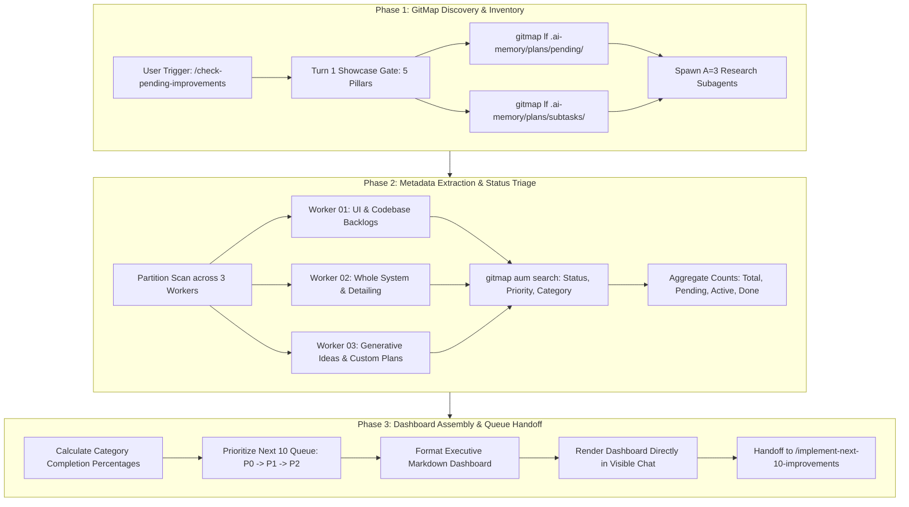

# High Priority Instruction
# Check Pending Improvements

## slug: check-pending-improvements

```text
N = 400 (Total self-loop steps budget — editable top-header parameter, default: 400)
A = 3   (MANDATORY number of spawned autonomous subagents running concurrently via invoke_subagent, default: 3)
H = 2   (Operational hands per agent: dual-task batch capacity & parallel tool dispatch, default: 2)
C = 30  (Tool calls per worker before it must report, default: 30)

System Concurrency Capacity = A × H = 3 agents × 2 hands = 6 concurrent subtask operations
Tree Hierarchy = Lead Orchestrator (Root Node) -> Branch Coordinators (Subtask Owners) -> Leaf Workers & Dynamic Joining Assistants
PHASE_1_BUDGET = 100     (Steps 1 .. 100: Planning, GitMap Directory Scan & Plan Discovery, Discovery Subagents, Up-Front Brain & Roadmap Creation)
PHASE_2_BUDGET = 150     (Steps 101 .. 250: Metadata Extraction, Status Matrix Aggregation, Category Breakdown & Priority Tier Classification)
PHASE_3_BUDGET = 150     (Steps 251 .. 400: Next 10 Queue Assembly, Dashboard Formatting, Visible Chat Rendering, Dynamic Join Saturation & Downstream Handoff)
WAVES = ceil(subtasks / (A x H))
```

> [!IMPORTANT]
> **Prompt Version:** 1.0.0  
> **Runtime:** Google Antigravity 2.0 (IDE and CLI) & Cursor IDE  
> **Invoke:** `> Invoke: /check-pending-improvements [scope-or-filter]`  
>
> **Trigger Keywords & Aliases:**  
> `check-pending-improvements`, `check-improvements`, `pending-improvements`, `improvements-status`, `how many improvements are pending`, `list-pending-improvements`, `improvements-dashboard`  
>
> **Companion Antigravity Skill:** [`check-pending-improvements`](file;.agents/skills/check-pending-improvements)  
> **Companion Cursor Skill:** [`check-pending-improvements`](file;.cursor/skills/check-pending-improvements)  
>
> **Top-Instruction Priority Mandate (Above Precedence / Preamble Precedence):**  
> Whatever directives, constraints, checklists, or user instructions are given ABOVE this prompt (including in the user preamble, header blocks, or incoming user request above) are HIGHEST PRIORITY and MUST BE FOLLOWED as strictly NON-NEGOTIABLE. They supersede and strictly override any conflicting general advice, default conventions, or lower-level guidelines below. The agent MUST inspect and follow the instructions above with absolute precedence.

[/goal](slashCommand;goal) Autonomously scan all pending improvement plans in `.ai-memory/plans/pending/` and modular subtasks in `.ai-memory/plans/subtasks/` using GitMap high-speed commands, extract complete metadata (status, category, priority, blast radius, target files), calculate total completion percentages and category distributions across all 5 improvement pillars, and render an authoritative Executive Continuous Improvement Dashboard in visible chat featuring the deterministic Next 10 Queue for immediate execution handoff to Prompt 07 (`/implement-next-10-improvements`).

[/learn](slashCommand;learn) Enforce the STRICT READ-ONLY INSPECTION & ZERO MUTATION MANDATE: this prompt is dedicated purely to high-speed backlog discovery, telemetry aggregation, triage status evaluation, and dashboard rendering. The agent is STRICTLY PROHIBITED from modifying source files, running compiler builds (`go build`, `npm run build`), or executing test suites (`go test`, `pytest`). All file searches and inspections must be performed exclusively via compiled GitMap commands (`gitmap lf`, `gitmap aum search`, `gitmap cat`).

[/plan](slashCommand;plan) first before doing work for improved work or less friction, faster work and more pure and effective work. Execute thorough step-by-step planning and discovery before rendering the dashboard. Ensure all active master plan documents, subtask checklists, and priority matrices across the workspace are cataloged into the roadmap ledger and subtask plans before dispatching worker waves.

---

### 🚨 MANDATORY SUBAGENT SPAWNING GATE (A = 3, H = 2, CAPACITY = 6 — TREE SWARM & DYNAMIC JOIN)

- **ACTUAL TOOL CALL REQUIRED:** You must ACTUALLY CALL the `invoke_subagent` tool via your tool-calling API. Do NOT just print the text `"Dispatched Worker..."` and stop. If you only print text, the subagents will not spawn and the task will fail! You must execute the `invoke_subagent` JSON tool payload.
- **TREE-STRUCTURED SWARM HIERARCHY:** Organize execution as an operational tree:
  1. **Root Orchestrator (Lead Agent):** Owns the unified inspection roadmap, telemetry aggregation, Next 10 Queue prioritization, and dashboard rendering in visible chat. Never executes file discoveries solo.
  2. **Branch Coordinators (Domain Subtask Owners):** Own designated scan partitions (Worker 01 owns UI and Codebase backlogs, Worker 02 owns Whole System and Detailing backlogs, Worker 03 owns Generative Ideas and Task-Specific plans) and manage subtask inspection waves.
  3. **Leaf Workers & Dynamic Joining Assistants:** Assist branch coordinators with GitMap status scanning, frontmatter parsing, priority extraction, and queue item sorting.
- **3-STAGE MANDATORY DISPATCH:** You must invoke `A = 3` agents (`invoke_subagent`) at EVERY stage of the workflow:
  1. **Directory Discovery Step (A = 3 `research` subagents):** Spawn 3 read-only discovery subagents (`TypeName: "research"`) to scan `.ai-memory/plans/pending/` and `.ai-memory/plans/subtasks/` using GitMap high-speed streaming commands, returning active plan paths, file counts, and subtask manifests.
  2. **Metadata Extraction Step (A = 3 `research` subagents):** Spawn 3 read-only parsing subagents (`TypeName: "research"`) to parse statuses (`PENDING`, `IN_PROGRESS`, `DONE`, `BLOCKED`), category tags, and priority tiers (`P0`, `P1`, `P2`, `P3`) across discovered files.
  3. **Dashboard Assembly Step (A = 3 `self` worker subagents):** Spawn 3 worker subagents (`TypeName: "self"`) to compile category completion metrics, assemble the Next 10 Queue, and format the executive markdown dashboard for chat rendering.
- **MANDATORY 3 SUBAGENTS IN SINGLE TOOL CALL:** Every call to `invoke_subagent` MUST contain an array of EXACTLY 3 subagent objects: `"Subagents": [agent1, agent2, agent3]`. Calling `invoke_subagent` with fewer than 3 subagents, or executing solo without calling `invoke_subagent`, is an immediate protocol violation and auto-reject failure.
- **DYNAMIC AGENT JOIN & IMMEDIATE RESPAWN (NO IDLE WORKERS):** Worker capacity `A` must remain pinned at 3 active agents (System Concurrency Capacity = 6) throughout execution. The lead orchestrator MUST NOT wait for an entire 3-agent wave to finish. As soon as ANY single worker completes, the lead immediately spawns a replacement worker for the next pending partition, or commands the worker to dynamically join an active subtask in collaborative assistance mode to keep concurrency at exactly 3 active subagents (100% duty cycle).
- **SOLO EXECUTION IS AN AUTO-REJECT FAILURE:** The lead orchestrator is **STRICTLY FORBIDDEN** from performing all backlog scanning, metadata parsing, or dashboard compilation solo without calling the `invoke_subagent` tool.

---

## Phase 0: Antigravity Skill Bootstrap (Memory Optimization)

Before executing the inspection tasks below, check if this prompt is already installed as a native IDE Skill in the workspace:

1. If `.agents/skills/check-pending-improvements/skill.md` does not exist in the workspace, create it now with IDE-detectable link syntax `[check-pending-improvements](file;.agents/skills/check-pending-improvements)`.
2. If `.cursor/skills/check-pending-improvements/skill.md` does not exist in the workspace, create it now with IDE-detectable Cursor skill link syntax `[check-pending-improvements](file;.cursor/skills/check-pending-improvements)`.
3. Once installed, rely on progressive disclosure for future runs. Do not keep the entire prompt in active memory if not needed.

---

## STRICT READ-ONLY INSPECTION & ZERO MUTATION MANDATE (NON-NEGOTIABLE)

> [!CAUTION]
> **ABSOLUTE BAN ON CODE MUTATIONS, BUILD RUNS, AND TEST RUNS:**
> Under this prompt, the AI agent is **STRICTLY PROHIBITED** from modifying production source code, editing configuration files, compiling binaries, running builds, running tests, or making invasive changes to repository files!
>
> 1. **Pure Telemetry & Observability:** The entire purpose of this workflow is **REAL-TIME BACKLOG DISCOVERY, METRIC AGGREGATION, AND TRIAGE VISIBILITY**.
> 2. **Visible Chat Dashboard Presentation:** The primary deliverable is an authoritative Continuous Improvement Status Dashboard rendered directly in visible chat.
> 3. **Next 10 Queue Handoff:** Identifies and ranks the immediate 10 pending improvements for zero-friction handoff to `/implement-next-10-improvements`.
> 4. **No-Build / No-Test Invariant:** Never run `go build`, `npm run build`, `vite build`, `cargo build`, or any test suites (`go test`, `pytest`, `npm test`) during this inspection workflow.



---

## The Unified Master Pipeline (Atomic Numbered Steps)

Execute this task via a strict 3-Phase pipeline. Do not skip steps.

### Phase 1: High-Speed Scanning & Inventory via GitMap (Steps 1–100)

1. **Top-Instruction Priority Verification:** Whatever directives, constraints, checklists, or user instructions are given ABOVE this prompt must be verified as highest priority and non-negotiable.
2. **Extreme "Understood" Turn-1 Showcase:** In your VERY FIRST response turn upon receiving the prompt, you MUST output a comprehensive, in-depth understanding block directly in visible chat before any background tool execution, covering the 5 Mandatory Pillars:
   - **Pillar 1: Strategic Intent & Systems Reasoning:** Explain *why* real-time backlog observability eliminates developer friction, prevents duplicate work, and provides deterministic triage for downstream execution swarms.
   - **Pillar 2: Explicit Scope Boundaries:** Define In-Scope (scanning `.ai-memory/plans/pending/`, `.ai-memory/plans/subtasks/`, parsing statuses, calculating KPIs, formatting Next 10 Queue) vs. strictly Excluded (source code edits, running builds, running tests, git commits).
   - **Pillar 3: Non-Negotiable Constraints & Negative Guardrails:** Explicitly recite bans on raw shell searches (`rg`, `ripgrep`, `grep`, `dir`, `ls`, `Get-ChildItem`), worker git commands, builds/tests, absolute paths, and uppercase filenames.
   - **Pillar 4: Blast Radius & Telemetry Topology:** Identify plan directories, manifest files, and downstream execution handoffs.
   - **Pillar 5: Verification & Governance Schema:** Detail the exact metrics, category columns, and priority rankings to be extracted.
3. **Master Plans Discovery:** Run `gitmap lf .ai-memory/plans/pending/` to enumerate all registered master plan files.
4. **Subtasks Discovery:** Run `gitmap lf .ai-memory/plans/subtasks/` to discover all active and pending subtask directories.
5. **Worker Subagent Dispatch:** Spawn `A = 3` read-only research subagents (`TypeName: "research"`) with disjoint directory allocations.

### Phase 2: Metadata Extraction & Status Matrix Aggregation (Steps 101–250)

6. **Status Extraction:** For each discovered plan and subtask file, stream contents via `gitmap cat` or search patterns using `gitmap aum search` to extract:
   - `Status: PENDING` / `[ ]`
   - `Status: IN_PROGRESS` / `Status: ACTIVE`
   - `Status: DONE` / `[x]`
   - `Status: BLOCKED`
7. **Category Classification:** Categorize items into the 5 core improvement pillars and custom task queues:
   - UI Materiality & Tokens (`01-next-100-ui-improvements.md` / `UI-IMP-*`)
   - Codebase Guidelines & Typing (`02-next-100-code-improvements.md` / `CODE-IMP-*`)
   - Whole System Ergonomics (`03-next-100-whole-system-improvements.md` / `SYS-IMP-*`)
   - Multi-Step Plan Detailing (`04-next-detail-out-100-improvements.md` / `PLAN-DET-*`)
   - Generative Innovation Ideas (`05-next-100-ideas-for-improvements.md` / `IDEA-*`)
   - Task-Specific Subtasks (`.ai-memory/plans/subtasks/XX-*/`)
8. **Priority Matrix Scoring:** Group uncompleted items by priority level:
   - `P0 (Critical):` Security vulnerabilities, data corruption risks, panic recoveries, broken contracts.
   - `P1 (High):` Performance bottlenecks, missing `*appfault.AppError` wrappers, parameter bloat (>2-3 args), unhandled errors.
   - `P2 (Normal):` Design token alignment, string constants extraction, function sizing (8–15 lines), documentation polish.
   - `P3 (Low):` Exploratory ideas, nice-to-have optimizations, speculative refactors.
9. **Next 10 Candidate Filter:** Filter for items with `Status: PENDING` that are unblocked and have resolved prerequisite dependencies, sorted by priority (`P0` $\rightarrow$ `P1` $\rightarrow$ `P2`).

### Phase 3: Dashboard Rendering & Downstream Handoff (Steps 251–400)

10. **KPI Calculation:** Compute:
    - Total Cataloged Improvements ($T = \text{Pending} + \text{Active} + \text{Done}$)
    - Pending Execution Backlog ($P$)
    - Completed & Verified Count ($D$)
    - Overall Completion Percentage ($\text{Pct} = \frac{D}{T} \times 100\%$)
11. **Next 10 Queue Formatting:** Assemble the top 10 pending items into a clean table with columns: `Queue #`, `Item Identifier`, `Category`, `Priority`, `Target Subsystem / File`, and `Summary Description`.
12. **Visible Chat Presentation:** Output the complete **Executive Continuous Improvement Dashboard** directly in visible chat.
13. **Actionable Handoff Directive:** Conclude with the explicit command invocation for Prompt 07:
    `> To execute the next batch of 10 improvements immediately, invoke: /implement-next-10-improvements`

---

## Output Dashboard Schema & Visual Layout

The visible chat output of this prompt MUST strictly adhere to the following schema:

```markdown
# 📊 Continuous Improvement Status Dashboard

**Generated At:** [ISO-8601 Timestamp]  
**Scan Scope:** `.ai-memory/plans/pending/` and `.ai-memory/plans/subtasks/`  
**Total Identified Improvements:** `NNN`  
**Pending Execution Backlog:** `NNN` (`XX.X%` of total)  
**Completed & Verified:** `NNN` (`XX.X%` of total)  

---

### 1. Executive Summary & Health Metrics

| Metric | Count | Percentage | Status Indicator |
|:---|:---:|:---:|:---|
| **Total Improvements Cataloged** | `NNN` | 100.0% | 📦 Complete Registry |
| **Pending Implementation** | `NNN` | `XX.X%` | ⏳ Ready for Prompt 07 |
| **In-Flight / Active** | `NNN` | `XX.X%` | 🔄 Work in Progress |
| **Completed & Verified** | `NNN` | `XX.X%` | ✅ Upstream Verified |

---

### 2. Categorical Breakdown (The 5 Improvement Pillars)

| Category / Domain | Master Plan | Pending | Active | Done | Total | Completion % |
|:---|:---|:---:|:---:|:---:|:---:|:---:|
| **UI Materiality & Tokens** | `01-next-100-ui-improvements` | `NN` | `NN` | `NN` | `100` | `XX%` |
| **Codebase Guidelines & Typing** | `02-next-100-code-improvements` | `NN` | `NN` | `NN` | `100` | `XX%` |
| **Whole System Ergonomics** | `03-next-100-whole-system-improvements` | `NN` | `NN` | `NN` | `100` | `XX%` |
| **Multi-Step Plan Detailing** | `04-next-detail-out-100-improvements` | `NN` | `NN` | `NN` | `100` | `XX%` |
| **Generative Innovation Ideas** | `05-next-100-ideas-for-improvements` | `NN` | `NN` | `NN` | `100` | `XX%` |
| **Task-Specific Plans** | `XX-[custom-slug]` | `NN` | `NN` | `NN` | `NN` | `XX%` |
| **TOTALS** | — | **`NNN`** | **`NNN`** | **`NNN`** | **`NNN`** | **`XX%`** |

---

### 3. Priority Tier Distribution

| Priority Tier | Criteria & Blast Radius | Pending Count | Target Turnaround |
|:---|:---|:---:|:---|
| **P0 (Critical)** | Security leaks, panic regressions, broken contracts, data corruption risk | `NN` | Immediate Next Batch |
| **P1 (High)** | Performance bottlenecks, missing AppError wrappers, parameter bloat, unhandled errors | `NN` | Priority Wave |
| **P2 (Normal)** | Design token alignment, string constants extraction, function line reduction, docs polish | `NN` | Standard Micro-Batch |
| **P3 (Low)** | Exploratory ideas, speculative refactorings, nice-to-have cleanups | `NN` | Backlog Queue |

---

### 4. 🚀 The Next 10 Queue (Immediate Handoff to Prompt 07)

The following 10 items are prioritized for immediate fast-forward implementation:

| Queue # | Item Identifier | Category | Priority | Target Subsystem / File | Summary Description |
|:---:|:---|:---|:---:|:---|:---|
| 01 | `[ID-001]` | `[Category]` | `P0/P1` | `[file/path]` | [Concise description] |
| 02 | `[ID-002]` | `[Category]` | `P0/P1` | `[file/path]` | [Concise description] |
| 03 | `[ID-003]` | `[Category]` | `P0/P1` | `[file/path]` | [Concise description] |
| 04 | `[ID-004]` | `[Category]` | `P1/P2` | `[file/path]` | [Concise description] |
| 05 | `[ID-005]` | `[Category]` | `P1/P2` | `[file/path]` | [Concise description] |
| 06 | `[ID-006]` | `[Category]` | `P1/P2` | `[file/path]` | [Concise description] |
| 07 | `[ID-007]` | `[Category]` | `P2` | `[file/path]` | [Concise description] |
| 08 | `[ID-008]` | `[Category]` | `P2` | `[file/path]` | [Concise description] |
| 09 | `[ID-009]` | `[Category]` | `P2` | `[file/path]` | [Concise description] |
| 10 | `[ID-010]` | `[Category]` | `P2` | `[file/path]` | [Concise description] |

> [!TIP]
> **To execute this exact batch immediately, invoke:**  
> `> /implement-next-10-improvements`
```

---

## Concrete Production Operational Example

Below is an authentic execution example demonstrating the exact dashboard rendering produced by this prompt:

```markdown
# 📊 Continuous Improvement Status Dashboard

**Generated At:** 2026-10-22T14:30:00Z  
**Scan Scope:** `.ai-memory/plans/pending/` and `.ai-memory/plans/subtasks/`  
**Total Identified Improvements:** 540  
**Pending Execution Backlog:** 380 (70.4% of total)  
**Completed & Verified:** 160 (29.6% of total)  

---

### 1. Executive Summary & Health Metrics

| Metric | Count | Percentage | Status Indicator |
|:---|:---:|:---:|:---|
| **Total Improvements Cataloged** | 540 | 100.0% | 📦 Complete Registry |
| **Pending Implementation** | 380 | 70.4% | ⏳ Ready for Prompt 07 |
| **In-Flight / Active** | 10 | 1.8% | 🔄 Work in Progress |
| **Completed & Verified** | 150 | 27.8% | ✅ Upstream Verified |

---

### 2. Categorical Breakdown (The 5 Improvement Pillars)

| Category / Domain | Master Plan | Pending | Active | Done | Total | Completion % |
|:---|:---|:---:|:---:|:---:|:---:|:---:|
| **UI Materiality & Tokens** | `01-next-100-ui-improvements` | 62 | 0 | 38 | 100 | 38.0% |
| **Codebase Guidelines & Typing** | `02-next-100-code-improvements` | 45 | 4 | 51 | 100 | 51.0% |
| **Whole System Ergonomics** | `03-next-100-whole-system-improvements` | 78 | 0 | 22 | 100 | 22.0% |
| **Multi-Step Plan Detailing** | `04-next-detail-out-100-improvements` | 95 | 0 | 5 | 100 | 5.0% |
| **Generative Innovation Ideas** | `05-next-100-ideas-for-improvements` | 100 | 0 | 0 | 100 | 0.0% |
| **Task-Specific Enhancements** | `05-improvements-folder-prompts` | 0 | 6 | 34 | 40 | 85.0% |
| **TOTALS** | — | **380** | **10** | **150** | **540** | **29.6%** |

---

### 3. Priority Tier Distribution

| Priority Tier | Criteria & Blast Radius | Pending Count | Target Turnaround |
|:---|:---|:---:|:---|
| **P0 (Critical)** | Security leaks, panic regressions, broken contracts, data corruption risk | 14 | Immediate Next Batch |
| **P1 (High)** | Performance bottlenecks, missing AppError wrappers, parameter bloat, unhandled errors | 112 | Priority Wave |
| **P2 (Normal)** | Design token alignment, string constants extraction, function line reduction, docs polish | 254 | Standard Micro-Batch |
| **P3 (Low)** | Exploratory ideas, speculative refactorings, nice-to-have cleanups | 0 | Backlog Queue |

---

### 4. 🚀 The Next 10 Queue (Immediate Handoff to Prompt 07)

The following 10 items are prioritized for immediate fast-forward implementation:

| Queue # | Item Identifier | Category | Priority | Target Subsystem / File | Summary Description |
|:---:|:---|:---|:---:|:---|:---|
| 01 | `CODE-IMP-014` | Codebase Guidelines | `P0` | `pkg/appwriter/writer.go` | Eliminate orphaned errors in stream flush and wrap via `*appfault.AppError` |
| 02 | `CODE-IMP-022` | Codebase Guidelines | `P0` | `pkg/auth/session.go` | Replace raw panic recovery with structured Result envelope return |
| 03 | `SYS-IMP-008` | Whole System | `P1` | `cli/internal/runner/exec.go` | Refactor 5 loose arguments into `*RunCommandParams` struct |
| 04 | `CODE-IMP-041` | Codebase Guidelines | `P1` | `pkg/protocol/command.go` | Extract magic command strings into strongly-typed `CommandNameType` enum |
| 05 | `CODE-IMP-058` | Codebase Guidelines | `P1` | `pkg/store/sqlite.go` | Decompose 38-line query builder into 3 functions <= 12 lines each |
| 06 | `UI-IMP-019` | UI Materiality | `P1` | `src/components/tree/TreeNode.tsx` | Split 165-line tree node into `TreeNode.tsx` (<100 lines) and `treeTypes.ts` |
| 07 | `CODE-IMP-063` | Codebase Guidelines | `P2` | `pkg/gitmap/scanner.go` | Add mandatory vertical spacing before `if` and after `}` blocks |
| 08 | `CODE-IMP-077` | Codebase Guidelines | `P2` | `pkg/config/loader.go` | Refactor explicit `if hasCache == true` to implicit `if hasCache` |
| 09 | `UI-IMP-034` | UI Materiality | `P2` | `src/styles/tokens.css` | Align color tokens with WCAG AAA contrast ramp standards |
| 10 | `SYS-IMP-029` | Whole System | `P2` | `cli/internal/help/render.go` | Extract CLI flag strings into constant registry |

> [!TIP]
> **To execute this exact batch immediately, invoke:**  
> `> /implement-next-10-improvements`
```

---

## Actionable Items & Operational Rules (R1 – R16)

When executing this prompt, all AI agents must follow these operational rules:

1. **Rule R1 (Task Breakdown in Visible Chat):** Turn 1 MUST display the 5 Mandatory Pillars and 6-part verification schema in visible chat before any background tool dispatch.
2. **Rule R2 (Read-Only Telemetry):** Strictly NO code modifications, zero file editing, and zero disk mutations during inspection turns.
3. **Rule R3 (No Full Builds):** Compiling binaries (`go build`, `npm run build`, `vite build`) is strictly prohibited.
4. **Rule R4 (No Test Execution):** Running test suites (`go test`, `pytest`, `npm test`) is strictly prohibited.
5. **Rule R5 (Strict Relative Git Paths):** All paths and markdown links MUST be strictly relative starting from repository root (`02-spec/...`, `.ai-memory/...`). Absolute paths and `file:///` URIs are totally banned.
6. **Rule R6 (Strict Lowercase Filenames):** Every newly created or modified file MUST use strictly lowercase naming.
7. **Rule R7 (GitMap High-Speed Primacy):** Query plan files and directories exclusively via GitMap (`gitmap lf`, `gitmap aum search`, `gitmap cat`). Total ban on `rg`, `ripgrep`, `dir`, `ls`, and `Get-ChildItem`.
8. **Rule R8 (.gitignore Hygiene Gate):** Ensure `.gitignore` covers temporary files and logs. Untrack ignored files via `git rm --cached`.
9. **Rule R9 (Zero Secrets Mandate):** Sensitive credentials, `.env` files, and tokens MUST be offloaded to `repo-secrets` via `gitmap rs`.
10. **Rule R10 (Tree Swarm & Subagent Spawning Gate):** Mandatory spawning of `A = 3` concurrent subagents via `invoke_subagent` (`H = 2`, Capacity = 6). Solo execution is an auto-reject failure.
11. **Rule R11 (Dynamic Join & 100% Duty Cycle):** Idle workers immediately respawn for pending partitions or dynamically join active subtasks.
12. **Rule R12 (Disjoint Partition Boundaries):** Subagents must never be assigned overlapping directory partitions during inspection.
13. **Rule R13 (Cognitive Heatmap Telemetry):** Log pre-action intent before file reads and post-action outcome verification via `gitmap heatmap`.
14. **Rule R14 (Non-Owned Repository Exclusion):** Never scan, modify, or commit to non-owned repositories (`omis`, `zsh`, `oh-my-posh`).
15. **Rule R15 (Deterministic Next 10 Queue):** Rank the Next 10 Queue deterministically by priority (`P0` $\rightarrow$ `P1` $\rightarrow$ `P2`) with unblocked status.
16. **Rule R16 (Mandatory Completion Invariant):** If git changes or commits are required by the orchestrator, never leave unpushed local commits ('No Push = Not Done').

---

## GitMap High-Speed Search Primacy & Command Suite

GitMap is your **PRIMARY** acceleration engine. Banned ALL variants of `Get-ChildItem`, `dir`, `ls` in shell, `rg`, `ripgrep`, `grep`, `git grep`, `Select-String`, and `findstr`. Execute all searches exclusively through GitMap:

| Operation | Primary GitMap Command | High-Speed Alias | Purpose & Advantage |
| :--- | :--- | :--- | :--- |
| **Directory Inventory** | `gitmap lf <dir>` / `gitmap find "*.*" <dir>` | `gitmap lf [pat]` | Instant indexed repository inventory (replaces `Get-ChildItem`, `dir`, `ls`) |
| **Live Streaming Search** | `gitmap aum search "<pattern>" [dir] [-e <.ext>] [-r] [-i]` | `gitmap aum grep` | Multi-core streaming live file search (replaces `Select-String`, `git grep`) |
| **Stream File Contents** | `gitmap cat <filepath>` | `gitmap cat` | Direct zero-disk memory streaming to stdout (replaces `cat`, `type`, `Get-Content`) |
| **Indexed Symbol Search** | `gitmap search "<query>" [--limit <n>]` | `gitmap search` | Instant SQLite cached keyword/symbol search across indexed repos |
| **Wildcard File Search** | `gitmap find "<pattern>" [-ext <ext>]` | `gitmap f "<pat>"` | Index-accelerated multi-core glob filename finder |
| **Substring File Search** | `gitmap find-files-any "<substring>"` | `gitmap ffa "<str>"` | High-speed partial filename matcher |
| **PowerShell Runner** | `gitmap pwsh "<command>"` | `gitmap ps "<cmd>"` | High-speed PowerShell execution with `-NoProfile` |
| **Bash Runner** | `gitmap bash "<command>"` | `gitmap sh "<cmd>"` | Standard cross-platform Bash command execution |
| **Offload Secrets** | `gitmap rs file <filepath>` / `folder` / `text` | `gitmap rs` | Auto-commits into `repo-secrets` in work directory |
| **Offload Scripts** | `gitmap rc file <file.ps1>` / `text` | `gitmap rc` | Auto-commits reusable scripts into `repo-cache` |
| **Atomic Commits** | `gitmap cpf "<module> - <msg>"` (Feature) / `cpb` (Bug) | `gitmap cpf` | Stages, formats with prefix, and pushes atomically (no colons in arguments). |
| **Agent Task Engine** | `gitmap task <init\|add\|claim\|complete\|fail\|status>` | `gitmap task` | Sub-millisecond compiled Go SQLite task manager for multi-agent workflows |
| **Heatmap Action Log** | `gitmap heatmap log --task <t> --action <A> --file <f>` | `gitmap heatmap log`| Concurrency-safe cognitive action telemetry into `.ai-memory/heatmap.db` |
| **Fleet Synchronization**| `gitmap sync [--workers 8]` | `gitmap sync` | Parallel Go sync engine across 43 repositories in <5s |

---

## Banned Operations Checklist (TOTAL BAN — Auto-Reject on Violation)

- [ ] TOP-INSTRUCTION PRIORITY MANDATE: Instructions given above this prompt are highest priority and strictly non-negotiable.
- [ ] STRICT READ-ONLY INSPECTION MANDATE: Never edit source code, modify files, run builds, or run tests during inspection.
- [ ] MANDATORY SUBAGENT SPAWNING GATE: Spawning `A = 3` subagents (`H = 2`, Capacity = 6) via `invoke_subagent` was explicitly called.
- [ ] NO SUBAGENT FILE WRITE COLLISIONS: Read-only subagents must not perform writes or mutate workspace state.
- [ ] NO SUBAGENT GIT EXECUTION: Subagents never run git commands (`git add`, `git commit`, `git push`, `git status`).
- [ ] NO LOCAL TESTS (TOTAL BAN): Never run all tests locally or full test suites.
- [ ] NO BUILD CHECKING (TOTAL BAN): Never run `go build`, `npm run build`, or full builds.
- [ ] NO RAW GIT COMMITS: Never run raw `git commit`, `git add -A`, or raw `git push`. All commits use GitMap semantic commands.
- [ ] NO RG, RIPGREP, OR RAW SHELL SEARCHES: Banned all `Get-ChildItem`, `dir`, `ls`, `rg`, `ripgrep`, `grep`, `Select-String`, and `findstr`.
- [ ] STRICT RELATIVE GIT PATHS: Zero absolute filesystem paths or `file:///` URIs in output or markdown documents.
- [ ] STRICT LOWERCASE FILENAMES: All referenced filenames and paths must be strictly lowercase.
- [ ] HEATMAP TELEMETRY INSPECTION: Pre-action intent logged before file reads and outcomes verified upon completion.

---

## Final Step Git Commit & Push Mandate

At the conclusion of the inspection run, if the lead orchestrator updates documentation or persisted registries, use GitMap semantic commit commands exclusively:

```bash
gitmap cpf "improvements - update check pending improvements prompt and telemetry registry"
```

- Format message strictly with a hyphen `-` to separate module and summary.
- NEVER include colons `:` inside the GitMap argument as GitMap automatically provides `Feature: ` or `Bug: `.
- ZERO intermediate commits during Phase 1 or Phase 2.
- Confirm `git status --porcelain` is completely clean and upstream tracking branch reflects the commit before concluding.
