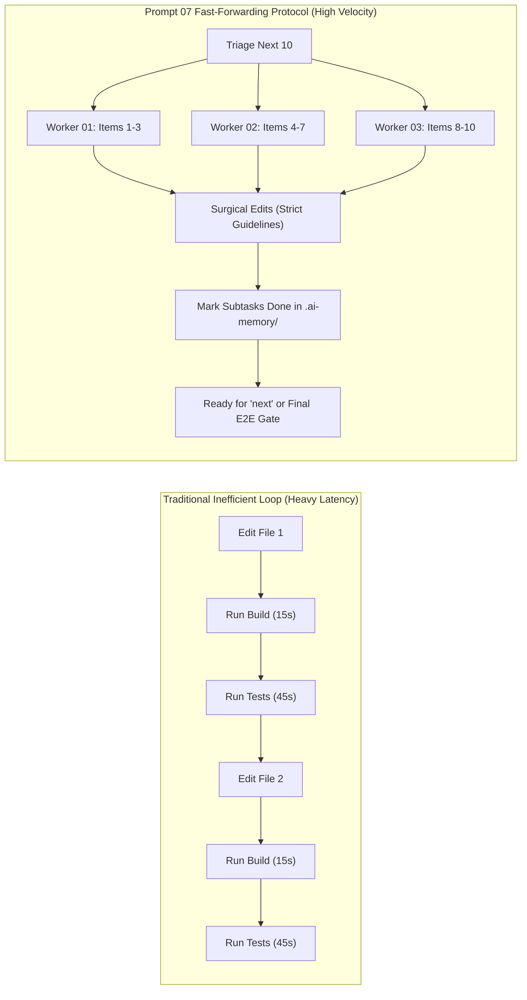
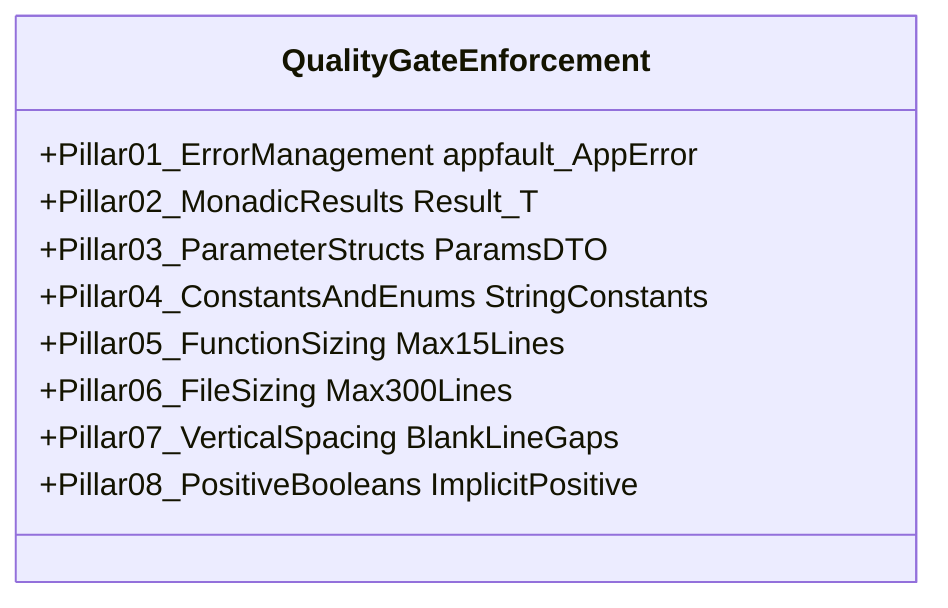
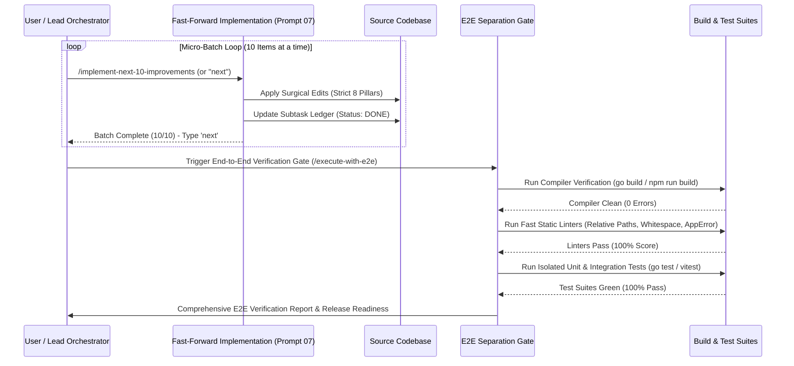

# High Priority Instruction
# Implement Next 10 Improvements

## slug: implement-next-10-improvements

```text
N = 400 (Total self-loop steps budget — editable top-header parameter, default: 400)
A = 3   (MANDATORY number of spawned autonomous subagents running concurrently via invoke_subagent, default: 3)
H = 2   (Operational hands per agent: dual-task batch capacity & parallel tool dispatch, default: 2)
C = 30  (Tool calls per worker before it must report, default: 30)

System Concurrency Capacity = A × H = 3 agents × 2 hands = 6 concurrent subtask operations
Tree Hierarchy = Lead Orchestrator (Root Node) -> Branch Coordinators (Subtask Owners) -> Leaf Workers & Dynamic Joining Assistants
PHASE_1_BUDGET = 100     (Steps 1 .. 100: Planning, Backlog Triage, Next 10 Queue Claim, Worker Dispatch & Disjoint Boundary Allocation)
PHASE_2_BUDGET = 200     (Steps 101 .. 300: Fast-Forward Implementation across 10 Items, Strict 8-Pillar Coding Guidelines, Zero Builds, Zero Tests)
PHASE_3_BUDGET = 100     (Steps 301 .. 400: Subtask State Closure [DONE], Batch Summary Report, Repeatable 'next' Cadence Handoff, Final E2E Gate Prompt)
WAVES = ceil(subtasks / (A x H))
```

> [!IMPORTANT]
> **Prompt Version:** 1.0.0  
> **Runtime:** Google Antigravity 2.0 (IDE and CLI) & Cursor IDE  
> **Invoke:** `> Invoke: /implement-next-10-improvements [plan-or-subtask-id]`  
>
> **Trigger Keywords & Aliases:**  
> `implement-next-10-improvements`, `implement-improvements`, `implement-next-10`, `next-10-improvements`, `next`, `run-next-10`, `fast-forward-improvements`  
>
> **Companion Antigravity Skill:** [`implement-next-10-improvements`](file;.agents/skills/implement-next-10-improvements)  
> **Companion Cursor Skill:** [`implement-next-10-improvements`](file;.cursor/skills/implement-next-10-improvements)  
>
> **Top-Instruction Priority Mandate (Above Precedence / Preamble Precedence):**  
> Whatever directives, constraints, checklists, or user instructions are given ABOVE this prompt (including in the user preamble, header blocks, or incoming user request above) are HIGHEST PRIORITY and MUST BE FOLLOWED as strictly NON-NEGOTIABLE. They supersede and strictly override any conflicting general advice, default conventions, or lower-level guidelines below. The agent MUST inspect and follow the instructions above with absolute precedence.

[/goal](slashCommand;goal) Autonomously claim and implement the next 10 unexecuted improvements from `.ai-memory/plans/subtasks/` or `.ai-memory/plans/pending/` with maximum velocity using the Fast-Forwarding Protocol (strictly NO-BUILD and NO-TEST execution during implementation turns), strictly enforce the 8-Pillar Coding Guideline Matrix (`*appfault.AppError`, monadic Result envelopes, parameter structs, string constants/enums, 8–15 line functions, 150–300 line files, vertical spacing rhythm, positive booleans), update subtask statuses to `DONE`, report the batch summary, and provide a seamless repeatable `"next"` cadence or handoff to the separated end-to-end verification gate (`/execute-with-e2e`).

[/learn](slashCommand;learn) Enforce the STRICT FAST-FORWARDING PROTOCOL (NO-BUILD / NO-TEST): running compilers (`go build`, `npm run build`, `vite build`, `cargo build`) or test suites (`go test`, `pytest`, `npm test`, `vitest`) during implementation turns is TOTALLY BANNED! Fast-forwarding eliminates intermediate compile-test churn that stalls batch implementation. Quality and correctness are guaranteed by construction through strict adherence to type signatures, interface contracts, and the 8-Pillar Coding Guideline Matrix. Verification is formally decoupled into an independent downstream phase (`/execute-with-e2e`).

[/plan](slashCommand;plan) first before doing work for improved work or less friction, faster work and more pure and effective work. Execute thorough step-by-step planning and triage in the repository before touching code files. Ensure the exact 10 candidate items are identified, dependencies are verified, file boundaries are partitioned across the 3 worker subagents without collisions, and subtask ledger entries are prepared before dispatching code modifications.

---

### 🚨 MANDATORY SUBAGENT SPAWNING GATE (A = 3, H = 2, CAPACITY = 6 — TREE SWARM & DYNAMIC JOIN)

- **ACTUAL TOOL CALL REQUIRED:** You must ACTUALLY CALL the `invoke_subagent` tool via your tool-calling API. Do NOT just print the text `"Dispatched Worker..."` and stop. If you only print text, the subagents will not spawn and the task will fail! You must execute the `invoke_subagent` JSON tool payload.
- **TREE-STRUCTURED SWARM HIERARCHY:** Organize execution as an operational tree:
  1. **Root Orchestrator (Lead Agent):** Owns backlog triage, queue claiming, batch status tracking, final subtask state updates, and conversational handoff. Never executes solo code edits without dispatching workers.
  2. **Branch Coordinators (Wave Subtask Owners):** Own disjoint subsets of the 10-batch:
     - Worker 01: Items 01–03
     - Worker 02: Items 04–07
     - Worker 03: Items 08–10
  3. **Leaf Workers & Dynamic Joining Assistants:** Apply surgical edits strictly within assigned file boundaries, enforcing the 8-Pillar Quality Gate with zero builds and zero tests.
- **3-STAGE MANDATORY DISPATCH:** You must invoke `A = 3` agents (`invoke_subagent`) at EVERY stage of the workflow:
  1. **Triage & Claim Step (A = 3 `research` subagents):** Spawn 3 read-only triage subagents (`TypeName: "research"`) to inspect the pending backlog via `gitmap lf` and `gitmap cat`, confirm target file existence, and lock the top 10 unexecuted items.
  2. **Fast-Forward Editing Step (A = 3 `self` worker subagents):** Spawn 3 authoring subagents (`TypeName: "self"`) to execute surgical edits across the 10 items in disjoint file boundaries under strict guideline enforcement.
  3. **State Closure & Summary Step (A = 3 `self` worker subagents):** Spawn 3 worker subagents (`TypeName: "self"`) to update subtask ledgers to `[x] DONE` in `.ai-memory/plans/subtasks/`, verify relative path hygiene, and compile the batch completion summary.
- **MANDATORY 3 SUBAGENTS IN SINGLE TOOL CALL:** Every call to `invoke_subagent` MUST contain an array of EXACTLY 3 subagent objects: `"Subagents": [agent1, agent2, agent3]`. Calling `invoke_subagent` with fewer than 3 subagents, or executing solo without calling `invoke_subagent`, is an immediate protocol violation and auto-reject failure.
- **DYNAMIC AGENT JOIN & IMMEDIATE RESPAWN (NO IDLE WORKERS):** Worker capacity `A` must remain pinned at 3 active agents (System Concurrency Capacity = 6) throughout execution. As soon as ANY single worker completes its assigned items, the lead immediately commands it to assist remaining workers or dynamic-join guideline verification to keep concurrency at exactly 3 active subagents (100% duty cycle).
- **SOLO EXECUTION IS AN AUTO-REJECT FAILURE:** The lead orchestrator is **STRICTLY FORBIDDEN** from performing all code modifications solo without calling the `invoke_subagent` tool.

---

## Phase 0: Antigravity Skill Bootstrap (Memory Optimization)

Before executing the implementation tasks below, check if this prompt is already installed as a native IDE Skill in the workspace:

1. If `.agents/skills/implement-next-10-improvements/skill.md` does not exist in the workspace, create it now with IDE-detectable link syntax `[implement-next-10-improvements](file;.agents/skills/implement-next-10-improvements)`.
2. If `.cursor/skills/implement-next-10-improvements/skill.md` does not exist in the workspace, create it now with IDE-detectable Cursor skill link syntax `[implement-next-10-improvements](file;.cursor/skills/implement-next-10-improvements)`.
3. Once installed, rely on progressive disclosure for future runs. Do not keep the entire prompt in active memory if not needed.

---

## FAST-FORWARDING IMPLEMENTATION PROTOCOL (NON-NEGOTIABLE)

> [!CAUTION]
> **TOTAL BAN ON INTERMEDIATE BUILDS AND INTERMEDIATE TESTS:**
> During implementation turns of this prompt, the AI agent is **STRICTLY FORBIDDEN** from running compilers (`go build`, `npm run build`, `vite build`, `cargo build`) or test suites (`go test`, `pytest`, `npm test`, `vitest`, `playwright`)!
>
> 1. **Why Fast-Forwarding Is Enforced:** Running builds and tests after every micro-edit creates massive latency, exhausts developer flow, and introduces transient compile errors for unintegrated sibling changes.
> 2. **Quality by Construction:** Correctness is guaranteed structurally through adherence to type signatures, interface contracts, and the 8-Pillar Coding Guideline Matrix.
> 3. **Decoupled Verification Gate:** Full compilation and test execution are isolated to an independent downstream phase triggered via `/execute-with-e2e` after all batches complete.



---

## The 8-Pillar Strict Coding Guideline Enforcement Matrix

Every modification performed across the 10 improvement items MUST strictly adhere to the 8 coding guideline pillars:



```text
+---------------------------------------------------------------------------------------------------+
|                            STRICT CODING GUIDELINES ENFORCEMENT MATRIX                            |
+------------------------------------+--------------------------------------------------------------+
| Guideline Category                 | Concrete Rule & Architectural Invariant                      |
+------------------------------------+--------------------------------------------------------------+
| 1. Error Management                | - Zero orphaned errors: `_ = err` is TOTALLY BANNED.        |
|                                    | - Structured error returns must use `*appfault.AppError`.    |
|                                    | - Preserves error causality via `.Wrap()` or `.WithCause()`. |
+------------------------------------+--------------------------------------------------------------+
| 2. Monadic Result Envelopes        | - Functions returning complex types or fallible data must    |
|                                    |   return `Result[T]` or `*appfault.AppError`.                |
|                                    | - Elimination of naked multi-value error tuples.             |
+------------------------------------+--------------------------------------------------------------+
| 3. Parameter Struct Encapsulation  | - Signatures with >2-3 parameters are STRICTLY BANNED.       |
|                                    | - Multiple arguments encapsulated into dedicated `*Params`   |
|                                    |   structs/DTOs (e.g. `ExecuteBatchParams`).                  |
+------------------------------------+--------------------------------------------------------------+
| 4. String Constants & Enums        | - Zero raw magic strings or inline string literals.          |
|                                    | - All domain keys, statuses, and tokens must be declared     |
|                                    |   as constants or strongly-typed enums (PascalCase + Type).  |
+------------------------------------+--------------------------------------------------------------+
| 5. Function Sizing Guardrails      | - Functions must be kept strictly between 8 and 15 lines.   |
|                                    | - Complex procedures decomposed into discrete helper verbs.  |
+------------------------------------+--------------------------------------------------------------+
| 6. File Sizing Guardrails          | - Files strictly bounded within 150 to 300 lines.            |
|                                    | - UI components strictly under 100 lines.                    |
|                                    | - Oversized files partitioned into modular siblings.         |
+------------------------------------+--------------------------------------------------------------+
| 7. Vertical Spacing Rhythm         | - Blank line mandatory before `if`.                          |
|                                    | - Blank line mandatory after closing brace `}`.              |
|                                    | - Blank line mandatory before `return`.                      |
|                                    | - Blank line surrounding multiline struct instantiations.    |
+------------------------------------+--------------------------------------------------------------+
| 8. Positive Boolean Standards      | - Affirmative prefixes only (`is*`, `has*`).                 |
|                                    | - Implicit boolean evaluation: `if isReady { ... }`.         |
|                                    | - TOTAL BAN on explicit true checks (`== true`).             |
|                                    | - TOTAL BAN on mixed polarity in single conditions.          |
+------------------------------------+--------------------------------------------------------------+
```

### Pillar Deep Dives:

1. **Error Management:** Use package `appfault` (`04-code/golang/pkg/appfault`) with struct `AppError`. Eliminate package stutter (never use `apperror.AppError`). Construct errors via `appfault.New(code, message)` or `appfault.Wrap(err, code, message)`.
2. **Monadic Results:** Use `Result[T]`, `ResultSlice[T]`, or `ResultMap[K, V]`. In TypeScript/Rust, use `Result<T, AppError>`. Replace multi-value return tuples like `(Data, error)` with monadic containers.
3. **Parameter Structs:** Any function signature taking >2–3 loose arguments must encapsulate parameters into a struct (`*<FunctionName>Params`).
4. **String Constants & Strongly-Typed Enums:** PascalCase enum types with `Type` suffix (e.g., `ImprovementPriorityType`). Companion validation methods (`IsValid() bool`) attached.
5. **Function Sizing:** Function bodies strictly 8–15 lines (optimal 8–10 lines). Guard clauses and early returns flatten nesting.
6. **File Sizing:** Production files bounded within 150–300 lines; UI components <= 100 lines.
7. **Vertical Spacing:** Blank line before `if`, after `}`, before `return`, and around multiline structs.
8. **Positive Booleans:** Implicit checks only (`if isReady`), affirmative prefixes (`is*`, `has*`), zero explicit `== true`, zero mixed polarity in conditions.

---

## The Repeatable "Next" Cadence & Batch Workflow

This prompt is engineered for high-cadence conversational iteration:

1. **Deterministic Selection:** Pulls the top 10 unexecuted, unblocked items from `.ai-memory/plans/subtasks/` (or active queue in Prompt 06).
2. **Surgical Fast-Forward Edits:** 3 concurrent workers apply changes in parallel with zero build/test delays.
3. **State Ledger Transition:** Each item is marked `- [x] DONE` in its respective subtask markdown document.
4. **Batch Handoff Prompt:** Turn concludes with:
   `"Batch [N] complete (10/10 items implemented). Type 'next' to implement the next 10 pending improvements, or invoke /execute-with-e2e to run the separated verification gate."`
5. **Repeatability:** The operator simply submits `"next"` to immediately advance to the subsequent 10 items.

---

## Separated End-to-End Verification Gate Handoff

When the operator decides to verify the accumulated batches or all backlogs are drained, invoke `/execute-with-e2e` for the decoupled verification sequence:



### Verification Gate Execution Commands:
1. **Build Pass:** `go build ./...` or `pnpm build` (verify zero syntax/type errors).
2. **Static Linters:** `python .agents/scripts/07-relative-path-fixer.py --check-only` and `python .agents/scripts/04-newline-fixer.py --check-only`.
3. **Targeted Tests:** `go test -v ./pkg/...` (isolated unit tests with zero OS modifications).
4. **GitMap Atomic Commit & Push:**
   `gitmap cpf "improvements - implement next 10 improvements batch"` (using hyphen format without colons).

---

## The Unified Master Pipeline (Atomic Numbered Steps)

Execute this task via a strict 3-Phase pipeline. Do not skip steps.

### Phase 1: Planning, Backlog Triage & Queue Claim (Steps 1–100)

1. **Top-Instruction Priority Verification:** Whatever directives, constraints, checklists, or user instructions are given ABOVE this prompt must be verified as highest priority and non-negotiable.
2. **Extreme "Understood" Turn-1 Showcase:** In your VERY FIRST response turn upon receiving the prompt, you MUST output a comprehensive understanding block directly in visible chat before any background tool dispatch, covering the 5 Mandatory Pillars:
   - **Pillar 1: Strategic Intent & Systems Reasoning:** Explain *why* fast-forwarding micro-batches with decoupled verification accelerates implementation velocity while preserving architectural integrity.
   - **Pillar 2: Explicit Scope Boundaries:** Define In-Scope (implementing exactly the next 10 pending items, enforcing 8 coding guidelines, updating subtask statuses to `DONE`) vs. strictly Excluded (running builds, running tests, touching files outside the 10 items, git commits in subagents).
   - **Pillar 3: Non-Negotiable Constraints & Negative Guardrails:** Explicitly recite bans on intermediate builds (`go build`), intermediate tests (`go test`), raw searches (`rg`, `grep`, `dir`), worker git commands, absolute paths, and uppercase filenames.
   - **Pillar 4: Blast Radius & Dependency Partitioning:** Map target files for the 10 items and allocate disjoint sets across Workers 01, 02, and 03.
   - **Pillar 5: Quality Gate & State Transition Contract:** Detail the 8 coding guidelines and the exact subtask ledger update format.
3. **Identify Candidate Queue:** Scan `.ai-memory/plans/subtasks/` or query Prompt 06 to locate the next 10 pending improvements (`Status: PENDING`).
4. **Partition Target Files:** Group the 10 items into 3 disjoint worker packages:
   - Package A (Items 01–03) $\rightarrow$ Worker 01
   - Package B (Items 04–07) $\rightarrow$ Worker 02
   - Package C (Items 08–10) $\rightarrow$ Worker 03
5. **Worker Subagent Dispatch:** Spawn `A = 3` concurrent authoring subagents (`TypeName: "self"`).

### Phase 2: Fast-Forward Implementation & Guideline Enforcement (Steps 101–300)

6. **Fast-Forward Editing:** Workers apply surgical edits to target files using `edit_file` or `write_file`.
7. **Zero-Build & Zero-Test Enforcement:** Workers MUST NOT execute `go build`, `npm run build`, `go test`, or `pytest`.
8. **Guideline Compliance Checklist per Item:**
   - [ ] No orphaned errors (`_ = err` discarded).
   - [ ] Structured errors return `*appfault.AppError` via constructor helpers.
   - [ ] Fallible procedures return monadic `Result[T]`.
   - [ ] Functions with >2-3 parameters use a `*Params` struct.
   - [ ] String literals converted to PascalCase enums with `Type` suffix.
   - [ ] Function bodies strictly bounded to 8–15 lines.
   - [ ] File sizing bounded within 150–300 lines (UI <= 100 lines).
   - [ ] Blank lines before `if`, after `}`, before `return`, around structs.
   - [ ] Affirmative positive booleans with implicit checks (`if isReady`).

### Phase 3: Subtask State Closure & Handoff (Steps 301–400)

9. **Subtask Ledger Checkpoints:** For each completed item, update its status from `- [ ]` / `Status: PENDING` to `- [x]` / `Status: DONE` in `.ai-memory/plans/subtasks/`.
10. **Relative Path Hygiene Audit:** Verify zero absolute filesystem paths or `file:///` URIs were introduced.
11. **Batch Summary Assembly:** Compile a report listing all 10 implemented improvements, target files modified, lines changed, and coding guidelines enforced.
12. **Continuous Cadence Handoff:** Output the summary in visible chat with clear guidance:
    `"Batch complete (10/10 items implemented). Type 'next' to implement the next 10 pending improvements, or invoke /execute-with-e2e to run the separated verification gate."`

---

## Concrete Production Operational Examples

### Example 1: Code Refactoring Under Strict 8 Pillars

#### Target File: `pkg/appwriter/writer.go`

```go
// ==========================================
// BEFORE REFACTORING (Violations Present):
// - Multiple loose arguments (>3)
// - Orphaned error (_ = w.Flush())
// - Raw error return instead of *appfault.AppError
// - Missing vertical blank lines before if and return
// - Explicit == true boolean check
// ==========================================

func WriteStreamRecord(w *bufio.Writer, header string, body []byte, isCompressed bool) error {
    if isCompressed == true {
        body = compressBytes(body)
    }
    w.WriteString(header)
    w.Write(body)
    _ = w.Flush() // VIOLATION: Orphaned error discarded!
    return nil
}

// ==========================================
// AFTER REFACTORING (100% Guideline Compliant):
// - Dedicated value parameter struct: WriteStreamRecordParams
// - Implicit positive boolean: if params.IsCompressed
// - Zero orphaned errors: w.Flush() error checked and wrapped
// - Structured return: *appfault.AppError standard
// - Strict vertical blank lines before if, after }, before return
// - Function sized cleanly at 11 lines
// ==========================================

package appwriter

import (
    "bufio"

    "04-code/golang/pkg/appfault"
)

type WriteStreamRecordParams struct {
    Writer       *bufio.Writer
    Header       string
    Body         []byte
    IsCompressed bool
}

func WriteStreamRecord(params *WriteStreamRecordParams) *appfault.AppError {
    if params.IsCompressed {
        params.Body = compressBytes(params.Body)
    }

    params.Writer.WriteString(params.Header)
    params.Writer.Write(params.Body)

    err := params.Writer.Flush()
    if err != nil {
        return appfault.Wrap(err, "ERR_STREAM_FLUSH", "failed to flush stream record buffer")
    }

    return nil
}
```

### Example 2: Subtask Ledger Checkpoint Update

In `.ai-memory/plans/subtasks/02-next-100-code-improvements/01-subtask-appwriter.md`:

```markdown
<!-- BEFORE -->
- [ ] CODE-IMP-014: Eliminate orphaned errors in stream flush and wrap via *appfault.AppError
  - Status: PENDING
  - Target: pkg/appwriter/writer.go

<!-- AFTER -->
- [x] CODE-IMP-014: Eliminate orphaned errors in stream flush and wrap via *appfault.AppError
  - Status: DONE
  - Target: pkg/appwriter/writer.go
  - Completed: 2026-10-22T14:35:00Z
```

### Example 3: Batch Completion Summary in Visible Chat

```markdown
### 🚀 Batch Implementation Summary (Items 01–10)

| Item # | Identifier | Subsystem / File | Guideline Enforced | Status |
|:---:|:---|:---|:---|:---:|
| 01 | `CODE-IMP-014` | `pkg/appwriter/writer.go` | `*appfault.AppError` & zero orphaned errors | `DONE` |
| 02 | `CODE-IMP-022` | `pkg/auth/session.go` | Monadic Result envelope & panic elimination | `DONE` |
| 03 | `SYS-IMP-008` | `cli/internal/runner/exec.go` | Parameter struct `*RunCommandParams` | `DONE` |
| 04 | `CODE-IMP-041` | `pkg/protocol/command.go` | Strongly-typed `CommandNameType` enum | `DONE` |
| 05 | `CODE-IMP-058` | `pkg/store/sqlite.go` | Function decomposition into <= 12 lines | `DONE` |
| 06 | `UI-IMP-019` | `src/components/tree/TreeNode.tsx` | Split into `<100` lines + `treeTypes.ts` | `DONE` |
| 07 | `CODE-IMP-063` | `pkg/gitmap/scanner.go` | Vertical blank lines before `if` and after `}` | `DONE` |
| 08 | `CODE-IMP-077` | `pkg/config/loader.go` | Implicit positive boolean `if params.HasCache` | `DONE` |
| 09 | `UI-IMP-034` | `src/styles/tokens.css` | WCAG AAA contrast token ramp alignment | `DONE` |
| 10 | `SYS-IMP-029` | `cli/internal/help/render.go` | CLI flag constants extraction | `DONE` |

**Fast-Forwarding Metric:** 10/10 items implemented | 0 build runs | 0 test runs  
**Backlog Remaining:** 370 pending improvements

> [!TIP]
> **Next Step Options:**
> 1. To advance immediately to the next 10 improvements, type: **`next`**
> 2. To trigger the decoupled end-to-end verification gate, invoke: **`/execute-with-e2e`**
```

---

## Actionable Items & Operational Rules (R1 – R16)

When executing this prompt, all AI agents must follow these operational rules:

1. **Rule R1 (Task Breakdown in Visible Chat):** Turn 1 MUST display the 5 Mandatory Pillars and 6-part verification schema in visible chat before any background tool dispatch.
2. **Rule R2 (Targeted Fast-Forwarding):** Strictly edit target files for the claimed 10 items only; never modify peripheral files.
3. **Rule R3 (No Full Builds):** Total ban on `go build`, `npm run build`, `vite build`, `cargo build` during implementation turns.
4. **Rule R4 (No Test Execution):** Total ban on `go test`, `pytest`, `npm test`, `vitest` during implementation turns.
5. **Rule R5 (Strict Relative Git Paths):** All paths and markdown links MUST be strictly relative starting from repository root (`02-spec/...`, `pkg/...`). Absolute paths and `file:///` URIs are totally banned.
6. **Rule R6 (Strict Lowercase Filenames):** Every newly created or modified file MUST use strictly lowercase naming.
7. **Rule R7 (GitMap Commit Primacy):** When lead commits at the final gate, use GitMap semantic commands (`gitmap cpf "<module> - <summary>"`). Never include colons inside the message argument.
8. **Rule R8 (.gitignore Hygiene Gate):** Ensure `.gitignore` covers caches and build outputs. Untrack ignored files via `git rm --cached`.
9. **Rule R9 (Zero Secrets Mandate):** Sensitive credentials, `.env` files, and tokens MUST be offloaded to `repo-secrets` via `gitmap rs`.
10. **Rule R10 (Tree Swarm & Subagent Spawning Gate):** Mandatory spawning of `A = 3` concurrent subagents via `invoke_subagent` (`H = 2`, Capacity = 6). Solo execution is an auto-reject failure.
11. **Rule R11 (Dynamic Join & 100% Duty Cycle):** Idle workers immediately respawn for pending items or dynamically join active subtasks.
12. **Rule R12 (Disjoint File Boundaries):** Subagents must never be assigned overlapping target files to prevent Windows file lock crashes.
13. **Rule R13 (Cognitive Heatmap Telemetry):** Log pre-action intent before file reads/edits and post-action outcome verification via `gitmap heatmap`.
14. **Rule R14 (Non-Owned Repository Exclusion):** Never modify or push to non-owned repositories (`omis`, `zsh`, `oh-my-posh`).
15. **Rule R15 (Subtask State Closure):** Mark each completed item as `DONE` in `.ai-memory/plans/subtasks/` immediately upon completion.
16. **Rule R16 (Mandatory Completion Invariant):** If git changes or commits are required by the orchestrator, never leave unpushed local commits ('No Push = Not Done').

---

## GitMap High-Speed Search Primacy & Command Suite

GitMap is your **PRIMARY** acceleration engine. Banned ALL variants of `Get-ChildItem`, `dir`, `ls` in shell, `rg`, `ripgrep`, `grep`, `git grep`, `Select-String`, and `findstr`. Execute all searches exclusively through GitMap:

| Operation | Primary GitMap Command | High-Speed Alias | Purpose & Advantage |
| :--- | :--- | :--- | :--- |
| **Directory Inventory** | `gitmap lf <dir>` / `gitmap find "*.*" <dir>` | `gitmap lf [pat]` | Instant indexed repository inventory (replaces `Get-ChildItem`, `dir`, `ls`) |
| **Live Streaming Search** | `gitmap aum search "<pattern>" [dir] [-e <.ext>] [-r] [-i]` | `gitmap aum grep` | Multi-core streaming live file search (replaces `Select-String`, `git grep`) |
| **Stream File Contents** | `gitmap cat <filepath>` | `gitmap cat` | Direct zero-disk memory streaming to stdout (replaces `cat`, `type`, `Get-Content`) |
| **Indexed Symbol Search** | `gitmap search "<query>" [--limit <n>]` | `gitmap search` | Instant SQLite cached keyword/symbol search across indexed repos |
| **Wildcard File Search** | `gitmap find "<pattern>" [-ext <ext>]` | `gitmap f "<pat>"` | Index-accelerated multi-core glob filename finder |
| **Substring File Search** | `gitmap find-files-any "<substring>"` | `gitmap ffa "<str>"` | High-speed partial filename matcher |
| **PowerShell Runner** | `gitmap pwsh "<command>"` | `gitmap ps "<cmd>"` | High-speed PowerShell execution with `-NoProfile` |
| **Bash Runner** | `gitmap bash "<command>"` | `gitmap sh "<cmd>"` | Standard cross-platform Bash command execution |
| **Offload Secrets** | `gitmap rs file <filepath>` / `folder` / `text` | `gitmap rs` | Auto-commits into `repo-secrets` in work directory |
| **Offload Scripts** | `gitmap rc file <file.ps1>` / `text` | `gitmap rc` | Auto-commits reusable scripts into `repo-cache` |
| **Atomic Commits** | `gitmap cpf "<module> - <msg>"` (Feature) / `cpb` (Bug) | `gitmap cpf` | Stages, formats with prefix, and pushes atomically (no colons in arguments). |
| **Agent Task Engine** | `gitmap task <init\|add\|claim\|complete\|fail\|status>` | `gitmap task` | Sub-millisecond compiled Go SQLite task manager for multi-agent workflows |
| **Heatmap Action Log** | `gitmap heatmap log --task <t> --action <A> --file <f>` | `gitmap heatmap log`| Concurrency-safe cognitive action telemetry into `.ai-memory/heatmap.db` |
| **Fleet Synchronization**| `gitmap sync [--workers 8]` | `gitmap sync` | Parallel Go sync engine across 43 repositories in <5s |

---

## Banned Operations Checklist (TOTAL BAN — Auto-Reject on Violation)

- [ ] TOP-INSTRUCTION PRIORITY MANDATE: Instructions given above this prompt are highest priority and strictly non-negotiable.
- [ ] STRICT FAST-FORWARDING MANDATE: Never run compiler builds (`go build`, `npm run build`) or test suites during implementation.
- [ ] MANDATORY SUBAGENT SPAWNING GATE: Spawning `A = 3` subagents (`H = 2`, Capacity = 6) via `invoke_subagent` was explicitly called.
- [ ] NO SUBAGENT FILE WRITE COLLISIONS: Two subagents never assigned to edit the same file path simultaneously.
- [ ] NO SUBAGENT GIT EXECUTION: Subagents never run git commands (`git add`, `git commit`, `git push`, `git status`).
- [ ] NO LOCAL TESTS (TOTAL BAN): Never run all tests locally or full test suites during implementation turns.
- [ ] NO BUILD CHECKING (TOTAL BAN): Every time you write code, do not build the code.
- [ ] NO RAW GIT COMMITS: Never run raw `git commit`, `git add -A`, or raw `git push`. All commits use GitMap semantic commands.
- [ ] NO INTERMEDIATE COMMITS: All changes committed together in one single atomic GitMap commit at the final gate.
- [ ] NO PER-FILE COMMITS: Never commit files individually as you edit them.
- [ ] NO UNCOMMITTED WORK (NO PUSH = NOT DONE): Task is incomplete until committed and confirmed pushed to GitHub.
- [ ] NO RG, RIPGREP, OR RAW SHELL SEARCHES: Banned all `Get-ChildItem`, `dir`, `ls`, `rg`, `ripgrep`, `grep`, `Select-String`, and `findstr`.
- [ ] STRICT RELATIVE GIT PATHS: Zero absolute filesystem paths or `file:///` URIs in output or markdown documents.
- [ ] STRICT LOWERCASE FILENAMES: All referenced filenames and paths must be strictly lowercase.
- [ ] HEATMAP TELEMETRY INSPECTION: Pre-action intent logged before file reads/edits and outcomes verified upon completion.

---

## Final Step Git Commit & Push Mandate

At the conclusion of the implementation session or when reaching the separation gate, the lead orchestrator uses GitMap semantic commit commands exclusively:

```bash
gitmap cpf "improvements - implement next 10 improvements batch"
```

- Format message strictly with a hyphen `-` to separate module and summary.
- NEVER include colons `:` inside the GitMap argument as GitMap automatically provides `Feature: ` or `Bug: `.
- ZERO intermediate commits during Phase 1 or Phase 2.
- Confirm `git status --porcelain` is completely clean and upstream tracking branch reflects the commit before concluding.
