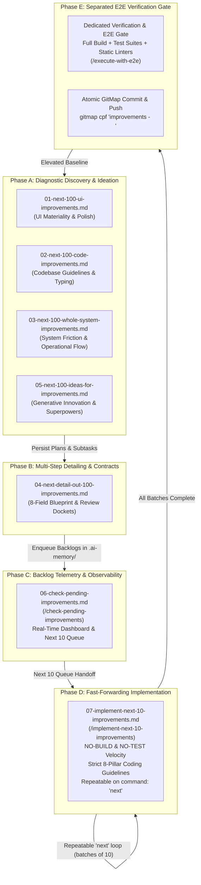

# Improvements Prompts (`30-improvements`) — Index & Catalog

> [!IMPORTANT]
> Category: `30-improvements`  
> Architecture: Canonical V6 Continuous Improvement Flywheel & Multi-Agent Protocol  
> Scope: System-Wide UX Optimization, Codebase Quality, UI/UX Materiality, Multi-Step Plan Detailing, Generative Ideation, Real-Time Backlog Telemetry, Fast-Forwarding Batch Execution, and Separated E2E Verification  

---

## Overview

The `30-improvements` prompt category establishes an autonomous, recurring continuous improvement flywheel, generative ideation engine, rigorous plan-detailing framework, real-time backlog inspection dashboard, and high-velocity batch execution system across the Prompt Architect meta-repository and connected fleet. Each prompt in this category conducts deep architectural audits, diagnostic inspections, or high-speed execution routines focused strictly on user and developer experience, turning continuous system refinement into an automated, self-sustaining pipeline.

The continuum spans 7 foundational stages:
1. **Multi-Dimensional Discovery:** Generating 100 grounded candidates across UI/UX polish (`01`), codebase hygiene and type safety (`02`), whole-system ergonomics (`03`), and generative innovation superpowers (`05`).
2. **Deep Specification & Detailing:** Expanding candidate items into actionable 8-field blueprints and structural contracts (`04`).
3. **Real-Time Backlog Inspection & Telemetry:** Scanning all pending plans and subtasks to render an executive status dashboard and deterministic Next 10 Queue (`06`).
4. **Fast-Forwarding Micro-Batch Execution:** Rapidly implementing batches of 10 items with zero intermediate builds or test delays under strict 8-pillar coding guidelines (`07`).
5. **Separated End-to-End Verification Gate:** Decoupling comprehensive builds, static linters, and regression test suites into an independent downstream verification phase.

All improvements adhere to structured specification schemas, enforce the **Zero Harm / Regression Safety Matrix**, provide backward compatibility guarantees, and include concrete, copy-paste ready implementation blueprints.

> [!NOTE]
> **Continuous Improvement Flywheel Invariant:**  
> Running discovery prompts in this category persists the identified 100 improvement items into `.ai-memory/plans/pending/XX-<slug>.md` along with subtasks in `.ai-memory/plans/subtasks/XX-<slug>/`. Detailing prompts expand these candidates into exhaustive multi-step execution roadmaps, inspection prompts aggregate real-time triage dashboards, and batch execution prompts chew through backlogs 10 items at a time on command `"next"`.
>
> **Strict Relative Git Paths Only:** All file paths, markdown links, and subtask citations must strictly use relative paths from the repository root (e.g. `01-prompts/...`, `02-spec/...`, `.ai-memory/...`, `pkg/...`). Absolute filesystem paths and `file:///` URIs are totally banned.

---

## Directory Index & Catalog

| Prompt File | Version | Scope | Key Capabilities |
| :--- | :--- | :--- | :--- |
| [`01-next-100-ui-improvements.md`](01-next-100-ui-improvements.md) | V6 / 1.0.0 | UI/UX & Design Tokens | 100 UI-level UX improvements covering design token registries, typography clamp formulas, WCAG AAA contrast, glassmorphic depth, virtualized trees, and presenter HUDs. |
| [`02-next-100-code-improvements.md`](02-next-100-code-improvements.md) | V6 / 1.0.0 | Codebase Quality & Hygiene | 100 codebase-level improvements enforcing monadic Result envelopes, domain `*appfault.AppError`, positive booleans, parameter structs, map dispatch tables, and value semantics. |
| [`03-next-100-whole-system-improvements.md`](03-next-100-whole-system-improvements.md) | V6 / 1.0.0 | Whole-System Architecture | 100 whole-system improvements across 10 UX clusters: DX/CLI ergonomics, UI tokens, agent swarms, prompt architecture, fleet sync, code quality, performance, diagnostics, test isolation, and spec governance. |
| [`04-next-detail-out-100-improvements.md`](04-next-detail-out-100-improvements.md) | V6 / 1.0.0 | Multi-Step Detailing & Review Dockets | Autonomously details out active, pending, and completed plans and discovered improvements into exhaustive multi-step execution roadmaps, structural contracts, dependency graphs, and review dockets with strict review-first gating (no immediate execution without user review). |
| [`05-next-100-ideas-for-improvements.md`](05-next-100-ideas-for-improvements.md) | V6 / 1.0.0 | Generative Innovation & Superpowers | Autonomously surveys target repositories across a 5-layer diagnostic inspection to synthesize 100 concrete, high-leverage improvement and innovation ideas across 10 ideation clusters with strict review-first gating, grounded codebase anchors, and actionable pending plan enqueueing. |
| [`06-check-pending-improvements.md`](06-check-pending-improvements.md) | V6 / 1.0.0 | Backlog Inspection & Telemetry | Autonomously scans `.ai-memory/plans/pending/` and `.ai-memory/plans/subtasks/` using GitMap high-speed commands to render an executive improvement dashboard with category breakdowns, priority tiers (P0–P3), completion KPIs, and the Next 10 Queue for immediate execution handoff. |
| [`07-implement-next-10-improvements.md`](07-implement-next-10-improvements.md) | V6 / 1.0.0 | Fast-Forward Batch Implementation | Autonomously implements the next 10 unexecuted improvements from the backlog using the Fast-Forwarding Protocol (strictly NO-BUILD and NO-TEST during implementation) while strictly enforcing the 8-Pillar Coding Guideline Matrix, repeatable on user command `"next"`. |

---

## Synergy: The 7-Prompt Improvement Continuum & Flywheel

The 7 prompts within Category 30 form a closed-loop, highly complementary continuous improvement flywheel:



### Operational Synergy Breakdown:
- **Diagnostic Discovery Prompts (`01`, `02`, `03`) — Broad Architectural Radar:**  
  Systematically scan the repository across UI/UX, codebase quality, or whole-system ergonomics to surface 100 grounded improvement opportunities. They capture the macro view and seed the backlog in `.ai-memory/plans/pending/`.
- **Generative Ideation Engine (`05`) — Strategic Superpowers & Unbuilt Capabilities:**  
  Conducts a 5-layer diagnostic inspection (identity, user journeys, developer ergonomics, architectural bottlenecks, ecosystem potential) to synthesize 100 innovative superpowers and unbuilt high-value capabilities that propel the repository beyond reactive maintenance into 10x leverage leaps.
- **Detailing Prompt (`04`) — Micro Precision & Structural Contracts:**  
  Ingests raw discovery candidates, pending backlogs, or ideation proposals, inspects the codebase using GitMap high-speed streaming search, and expands each item into an exhaustive 8-Field Specification Card with concrete code blueprints, exact caller counts, and binary verification criteria.
- **Backlog Inspection Dashboard (`06`) — Real-Time Visibility & Prioritization:**  
  Scans all pending plan files and subtask folders using GitMap streaming commands (`gitmap lf`, `gitmap aum search`), aggregating exact counts, category splits, completion percentages, priority tiers (P0–P3), and the deterministic Next 10 Queue for immediate execution.
- **Fast-Forwarding Batch Execution (`07`) — High-Throughput Implementation:**  
  Consumes exactly 10 improvements per batch in fast-forwarding mode (`NO-BUILD`, `NO-TEST`), enforcing strict coding guidelines by construction. The operator advances through successive batches simply by entering `"next"`.
- **Decoupled Verification Gate (`execute-with-e2e`) — Enterprise Safety:**  
  Once desired batches are finished, comprehensive compiler checks, static linters, and isolated unit/regression tests run in a single consolidated pass before upstream atomic push.
- **Continuous Flywheel Renewal:**  
  As completed improvements are merged and pushed, running discovery prompts again surveys the elevated codebase baseline, surfacing the next wave of refinements.

---

## The Fast-Forwarding Protocol & The 8-Pillar Quality Gate

Prompt 07 introduces the **Fast-Forwarding Protocol**:

> [!IMPORTANT]
> **Strict Fast-Forwarding Invariant (`NO-BUILD`, `NO-TEST`):**  
> During implementation turns of Prompt 07, agents MUST NOT execute compiler commands (`go build`, `npm run build`, `vite build`), test suites (`go test`, `pytest`, `npm test`, `vitest`), or end-to-end runners.  
> **Rationale:** Eliminates intermediate compile-test churn that stalls batch implementation. Quality and correctness are guaranteed structurally through grounded coding standards and syntax-level precision. Full end-to-end compilation and testing are decoupled into a dedicated phase at the conclusion of all batches.

### The 8-Pillar Strict Coding Guideline Matrix:

```text
+---------------------------------------------------------------------------------------------------+
|                            STRICT CODING GUIDELINES ENFORCEMENT MATRIX                            |
+------------------------------------+--------------------------------------------------------------+
| Guideline Category                 | Concrete Rule & Architectural Invariant                      |
+------------------------------------+--------------------------------------------------------------+
| 1. Error Management                | - Zero orphaned errors: `_ = err` is TOTALLY BANNED.        |
|                                    | - Structured error returns must use `*appfault.AppError`.    |
|                                    | - Preserves error causality via `.Wrap()` or `.WithCause()`. |
+------------------------------------+--------------------------------------------------------------+
| 2. Monadic Result Envelopes        | - Functions returning complex types or fallible data must    |
|                                    |   return `Result[T]` or `*appfault.AppError`.                |
|                                    | - Elimination of naked multi-value error tuples.             |
+------------------------------------+--------------------------------------------------------------+
| 3. Parameter Struct Encapsulation  | - Signatures with >2-3 parameters are STRICTLY BANNED.       |
|                                    | - Multiple arguments encapsulated into dedicated `*Params`   |
|                                    |   structs/DTOs (e.g. `ExecuteBatchParams`).                  |
+------------------------------------+--------------------------------------------------------------+
| 4. String Constants & Enums        | - Zero raw magic strings or inline string literals.          |
|                                    | - All domain keys, statuses, and tokens must be declared     |
|                                    |   as constants or strongly-typed enums (PascalCase + Type).  |
+------------------------------------+--------------------------------------------------------------+
| 5. Function Sizing Guardrails      | - Functions must be kept strictly between 8 and 15 lines.   |
|                                    | - Complex procedures decomposed into discrete helper verbs.  |
+------------------------------------+--------------------------------------------------------------+
| 6. File Sizing Guardrails          | - Files strictly bounded within 150 to 300 lines.            |
|                                    | - UI components strictly under 100 lines.                    |
|                                    | - Oversized files partitioned into modular siblings.         |
+------------------------------------+--------------------------------------------------------------+
| 7. Vertical Spacing Rhythm         | - Blank line mandatory before `if`.                          |
|                                    | - Blank line mandatory after closing brace `}`.              |
|                                    | - Blank line mandatory before `return`.                      |
|                                    | - Blank line surrounding multiline struct instantiations.    |
+------------------------------------+--------------------------------------------------------------+
| 8. Positive Boolean Standards      | - Affirmative prefixes only (`is*`, `has*`).                 |
|                                    | - Implicit boolean evaluation: `if isReady { ... }`.         |
|                                    | - TOTAL BAN on explicit true checks (`== true`).             |
|                                    | - TOTAL BAN on mixed polarity in single conditions.          |
+------------------------------------+--------------------------------------------------------------+
```

---

## The Review-First Gate: Mandatory Pre-Execution Protocol

A cornerstone invariant of the `30-improvements` category for discovery and detailing prompts is the **Review-First Gate**:

> [!CAUTION]
> **Total Ban on Immediate / Unreviewed Code Execution in Prompts 01–05:**  
> When running improvement discovery, ideation, or detailing prompts, agents are **STRICTLY PROHIBITED** from immediately applying code changes, modifying source files, running builds, or executing automated refactoring waves.  
> All improvements, ideas, and detailed plans must be presented and enqueued for review. Code execution is strictly blocked pending explicit user review and sign-off.

### Why Review-First Gating Is Mandatory:
1. **Zero Unintended Mutations:** Complex codebases require careful scrutiny of caller blast radius, API surface stability, and architectural boundary integrity before any refactoring begins.
2. **Deterministic Risk Governance:** The centralized Review Docket maps out risk tiers (Low/Medium/High/Critical), rollback complexity, and backward compatibility shims prior to code touch.
3. **Multi-Stage Dependency Clarity:** Stakeholders review the proposed Directed Acyclic Graph (DAG) of execution waves, ensuring prerequisite data structures, types, and error envelopes land before dependent modules are modified.
4. **Transparent User Control:** The user retains full control over project direction, approving, modifying, or prioritizing subtasks before background worker swarms touch production code.

---

## The 10 System UX Clusters (Whole System)

The whole-system improvements catalog (`03-next-100-whole-system-improvements.md`) organizes 100 concrete enhancements across 10 distinct operational clusters (10 items each):

1. **Cluster 01: Developer Experience (DX) & CLI Ergonomics (`SYS-IMP-001` – `SYS-IMP-010`):** Typo-tolerant command suggestions, terminal auto-scaling, shell completion installers, live spinners, color formatting, environment health preflights, and workspace root auto-discovery.
2. **Cluster 02: UI/UX, Design Tokens & Materiality (`SYS-IMP-011` – `SYS-IMP-020`):** Unified design tokens, WCAG AAA contrast ramps, fluid typography clamp scales, virtualized tree lists, glassmorphic surfaces, scroll-spy docs preview, and zero-FOUC theme hydration.
3. **Cluster 03: Autonomous Agent Orchestration & Heatmap Telemetry (`SYS-IMP-021` – `SYS-IMP-030`):** SQLite WAL task queues, file lease contention locks, deadlock autopsy, live terminal tree matrix, shared memory bus, dynamic hand capacity, and pre/post-action telemetry pairing.
4. **Cluster 04: Prompt Engineering & Instruction Architecture (`SYS-IMP-031` – `SYS-IMP-040`):** V6 parameterized template engine, above-precedence verification, IDE skill link synthesis, lossless verbatim capture, negative guardrails, and token density optimization.
5. **Cluster 05: Multi-Repository Fleet Synchronization & Boundaries (`SYS-IMP-041` – `SYS-IMP-050`):** Parallel multi-repo sync, 5 non-negotiable boundary guardrails, pre-flight safety backup branches, zero secrets offloading (`gitmap rs`), and reusable script vault distribution (`gitmap rc`).
6. **Cluster 06: Cross-Language Code Quality & Immutability (`SYS-IMP-051` – `SYS-IMP-060`):** Monadic Result wrappers, domain `*appfault.AppError`, positive boolean standards, parameter structs, map dispatch tables, and allocation-free string utilities (`EqualFoldAny`).
7. **Cluster 07: Performance, Caching & Resource Efficiency (`SYS-IMP-061` – `SYS-IMP-070`):** Zero-disk memory streaming (`gitmap cat`), SQLite WAL tuning, SIMD-accelerated AUM search, shared engine caching, lazy regex compilation, and stack value semantics.
8. **Cluster 08: Diagnostics, Observability & Error Management (`SYS-IMP-071` – `SYS-IMP-080`):** 4-part RCA engine, pipeline error extractor (`gitmap pe -t`), contextual stack trace truncation, non-polling ETA waiting, zero-storage summaries, and backward-compatible shims (`type Fault = AppError`).
9. **Cluster 09: Testing, Verification & Regression Isolation (`SYS-IMP-081` – `SYS-IMP-090`):** Destructive OS call mocking, temporary E2E test isolation, surgical micro-linters, in-memory test fixtures, behavioral AAA naming, smart incremental test runners, and installer smoke tests.
10. **Cluster 10: Documentation, Memory & Spec Governance (`SYS-IMP-091` – `SYS-IMP-100`):** Strict relative path linters, lowercase filename governance, 3-tier application specs, lean subtask queues, memory consolidation, index deadman switches, and the continuous improvement flywheel.

---

## The 10 Ideation Clusters (Generative Innovation & Superpowers)

The ideation improvements catalog (`05-next-100-ideas-for-improvements.md`) organizes 100 breakthrough innovation ideas across 10 strategic domains (10 ideas each):

1. **Cluster 01: Core Product Capabilities & Unbuilt High-Value Features (`IDEA-001` – `IDEA-010`):** Bi-directional worktree sync, multi-repo symbol visualizers, headless pixel-diff regression, macro recording/replay, and self-healing spec drift detection.
2. **Cluster 02: Developer Ergonomics, Tooling & Workflow Velocity (`IDEA-011` – `IDEA-020`):** Fuzzy navigation palettes, terminal HUDs, smart commit synthesizers, zero-dependency completion installers, and code smell heatmaps.
3. **Cluster 03: Architecture, Modularization & Clean Package Boundaries (`IDEA-021` – `IDEA-030`):** Nuclear package modularization, struct value semantics layout, monadic Result unification, map dispatch tables, and parameter struct DTOs.
4. **Cluster 04: Autonomous AI Agent Optimization & Context Efficiency (`IDEA-031` – `IDEA-040`):** Sliding window memory distillation, dynamic swarm agent join, lockless SQLite task ring buffers, anti-hallucination fact checkers, and file lease coordinators.
5. **Cluster 05: API Design, Schema Contracts & Type Safety (`IDEA-041` – `IDEA-050`):** Go-to-TypeScript type sync, discriminated union RPC protocols, declarative OpenAPI generators, and primitive obsession elimination.
6. **Cluster 06: Performance, Caching & Resource Utilization (`IDEA-051` – `IDEA-060`):** Zero-allocation case folding (`EqualFoldAny`), multi-tier SQLite caching, parallel file discovery scanners, and chunk-level SHA-256 caching.
7. **Cluster 07: Reliability, Fault Tolerance & Error Recovery (`IDEA-061` – `IDEA-070`):** Adaptive circuit breakers with jitter, deadlock prevention, self-healing supervisors, deterministic replay journals, and transactional file mutators.
8. **Cluster 08: Security, Secret Isolation & Access Governance (`IDEA-071` – `IDEA-080`):** Pre-commit high-entropy secret scanners, ephemeral in-memory decryption, script sandboxing, Casbin RBAC, and automated SBOM generation.
9. **Cluster 09: Test Automation, Diagnostic Observability & CI/CD (`IDEA-081` – `IDEA-090`):** Call-graph incremental test runners, zero-storage summary diagnostics, synthetic AST test fixtures, flaky test quarantine, and OpenTelemetry trace exporters.
10. **Cluster 10: Documentation, Self-Service Onboarding & Ecosystem Extensibility (`IDEA-091` – `IDEA-100`):** Interactive spec sandboxes, AST sequence diagram generators, contributor onboarding wizards, living design component catalogs, and ADR auto-synthesizers.

---

## 8-Part Structured Specification Schema

Every improvement generated or detailed under Category 30 adheres to the strict 8-part schema:

1. **Identifier & Subsystem:** `SYS-IMP-NNN`, `IDEA-NNN`, or `PLAN-DET-NNN`, Subsystem, and Target Boundaries.
2. **System-Level User Experience (UX) Impact:** Cognitive load reduction, workflow velocity, error clarity.
3. **Cause / Problem Statement:** Root cause analysis or current structural limitation in 1-2 sharp sentences.
4. **Effect / Solution Description:** Quantitative metrics and target behavioral state or concrete innovative solution.
5. **Zero Harm / Regression Safety Matrix:** Confinement rules, no-build/no-test rules, and zero secrets invariants.
6. **Backward Compatibility Guarantee:** CLI flags preservation, non-breaking API signatures, and deprecation shims.
7. **Concrete Implementation Blueprint:** Concise code snippet, configuration diff, or schema enhancement.
8. **Binary Verification & Acceptance Criteria:** Exact GitMap command or test check returning exit code 0.

---

## Companion Skills

Each prompt in this category is accompanied by symmetric, production-grade skills installed in both Antigravity Agents and Cursor IDE:

- **Antigravity Agents:**
  - [`next-100-ui-improvements`](file;.agents/skills/next-100-ui-improvements)
  - [`next-100-code-improvements`](file;.agents/skills/next-100-code-improvements)
  - [`next-100-whole-system-improvements`](file;.agents/skills/next-100-whole-system-improvements)
  - [`next-detail-out-100-improvements`](file;.agents/skills/next-detail-out-100-improvements)
  - [`next-100-ideas-for-improvements`](file;.agents/skills/next-100-ideas-for-improvements)
  - [`check-pending-improvements`](file;.agents/skills/check-pending-improvements)
  - [`implement-next-10-improvements`](file;.agents/skills/implement-next-10-improvements)
- **Cursor IDE:**
  - [`next-100-ui-improvements`](file;.cursor/skills/next-100-ui-improvements)
  - [`next-100-code-improvements`](file;.cursor/skills/next-100-code-improvements)
  - [`next-100-whole-system-improvements`](file;.cursor/skills/next-100-whole-system-improvements)
  - [`next-detail-out-100-improvements`](file;.cursor/skills/next-detail-out-100-improvements)
  - [`next-100-ideas-for-improvements`](file;.cursor/skills/next-100-ideas-for-improvements)
  - [`check-pending-improvements`](file;.cursor/skills/check-pending-improvements)
  - [`implement-next-10-improvements`](file;.cursor/skills/implement-next-10-improvements)

---

## Directory Tree

```text
01-prompts/30-improvements/
├── 01-next-100-ui-improvements.md
├── 02-next-100-code-improvements.md
├── 03-next-100-whole-system-improvements.md
├── 04-next-detail-out-100-improvements.md
├── 05-next-100-ideas-for-improvements.md
├── 06-check-pending-improvements.md
├── 07-implement-next-10-improvements.md
└── readme.md
```
