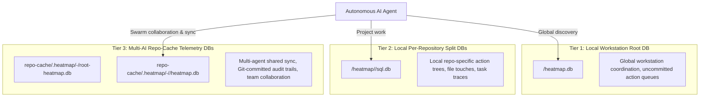
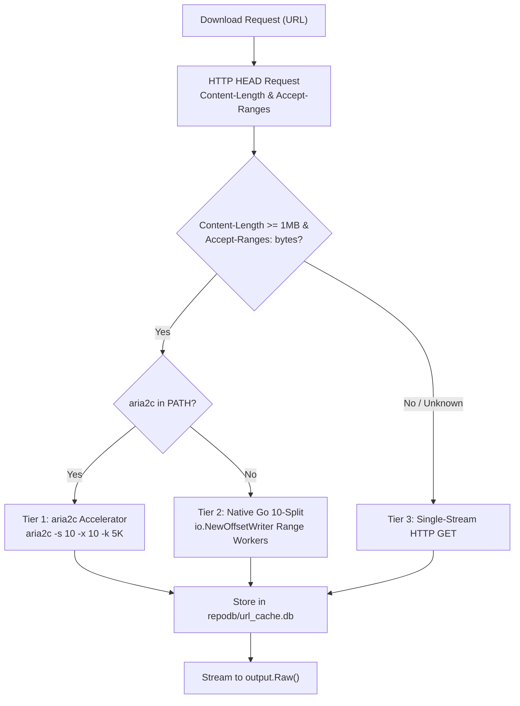

# Heatmap Telemetry & URL Caching (AI Execution Prompt)

> **/goal** Establish universal architectural standards for GitMap's 3-tier Heatmap Telemetry topology, ambient AI model detection, URL Split-DB caching, 10-split segmented downloading, and LLM training integration.
> **/learn** Master cognitive action tracing across local and repo-cache databases, sub-millisecond URL caching via WAL mode and 256MB mmap, unbuffered `output.Raw()` streaming, dynamic download acceleration ($\ge 1\text{--}2\text{ MB}$), and training curriculum ingestion.

## 🎯 Actionable CI/CD & Agent Checklist

- [ ] `/goal` Log all cognitive decisions and file touches into the appropriate tier of the 3-tier Heatmap database topology.
- [ ] `/learn` Detect and record ambient AI model attribution (`ModelName`, `ToolName`) across Antigravity, Muse, Claude Code, Grok, and Cursor.
- [ ] `/goal` Cache all external HTTP/HTTPS assets in `repodb/url_cache.db` using SHA-256 keys, WAL mode, and memory mapping.
- [ ] `/learn` Emit cached URL payloads byte-faithfully using unbuffered `output.Raw()`, directing diagnostics exclusively to `output.UIErr()`.
- [ ] `/goal` Activate 10-split segmented downloading with `aria2c` detection and native Go Range fallback for payloads $\ge 1\text{--}2\text{ MB}$.
- [ ] `/learn` Ingest decision traces and heatmap databases into LLM training pipelines using `gitmap llm train --heatmap <path|url>`.

. **CRITICAL AI INSTRUCTION:** This specification is an active AI execution directive. All code generated or modified must strictly follow the rules below.

**Version:** 1.0.0
**Updated:** 2026-10-23
**AI Confidence:** Production-Ready
**Ambiguity:** None

---

## 1. 3-Tier Heatmap Database Topology

GitMap organizes cognitive telemetry and action traces into three isolated, purpose-built SQLite tiers to balance low-latency local logging, per-project encapsulation, and multi-agent coordination.



### 1.1 Tier 1: Local Workstation Root Database
- **Resolved Path:** `<EffectiveDataDir>/heatmap.db` via `store.EffectiveDataDir()`.
- **Primary Responsibility:** Coordinates local workstation actions, tracks overall execution state, manages uncommitted mutation counters, and maintains local sync state with remote repositories.
- **SQLite Pragmas:**
  - `PRAGMA journal_mode = WAL;`
  - `PRAGMA busy_timeout = 5000;`
  - `PRAGMA synchronous = NORMAL;`
  - `PRAGMA foreign_keys = ON;`

### 1.2 Tier 2: Local Per-Repository Split Databases
- **Resolved Path:** `<EffectiveDataDir>/heatmap/<repoSlug>/sql.db` via `store.ResolveHeatmapRepoSplitDbPath(repoSlug, repoRoot)`.
- **Primary Responsibility:** Isolates large action log volumes per repository. Prevents a single high-churn project from bloating global data or causing lock contention. Stores local execution trees, file touch counts, and task summaries.

### 1.3 Tier 3: Multi-AI Repo-Cache Telemetry Databases
- **Resolved Path:** `<repo-cache>/.heatmap/<seq>-<ai>/` via `store.ResolveRcHeatmapAiDir(aiName)`.
- **Primary Responsibility:** Serves as the Git-tracked repository coordination medium. Each AI agent family operates inside a partitioned sequential namespace:
  - `01-antigravity`: Google Antigravity IDE and subagents
  - `02-muse`: Muse autonomous orchestration agents
  - `03-cloud-code`: Cloud Code developer sessions
  - `04-codex`: OpenAI / GitHub Copilot agents
  - `05-grok`: Grok reasoning agents
  - `06-cursor`: Cursor IDE sessions
- **Storage Artifacts per AI Namespace:**
  - `root-heatmap.db`: High-level session logs and roadmap milestones.
  - `<repoSlug>/heatmap.db`: Project-specific cognitive traces, reasoning states, and verification results.

---

## 2. Ambient AI Model & Environment Detection

Every cognitive telemetry record captured in `HeatmapActionLog` must identify the generating AI model (`ModelName`) and host execution environment (`ToolName`).

### 2.1 Detection Hierarchy
GitMap dynamically evaluates host environment variables to auto-detect the ambient AI identity without requiring manual configuration:

| Detection Precedence | Environment Variable / Condition | Detected Model (`ModelName`) | Detected Tool (`ToolName`) |
| :--- | :--- | :--- | :--- |
| 1 | `ANTIGRAVITY_AGENT_ID` is set or `.gemini/` in path | `gemini-2.5-pro` (or env `AI_MODEL`) | `antigravity-ide` |
| 2 | `MUSE_RUNNER` or `MUSE_AGENT_ID` is set | `muse` | `muse-runner` |
| 3 | `CLAUDE_CODE` is set | `claude-3-7-sonnet` | `claude-code` |
| 4 | `CURSOR_AGENT` is set | `cursor-agent` | `cursor-ide` |
| 5 | `AI_MODEL` or `GEMINI_MODEL` is set | Env value | `ambient-cli` |
| 6 | Default Fallback | `unknown-model` | `gitmap-cli` |

### 2.2 Telemetry Ingestion Convention
When recording actions, AI agents should invoke one-shot JSON ingestion to supply complete cognitive attribution:

```bash
gitmap heatmap log --json '{
  "task": "314-gitmap-heatmap-and-url-handling-instructions",
  "action": "MODIFY",
  "file": "cli/cmd/llm/llm_urls.go",
  "state": "EXECUTION",
  "expected": "Register PublicHeatmapUrlCacheURL in authoritative doc registry",
  "model": "gemini-2.5-pro",
  "tool": "antigravity-ide"
}'
```

---

## 3. Dedicated URL Caching Split-DB (`repodb/url_cache.db`)

To eliminate redundant network calls and provide sub-millisecond (<0.5ms) responses across parallel workers, GitMap employs a dedicated SQLite Split-DB for URL payloads.

### 3.1 Path Resolution & Registry
- **Database Path:** `repodb/url_cache.db` relative to repository base data directory.
- **Self-Registration:** Automatically registered in `SplitDatabaseRegistry` under `DatabaseType: "repodb"` and `DatabaseKey: "url_cache"`.
- **Inventory Integration:** Surface-able via `gitmap dbl` and `cli/store/storage_inventory.go`.

### 3.2 High-Performance PRAGMA Tuning

```sql
PRAGMA journal_mode = WAL;
PRAGMA synchronous = NORMAL;
PRAGMA busy_timeout = 5000;
PRAGMA mmap_size = 268435456; -- 256MB memory mapping
PRAGMA cache_size = -64000;   -- 64MB RAM page cache
PRAGMA temp_store = MEMORY;
```

### 3.3 Database Schema (PascalCase Tables)

```sql
CREATE TABLE IF NOT EXISTS UrlCacheEntry (
    UrlCacheEntryId INTEGER PRIMARY KEY AUTOINCREMENT,
    UrlHash         TEXT NOT NULL UNIQUE,
    UrlText         TEXT NOT NULL,
    Etag            TEXT NULL,
    ContentType     TEXT NOT NULL DEFAULT 'application/octet-stream',
    ContentLength   INTEGER NOT NULL DEFAULT 0,
    PayloadBlob     BLOB NOT NULL,
    CompressionType TEXT NOT NULL DEFAULT 'none',
    ExpiresAt       INTEGER NOT NULL DEFAULT 0,
    AccessCount     INTEGER NOT NULL DEFAULT 1,
    IsActive        INTEGER NOT NULL DEFAULT 1,
    IsCompressed    INTEGER NOT NULL DEFAULT 0,
    CreatedAt       INTEGER NOT NULL DEFAULT (unixepoch()),
    UpdatedAt       INTEGER NOT NULL DEFAULT (unixepoch())
);

CREATE INDEX IF NOT EXISTS IdxUrlCacheEntry_UrlHash ON UrlCacheEntry(UrlHash);
CREATE INDEX IF NOT EXISTS IdxUrlCacheEntry_ExpiresAt ON UrlCacheEntry(ExpiresAt);

CREATE TABLE IF NOT EXISTS UrlAccessLog (
    UrlAccessLogId  INTEGER PRIMARY KEY AUTOINCREMENT,
    UrlHash         TEXT NOT NULL,
    AccessMethod    TEXT NOT NULL DEFAULT 'GET',
    ResponseStatus  INTEGER NOT NULL DEFAULT 200,
    DurationMs      INTEGER NOT NULL DEFAULT 0,
    ByteCount       INTEGER NOT NULL DEFAULT 0,
    IsCacheHit      INTEGER NOT NULL DEFAULT 0,
    CreatedAt       INTEGER NOT NULL DEFAULT (unixepoch()),
    FOREIGN KEY(UrlHash) REFERENCES UrlCacheEntry(UrlHash) ON DELETE CASCADE
);
```

### 3.4 Output Channel Separation & Unbuffered Streaming
- **`output.Raw()` for Payloads:** Cached content, JSON streams, and raw binaries must stream directly to `os.Stdout` without string escaping or line-wrapping.
- **`output.UIErr()` for Diagnostics:** Cache hit notices, transfer timings, and error alerts are routed exclusively to `os.Stderr`.
- **Request Deduplication:** Parallel requests for the same URL hash coalesce into a single HTTP download via `singleflight.Group`.

---

## 4. 10-Split Segmented Downloader Engine

For payloads meeting or exceeding 1–2 MB, GitMap activates multi-connection segmented acceleration.



### 4.1 Acceleration Tiers
1. **Tier 1 (Host `aria2c`):**
   - Executed when `aria2c` is present in system `PATH`.
   - Command flags: `-s 10 -x 10 -k 5K --file-allocation=none --summary-interval=0 --console-log-level=error`.
2. **Tier 2 (Native Go 10-Connection Range Downloader):**
   - Pre-allocates target file via `f.Truncate(contentLength)` to prevent non-sequential write races.
   - Spawns 10 concurrent goroutines requesting `Range: bytes={start}-{end}`.
   - Writes concurrently into file descriptors using `io.NewOffsetWriter(f, start)`.
   - Retries dropped chunks up to 3 times with exponential backoff.
3. **Tier 3 (Single-Stream Fallback):**
   - Active when server responds with `200 OK` (ignoring Range) or for small payloads $< 1\text{ MB}$.

---

## 5. LLM Training Integration & Curriculum Ingestion

Heatmap telemetry serves as an empirical dataset of successful and failed cognitive execution traces. The LLM training curriculum in `cli/cmd/llm` ingests these traces for model fine-tuning and context expansion.

### 5.1 CLI Invocation Contract
```bash
# Ingest local heatmap database into training curriculum
gitmap llm train --heatmap repodb/heatmap.db

# Ingest remote live telemetry endpoint
gitmap llm train --heatmap https://telemetry.gitmap.internal/api/heatmap/export

# Filter training examples by repository and task
gitmap llm train --heatmap repodb/heatmap.db --heatmap-repo gitmap --heatmap-task 314-gitmap-heatmap-and-url-handling-instructions
```

### 5.2 Training Example Structure (`HeatmapTrainingExample`)
```go
type HeatmapTrainingExample struct {
    ActionId         int64  `json:"actionId"`
    RepoSlug         string `json:"repoSlug"`
    TaskSlug         string `json:"taskSlug"`
    ActionType       string `json:"actionType"`
    FilePath         string `json:"filePath"`
    ReasoningState   string `json:"reasoningState"`
    ReasoningNotes   string `json:"reasoningNotes"`
    ExpectedOutcome  string `json:"expectedOutcome"`
    ActualOutcome    string `json:"actualOutcome"`
    IsExpectationMet bool   `json:"isExpectationMet"`
    ModelName        string `json:"modelName"`
    ToolName         string `json:"toolName"`
}
```

---

## 6. Coding Standards & Rule Invariants

1. **Strictly Relative Paths:** Zero absolute filesystem paths (`C:\`, `D:\`, `file:///`) in code, specs, or documentation.
2. **Positive Boolean Naming:** All booleans must use `is*` or `has*` prefixes exclusively (`isCacheHit`, `isFresh`, `hasAria2c`, `isRangeSupported`).
3. **15-Line Function Limit:** Functions must remain concise ($\le 8$ lines preferred, $\le 15$ lines maximum).
4. **Zero Nested Ifs:** Flatten conditional branches using early returns and guard clauses.
5. **Leaf Error Sovereignty:** Return structured errors using `apperror.WrapSimple(err, "context")`. Outer command dispatchers handle process termination.

---

## Verification & Acceptance Criteria

_Auto-generated section — see `02-spec/02-coding-guidelines/06-ai-optimization/97-acceptance-criteria.md` for the full criteria index._

### AC-CG-AI-011: Heatmap Telemetry Architecture & URL Caching Conformance

**Given** AI agents operating within the repository and codebase guidelines.
**When** Audited against this heatmap telemetry and URL caching specification.
**Then** Zero telemetry omissions, Split-DB violations, or unbuffered streaming corruptions are detected and exit code is 0.

**Verification command:**
```bash
python 03-ai-scripts/05-guideline-autofixer.py 02-spec/02-coding-guidelines/06-ai-optimization --check-only
```
**Expected:** exit 0. Zero violations.
