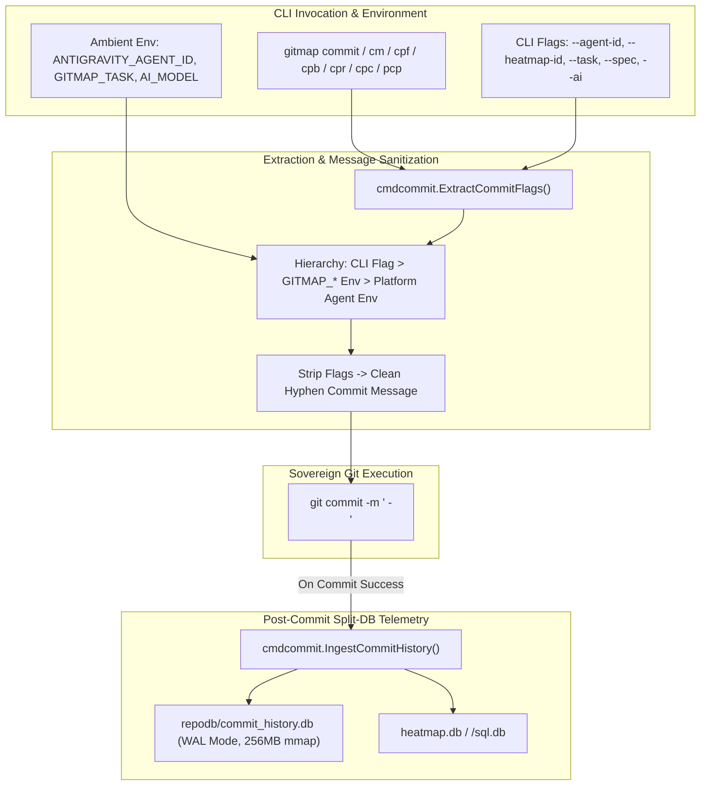
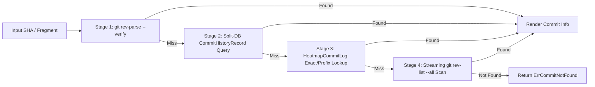

# Commit Provenance & Tracking (AI Execution Prompt)

> **/goal** Establish universal architectural standards for GitMap machine-verifiable AI commit provenance, ambient fallback resolution, automatic flag stripping, external Split-DB history caching, and origin attribution.
> **/learn** Master the 6 core non-negotiable commit provenance rules, mandatory AI flags (`--agent-id`, `--heatmap-id`, `--task`, `--spec`, `--ai`), ambient environment hierarchy, universal commit inspection (`gitmap commit info <sha>`), origin disambiguation, and external split-db isolation.

## 🎯 Actionable CI/CD & Agent Checklist

- [ ] `/goal` Enforce mandatory AI flags (`--agent-id`, `--heatmap-id`, `--task`, `--spec`, `--ai`) on all commit commands (`commit`, `cm`, `cpf`, `cpb`, `cpr`, `cpc`, `pcp`).
- [ ] `/learn` Guarantee automatic flag stripping so provenance flags never leak or contaminate git commit message text.
- [ ] `/goal` Resolve AI provenance through the ambient fallback precedence hierarchy (`CLI Flag` > `GITMAP_* Env` > `Platform Agent Env`).
- [ ] `/learn` Inspect full commit provenance, touched files, and AI attribution via `gitmap commit info <sha>` (aliases: `gitmap ci <sha>`, `gitmap commit-info <sha>`).
- [ ] `/goal` Explicitly report origin attribution when the current machine's AI did not commit the change: `"The current machine's AI has not committed this (likely another worker/node/human)"`.
- [ ] `/learn` Store commit history exclusively in the external Split-DB `<EffectiveDataDir>/repodb/commit_history.db` with WAL mode and 256MB mmap.

. **CRITICAL AI INSTRUCTION:** This specification is an active AI execution directive. All code generated or modified must strictly follow the rules below.

**Version:** 1.0.0
**Updated:** 2026-10-23
**AI Confidence:** Production-Ready
**Ambiguity:** None

---

## 1. Executive Summary & Purpose

In modern agentic software development, swarms of autonomous AI agents (operating across Claude, Gemini, GPT, DeepSeek, and Muse instances) concurrently develop and modify repositories alongside human engineers. Under standard Git version control, commits record only the author's local git user name and email. This introduces severe attribution opacity:

1. **Model & Agent Obscurity:** Git logs do not identify which AI model (e.g. `gemini-2.5-pro`, `claude-3-7-sonnet`), toolchain, or subagent ID executed the commit.
2. **Task & Spec Disconnect:** Commits lack direct relational linkage to parent task slugs, active subtask plans, or application specification paths.
3. **Heatmap & Action Trace Isolation:** Local cognitive decisions recorded in SQLite heatmap databases are not bound to resulting Git commit SHAs.
4. **Origin Ambiguity in Swarms:** When inspecting commits from remote nodes or team members, developers cannot differentiate whether the commit originated on the current machine or from an external AI worker or human.

GitMap's Commit Provenance & Tracking System establishes a machine-verifiable chain of custody connecting Git commits directly to AI models, agent IDs, heatmap sessions, and specifications without polluting git commit messages or working trees.

---

## 2. The 6 Non-Negotiable Commit Provenance Rules



### Rule 1: Zero Unattributed AI Commits in Automated Swarms
All autonomous AI agents executing commits must provide provenance metadata:
- `--agent-id <id>`: Identifier of the executing subagent (e.g. `worker-04`, `subagent-315-05`).
- `--heatmap-id <id>`: Associated cognitive heatmap action ID or session ID.
- `--task <slug>`: Parent task or subtask slug (e.g. `315-gitmap-commit-tracking-and-database-integration`).
- `--spec <path>`: Relative path to related application specification.
- `--ai <name>`: Model identifier (e.g. `gemini-2.5-pro`, `claude-3-7-sonnet`).

> [!IMPORTANT]
> Provenance flags are optional for human developers but **strictly mandatory** for autonomous AI coding agents operating in swarms.

### Rule 2: Automatic Flag Stripping Guarantee
Git commit messages must remain clean, semantic, and human-readable. All custom GitMap provenance flags (`--agent-id`, `--heatmap-id`, `--task`, `--spec`, `--ai`, `--push`, `--dry-run`) are parsed and stripped from the argument list prior to invoking `git commit`. Provenance flags must **never** leak or be appended into the git commit message text.

### Rule 3: Ambient Fallback Precedence Hierarchy
When an agent or developer omits explicit CLI flags, GitMap automatically resolves provenance through ambient host environment variables using the following deterministic resolution order:

| Resolution Precedence | Metadata Field | 1. CLI Flag | 2. GitMap Env | 3. Platform Agent Env | Default Fallback |
| :--- | :--- | :--- | :--- | :--- | :--- |
| **Priority 1** | Agent ID | `--agent-id <id>` | `GITMAP_AGENT_ID` | `ANTIGRAVITY_AGENT_ID`, `AGENT_ID` | `""` |
| **Priority 2** | Heatmap ID | `--heatmap-id <id>` | `GITMAP_HEATMAP_ID` | `HEATMAP_ID` | `""` |
| **Priority 3** | Task Slug | `--task <slug>` | `GITMAP_TASK` | `TASK_SLUG` | `""` |
| **Priority 4** | Spec Path | `--spec <path>` | `GITMAP_SPEC_PATH` | `SPEC_PATH` | `""` |
| **Priority 5** | AI Model | `--ai <name>` | `GITMAP_AI_NAME` | `AI_MODEL`, `GEMINI_MODEL` | `""` |

If any AI flag or environment indicator is present, `isAiMode` is automatically set to `true`.

### Rule 4: Hyphen-Separated Uppercase Module Standard (Zero Third Brackets)
Square brackets (`[` `]`, colloquially termed "third brackets") are **strictly prohibited** in all Git commit headers, module tags, semantic verbs, and subjects. Square brackets embedded inside commit headers introduce critical hazards across automated build pipelines:
- **Markdown Link Reference Collisions:** CommonMark and GitHub Flavored Markdown (GFM Section 4.7) interpret `[module]: description` as a Link Reference Definition, discarding the commit from visual changelog rendering.
- **Changelog Generator Failures:** Standard conventional changelog parsers (`conventional-changelog`, `standard-version`, `git-cliff`) break when scopes contain brackets (`feat([scope]):`).
- **Regex Capture Group Shattering:** Dynamic regexes interpolating component scopes fail with unescaped bracket character set errors.
- **Double-Colon Parsing Ambiguity:** Splitting on `": "` creates multiple ambiguous chunks when headers contain both semantic and module colons.
- **Shell Wildcard Hazards:** Unquoted square brackets in Unix shells and PowerShell act as filename glob patterns.

#### Canonical Format & Grammar
All semantic commits across GitMap CLI verbs (`cpf`, `cpb`, `cbf`, `cpc`, `cpr`, `cfr`) adhere to a clean input format with an uppercase module identifier and space-padded hyphen separator:
```text
gitmap cpf "MODULE - summary of changes"
```
which produces the sovereign Git commit header:
```text
Feature: MODULE - summary of changes
```

#### Banned vs. Approved Commit Formats

| Category | Banned Example (Strictly Prohibited) | Primary Reason for Ban | Approved User Command | Approved Sovereign Git Header |
| :--- | :--- | :--- | :--- | :--- |
| **Feature** | `feat([workgroup]): add ssh keys` | Brackets break changelog & regex | `gitmap cpf "WORKGROUP - add ssh keys"` | `Feature: WORKGROUP - add ssh keys` |
| **Feature** | `Feature: [auth]: add jwt` | Double colon and bracket syntax | `gitmap cpf "AUTH - add jwt"` | `Feature: AUTH - add jwt` |
| **Feature** | `gitmap cpf "auth: add jwt"` | Colon separator instead of hyphen | `gitmap cpf "AUTH - add jwt"` | `Feature: AUTH - add jwt` |
| **Bug Fix** | `fix([ci]): resolve gofmt` | Square brackets in scope | `gitmap cpb "CI - resolve gofmt"` | `Bug: CI - resolve gofmt` |
| **Bug Fix** | `Bug: [db]: fix deadlock` | Bracketed module and double colon | `gitmap cbf "DB - fix deadlock"` | `Bug: DB - fix deadlock` |
| **Chore** | `chore([skills]): update skill` | Bracket nesting breaks parsers | `gitmap cpc "SKILLS - update skill"` | `Chore: SKILLS - update skill` |
| **Release Misuse** | `gitmap cpf "chore(release): bump version to v4.259.0"` | Misuses cpf (Feature) for release, nested chore(release) prefix, lowercase, colon | `gitmap cpr "RELEASE - bump version to v4.259.0"` | `Release: RELEASE - bump version to v4.259.0` |
| **Chore Misuse** | `gitmap cpf "chore: sync prompts and skills"` | Misuses cpf (Feature) for chore, nested conventional prefix, colon | `gitmap cpc "SYNC - update prompts and skills"` | `Chore: SYNC - update prompts and skills` |
| **Raw Git Commit** | `git commit -m "feat(auth): add jwt"` | Raw git commit bypasses GitMap atomic staging, split-db tracking, and push | `gitmap cpf "AUTH - add jwt"` | `Feature: AUTH - add jwt` |
| **Raw Git Pull** | `git pull origin main` | Raw git pull bypasses GitMap multi-phase conflict detection and telemetry | `gitmap pull` (fallback `git pull`) | Pulls latest remote updates cleanly |
| **Release** | `chore(release): [v6.600.0]: cut` | Markdown link collision hazard | `gitmap cpr "V6.600.0 - cut release"` | `Release: V6.600.0 - cut release` |
| **Docs Spec** | `docs([spec]): add bracketed rules` | Square brackets in scope | `gitmap cpc "SPEC - update commit rules"` | `Chore: SPEC - update commit rules` |
| **Docs Plan** | `docs([plan]): update master plan` | Square brackets in scope | `gitmap cpc "PLAN - update master plan"` | `Chore: PLAN - update master plan` |
| **Mixed Case**| `gitmap cpf "workgroup - fix bind"` | Lowercase module tag | `gitmap cpf "WORKGROUP - fix bind"` | `Feature: WORKGROUP - fix bind` |

### Rule 5: External Split-DB Isolation & Storage
Commit history, file touches, diff metrics, and AI provenance are recorded into GitMap's external split database:
- **Canonical Path:** `<EffectiveDataDir>/repodb/commit_history.db`
- **Location Rule:** The database is stored completely outside the target repository working tree. Storing tracking databases inside the repository root is strictly forbidden because database writes would immediately dirty `git status` and trigger infinite commit loops.
- **Engine Performance:** Operates in SQLite WAL mode (`PRAGMA journal_mode = WAL`), `PRAGMA synchronous = NORMAL`, `PRAGMA busy_timeout = 5000`, single-writer mutex locking, and 256MB memory mapping (`PRAGMA mmap_size = 268435456`) to guarantee sub-millisecond ($<0.5\text{ ms}$) retrieval.

### Rule 6: Origin Attribution & Disambiguation
When querying commit information via `gitmap commit info <sha>`, GitMap cross-references the Git commit with the local split-db, cognitive heatmap databases, and agent task databases.
- If the commit was authored by the current machine's AI, the visualizer renders the exact AI Model, Agent ID, Heatmap ID, and Task context.
- If the commit is recorded in Git but absent from the current machine's AI databases, GitMap renders an explicit notice:
  `"The current machine's AI has not committed this (likely another worker/node/human)"`.

---

## 3. Universal Commit Info Inspection (`gitmap commit info <sha>`)

The `gitmap commit info` command (aliases: `gitmap ci`, `gitmap commit-info`) resolves any commit identifier and renders a comprehensive ASCII tree visualization.

### 3.1 Universal SHA Resolution Pipeline
The command accepts multiple SHA input formats:
- Full 40-character SHA-1 / SHA-256 string
- 7-character or 8-character short SHA
- Arbitrary SHA prefix, suffix, or substring



### 3.2 Terminal ASCII Tree Output Format

When executed, `gitmap commit info <sha>` presents a clean Tokyo Night / ASCII tree:

```
Commit Information: dc8e0d8f342a1b9e5c704f2d6e8a10bc39f12345
├── Commit SHA:    dc8e0d8f342a1b9e5c704f2d6e8a10bc39f12345 [dc8e0d8]
├── Author:        MD ALIM UL KARIM <alim@riseup-asia.com>
├── Date:          2026-10-23 21:30:15 +08:00 (15 minutes ago)
├── Branch:        main
├── Message:       Feature: cmdcommit - add commit info inspection command
├── AI Attribution:
│   ├── Model:     gemini-2.5-pro
│   ├── Agent ID:  worker-04
│   ├── Heatmap:   HM-9821
│   ├── Task:      315-gitmap-commit-tracking-and-database-integration
│   └── Spec:      02-spec/21-app/315-gitmap-commit-tracking-and-database-integration/00-overview.md
├── Origin:        Local Machine AI (verified in heatmap.db & commit_history.db)
└── Files Modified (3 files, +142, -18 lines):
    ├── [M] cli/cmdcommit/commit_info.go (+85, -10)
    ├── [M] cli/cmdcommit/commit_types.go (+32, -4)
    └── [A] cli/store/commit_history_split_db.go (+25, -4)
```

When the commit originated from an external contributor, another cluster node, or a human without local heatmap traces:

```
Commit Information: 4a2b9c1d0e8f7a6b5c4d3e2f1a0b9c8d7e6f5a4b
├── Commit SHA:    4a2b9c1d0e8f7a6b5c4d3e2f1a0b9c8d7e6f5a4b [4a2b9c1]
├── Author:        External Contributor <dev@external.org>
├── Date:          2026-10-22 14:12:00 +00:00 (1 day ago)
├── Branch:        main
├── Message:       Bug: cloner - fix concurrent worker race condition
├── AI Attribution: None (No AI flags or metadata recorded)
├── Origin:        The current machine's AI has not committed this (likely another worker/node/human)
└── Files Modified (1 file, +12, -8 lines):
    └── [M] cli/cmdcloner/cloner.go (+12, -8)
```

---

## 4. Forbidden vs. Required Pattern Comparisons

### Anti-Pattern 1: Unattributed AI Commits vs Explicit Provenance Flags

```bash
<!-- ❌ FORBIDDEN: Unattributed AI commits without provenance flags or ambient context -->
gitmap cpf "store - add commit history split db"
git commit -m "add commit history split db"
```

```bash
<!-- ✅ REQUIRED: Full AI commit provenance with flags or ambient environment variables -->
# Direct CLI flag passing
gitmap cpf "store - add commit history split db" \
  --agent-id "worker-04" \
  --heatmap-id "HM-9821" \
  --task "315-gitmap-commit-tracking-and-database-integration" \
  --spec "02-spec/21-app/315-gitmap-commit-tracking-and-database-integration/00-overview.md" \
  --ai "gemini-2.5-pro"

# Ambient environment variable approach (e.g. in subagent runner sessions)
export ANTIGRAVITY_AGENT_ID="worker-04"
export GITMAP_TASK="315-gitmap-commit-tracking-and-database-integration"
export GITMAP_HEATMAP_ID="HM-9821"
export AI_MODEL="gemini-2.5-pro"
gitmap cpf "store - add commit history split db"
```

### Anti-Pattern 2: Flag Contamination vs Automatic Flag Stripping

```bash
<!-- ❌ FORBIDDEN: Allowing provenance flags to contaminate commit message text -->
# Running raw git with flags embedded inside the message
git commit -m "store - add commit history split db --agent-id worker-04 --task 315"
# Or raw colons inside the commit message
gitmap cpf "Feature: store - add commit history"
```

```bash
<!-- ✅ REQUIRED: Clean semantic hyphen-separated commit message with flags stripped -->
# GitMap parses flags separately and commits clean message: 'Feature: store - add commit history split db'
gitmap cpf "store - add commit history split db" --agent-id "worker-04" --task "315-gitmap-commit-tracking"
```

### Anti-Pattern 3: In-Repository Databases vs External Split-DB Storage

```bash
<!-- ❌ FORBIDDEN: Storing commit tracking database inside working tree -->
# Creating SQLite databases in .gitmap/ or repository root
sqlite3 .gitmap/commit_history.db "CREATE TABLE ..."
sqlite3 commit_history.db "INSERT INTO ..."
```

```bash
<!-- ✅ REQUIRED: External Split-DB storage under EffectiveDataDir/repodb/commit_history.db -->
# Resolved automatically via store.ResolveCommitHistoryDbPath(repoRoot)
# Stores data in <EffectiveDataDir>/repodb/commit_history.db outside working tree
gitmap commit info dc8e0d8
```

---

## 5. Domain Models & Relational Schema

### 5.1 Relational Schema DDL (`CommitHistoryRecord` & `CommitFileTouch`)

```sql
CREATE TABLE IF NOT EXISTS CommitHistoryRecord (
    RecordId INTEGER PRIMARY KEY AUTOINCREMENT,
    CommitSha TEXT NOT NULL,
    ShortSha TEXT NOT NULL,
    RepoRoot TEXT NOT NULL,
    RepoName TEXT NOT NULL,
    BranchName TEXT NOT NULL,
    AuthorName TEXT NOT NULL,
    AuthorEmail TEXT NOT NULL,
    CommitMessage TEXT NOT NULL,
    TaskSlug TEXT NOT NULL DEFAULT '',
    AgentId TEXT NOT NULL DEFAULT '',
    HeatmapId TEXT NOT NULL DEFAULT '',
    AiName TEXT NOT NULL DEFAULT '',
    SpecPath TEXT NOT NULL DEFAULT '',
    FilesChanged INTEGER NOT NULL DEFAULT 0,
    Insertions INTEGER NOT NULL DEFAULT 0,
    Deletions INTEGER NOT NULL DEFAULT 0,
    IsAiMode INTEGER NOT NULL DEFAULT 0,
    HasPushed INTEGER NOT NULL DEFAULT 0,
    CommittedAt INTEGER NOT NULL,
    CreatedAt INTEGER NOT NULL,
    CONSTRAINT Uq_CommitHistory_Sha UNIQUE (CommitSha)
);

CREATE TABLE IF NOT EXISTS CommitFileTouch (
    TouchId INTEGER PRIMARY KEY AUTOINCREMENT,
    CommitSha TEXT NOT NULL,
    RepoRoot TEXT NOT NULL,
    FilePath TEXT NOT NULL,
    ChangeType TEXT NOT NULL,
    Insertions INTEGER NOT NULL DEFAULT 0,
    Deletions INTEGER NOT NULL DEFAULT 0,
    CreatedAt INTEGER NOT NULL,
    FOREIGN KEY (CommitSha) REFERENCES CommitHistoryRecord(CommitSha) ON DELETE CASCADE
);

CREATE INDEX IF NOT EXISTS IdxCommitHistory_Covering
    ON CommitHistoryRecord(RepoRoot, CommittedAt DESC, CommitSha);

CREATE INDEX IF NOT EXISTS IdxCommitHistory_ShortSha
    ON CommitHistoryRecord(ShortSha);

CREATE INDEX IF NOT EXISTS IdxCommitHistory_TaskSlug
    ON CommitHistoryRecord(TaskSlug);

CREATE INDEX IF NOT EXISTS IdxCommitHistory_AgentId
    ON CommitHistoryRecord(AgentId);

CREATE INDEX IF NOT EXISTS IdxCommitFileTouch_CommitSha
    ON CommitFileTouch(CommitSha);
```

### 5.2 Go Struct Representations with Positive Booleans

```go
type CommitMetadata struct {
    TaskSlug   string
    AgentID    string
    HeatmapID  string
    AIName     string
    SpecPath   string
    IsAIMode   bool
    HasPush    bool
    IsDryRun   bool
}

type CommitInfoResult struct {
    CommitSha         string
    ShortSha          string
    AuthorName        string
    AuthorEmail       string
    BranchName        string
    CommitMessage     string
    TaskSlug          string
    AgentId           string
    HeatmapId         string
    AiName            string
    SpecPath          string
    FilesChanged      int
    Insertions        int
    Deletions         int
    IsAiMode          bool
    IsAiCommitted     bool
    IsCurrentMachineAi bool
    HasPushed         bool
    HasHeatmapMatch   bool
    HasAgentMatch     bool
    CommittedAt       time.Time
    TouchedFiles      []CommitFileTouchRecord
}
```

---

## 6. Coding Standards & Rule Invariants

1. **Strictly Relative Paths:** Zero absolute filesystem paths (`C:\`, `D:\`, `file:///`) in code, specs, or documentation.
2. **Positive Boolean Naming:** All booleans must use `is*` or `has*` prefixes exclusively (`isAiMode`, `isAiCommitted`, `isCurrentMachineAi`, `hasPushed`, `hasChanges`). Banned: `can`, `should`, `was`, `will`, and negative booleans.
3. **15-Line Function Limit:** Functions must remain concise ($\le 8$ lines preferred, $\le 15$ lines maximum).
4. **Zero Nested Ifs:** Flatten conditional branches using early returns and guard clauses.
5. **Leaf Error Sovereignty:** Return structured errors using `apperror.WrapSimple(err, "context")`. Outer command dispatchers handle process termination.
6. **Non-Fatal Telemetry Guarantee:** Split-DB recording failures must never fail an already successful git commit.

---

## Verification & Acceptance Criteria

_Auto-generated section — see `02-spec/02-coding-guidelines/06-ai-optimization/97-acceptance-criteria.md` for the full criteria index._

### AC-CG-AI-012: Commit Provenance Tracking & Split-DB Ingestion Conformance

**Given** AI agents committing code or inspecting commit history within GitMap repositories.
**When** Audited against this commit provenance and tracking specification.
**Then** Zero unattributed AI commits, unstripped flag leaks, or internal repo database violations are detected and exit code is 0.

**Verification command:**
```bash
python 03-ai-scripts/05-guideline-autofixer.py 02-spec/02-coding-guidelines/06-ai-optimization --check-only
```
**Expected:** exit 0. Zero violations.
