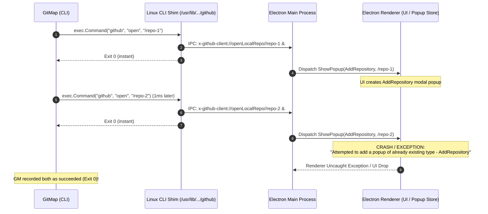
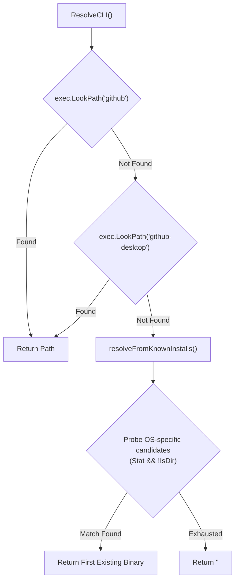

# Architecture Specification: GitHub Desktop CLI Synchronization & Resolution Fix

> **Spec ID:** `SPEC-21-02-ARCH`
> **Subsystem:** `cli/desktop`, `cli/cmddesktopsync`, `cli/cmdide`
> **Status:** Active / Specification
> **Date:** 2026-10-13
> **Related Specs:**
> - [10-github-desktop.md](../10-github-desktop.md)
> - [11-desktop-sync.md](../11-desktop-sync.md)
> - [02-component-spec.md](02-component-spec.md)
> **Related Plans:**
> - [.ai-memory/plans/02-github-desktop-sync-fix.md](../../../.ai-memory/plans/02-github-desktop-sync-fix.md)
> - [.ai-memory/plans/subtasks/02-github-desktop-sync-fix/01-investigate-and-resolve-cli.md](../../../.ai-memory/plans/subtasks/02-github-desktop-sync-fix/01-investigate-and-resolve-cli.md)

---

## 1. Executive Summary & Root Cause Analysis (RCA)

When running GitMap's desktop registration features on Linux (Ubuntu/Debian/Fedora/Arch) — including `gitmap desktop-sync` (`ds`), `gitmap github-desktop` (`gd`), `gitmap scan --github-desktop`, `gitmap clone --github-desktop`, and `gitmap ide sync` / `gitmap ide add` — users reported that repositories were either skipped entirely or only partially added before GitHub Desktop silently dropped UI popups or crashed.

### 4-Part Root Cause Analysis

```
+---------------------------------------------------------------------------------------------------+
| 1. SYMPTOM                                                                                        |
| On Ubuntu/Linux, GitHub Desktop registers 0 or only a fraction of repositories during batch       |
| sync, or crashes midway through registration. No error message is surfaced to the CLI user.       |
+---------------------------------------------------------------------------------------------------+
                                                  |
                                                  v
+---------------------------------------------------------------------------------------------------+
| 2. RESOLUTION ROOT CAUSE                                                                          |
| cli/desktop/resolve.go only probes exec.LookPath("github") and ~/.local/... paths. Linux packages |
| (Debian, Ubuntu PPA, Arch AUR, RPM) install the binary as `github-desktop` or place the shim in   |
| /usr/bin, /usr/local/bin, or /usr/lib/github-desktop/resources/app/static/github. When HOME is    |
| unpopulated or PATH only contains github-desktop, ResolveCLI() returns "" and fails silently.      |
+---------------------------------------------------------------------------------------------------+
                                                  |
                                                  v
+---------------------------------------------------------------------------------------------------+
| 3. INVOCATION SYNTAX ROOT CAUSE                                                                   |
| cli/desktop/desktop.go executes exec.Command(cli, repoPath) without the canonical "open" verb.    |
| Modern GitHub Desktop CLI shims require `github open <path>` across Linux, macOS, and Windows.   |
| Without "open", invocations can be ignored or mishandled as launch flags.                         |
+---------------------------------------------------------------------------------------------------+
                                                  |
                                                  v
+---------------------------------------------------------------------------------------------------+
| 4. DETACHMENT & IPC FLOODING ROOT CAUSE                                                           |
| Linux wrapper (/usr/lib/github-desktop/resources/app/static/github) spawns Electron with `&` and  |
| exits 0 immediately. Each call transmits an `x-github-client://openLocalRepo/...` deep-link IPC  |
| message to the Electron main process. Rapid unthrottled calls cause concurrent modal popup        |
| creation: `Attempted to add a popup of already existing type - AddRepository`. Electron drops the |
| popup or crashes, while the Go caller sees exit code 0 and assumes success.                      |
+---------------------------------------------------------------------------------------------------+
```

---

## 2. Linux Desktop Shell Launcher Detachment Architecture

### 2.1 The Launcher Script Behavior

On Linux installations (e.g. `shiftkey/desktop` packages, native Debian `.deb`, Fedora `.rpm`), the executable shim installed in `/usr/lib/github-desktop/resources/app/static/github` contains logic equivalent to:

```bash
#!/bin/bash
# GitHub Desktop Linux CLI wrapper
if [ -z "$1" ]; then
    github-desktop >/dev/null 2>&1 &
elif [ "$1" = "open" ]; then
    shift
    github-desktop "x-github-client://openLocalRepo/$(realpath "$1")" >/dev/null 2>&1 &
else
    github-desktop "x-github-client://openLocalRepo/$(realpath "$1")" >/dev/null 2>&1 &
fi
exit 0
```

### 2.2 The Deceptive Exit Code 0

Because the shell wrapper appends `&` to the background command and calls `exit 0`, Go's `exec.Command` completes in mere milliseconds with `err == nil`. The parent Go process receives no signal regarding:
1. Whether GitHub Desktop was already running.
2. Whether the deep-link was received and parsed by Electron's single-instance lock handler.
3. Whether the repository was successfully added, was already present, or threw an error in the renderer process.

### 2.3 Electron Deep-Link IPC Flooding

When GitMap iterates over 10, 50, or 200 repositories in a tight loop:



### 2.4 The Electron State Machine Collision

In GitHub Desktop's open-source TypeScript codebase (`app/src/ui/lib/app-store.ts`), the internal popup state is governed by:

```typescript
if (this.currentPopup?.type === PopupType.AddRepository) {
  fatalError('Attempted to add a popup of already existing type - AddRepository')
}
```

When an `openLocalRepo` URL arrives while an `AddRepository` popup is already open or animating into view, GitHub Desktop triggers `fatalError` or drops the action. 

To prevent this collision, two architectural requirements must be satisfied:
1. **Canonical Command Structure:** Always invoke with explicit subcommand `open`.
2. **Inter-Invocation Pacing:** Introduce a deterministic pacing delay (150ms–250ms) between successive CLI executions so Electron's main process can serialize deep links and complete the repository addition cycle.

---

## 3. Canonical Command Construction & CLI Syntax

### 3.1 Cross-Platform Command Matrix

GitHub Desktop exposes a unified CLI interface across Windows, macOS, and Linux:

| Platform | Primary Binary / Shim Path | Canonical Invocation Syntax | Prior Buggy Syntax |
|----------|----------------------------|-----------------------------|--------------------|
| **Linux** | `/usr/bin/github`, `/usr/bin/github-desktop`, `/usr/lib/.../github` | `exec.Command(cli, "open", repoPath)` | `exec.Command(cli, repoPath)` |
| **macOS** | `/Applications/GitHub Desktop.app/.../github` | `exec.Command(cli, "open", repoPath)` | `exec.Command(cli, repoPath)` |
| **Windows** | `%LOCALAPPDATA%\GitHubDesktop\bin\github.bat` | `exec.Command(cli, "open", repoPath)` | `exec.Command(cli, repoPath)` |

### 3.2 Canonical Implementation in `cli/desktop/desktop.go`

In `cli/desktop/desktop.go`, `addOne` must construct the process arguments with the `"open"` verb:

```go
// addOne opens a single repo in GitHub Desktop using the canonical "open" verb.
func addOne(repoPath, cli string) error {
	cmd := exec.Command(cli, constants.GitHubDesktopVerbOpen, repoPath)
	_, err := cmd.Output()

	return err
}
```

Where `constants.GitHubDesktopVerbOpen` is `"open"`.

---

## 4. Platform Binary Discovery & Resolution Architecture

### 4.1 Resolution Pipeline in `cli/desktop/resolve.go`

The resolution pipeline in `ResolveCLI()` must follow a 2-stage discovery process:



### 4.2 Linux Candidates Expansion

On Linux distributions, GitHub Desktop is distributed via multiple packaging systems:
- Native DEB/RPM packages (`/usr/bin/github`, `/usr/bin/github-desktop`, `/usr/lib/github-desktop/...`)
- Manual local builds (`/usr/local/bin/github`, `/usr/local/bin/github-desktop`)
- Flatpak (`~/.local/share/flatpak/...`, `/var/lib/flatpak/...`)
- Snap (`/snap/bin/github-desktop`)
- User-space links (`~/.local/bin/github`, `~/.local/bin/github-desktop`)

#### Candidate List Specification:

```go
// linuxCandidates returns known Linux installation paths for GitHub Desktop.
// System-wide paths are checked regardless of whether $HOME is populated.
func linuxCandidates() []string {
	candidates := []string{
		"/usr/bin/github",
		"/usr/bin/github-desktop",
		"/usr/local/bin/github",
		"/usr/local/bin/github-desktop",
		"/usr/lib/github-desktop/resources/app/static/github",
		"/snap/bin/github-desktop",
		"/var/lib/flatpak/exports/bin/io.github.shifteight9.desktop",
	}

	home := os.Getenv("HOME")
	if home != "" {
		candidates = append(candidates,
			filepath.Join(home, ".local/bin/github"),
			filepath.Join(home, ".local/bin/github-desktop"),
			filepath.Join(home, ".local/share/flatpak/exports/bin/io.github.shifteight9.desktop"),
			filepath.Join(home, ".local/share/applications/github-desktop"),
		)
	}

	return candidates
}
```

### 4.3 Key Architectural Guardrails for Resolution

1. **System Paths Independent of `$HOME`:** Previously, if `$HOME` was empty, `linuxCandidates()` returned `nil` immediately. In containerized, headless, or automated CI environments, system paths must always be probed.
2. **Dual LookPath Check:** Checking `github-desktop` alongside `github` guarantees immediate discovery on systems where only `github-desktop` is symlinked in `/usr/bin`.
3. **Stat Verification:** Only files where `statErr == nil && !info.IsDir()` are accepted, preventing directory symlink confusion.

---

## 5. Component Interaction & Pacing Architecture

### 5.1 Consumers of Desktop Registration

The following components interact with GitHub Desktop registration:

| Component | File Path | Current Status | Required Update |
|-----------|-----------|----------------|-----------------|
| `desktop` | `cli/desktop/resolve.go` | Incomplete Linux paths, single LookPath | Dual LookPath, system candidates |
| `desktop` | `cli/desktop/desktop.go` | Calls `exec.Command(cli, repoPath)` | Canonical `exec.Command(cli, "open", repoPath)` |
| `cmddesktopsync` | `cli/cmddesktopsync/desktopsync_ops.go` | Calls `exec.Command(cli, repoPath)`, unthrottled | Canonical "open", inter-invocation pacing (Subtask 02) |
| `cmdide` | `cli/cmdide/ide_add.go` | Calls `exec.Command(cli, absPath)`, swallows errors | Canonical "open", error propagation (Subtask 02) |
| `cmdide` | `cli/cmdide/ide_sync.go` | Calls `exec.Command(cli, p)`, unthrottled, swallows errors | Canonical "open", inter-invocation pacing, error surfacing (Subtask 02) |

### 5.2 Inter-Invocation Pacing Protocol

To protect the Electron renderer from IPC flooding and popup collisions:
- Minimum sleep duration between sequential calls: **200 milliseconds**.
- Configurable constant: `constants.GitHubDesktopSyncDelayMS = 200`.
- In headless/dry-run mode: delay is bypassed.

---

## 6. Coding Guidelines & Invariants

All implementation files must adhere to the central repository standards:
1. **Strict Relative Paths:** No absolute filesystem paths in documentation or code.
2. **Positive Boolean Naming:** All boolean fields, variables, and functions must use positive prefixes:
   - `isInstalled`, `hasResolvedCLI`, `hasLookPathMatch`, `isValidBinary`.
   - Never use `isNotFound`, `notConfigured`, or `!isNotInstalled`.
3. **Low Cyclomatic Complexity:** Guard clauses with early returns, max 1 level of branching nesting.
4. **No Raw Grep or Git Execution:** AI workflows and tests must never call unmocked grep or destructive git commands.

---

## 7. Verification & Acceptance Criteria

### 7.1 Automated Verification Plan

1. **Unit Tests for Binary Resolution (`cli/desktop/resolve_test.go`):**
   - Test `ResolveCLI` succeeds when only `github-desktop` exists on PATH.
   - Test `ResolveCLI` succeeds when `/usr/lib/github-desktop/resources/app/static/github` exists in simulated root.
   - Test `linuxCandidates` returns system candidates even when `HOME` environment variable is unset.
2. **Unit Tests for Command Construction (`cli/desktop/desktop_test.go`):**
   - Assert `addOne` passes `"open"` as the first argument after `cli`.
3. **Build & Quality Gates:**
   - Compile cleanly via `go build ./...` in `cli/`.
   - Pass FastGate linter checks without style or naming violations.
