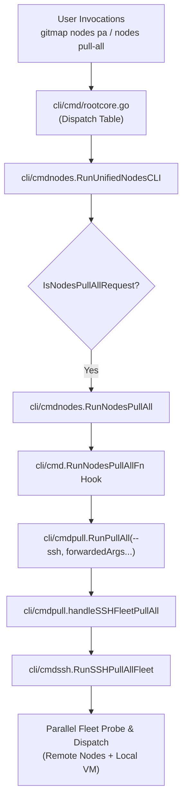

# Spec 270: Fleet Nodes Pull-All Command (`gitmap nodes pa`)

> **Spec ID:** `SPEC-270`
> **Subsystem:** `cli/cmdnodes`, `cli/cmdpull`, `cli/cmdssh`, `cli/cmd`
> **Status:** Implemented & Verified
> **Date:** 2026-10-13

---

## 1. Overview & Objective

Users managing distributed computing fleets require ergonomic, intuitive CLI commands to synchronize codebases across all fleet machines simultaneously. While `gitmap pa --ssh` (or `gitmap pas`) executes fleet-wide batch pulls, the `gitmap nodes` subcommand family lacked a corresponding pull-all entry point.

Spec 270 establishes `gitmap nodes pa` and `gitmap nodes pull-all` as first-class members of the `gitmap nodes` subcommand hierarchy, providing an exact, seamless alternative to `gitmap pa --ssh`.

---

## 2. Command Syntax & Aliases

### Primary Invocations
```bash
gitmap nodes pa [flags]
gitmap nodes pull-all [flags]
gitmap nodes pull [flags]
gitmap nodes pas [flags]
```

### Hyphenated Top-Level Aliases
```bash
gitmap nodes-pa [flags]
gitmap node-pa [flags]
gitmap nodes-pull-all [flags]
gitmap node-pull-all [flags]
gitmap nodes-pull [flags]
gitmap node-pull [flags]
gitmap nodes-pas [flags]
gitmap node-pas [flags]
```

### Supported Flags (Forwarded to Engine)
All standard pull flags are transparently passed through to the underlying engine:
- `--status`: Display colorized per-repository status table
- `--json`: Emit structured telemetry JSON for machine consumption
- `--parallel <N>`: Set local batch pull worker concurrency
- `--fast`: Fast-mode execution
- `-v, --verbose`: Enable detailed operational logs

---

## 3. Architecture & Execution Flow



### Component Breakdown
1. **`cli/cmdnodes/nodes_pull.go`:**
   - Defines `IsNodesPullAllRequest(args []string) bool` to recognize `"pa"`, `"pull-all"`, `"pullall"`, `"pull"`, `"pas"`, `"pull-all-ssh"` while cleanly excluding `"pull errors"`.
   - Defines `RunNodesPullAll(args []string) error` with fallback to `cmdssh.RunSSHPullAllFleet` for isolated environments.
2. **`cli/cmdnodes/nodes_cmd.go`:**
   - Injects `IsNodesPullAllRequest` dispatch branch in `RunUnifiedNodesCLI`.
   - Documents `gitmap nodes pa` in `printUnifiedNodesHelp`.
3. **`cli/cmd/di_hooks_wave2.go`:**
   - Wires `cmdnodes.RunNodesPullAllFn = func(args []string) error { return cmdpull.RunPullAll(append([]string{"--ssh"}, args...)) }`.
4. **`cli/cmd/rootcore.go`:**
   - Registers root hyphenated aliases (`nodes-pa`, `node-pa`, `nodes-pull-all`, `node-pull-all`, `nodes-pas`, `node-pas`).

---

## 4. Verification & Quality Gates

1. **Unit Tests:**
   - `cli/cmdnodes/nodes_pull_test.go`:
     - `TestIsNodesPullAllRequest`: Validates positive tokens (`pa`, `PA`, `pull-all`, `pullall`, `pull`, `pas`) and negative tokens (`pull errors`, `ping`, `clone`).
     - `TestRunNodesPullAll_DispatchesToHook`: Verifies argument forwarding and hook dispatch.
     - `TestRunNodesPullAll_HookErrorPropagated`: Verifies error propagation.
2. **Pre-Commit Quality Gate:**
   - Executed via `python3 03-ai-scripts/50-fastgate.py` (relative paths, nested ifs, boolean rules, file size limits).
