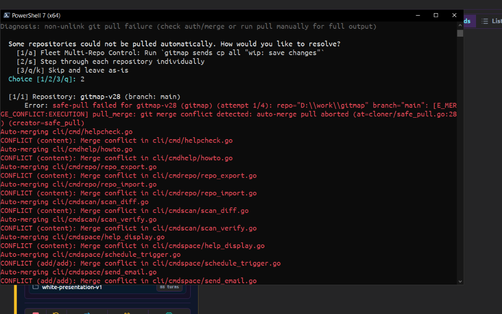
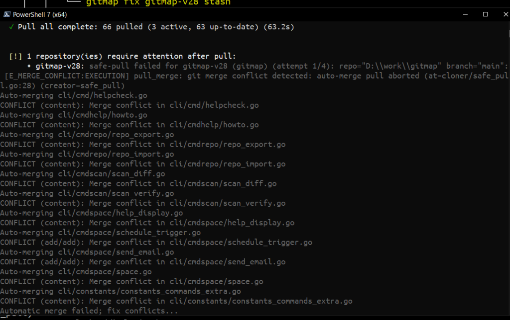

# Spec 279: Scope & Technical Plan

## User Request (Verbatim)
```text
auto merging failed, try to see how to we can improve our automerge to avoid issues in the future, if issues we should provide manual suggestion for the user to fix using IDE like vscode and provide gitmap based commands to run and resolve conflicts, can you please do that and make sure to have helptext and ui help
```

## Visual Context & Screenshots
- Pull failure with merge conflicts:
  
- Interactive resolution prompt:
  

## Architectural Scope & Analysis

### 1. Automerge Optimization & Prevention
- **Root Cause of Past Merge Failures:**
  When local and remote branches diverge, standard `git pull --no-rebase` executes a default 3-way merge. Without smart diff algorithms, mechanical conflict assistance, or `rerere` recording, Git aborts on any overlapping lines.
- **Remediation Strategy:**
  1. Add `-X diff-algorithm=histogram` to merge invocations in `cli/cloner/safe_pull.go`, which produces significantly cleaner merges across structured code and prevents false conflicts caused by common bracket/brace lines.
  2. Implement `git rerere` auto-configuration (`git config rerere.enabled true` and `git config rerere.autoupdate true`). Once enabled, any previously resolved conflict is remembered and re-applied automatically.
  3. Cleanly parse and extract conflicted files when a merge fails, so the user sees a clear, structured list of files rather than an unformatted error dump.

### 2. IDE Integration & Manual VSCode Guidance
- **IDE Detection:**
  Detect installed editors in order of priority: `code` (VS Code), `cursor` (Cursor IDE), `windsurf` (Windsurf), `codium` (VSCodium).
- **IDE Launch Execution:**
  - Open repository: `code <repoPath>`
  - Open conflicted files directly: `code -r <file1> <file2>...`
- **Step-by-Step Merge Editor Guide:**
  Display clear terminal card:
  1. Open the repository in VS Code (`code <repoPath>`).
  2. Open Source Control view (`Ctrl+Shift+G` / `Cmd+Shift+G`).
  3. Click the conflicted file in the "Merge Changes" list and select **"Resolve in Merge Editor"**.
  4. Use the 3-Way Merge Editor: choose **"Accept Incoming"** (remote) or **"Accept Current"** (local).
  5. Save and commit: run `gitmap cpf "resolve merge conflicts"`.

### 3. GitMap Conflict Resolution CLI
- **New Command:** `gitmap resolve <repo> [flags]` / `gitmap conflict <repo>` / `gitmap conflicts`
  - `--theirs`: Accept incoming remote version for all conflicted files (`git checkout --theirs <files>` + `git add`).
  - `--ours`: Accept current local version for all conflicted files (`git checkout --ours <files>` + `git add`).
  - `--ide`: Launch detected IDE on all conflicted files.
  - `--abort`: Safely abort merge or rebase.
- **Extensions to `gitmap fix <repo>`:**
  - `gitmap fix <repo> resolve`: Interactive conflict solver or IDE launcher.
  - `gitmap fix <repo> theirs`: Shortcut to accept remote incoming.
  - `gitmap fix <repo> ours`: Shortcut to accept local current.
  - `gitmap fix <repo> abort`: Shortcut to abort in-progress merge.
  - `gitmap fix <repo> rerere`: Enable Git `rerere` memory for the repository.

### 4. Post-Pull Interactive Menu Polish
- When a repository in `pull_prompt.go` has merge conflicts:
  - Display a dedicated styled Lipgloss conflict box.
  - List the conflicted files with status badges.
  - Provide direct options: `[v] Open in VS Code`, `[t] Accept Theirs`, `[o] Accept Ours`, `[a] Abort Merge`, `[h] Merge Help`.

### 5. Documentation & UI Help
- CLI Markdown Documentation:
  - `cli/helpdoc/resolve.md`
  - `cli/helpdoc/conflicts.md`
- Terminal How-To:
  - `cli/cmdhelp/howto.go`: Add "How to resolve merge conflicts with VS Code or GitMap".
- Web Dashboard Data:
  - `src/data/commands.ts`: Register `gitmap resolve` and `gitmap conflicts`.
  - `src/data/troubleshootingIssues.ts`: Register merge conflict troubleshooting card with VS Code steps.
