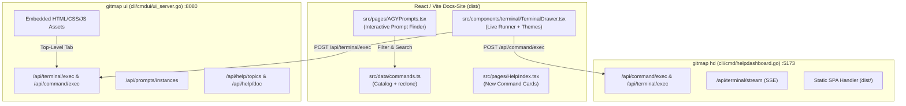

# Specification: Help Dashboard (HD) UI, Theme System, Terminal Runner & Help Documentation

**Slug:** `282-help-doc-ui-hd-theme-and-terminal-runner`  
**Parent Task ID:** `task-282`  
**Status:** `Approved`  
**Version:** `1.0.0`  
**Date:** `2026-10-17`

---

## 1. Problem Statement & Background

GitMap provides two distinct dashboard interfaces for operators:
1. **`gitmap help-dashboard` (`gitmap hd`)**: Serves the React 18 / Tailwind / Vite documentation single-page application from `dist/` on port `5173`.
2. **`gitmap ui`**: Serves a lightweight, zero-dependency embedded web control panel compiled into the Go binary (`cli/cmdui/`) on port `8080`.

Recent audits revealed four user-facing issues:
- **Missing UI Help Documentation:** While `resolve`, `conflicts`, `split-large-files`, `lfs-convert`, and `repo-flatten` were added to `commands.ts`, `reclone` (`rec`) was missing, and none of the new commands were surfaced in `src/pages/HelpIndex.tsx`.
- **Broken / Mocked Terminal Runner:** In the React Help Dashboard, `TerminalDrawer.tsx` was a pure mock simulator that printed hardcoded strings without calling any backend execution API. In the embedded `gitmap ui`, the terminal pane was buried in a settings sub-pane, and direct routing to `/terminal` failed because `tab-terminal` did not exist.
- **Theme & Terminal UI Polish:** The terminal drawer hardcoded `#0c0c0c` dark styling, clashing with light theme settings and ignoring user-selected terminal themes (`dark`, `ubuntu`, `win`). In `cmdui`, the prompt manager had non-functional stub buttons and lacked search capabilities.
- **Embedded Help Doc Gap:** In `cmdui`, `#tab-help` was a static 15-command table that did not expose any of the 100+ embedded markdown manuals in `cli/helpdoc/`.

---

## 2. Technical Architecture

---

## 3. Detailed Requirements & Component Matrix

### 3.1 Frontend (`src/`)
1. **`src/data/commands.ts`**:
   - Register `reclone` (`rec`) with category `"repo"`, full argument options (`--manifest`, `--scan-root`, `--mode`, `--execute`, `-y`), description, and single-repo wipe-and-reclone usage.
2. **`src/data/troubleshootingIssues.ts`**:
   - Add troubleshooting issue for repository corruption / re-cloning using `gitmap reclone`.
3. **`src/pages/HelpIndex.tsx`**:
   - Add dedicated sections/cards for `Merge Conflict Resolution` (`resolve`, `conflicts`) and `Large Files & History Flattening` (`split-large-files`, `lfs-convert`, `repo-flatten`, `reclone`).
4. **`src/components/terminal/TerminalDrawer.tsx`**:
   - Replace fake `runCommand` mock with real `fetch("/api/command/exec")` (with fallback to `/api/terminal/exec`).
   - Implement command history navigation (ArrowUp, ArrowDown).
   - Wire theme styling to honor both `useTheme()` (`isDark`) and `gitmap_terminal_theme` (`dark`, `ubuntu`, `win`).
   - Display real exit codes, execution duration, and formatted output.
5. **`src/pages/AGYPrompts.tsx`**:
   - Introduce an interactive prompt search filter, category filter badges, and one-click clipboard copy / CLI execution helper.

### 3.2 Backend (`cli/`)
1. **`cli/cmdui/ui_assets_js_nodes.go`**:
   - Add `{ id: 'terminal', label: 'Terminal', icon: 'scroll-text' }` to `NAV_ITEMS`.
   - Ensure `showTab('terminal')` activates the dedicated terminal tab.
2. **`cli/cmdui/ui_assets_markup_ops.go`**:
   - Promote terminal from settings sub-pane into top-level `
`.
   - Add prompt search input and interactive results container in `
`.
3. **`cli/cmdui/ui_assets_markup_misc.go`**:
   - Add dynamic markdown topic search and viewer in `
`.
4. **`cli/cmdui/ui_assets_theme.go`**:
   - Enhance contrast tokens, clean card borders, and theme definitions for `--terminal-bg` and `--terminal-text`.
5. **`cli/cmdui/ui_server.go`**:
   - Mount `/api/command/exec` alias pointing to `handleAPITerminalExec`.
   - Mount `/api/help/topics` and `/api/help/doc` calling `cli/helpdoc` engine.
6. **`cli/cmd/hd_terminal.go`**:
   - Mount `/api/terminal/exec` alias pointing to `handleCommandExec`.

---

## 4. Non-Negotiable Invariants

- **Zero Raw Git Commands:** Only `gitmap cpf` / `gitmap cpb` for committing.
- **Strict Relative Paths:** 100% relative paths from git root in all files, commits, and logs.
- **FastGate Compliance:** Line length caps $\le 300$ for new files, $\le 500$ for modified files; nesting depth $\le 1$.
- **Zero Builds or Test Suites:** Do not run manual heavy builds during development.
