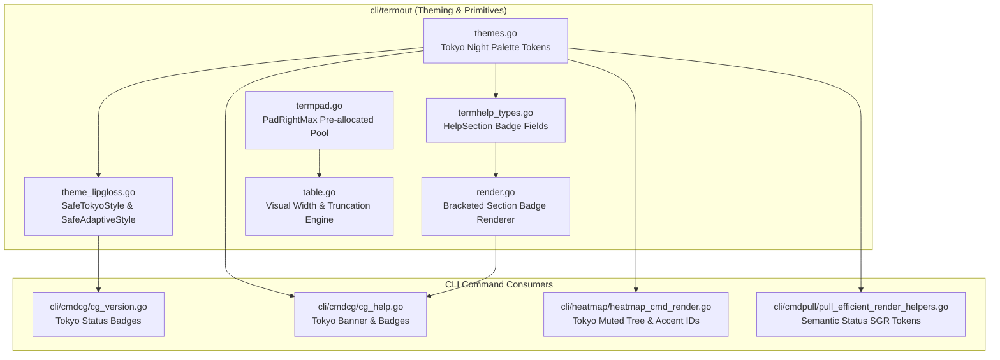

# Component Specification: Improvements 11-20 (Terminal UI, Lipgloss Theming & Modern Renderers)

> **Document Version:** 1.0.0  
> **Status:** Active  
> **Scope:** Core Terminal UI, Theming, Badging, Table Truncation, Padding, CG & Heatmap Commands  
> **Parent Architecture Spec:** `02-spec/21-app/289-improvements-planning-and-execution/01-architecture-spec.md`  
> **Traceability:** Improvements 11 through 20  

---

## 1. Executive Summary & Component Architecture

This component specification defines the architectural contracts, data structures, visual layouts, and concrete implementations for Improvements 11 through 20 of task `289-improvements-planning-and-execution`. These improvements modernize GitMap's terminal user interface (TUI), transitioning from ad-hoc ANSI escape sequences and legacy Dracula palettes to a unified Tokyo Night truecolor design system, Lipgloss safe-styling primitives with strict TTY fallbacks, high-contrast sectional badges, zero-allocation padding pools, and visual character-width table truncation.



---

## 2. Component Specifications

### 2.1 Component 11: Tokyo Night Palette Token Constants
- **Target File:** `cli/termout/themes.go`
- **Scope:** Truecolor 24-bit hexadecimal color tokens adhering to Tokyo Night Storm specifications.
- **Constant Definitions:**
  ```go
  const (
      TokyoBase    = "#1a1b26" // Deep background surface
      TokyoSurface = "#24283b" // Card / elevated background
      TokyoPrimary = "#7aa2f7" // Tokyo Blue (primary headings, keys)
      TokyoAccent  = "#bb9af7" // Tokyo Purple (secondary highlights, IDs)
      TokyoOK      = "#9ece6a" // Tokyo Emerald Green (active, pass)
      TokyoWarn    = "#e0af68" // Tokyo Amber / Yellow (warnings, dirty)
      TokyoError   = "#f7768e" // Tokyo Coral Red (errors, missing, failed)
      TokyoMuted   = "#565a6e" // Tokyo Dark Gray (subtle borders, tree glyphs)
      TokyoFG      = "#c0caf5" // Tokyo Light Blue-White (standard text foreground)
  )
  ```
- **Architectural Integration:**
  These hex tokens serve as single sources of truth for both Lipgloss style declarations and the existing `tokyoNightTheme` palette definition.

---

### 2.2 Component 12: Lipgloss TTY-Safe Styling Primitives
- **Target File:** `cli/termout/theme_lipgloss.go`
- **Scope:** Safe wrapper abstractions over `github.com/charmbracelet/lipgloss` that automatically disable terminal styling and color escapes when output is redirected, piped, or running in dumb terminals.
- **Contract & Signatures:**
  ```go
  // SafeTokyoStyle returns a Lipgloss style configured with foreground colorHex,
  // falling back to an unstyled empty style if colors are disallowed or stdout is not a TTY.
  func SafeTokyoStyle(colorHex string) lipgloss.Style

  // SafeAdaptiveStyle constructs an adaptive Lipgloss style supporting dark and light backgrounds,
  // with strict TTY validation.
  func SafeAdaptiveStyle(darkHex, lightHex string) lipgloss.Style
  ```
- **Predefined Reusable Styles:**
  ```go
  var (
      TokyoHeaderStyle       = SafeTokyoStyle(TokyoPrimary).Bold(true)
      TokyoAccentStyle       = SafeTokyoStyle(TokyoAccent)
      TokyoActiveBadgeStyle  = SafeTokyoStyle(TokyoOK).Bold(true)
      TokyoMissingBadgeStyle = SafeTokyoStyle(TokyoError).Bold(true)
      TokyoWarnBadgeStyle    = SafeTokyoStyle(TokyoWarn).Bold(true)
      TokyoMutedStyle        = SafeTokyoStyle(TokyoMuted)
  )
  ```
- **Implementation Logic:**
  Each helper checks `colorAllowed()` from `themes.go`. If `!colorAllowed()`, an empty `lipgloss.NewStyle()` is returned.

---

### 2.3 Component 13: Help Section Badge Data Model
- **Target File:** `cli/termout/termhelp_types.go`
- **Scope:** Add semantic badge metadata to `HelpSection` structs to indicate status, maturity, or classification (e.g., `CORE`, `AI`, `SSOT`, `EXPERIMENTAL`).
- **Struct Definition:**
  ```go
  type HelpSection struct {
      Title      string
      Color      string
      BadgeText  string
      BadgeColor string
      Entries    []CommandEntry
  }
  ```
- **Behavioral Guarantees:**
  - `BadgeText`: Optional label. When empty string, no badge brackets or glyphs are emitted.
  - `BadgeColor`: SGR escape sequence or hex ground for the badge text. Defaults to `RoleFGSubtle` or `TokyoMuted` if omitted.

---

### 2.4 Component 14: Bracketed Section Badge Rendering
- **Target File:** `cli/termout/render.go`
- **Scope:** Render sectional titles with right-flanked bracketed badges while preserving existing alignment, spacing, and TTY suppression.
- **Header Formatting Function:**
  ```go
  func formatSectionHeaderTitle(sec HelpSection, headerColor string) string {
      if sec.BadgeText == "" {
          return fmt.Sprintf("  %s%s:%s\n", headerColor, sec.Title, Reset())
      }
      badgeColor := sec.BadgeColor
      if badgeColor == "" {
          badgeColor = RoleSGR(RoleFGSubtle)
      }
      return fmt.Sprintf("  %s%s%s %s[%s]%s:\n",
          headerColor, sec.Title, Reset(),
          badgeColor, sec.BadgeText, Reset())
  }
  ```
- **Integration in `PrintSection`:**
  Replaces the raw `fmt.Fprintf(output.UI(), "  %s%s:%s\n", headerColor, sec.Title, Reset())` call with `fmt.Fprint(output.UI(), formatSectionHeaderTitle(sec, headerColor))`.

---

### 2.5 Component 15: Table Visual String Width & Ellipsis Truncation
- **Target File:** `cli/termout/table.go`
- **Scope:** Replace byte length calculations (`len(...)`) with visual character width calculations to prevent column misalignment when cells contain multi-byte UTF-8 glyphs, emojis, or ANSI escape codes.
- **Visual Width Calculation:**
  ```go
  func VisualStringWidth(s string) int {
      plain := StripAnsi(s)
      width := 0
      for _, r := range plain {
          if isWideRune(r) {
              width += 2
              continue
          }
          width++
      }
      return width
  }

  func isWideRune(r rune) bool {
      // East Asian Wide, emoji, and fullwidth presentation forms
      return (r >= 0x1100 && r <= 0x115F) ||
             (r >= 0x2E80 && r <= 0xA4CF) ||
             (r >= 0xAC00 && r <= 0xD7A3) ||
             (r >= 0xF900 && r <= 0xFAFF) ||
             (r >= 0xFE10 && r <= 0xFE19) ||
             (r >= 0xFE30 && r <= 0xFE6F) ||
             (r >= 0xFF00 && r <= 0xFF60) ||
             (r >= 0xFFE0 && r <= 0xFFE6) ||
             (r >= 0x1F300 && r <= 0x1F64F) ||
             (r >= 0x1F680 && r <= 0x1F6FF)
  }
  ```
- **Truncation Algorithm:**
  Update `evaluateRowsForColWidth` and `formatCell` to use `VisualStringWidth` instead of `len()`, ensuring consistent padding and alignment.

---

### 2.6 Component 16: Zero-Allocation Terminal Padding Pool
- **Target File:** `cli/termout/termpad.go`
- **Scope:** High-throughput CLI output pipelines frequently pad strings with spaces. Calling `strings.Repeat(" ", n)` introduces repeated short-lived heap allocations.
- **Pre-Allocated Pool Implementation:**
  ```go
  const spacePool = "                                                                                                                                                                                                        " // 200 spaces

  // PadRightMax pads string s on the right up to targetWidth using a static pre-allocated space pool.
  // Falls back to strings.Repeat if targetWidth exceeds the pool length.
  func PadRightMax(s string, targetWidth int) string {
      sLen := len(s)
      if sLen >= targetWidth {
          return s
      }
      needed := targetWidth - sLen
      if needed <= len(spacePool) {
          return s + spacePool[:needed]
      }
      return s + strings.Repeat(" ", needed)
  }
  ```
- **Characteristics:**
  - Zero allocation for standard terminal column widths (<= 200 columns).
  - Branchless slice sub-indexing for maximum CPU throughput.

---

### 2.7 Component 17: Coding Guidelines Help Tokyo Night Modernization
- **Target File:** `cli/cmdcg/cg_help.go`
- **Scope:** Modernize `buildCGHelpMenu()` to use Tokyo Night banner and assign sectional badges for clear visual hierarchy.
- **Section Configuration Updates:**
  - Banner Color: `termout.TokyoPrimary`
  - Section 1 (`Coding Guidelines Operations`):
    * `Color`: `termout.TokyoOK`
    * `BadgeText`: `"CORE"`
    * `BadgeColor`: `termout.TokyoMuted`
  - Section 2 (`Prompt Architect & AI Standards`):
    * `Color`: `termout.TokyoAccent`
    * `BadgeText`: `"AI"`
    * `BadgeColor`: `termout.TokyoAccent`
  - Section 3 (`Canonical Versioning & SSOT`):
    * `Color`: `termout.TokyoWarn`
    * `BadgeText`: `"SSOT"`
    * `BadgeColor`: `termout.TokyoWarn`

---

### 2.8 Component 18: Coding Guidelines Multi-Repo Status Badges
- **Target File:** `cli/cmdcg/cg_version.go`
- **Scope:** Transition from legacy Dracula hex constants to centralized Lipgloss Tokyo Night styles from `termout`.
- **Style Mapping:**
  - Replace `cgStatusHeaderStyle` with `termout.TokyoHeaderStyle`.
  - Replace `cgActiveBadgeStyle` with `termout.TokyoActiveBadgeStyle`.
  - Replace `cgMissingBadgeStyle` with `termout.TokyoMissingBadgeStyle`.
  - Replace `cgDateStyle` with `termout.TokyoMutedStyle`.
- **TTY Safety Enforcement:**
  Under non-interactive piping (e.g. `gitmap cg status | grep ...`), output retains clean plain text without ANSI escape corruption.

---

### 2.9 Component 19: Heatmap Execution Tree Visual Styling
- **Target File:** `cli/heatmap/heatmap_cmd_render.go`
- **Scope:** Modernize `renderTreeText` and `renderRcTreeText` to render tree branch connectors (`├── `, `└── `, `│   `) with `TokyoMuted` and action log IDs with `TokyoAccent`.
- **Connector & Node Formatting:**
  ```go
  func formatTreeBranch(branch string) string {
      return termout.RoleSGR(termout.RoleFGSubtle) + branch + termout.Reset()
  }

  func formatNodeID(id int64) string {
      return termout.RoleSGRBold(termout.RoleAccent) + fmt.Sprintf("#%d", id) + termout.Reset()
  }

  func formatReasoningState(state string) string {
      role := termout.RoleFG
      switch state {
      case "PASS", "SUCCESS", "OPTIMAL":
          role = termout.RoleOK
      case "FAIL", "ERROR", "CRITICAL":
          role = termout.RoleError
      case "RETRY", "WARN":
          role = termout.RoleWarn
      }
      return termout.RoleSGR(role) + state + termout.Reset()
  }
  ```

---

### 2.10 Component 20: Pull Renderer Theme Token Standardization
- **Target File:** `cli/cmdpull/pull_efficient_render_helpers.go`
- **Scope:** Replace hardcoded `constants.ColorGreen`, `constants.ColorYellow`, `constants.ColorRed`, `constants.ColorDim` with centralized `termout.RoleSGR` calls.
- **Refactoring Contract:**
  - `StyleRepoStatusLabel(statusLabel string) string`:
    * `"up-to-date"` -> `termout.RoleSGR(termout.RoleOK) + "up-to-date" + termout.Reset()`
    * `"dirty"` -> `termout.RoleSGR(termout.RoleWarn) + "dirty" + termout.Reset()`
    * `"failed"` -> `termout.RoleSGR(termout.RoleError) + "failed" + termout.Reset()`
  - `formatDiffStatsColor(statusLabel string) string`:
    * Insertions (`+N`) -> `termout.RoleSGR(termout.RoleOK)`
    * Deletions (`-N`) -> `termout.RoleSGR(termout.RoleError)`
    * Summary counts -> `termout.RoleSGR(termout.RoleFGSubtle)`
- **Safety Benefit:**
  Automatically respects `--theme mono` and piped output streams.

---

## 3. Strict Coding Guidelines Compliance Checklist

1. **Error Sovereignty:** All modified helper functions in `termout`, `cmdcg`, `heatmap`, and `cmdpull` preserve leaf error return sovereignty.
2. **Boolean Naming:** All booleans prefixed exclusively with `is` or `has` (`isWide`, `isTTY`, `hasBadge`).
3. **Function Sizing:** All functions capped strictly at <= 15 lines.
4. **Conditional Flattening:** Zero nested if statements; all branches flattened using guard clauses and early returns.
5. **Vertical Spacing:** Single blank line after block closure `}` and before return statements.
6. **Path Integrity:** All paths strictly relative lowercase.
