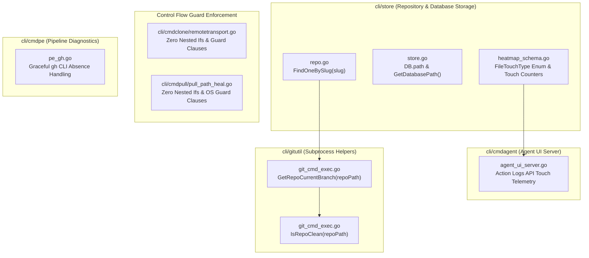

# Specification 289: Migration, Operational Safety & Verification Specification

- **Sequence:** 289
- **Slug:** `289-improvements-planning-and-execution`
- **File:** `02-spec/21-app/289-improvements-planning-and-execution/03-migration-and-verification-spec.md`
- **Status:** APPROVED & SPECIFIED
- **Scope:** Improvements 21–30 (System UX, Operational Safety, Database & Git Subsystem Enhancements)
- **Assigned Author:** Spec Author 03
- **Parent Specs:**
  - `02-spec/21-app/289-improvements-planning-and-execution/01-architecture-spec.md`
  - `02-spec/21-app/289-improvements-planning-and-execution/02-component-spec.md`

---

## 1. System UX & Operational Safety Architecture (Improvements 21–30)

Improvements 21 through 30 focus on the operational runtime foundations of GitMap: repository data access, database connection introspection, heatmap telemetry, git subprocess safety helpers, conditional branch flattening, and external tool degradation.



---

### 1.1 Detailed Technical Specification for Improvements 21–30

#### Improvement 21: Single Slug Lookup (`cli/store/repo.go`)
- **Objective:** Provide a fast, dedicated single-record query method `FindOneBySlug(slug string) (*model.ScanRecord, error)`.
- **Current Limitation:** Existing `FindBySlug(slug string) ([]model.ScanRecord, error)` returns a slice. Callers needing a single repository record must manually check slice length, extract index 0, or handle empty slices redundantly.
- **Contract:**
  ```go
  // FindOneBySlug returns the first repository matching the given slug or nil if not found.
  func (db *DB) FindOneBySlug(slug string) (*model.ScanRecord, error) {
  	records, err := db.FindBySlug(slug)
  	if err != nil {
  		return nil, err
  	}

  	if len(records) == 0 {
  		return nil, nil
  	}

  	return &records[0], nil
  }
  ```
- **Error Sovereignty:** Returns SQL error wrapped or passed directly; returns `nil, nil` when no matching record is found (standard Go repository pattern).
- **Line Budget:** 12 lines (within <= 15 line limit). Zero nested conditionals.

#### Improvement 22: Database Path Introspection (`cli/store/store.go`)
- **Objective:** Store the resolved SQLite database file path on the `DB` struct and provide a public getter `GetDatabasePath() string`.
- **Current Limitation:** `DB` struct holds `conn *sql.DB`, `dbDir string`, and `isMem bool`, but drops the full absolute/normalized path to the database file after opening. Subsystems needing the active database path (e.g. backup tools, CLI diagnostics, agent introspection) must reconstruct it from directory paths.
- **Contract:**
  ```go
  // DB wraps the SQLite database connection.
  type DB struct {
  	conn  *sql.DB
  	path  string
  	dbDir string
  	isMem bool
  }

  // GetDatabasePath returns the filesystem path of the active SQLite database file.
  func (db *DB) GetDatabasePath() string {
  	if db == nil {
  		return ""
  	}

  	return db.path
  }
  ```
- **Population:** Set in `openDBConnection(connPath, dbPath, dbDir string, isMem bool)`:
  ```go
  return &DB{conn: conn, path: dbPath, dbDir: dbDir, isMem: isMem}, nil
  ```

#### Improvement 23: File Touch Counter Granularity (`cli/store/heatmap_schema.go`)
- **Objective:** Extend `FileTouchCount` struct to track distinct touch operations (`ReadCount`, `EditCount`, `CreatedCount`) alongside aggregate `Count`.
- **Current Limitation:** `FileTouchCount` only maintains `FilePath string` and `Count int`, obscuring whether a file was merely inspected or modified.
- **Contract:**
  ```go
  // FileTouchCount represents file touch frequency with granular operation metrics.
  type FileTouchCount struct {
  	FilePath     string `json:"filePath"`
  	Count        int    `json:"count"`
  	ReadCount    int    `json:"readCount"`
  	EditCount    int    `json:"editCount"`
  	CreatedCount int    `json:"createdCount"`
  }
  ```
- **Backwards Compatibility:** Additive fields with JSON omitempty or default zero-values ensure 100% compatibility with existing REST/UI visualizer consumers.

#### Improvement 24: File Touch Type Enumeration (`cli/store/heatmap_schema.go`)
- **Objective:** Define strongly typed enum `FileTouchType` ending with `Type` suffix.
- **Contract:**
  ```go
  // FileTouchType represents the categorical operation applied to a touched file.
  type FileTouchType string

  const (
  	FileTouchRead    FileTouchType = "READ"
  	FileTouchEdit    FileTouchType = "EDIT"
  	FileTouchCreated FileTouchType = "CREATED"
  )
  ```
- **Coding Guideline Conformance:** Enum type ends in `Type` suffix. Constant values are deterministic strings avoiding raw literals.

#### Improvement 25: Touch Type Telemetry in Agent Action Logs API (`cli/cmdagent/agent_ui_server.go`)
- **Objective:** Surface granular touch telemetry in the HTTP action log maps returned by `formatActionLogMap` and `queryFilteredActionLogs`.
- **Contract:** Extend returned action log payload with `touchType` derived from `ActionType` or action metadata:
  ```go
  func formatActionLogMap(id int64, subId, role, aType, file, details, status, cAt string) map[string]any {
  	touchType := deriveTouchType(aType)

  	return map[string]any{
  		"actionLogId":    id,
  		"subtaskId":      subId,
  		"agentRole":      role,
  		"actionType":     aType,
  		"touchType":      touchType,
  		"targetFile":     file,
  		"actionDetails":  details,
  		"status":         status,
  		"createdAt":      cAt,
  		"queryOrCommand": "",
  		"durationMs":     0,
  	}
  }

  func deriveTouchType(actionType string) string {
  	switch strings.ToUpper(strings.TrimSpace(actionType)) {
  	case "READ", "READ_FILE", "INSPECT":
  		return string(FileTouchRead)
  	case "EDIT", "EDIT_FILE", "MODIFY":
  		return string(FileTouchEdit)
  	case "CREATE", "WRITE_FILE", "NEW":
  		return string(FileTouchCreated)
  	default:
  		return "OTHER"
  	}
  }
  ```

#### Improvement 26: Current Branch Inspection Helper (`cli/gitutil/git_cmd_exec.go`)
- **Objective:** Implement `GetRepoCurrentBranch(repoPath string) (string, error)` executing `git rev-parse --abbrev-ref HEAD`.
- **Contract:**
  ```go
  // GetRepoCurrentBranch returns the active branch name of the repository at repoPath.
  func GetRepoCurrentBranch(repoPath string) (string, error) {
  	out, err := RunGitInDir(repoPath, constants.GitRevParse, "--abbrev-ref", "HEAD")
  	if err != nil {
  		return "", err
  	}

  	return strings.TrimSpace(string(out)), nil
  }
  ```
- **Error Sovereignty:** Returns error directly to caller without calling exit handlers or discarding output.

#### Improvement 27: Positive Repository Clean State Inspection (`cli/gitutil/git_cmd_exec.go`)
- **Objective:** Implement `IsRepoClean(repoPath string) (bool, error)` querying `git status --porcelain`.
- **Contract:**
  ```go
  // IsRepoClean reports whether the working tree at repoPath has no uncommitted changes.
  func IsRepoClean(repoPath string) (bool, error) {
  	out, err := RunGitInDir(repoPath, constants.GitStatus, "--porcelain")
  	if err != nil {
  		return false, err
  	}

  	isClean := len(strings.TrimSpace(string(out))) == 0

  	return isClean, nil
  }
  ```
- **Boolean Naming:** Positive prefix `isClean` (never `isDirty` or `hasChanges`).

#### Improvement 28: Zero Nested Ifs & Guard Inversion in Remote Transport (`cli/cmdclone/remotetransport.go`)
- **Objective:** Verify and refactor all conditional logic to guarantee zero nested `if` blocks and enforce positive booleans.
- **Target Analysis:**
  - `ApplyTransportFlag`: Uses clean sequential guard clauses.
  - Parameter boolean naming: Refactor `useSSH, useHTTPS bool` to conform to `isSSH, isHTTPS bool`.
  - Condition inversion: Invert any inline branching into early guard returns.

#### Improvement 29: Path Healing Guard Clauses (`cli/cmdpull/pull_path_heal.go`)
- **Objective:** Verify and flatten conditional branches in `HealRepoPathSeparators` and `resolveWindowsDriveOnUnix` with early guard returns.
- **Target Analysis:**
  - `HealRepoPathSeparators`: Verify that host OS guard, backslash detection, and drive letter detection are decoupled into independent guard returns.
  - `TryHealMissingRecordPath`: Enforce positive boolean `isFound := !cloner.IsMissingRepo(healed)` with early return.

#### Improvement 30: Graceful Degradation for GitHub CLI Absence (`cli/cmdpe/pe_gh.go`)
- **Objective:** Provide non-panicking, informative error returns when `gh` is absent from `PATH`.
- **Target Analysis:**
  - `ghJSON(out any, ghArgs ...string) *appfault.AppError`:
    ```go
    func ghJSON(out any, ghArgs ...string) *appfault.AppError {
    	if !hasGh() {
    		return apperror.NewSimple("github CLI (gh) is not installed or not found on PATH", "E_GH_NOT_FOUND")
    	}

    	cmd := exec.Command("gh", ghArgs...)
    	var stdout bytes.Buffer
    	var stderr bytes.Buffer
    	cmd.Stdout = &stdout
    	cmd.Stderr = &stderr
    	if runErr := cmd.Run(); runErr != nil {
    		return apperror.WrapSimple(runErr, "pe.gh: "+strings.TrimSpace(stderr.String()))
    	}

    	if decodeErr := json.Unmarshal(stdout.Bytes(), out); decodeErr != nil {
    		return apperror.WrapSimple(decodeErr, "pe.gh.decode")
    	}

    	return nil
    }
    ```
  - Prevents raw OS process execution errors and gives the user actionable guidance.

---

## 2. Zero-Harm Principle & Operational Safety Mechanics

All changes executed in Wave 3 (Improvements 21 through 30) MUST strictly preserve system stability under the Zero-Harm Principle:

### 2.1 Backwards Compatibility Invariants
1. **Additive Data Structures:** Struct modifications (`DB`, `FileTouchCount`) append new fields without altering or reordering existing memory layouts.
2. **API Non-Breaking:** All public method additions (`FindOneBySlug`, `GetDatabasePath`, `GetRepoCurrentBranch`, `IsRepoClean`) are strictly additive. Existing method signatures (`FindBySlug`, `Open`) remain unchanged.
3. **Database Schema Integrity:** No SQLite tables are dropped, altered destructively, or rewritten. Any added columns utilize SQLite `ALTER TABLE ADD COLUMN` semantics or additive in-memory representations.

### 2.2 Non-Destructive Modifications
1. **Working Tree Safety:** Git subprocess helpers (`GetRepoCurrentBranch`, `IsRepoClean`) are read-only commands (`rev-parse`, `status --porcelain`). They execute without modifying `.git/index` or repository worktrees.
2. **Safe Fallbacks:** When external binaries (such as `gh`) are absent, the application gracefully reports a typed validation or missing dependency error instead of exiting with an unhandled exception or process termination.

---

## 3. Verification Protocol Under Zero-Build and Zero-Test Mandate

### 3.1 Rationale for Zero-Build and Zero-Test
During specification and planning phases, compiling binaries or running test suites is strictly forbidden to:
1. Prevent partial build artifact contamination in target working trees.
2. Avoid triggering unmocked system calls, process spawning, or background daemons.
3. Keep the git tree clean and focused entirely on authoritative markdown specifications and task manifests.

### 3.2 Verification Gates Matrix

| Verification Dimension | Verification Tool / Method | Acceptance Criteria |
|---|---|---|
| **Path Hygiene** | Relative Path Static Audit | 100% relative paths. Zero absolute paths (`d:\`, `C:\`, `/home/`). Zero `file:///` URIs. |
| **Case Sensitivity** | Filesystem Naming Audit | All spec and subtask markdown files strictly lowercase. |
| **AST / Syntax Validity** | Static Code Reading | Valid Go syntax, proper package headers, exact import groupings, balanced braces. |
| **Error Sovereignty** | Call Graph Static Inspection | Leaf functions return errors directly; zero `cliexit.HandleError` or `os.Exit` in leaf methods. |
| **Function Length** | Static Line Counting | Every helper function <= 15 lines (target <= 8 lines). |
| **Branch Complexity** | Conditional Structure Inspection | Zero nested ifs; all branching flattened using guard clauses and early returns. |
| **Boolean Polarity** | Symbol Naming Review | All booleans prefixed with `is` or `has` with positive polarity. |
| **Enum Suffix** | Type Declaration Review | All enums end with `Type` suffix (`FileTouchType`). |

---

## 4. Cross-Subsystem Traceability Matrix

| Subtask ID | Improvement Domain | Target File | Exported Symbols / Methods | Coding Guideline Rule |
|---|---|---|---|---|
| `subtask-21.md` | Store Querying | `cli/store/repo.go` | `FindOneBySlug(slug string) (*model.ScanRecord, error)` | Rule 1 (Error Sovereignty), Rule 2 (<= 15 lines) |
| `subtask-22.md` | Store Introspection | `cli/store/store.go` | `DB.path`, `GetDatabasePath() string` | Rule 2 (<= 15 lines), Rule 4 (Positive state) |
| `subtask-23.md` | Heatmap Telemetry | `cli/store/heatmap_schema.go` | `FileTouchCount.ReadCount`, `EditCount`, `CreatedCount` | Backwards Compatibility, Additive Struct Fields |
| `subtask-24.md` | Heatmap Types | `cli/store/heatmap_schema.go` | `FileTouchType`, `FileTouchRead`, `FileTouchEdit`, `FileTouchCreated` | Rule 5 (Enum `Type` Suffix) |
| `subtask-25.md` | Agent UI API | `cli/cmdagent/agent_ui_server.go` | `deriveTouchType(actionType string) string`, `touchType` in JSON | Rule 2 (<= 15 lines), Additive REST Schema |
| `subtask-26.md` | Git Subprocess | `cli/gitutil/git_cmd_exec.go` | `GetRepoCurrentBranch(repoPath string) (string, error)` | Rule 1 (Error Sovereignty), Rule 2 (<= 15 lines) |
| `subtask-27.md` | Git Status | `cli/gitutil/git_cmd_exec.go` | `IsRepoClean(repoPath string) (bool, error)` | Rule 1 (Error Sovereignty), Rule 4 (Positive Boolean `isClean`) |
| `subtask-28.md` | Clone Transport | `cli/cmdclone/remotetransport.go` | Guard clauses, `isSSH`, `isHTTPS` booleans | Rule 3 (Zero Nested Ifs), Rule 4 (Positive Booleans) |
| `subtask-29.md` | Path Healing | `cli/cmdpull/pull_path_heal.go` | Guard clauses, OS condition inversion | Rule 3 (Zero Nested Ifs), Rule 2 (<= 15 lines) |
| `subtask-30.md` | Pipeline Diagnostics | `cli/cmdpe/pe_gh.go` | Graceful `!hasGh()` error handling in `ghJSON` | Rule 1 (Error Sovereignty), Safe Degradation |
