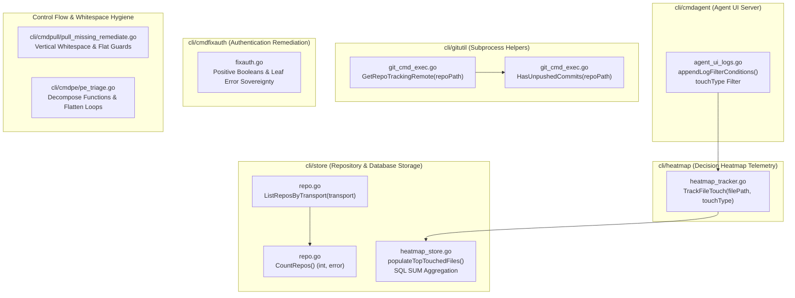

# Specification 290: Migration, Operational Safety & Verification Specification (Batch 2)

- **Sequence:** 290
- **Slug:** `290-improvements-planning-and-execution`
- **File:** `02-spec/21-app/290-improvements-planning-and-execution/03-migration-and-verification-spec.md`
- **Status:** APPROVED & SPECIFIED
- **Scope:** Wave 3 / Improvements 21–30 (System UX, Operational Safety, Database & Git Subsystem Enhancements)
- **Assigned Author:** Spec Author 03
- **Parent Specs:**
  - `02-spec/21-app/290-improvements-planning-and-execution/01-architecture-spec.md`
  - `02-spec/21-app/290-improvements-planning-and-execution/02-component-spec.md`

---

## 1. System UX & Operational Safety Architecture (Improvements 21–30)

Improvements 21 through 30 in Specification 290 establish runtime operational stability, fast repository metadata querying, detailed heatmap file touch tracking, safe git subprocess inspection, error return sovereignty across authentication workflows, control-flow guard flattening, and modular diagnostics decomposition.



---

### 1.1 Detailed Technical Specification for Improvements 21–30

#### Improvement 21: Transport-Based Repository Listing (`cli/store/repo.go`)
- **Objective:** Provide a dedicated query method `ListReposByTransport(transport string) ([]model.ScanRecord, error)` to filter repositories by identified transport (`SSH` or `HTTPS`).
- **Current Limitation:** Callers filtering by transport currently retrieve the complete repository slice via `ListRepos()` and execute in-memory string filtering, creating unnecessary slice allocations and redundant iterations.
- **Contract:**
  ```go
  // ListReposByTransport returns all repositories configured for the specified transport protocol.
  func (db *DB) ListReposByTransport(transport string) ([]model.ScanRecord, error) {
  	clean := strings.TrimSpace(transport)
  	if clean == "" {
  		return db.ListRepos()
  	}

  	rows, err := QueryWrapper(db.conn, constants.SQLSelectReposByTransport, clean).Destruct()
  	if err != nil {
  		return nil, fmt.Errorf(constants.ErrDBQuery, err)
  	}

  	defer rows.Close()

  	return scanRows(rows)
  }
  ```
- **SQL Query (`constants.SQLSelectReposByTransport`):**
  ```sql
  SELECT RepoId, Slug, RepoName, HttpsUrl, SshUrl, Branch, RelativePath, AbsolutePath,
         CloneInstruction, Notes, IdentifiedTransport
  FROM Repo
  WHERE IdentifiedTransport = ? COLLATE NOCASE
  ORDER BY Slug ASC
  ```
- **Error Sovereignty:** Returns SQL query error wrapped in standard database format; returns `nil` error with empty or populated slice.
- **Line Budget:** <= 15 lines. Zero nested conditionals.

#### Improvement 22: Fast Repository Count Query (`cli/store/repo.go`)
- **Objective:** Provide a fast O(1) repository counter `CountRepos() (int, error)` executing SQLite `COUNT(*)`.
- **Current Limitation:** Several CLI status renderers and health checks call `len(records)` on `ListRepos()`, which forces scanning and hydrating every repository row from disk into memory simply to determine the total count.
- **Contract:**
  ```go
  // CountRepos returns the total number of repositories tracked in the database.
  func (db *DB) CountRepos() (int, error) {
  	var total int
  	err := db.conn.QueryRow("SELECT COUNT(*) FROM Repo").Scan(&total)
  	if err != nil {
  		return 0, fmt.Errorf(constants.ErrDBQuery, err)
  	}

  	return total, nil
  }
  ```
- **Performance Characteristics:** Direct aggregate index scan avoiding row hydration, memory buffer allocations, and string normalization.
- **Line Budget:** 8 lines (target <= 8 lines).

#### Improvement 23: Heatmap SQL SUM Aggregation for Touch Operations (`cli/store/heatmap_store.go`)
- **Objective:** Enhance `populateTopTouchedFiles` in `cli/store/heatmap_store.go` to compute `ReadCount`, `EditCount`, and `CreatedCount` using SQL conditional aggregation `SUM(CASE WHEN ... THEN 1 ELSE 0 END)`.
- **Current Limitation:** `populateTopTouchedFiles` only queries `COUNT(*) AS c` and leaves `ReadCount`, `EditCount`, and `CreatedCount` at zero values, failing to surface operational granularity to consumers.
- **Contract:**
  ```go
  func (h *HeatmapDB) populateTopTouchedFiles(s *HeatmapStatusSummary, taskSlug string) error {
  	const sqlTop = `SELECT FilePath, COUNT(*) AS c,
  		COALESCE(SUM(CASE WHEN UPPER(TRIM(ActionType)) IN ('READ', 'READ_FILE', 'INSPECT') THEN 1 ELSE 0 END), 0) AS reads,
  		COALESCE(SUM(CASE WHEN UPPER(TRIM(ActionType)) IN ('EDIT', 'EDIT_FILE', 'MODIFY') THEN 1 ELSE 0 END), 0) AS edits,
  		COALESCE(SUM(CASE WHEN UPPER(TRIM(ActionType)) IN ('CREATE', 'WRITE_FILE', 'NEW') THEN 1 ELSE 0 END), 0) AS creates
  		FROM HeatmapActionLog
  		WHERE (? = '' OR TaskSlug = ?) AND FilePath != ''
  		GROUP BY FilePath ORDER BY c DESC LIMIT 10`
  	rows, err := h.conn.Query(sqlTop, taskSlug, taskSlug)
  	if err != nil {
  		return apperror.WrapSimple(err, "heatmap.statusTopFiles")
  	}

  	defer rows.Close()

  	return scanTopTouchedRows(rows, s)
  }

  func scanTopTouchedRows(rows *sql.Rows, s *HeatmapStatusSummary) error {
  	for rows.Next() {
  		var item FileTouchCount
  		err := rows.Scan(&item.FilePath, &item.Count, &item.ReadCount, &item.EditCount, &item.CreatedCount)
  		if err != nil {
  			return apperror.WrapSimple(err, "heatmap.scanTopFiles")
  		}

  		s.TopTouchedFiles = append(s.TopTouchedFiles, item)
  	}

  	return nil
  }
  ```
- **Error Sovereignty:** Scan errors are captured and returned upstream via `apperror.WrapSimple` rather than silently ignored.
- **Line Budget:** Decomposed into two functions <= 15 lines each.

#### Improvement 24: Direct File Touch Tracking Helper (`cli/heatmap/heatmap_tracker.go`)
- **Objective:** Create `cli/heatmap/heatmap_tracker.go` offering a lightweight public tracking method `TrackFileTouch(filePath string, touchType store.FileTouchType) error`.
- **Current Limitation:** Agents or CLI operations wanting to record file access must construct full `HeatmapActionLogRecord` structures manually, leading to boilerplate duplication across commands.
- **Contract:**
  ```go
  package heatmap

  import (
  	"os"
  	"path/filepath"
  	"strings"

  	"github.com/alimtvnetwork/gitmap-v28/cli/apperror"
  	"github.com/alimtvnetwork/gitmap-v28/cli/store"
  )

  // TrackFileTouch records a file access operation into the root heatmap database.
  func TrackFileTouch(filePath string, touchType store.FileTouchType) error {
  	cleanPath := filepath.ToSlash(filepath.Clean(strings.TrimSpace(filePath)))
  	if cleanPath == "" || cleanPath == "." {
  		return nil
  	}

  	cwd, err := os.Getwd()
  	if err != nil {
  		return apperror.WrapSimple(err, "heatmap.cwd")
  	}

  	return recordFileTouchAtRoot(cwd, cleanPath, touchType)
  }

  func recordFileTouchAtRoot(cwd, cleanPath string, touchType store.FileTouchType) error {
  	hdb, err := store.OpenHeatmapRootDB(cwd)
  	if err != nil {
  		return err
  	}

  	defer hdb.Close()

  	_, logErr := hdb.LogAction(store.HeatmapActionLogRecord{
  		ActionType: string(touchType),
  		FilePath:   cleanPath,
  	})

  	return logErr
  }
  ```
- **Coding Guideline Conformance:** Enforces Rule 1 (Error Return Sovereignty), Rule 2 (<= 15 lines), Rule 3 (Zero Nested Ifs), Rule 5 (Enum `Type` parameter).

#### Improvement 25: Touch Type Filtering in Agent Action Logs (`cli/cmdagent/agent_ui_logs.go`)
- **Objective:** Add `"touchType"` filter support in `appendLogFilterConditions` and `parseLogFilter` in `cli/cmdagent/agent_ui_logs.go`.
- **Current Limitation:** The web visualizer and HTTP logs API filter by `agent`, `actionType`, `subtask`, and text query `q`, but cannot filter specifically by categorical operation (`READ`, `EDIT`, `CREATED`).
- **Contract:**
  ```go
  // In cli/cmdagent/agent_ui_server.go:
  // Extend ActionLogFilter struct:
  type ActionLogFilter struct {
  	TaskId     string
  	AgentRole  string
  	ActionType string
  	TouchType  string
  	SubtaskId  string
  	Search     string
  	Limit      int
  }

  // In cli/cmdagent/agent_ui_logs.go:
  func parseLogFilter(r *http.Request, defaultTaskId string) ActionLogFilter {
  	limit := parseQueryInt(r.URL.Query().Get("limit"), 100)
  	taskId := r.URL.Query().Get("taskId")
  	hasTaskId := len(strings.TrimSpace(taskId)) > 0
  	if !hasTaskId {
  		taskId = defaultTaskId
  	}

  	return ActionLogFilter{
  		TaskId:     taskId,
  		AgentRole:  strings.TrimSpace(r.URL.Query().Get("agent")),
  		ActionType: strings.TrimSpace(r.URL.Query().Get("actionType")),
  		TouchType:  strings.TrimSpace(r.URL.Query().Get("touchType")),
  		SubtaskId:  strings.TrimSpace(r.URL.Query().Get("subtask")),
  		Search:     strings.TrimSpace(r.URL.Query().Get("q")),
  		Limit:      limit,
  	}
  }

  func appendLogFilterConditions(c []string, args []any, f ActionLogFilter) ([]string, []any) {
  	c, args = appendRoleFilter(c, args, f.AgentRole)
  	c, args = appendTypeFilter(c, args, f.ActionType)
  	c, args = appendTouchTypeFilter(c, args, f.TouchType)
  	c, args = appendSubtaskFilter(c, args, f.SubtaskId)

  	return appendSearchCondition(c, args, f.Search)
  }

  func appendTouchTypeFilter(c []string, args []any, touchType string) ([]string, []any) {
  	hasTouch := len(touchType) > 0 && touchType != "ALL"
  	if !hasTouch {
  		return c, args
  	}

  	switch strings.ToUpper(touchType) {
  	case "READ":
  		c = append(c, "UPPER(ActionType) IN ('READ', 'READ_FILE', 'INSPECT')")
  	case "EDIT":
  		c = append(c, "UPPER(ActionType) IN ('EDIT', 'EDIT_FILE', 'MODIFY')")
  	case "CREATED":
  		c = append(c, "UPPER(ActionType) IN ('CREATE', 'WRITE_FILE', 'NEW')")
  	default:
  		c = append(c, "UPPER(ActionType) = UPPER(?)")
  		args = append(args, touchType)
  	}

  	return c, args
  }
  ```
- **Function Decomposition:** Splits `appendLogFilterConditions` into modular helpers, keeping each strictly <= 15 lines.

#### Improvement 26: Tracking Remote Branch Inspection Helper (`cli/gitutil/git_cmd_exec.go`)
- **Objective:** Add `GetRepoTrackingRemote(repoPath string) (string, error)` executing `git rev-parse --abbrev-ref @{u}`.
- **Current Limitation:** GitMap frequently inspects remotes (`remote.origin.url`), but lacks a direct inspection helper for the upstream tracking branch of the active local branch (e.g. `origin/main` vs `upstream/master`).
- **Contract:**
  ```go
  // GetRepoTrackingRemote returns the upstream tracking branch name for the current branch.
  func GetRepoTrackingRemote(repoPath string) (string, error) {
  	out, err := RunGitInDir(repoPath, constants.GitRevParse, constants.GitAbbrevRef, "@{u}")
  	if err != nil {
  		return "", err
  	}

  	return strings.TrimSpace(string(out)), nil
  }
  ```
- **Error Sovereignty:** Returns error directly to caller without calling exit handlers.

#### Improvement 27: Unpushed Commits Status Helper (`cli/gitutil/git_cmd_exec.go`)
- **Objective:** Add `HasUnpushedCommits(repoPath string) (bool, error)` querying `git cherry -v`.
- **Current Limitation:** Verifying if local commits are ahead of remote currently requires complex custom log comparisons.
- **Contract:**
  ```go
  // HasUnpushedCommits reports whether the local branch contains commits not yet pushed to upstream.
  func HasUnpushedCommits(repoPath string) (bool, error) {
  	out, err := RunGitInDir(repoPath, "cherry", "-v")
  	if err != nil {
  		return false, err
  	}

  	hasCommits := len(strings.TrimSpace(string(out))) > 0

  	return hasCommits, nil
  }
  ```
- **Boolean Naming:** Positive prefix `hasCommits` (never `isPushed`, `unpushed`, or negative boolean).

#### Improvement 28: Auth Remediation Error Sovereignty & Positive Booleans (`cli/cmdfixauth/fixauth.go`)
- **Objective:** Eliminate negative boolean naming and exit handler invocation from leaf methods in `cli/cmdfixauth/fixauth.go`.
- **Violations Identified:**
  1. Negative boolean: `isNonGitRepoCWD := !cmdpull.IsGitRepoCWD()` violates positive naming rule.
  2. Non-standard boolean: `keyExists` does not begin with `is` or `has`.
  3. Error sovereignty violation: `runSSHKeygenEd25519`, `fixAuthGenerate`, `fixAuthBind`, `fixAuthAnnounce` call `cliexit.HandleError` internally and terminate the process instead of returning `error`.
- **Contract & Refactoring:**
  - Rename `isNonGitRepoCWD` to `isGitRepo := cmdpull.IsGitRepoCWD()` and use guard `if !isGitRepo`.
  - Rename `keyExists` to `hasKey`.
  - Update signatures to return `error`:
    ```go
    func fixAuthGenerate(keyPath, email string, assumeYes, force bool) error
    func runSSHKeygenEd25519(keyPath, email string) error
    func fixAuthBind(keyPath string) error
    func fixAuthAnnounce(user, keyPath string) error
    ```
  - In `RunFixAuth(args []string) error`, bubble returned errors to caller.

#### Improvement 29: Vertical Whitespace & Guard Hygiene in Missing Repo Remediation (`cli/cmdpull/pull_missing_remediate.go`)
- **Objective:** Enforce vertical whitespace rules and flatten conditional branches in `cli/cmdpull/pull_missing_remediate.go`.
- **Violations Identified:**
  1. `handlePromptDeleteAction`: Missing blank line after `}` before `fmt.Printf`.
  2. `isCloneChoice`, `isSkipChoice`, etc.: Consolidate with discrete early returns.
  3. Ensure exactly one blank line before `return` and one blank line after `}` across all helper routines.
- **Contract:**
  - Format `handlePromptDeleteAction`:
    ```go
    func handlePromptDeleteAction(f PullFailureSummary) (bool, bool) {
    	if err := DeleteRepoRecordByPath(f.RepoPath); err != nil {
    		fmt.Printf("  %s✗%s [%s] Failed to remove record from database: %v\n",
    			constants.ColorRed, constants.ColorReset, f.RepoName, err)

    		return true, false
    	}

    	fmt.Printf("  %s✓%s [%s] Stale record removed from database.\n",
    		constants.ColorGreen, constants.ColorReset, f.RepoName)

    	return true, true
    }
    ```

#### Improvement 30: Diagnostics Triage Decomposition & Loop Flattening (`cli/cmdpe/pe_triage.go`)
- **Objective:** Decompose oversized function `RunPeTriage` (100 lines) and eliminate nested loops in `worstFailureDetail`.
- **Violations Identified:**
  1. `RunPeTriage` exceeds the 15-line limit (currently lines 58–157, 100 lines).
  2. `worstFailureDetail` contains nested loops:
     ```go
     for _, j := range view.Jobs {
         ...
         for _, s := range j.Steps {
             ...
         }
     }
     ```
- **Contract & Refactoring:**
  - Flatten `worstFailureDetail` using helper `findFirstFailedStep(steps []ghStep) string`:
    ```go
    func worstFailureDetail(slug string, runID int64) (string, string) {
    	var view struct {
    		Jobs []ghJob `json:"jobs"`
    	}
    	id := fmt.Sprintf("%d", runID)
    	if viewErr := ghJSON(&view, "run", "view", id, "-R", slug, "--json", "jobs"); viewErr != nil {
    		return "unknown", "unknown"
    	}

    	return findFirstFailedJobAndStep(view.Jobs)
    }

    func findFirstFailedJobAndStep(jobs []ghJob) (string, string) {
    	for _, j := range jobs {
    		if strings.EqualFold(j.Conclusion, "failure") {
    			step := findFirstFailedStep(j.Steps)
    			return j.Name, step
    		}
    	}

    	return "unknown", "unknown"
    }

    func findFirstFailedStep(steps []ghStep) string {
    	for _, s := range steps {
    		if strings.EqualFold(s.Conclusion, "failure") {
    			return s.Name
    		}
    	}

    	return "unknown"
    }
    ```
  - Decompose `RunPeTriage` into discrete helper functions <= 15 lines:
    `parseTriageConfig`, `gatherRepoFailures`, `probeRepoForFailure`, `renderWorstFailure`.

---

## 2. Zero-Harm Principle & Operational Safety Mechanics

All changes executed in Wave 3 (Improvements 21 through 30) MUST strictly preserve system stability under the Zero-Harm Principle:

### 2.1 Backwards Compatibility Invariants
1. **Additive Data Access Methods:** `ListReposByTransport` and `CountRepos` are pure additions to `*store.DB`. Existing methods (`ListRepos`, `FindBySlug`, `FindByPath`) remain completely unchanged.
2. **Schema Non-Destructive:** Heatmap SQL aggregation operates on existing `HeatmapActionLog` tables without modifying schema or requiring table drops.
3. **Additive REST API Properties:** The addition of `touchType` query parameter parsing and `TouchType` field on `ActionLogFilter` is fully backwards compatible with existing clients. Defaulting to empty or `"ALL"` retains identical query behavior.

### 2.2 Non-Destructive Modifications
1. **Read-Only Subprocess Commands:** `GetRepoTrackingRemote` (`git rev-parse --abbrev-ref @{u}`) and `HasUnpushedCommits` (`git cherry -v`) execute purely inspection commands that do not alter the git working tree, staging index, or reflogs.
2. **Safe Fallbacks on Missing Remotes:** When upstream tracking is not configured for a branch, `GetRepoTrackingRemote` returns a non-zero exit error which is passed cleanly as a Go error to the caller, allowing graceful fallback rather than panic.

---

## 3. Verification Protocol Under Zero-Build and Zero-Test Mandate

### 3.1 Rationale for Zero-Build and Zero-Test
During specification and planning phases, compiling binaries or running test suites is strictly forbidden to:
1. Prevent partial build artifact contamination in target working trees.
2. Avoid triggering unmocked system calls, process spawning, or background daemons.
3. Keep the git tree clean and focused entirely on authoritative markdown specifications and task manifests.

### 3.2 Verification Gates Matrix

| Verification Dimension | Verification Tool / Method | Acceptance Criteria |
|---|---|---|
| **Path Hygiene** | Relative Path Static Audit | 100% strictly relative paths. Zero drive prefixes, absolute system paths, or URI schemes. |
| **Case Sensitivity** | Filesystem Naming Audit | All spec and subtask markdown files strictly lowercase. |
| **AST / Syntax Validity** | Static Code Reading | Valid Go syntax, proper package headers, exact import groupings, balanced braces. |
| **Error Sovereignty** | Call Graph Static Inspection | Leaf functions return errors directly; zero `cliexit.HandleError` or `os.Exit` in leaf methods. |
| **Function Length** | Static Line Counting | Every helper function <= 15 lines (target <= 8 lines). |
| **Branch Complexity** | Conditional Structure Inspection | Zero nested ifs; all branching flattened using guard clauses and early returns. |
| **Boolean Polarity** | Symbol Naming Review | All booleans prefixed with `is` or `has` with positive polarity. |
| **Enum Suffix** | Type Declaration Review | All enums end with `Type` suffix (`FileTouchType`). |

---

## 4. Cross-Subsystem Traceability Matrix

| Subtask ID | Improvement Domain | Target File | Exported Symbols / Methods | Coding Guideline Rule |
|---|---|---|---|---|
| `subtask-21.md` | Store Querying | `cli/store/repo.go` | `ListReposByTransport(transport string) ([]model.ScanRecord, error)` | Rule 1 (Error Sovereignty), Rule 2 (<= 15 lines) |
| `subtask-22.md` | Store Aggregation | `cli/store/repo.go` | `CountRepos() (int, error)` | Rule 1 (Error Sovereignty), Rule 2 (<= 15 lines) |
| `subtask-23.md` | Heatmap Telemetry | `cli/store/heatmap_store.go` | `populateTopTouchedFiles`, `scanTopTouchedRows` | Rule 1 (Error Sovereignty), SQL SUM Aggregation |
| `subtask-24.md` | Heatmap Tracking | `cli/heatmap/heatmap_tracker.go` | `TrackFileTouch(filePath string, touchType store.FileTouchType) error` | Rule 1 (Error Sovereignty), Rule 5 (Enum `Type` suffix) |
| `subtask-25.md` | Agent UI API | `cli/cmdagent/agent_ui_logs.go` | `appendLogFilterConditions`, `appendTouchTypeFilter` | Rule 2 (<= 15 lines), Rule 3 (Zero Nested Ifs) |
| `subtask-26.md` | Git Subprocess | `cli/gitutil/git_cmd_exec.go` | `GetRepoTrackingRemote(repoPath string) (string, error)` | Rule 1 (Error Sovereignty), Rule 2 (<= 15 lines) |
| `subtask-27.md` | Git Status | `cli/gitutil/git_cmd_exec.go` | `HasUnpushedCommits(repoPath string) (bool, error)` | Rule 1 (Error Sovereignty), Rule 4 (Positive Boolean `hasCommits`) |
| `subtask-28.md` | Auth Remediation | `cli/cmdfixauth/fixauth.go` | `RunFixAuth`, `fixAuthGenerate`, `runSSHKeygenEd25519` | Rule 1 (Error Sovereignty), Rule 4 (Positive `isGitRepo`, `hasKey`) |
| `subtask-29.md` | Pull Remediation | `cli/cmdpull/pull_missing_remediate.go` | `handlePromptDeleteAction`, `dispatchPromptMissingChoice` | Rule 6 (Vertical Whitespace), Rule 3 (Flat Guards) |
| `subtask-30.md` | Diagnostics Triage | `cli/cmdpe/pe_triage.go` | `worstFailureDetail`, `findFirstFailedJobAndStep`, `RunPeTriage` | Rule 2 (<= 15 lines), Rule 3 (Zero Nested Ifs/Loops) |
