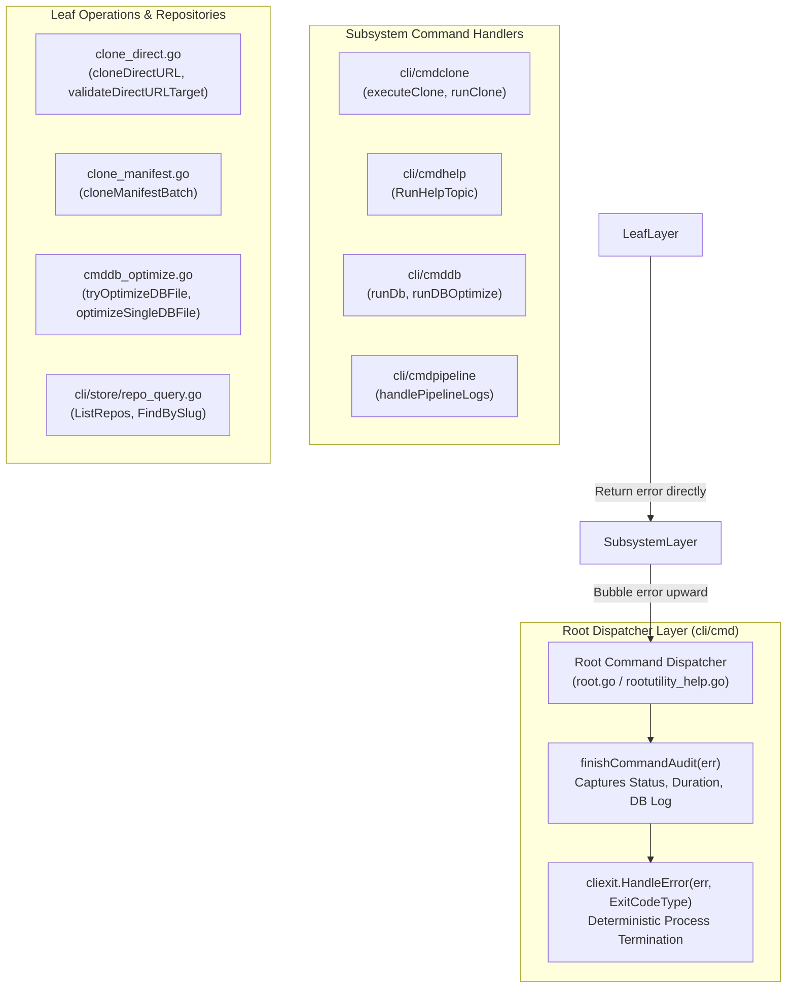

# Architecture Specification: 291 Improvements Planning & Execution (Batch 3)

## 1. Executive Summary & Vision

Plan 291 delivers Batch 3 (Improvements 61 through 90, broken down into Subtasks 01 through 30) of the system-wide architecture and quality modernization initiative across Gitmap. This specification defines the foundational architecture, design constraints, and implementation standards for Improvements 01 through 10 (Subtasks 01 through 10), centering on three critical pillars:

1. **Golang Error Management & Leaf Error Sovereignty**: Complete elimination of anti-patterns where leaf helper functions invoke CLI exit handlers (`cliexit.HandleError`) or `os.Exit` and return `nil`. All leaf functions must return structured errors directly (`error` or `*apperror.AppError`), permitting top-level dispatchers in `cli/cmd/root.go` to capture errors, complete audit trails via `finishCommandAudit`, and determine process termination codes deterministically.
2. **Strict Coding Style & Metric Boundaries**:
   - **Function Length**: Hard limit of $\le 15$ lines per function ($\le 8$ lines strongly preferred).
   - **Cyclomatic Complexity**: Zero nested `if` statements through guard clauses and early returns.
   - **Boolean Polarity**: Every boolean variable and function must start strictly with `is` or `has` (banning `can`, `should`, `was`, `will`, and negative booleans).
   - **Whitespace Hygiene**: Mandatory blank line after closing brace `}` and blank line preceding `return`.
   - **File Size Cap Ratchet**: Hard cap of 500 lines per `.go` file, actively decomposing bloated files into focused companion modules.
3. **Strongly-Typed Constants & Value Semantics**: Eradication of magic integer exit codes and arbitrary string literals through typed enums (`GitCommandType`, `DatabaseTableType`, `ExitCodeType`), alongside value semantics across query structures and database access layers.

---

## 2. Core Architectural Principles & Invariants



### 2.1 Leaf Error Sovereignty
- **Rule**: Leaf functions declaring an `error` return type MUST return the error directly (`return err` or `return apperror.WrapSimple(err, ...)`). Leaf functions MUST NEVER invoke exit handlers (`cliexit.HandleError`), `os.Exit`, or `cliexit.Exit` and then return `nil`.
- **Rationale**: In Gitmap's Split-DB telemetry architecture, invoking an immediate exit within a helper terminates the runtime process before the root dispatcher can trigger `finishCommandAudit`. This drops telemetry records, corrupts in-flight transaction rollbacks, and prevents outer recovery mechanisms.
- **Top-Level Exit Authority**: Only the top-level command dispatcher (`runClone`, `runDb`, `runHelpDispatch`) or root runner owns process termination decisions.

### 2.2 15-Line Function Limit & Guard Clause Inversion
- Every function must strictly not exceed 15 lines. Complex routines must be decomposed into single-responsibility companion functions.
- Conditional nesting is strictly prohibited (`Zero Nested Ifs`). Nested logic must be flattened by inverting condition checks into guard clauses that exit immediately:
  ```go
  // Compliant: Guard clause with vertical spacing
  if !isValid {
      return apperror.NewValidationError("invalid argument")
  }

  return processValid()
  ```

### 2.3 Positive Boolean Naming & Banned Tokens
- All boolean variables, fields, and functions must begin exclusively with `is` or `has`.
- Banned prefixes: `can`, `should`, `was`, `will`, `allow`, `disable`.
- Negative boolean names (`isNotValid`, `hasNoErrors`, `isDisabled`) are forbidden. Always represent state positively (`isValid`, `hasErrors`, `isEnabled`).

### 2.4 Strong Typing for Constants & Enums
- Magic strings and integer literals are banned across command invocations, Git CLI arguments, exit statuses, and database tables.
- All enums must be defined with strong type aliases ending in `Type` (e.g., `GitCommandType`, `DatabaseTableType`, `ExitCodeType`).

### 2.5 500-Line File Cap Ratchet & Decomposition Strategy
- Any `.go` file approaching or exceeding 500 lines must be systematically decomposed.
- In Batch 3 (Subtask 10), `cli/store/repo.go` (currently 350 lines with mixed persistence and query responsibilities) will be refactored by extracting all read/query methods into `cli/store/repo_query.go`, enforcing clean separation of concerns and keeping both modules well under the 250-line threshold.

---

## 3. Subsystem Architectural Breakdown (Improvements 01–10)

| Subtask | Target Subsystem / Files | Core Architectural Refactoring | Primary Guideline Focus |
| :--- | :--- | :--- | :--- |
| **01** | `cli/cmdclone/clonerun.go`<br/>`cli/cmdclone/clone_direct.go` | Eliminate void exit calls (`cliexit.HandleError(..., 1)`). Convert helper routines (`cloneDirectURL`, `validateDirectURLTarget`) to return `error`. Bubble up to `runClone`. | Leaf Error Sovereignty, No Magic Exit Codes |
| **02** | `cli/cmdclone/clone_manifest.go` | Convert `executeClone` and `cloneManifestBatch` to return `error`. Eliminate buried exits on concurrency resolution and cloning failures. Bubble errors to dispatcher. | Leaf Error Sovereignty, Database Audit Capture |
| **03** | `cli/cmdclone/clonepretty.go` | Replace any swallowed errors or exit handler invocations with explicit `error` returns. Clean subprocess error mapping. | Leaf Error Sovereignty, $\le 15$-line functions |
| **04** | `cli/cmdhelp/helpcheck.go`<br/>`cli/cmdhelp/help_topic.go` | Remove `cliexit.Exit(0)` inside `RunHelpTopic`. Return `nil` or error to root dispatch. Ensure safe topic lookups without void error discards. | Outer Caller Handles Exits, Guard Clauses |
| **05** | `cli/cmd/rootutility_help.go` | Propagate errors from help topic and example dispatches. Remove silent swallow of `helpdoc.ReadRaw` errors. Clean return blank line styling. | Error Management, Vertical Blank Line Rules |
| **06** | `cli/cmddb/cmddb_dispatch.go`<br/>`cli/cmddb/cmddb_optimize.go`<br/>`cli/cmddb/db_vacuum.go` | Propagate vacuum and maintenance errors out of `tryOptimizeDBFile` and `runDBOptimize` rather than silently returning `0, 0`. Streamline dispatch ladder. | Leaf Error Sovereignty, Zero Swallowed Errors |
| **07** | `cli/cmdpipeline/pipeline_logs_cmd.go`<br/>`cli/cmdpipeline/pipeline_logs_output.go` | Explicitly capture and bubble stream closing, pipe writes, and clipboard write errors across pipeline terminal formatters. | IO Error Propagation, $\le 15$-line functions |
| **08** | `cli/constants/constants_git.go` | Define `GitCommandType` enum and introduce typed constants for `GitRevList`, `GitCountFlag`, `GitSymbolicRef`, `GitClone`, etc. | Typed Constants ending in `Type`, DRYness |
| **09** | `cli/constants/constants_store.go` | Expand strongly-typed table constants (`DatabaseTableType`) with `TablePipelineRun = "PipelineRun"` and `TableHeatmapActionLog = "HeatmapActionLog"`. | Database Table Standards, Positive Booleans |
| **10** | `cli/store/repo_query.go`<br/>`cli/store/repo.go` | Decompose `repo.go` queries into `repo_query.go`. Enforce value semantics, functions $\le 15$ lines, positive boolean flags (`hasFilter`, `isExact`). | File Size Cap Ratchet, Value Semantics |

---

## 4. Execution Invariants & Non-Negotiables

1. **Strictly Relative Git Paths Only**:
   - All references to files and directories across specifications, subtask plans, code changes, and documentation MUST use strictly relative forward-slash paths (e.g., `cli/cmdclone/clone_direct.go`).
   - Absolute file paths (e.g., `c:`, `d:`) and file URIs (`file:///`) are strictly prohibited in all authored artifacts and subagent messages.
2. **Zero Test & Build Execution**:
   - In accordance with the execution protocol for this planning and specification phase, running compilers (`go build`, `go run`) and test runners (`go test`, `pytest`) is strictly forbidden.
   - All code audits and refactoring designs must be conducted via static analysis and verified through structural inspections.
3. **No Direct Git Operations**:
   - AI agents must not run raw git commands (`git commit`, `git push`, `git checkout`). Working tree integrity is managed strictly through defined tooling.
4. **Lowercase Filenames**:
   - All newly introduced specifications, plans, and subtask documentation files must use strictly lowercase alphanumeric characters with hyphen separators.
