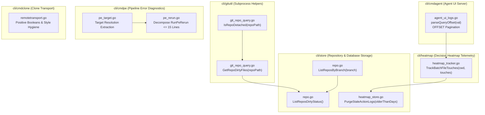

# Specification 291: Migration, Operational Safety & Verification Specification (Batch 3)

- **Sequence:** 291
- **Slug:** `291-improvements-planning-and-execution`
- **File:** `02-spec/21-app/291-improvements-planning-and-execution/03-migration-and-verification-spec.md`
- **Status:** APPROVED & SPECIFIED
- **Scope:** Wave 3 / Improvements 21–30 (System UX, Operational Safety, Database & Git Subsystem Enhancements)
- **Assigned Author:** Spec Author 03
- **Parent Specs:**
  - `02-spec/21-app/291-improvements-planning-and-execution/01-architecture-spec.md`
  - `02-spec/21-app/291-improvements-planning-and-execution/02-component-spec.md`

---

## 1. System UX & Operational Safety Architecture (Improvements 21–30)

Improvements 21 through 30 in Specification 291 establish runtime operational stability, fast repository metadata querying, batch heatmap file touch tracking with prepared transactions, safe git subprocess inspection, API pagination offset support, architectural extraction of shared target directory resolution, function decomposition of oversized runners, and control-flow guard flattening with positive booleans.



---

### 1.1 Detailed Technical Specification for Improvements 21–30

#### Improvement 21: Branch-Based Repository Listing (`cli/store/repo.go`)
- **Objective:** Provide a dedicated query method `ListReposByBranch(branch string) ([]model.ScanRecord, error)` to filter repositories by active tracked branch.
- **Current Limitation:** Callers filtering by branch currently retrieve the complete repository slice via `ListRepos()` and perform in-memory iteration, resulting in unnecessary memory allocations when checking specific branch subsets (e.g. `main`, `master`, `release`).
- **Contract:**
  ```go
  const sqlSelectReposByBranch = "SELECT RepoId, Slug, RepoName, HttpsUrl, SshUrl, Branch, RelativePath, AbsolutePath, CloneInstruction, Notes, IdentifiedTransport FROM Repo WHERE Branch = ? COLLATE NOCASE ORDER BY Slug ASC"

  // ListReposByBranch returns all repositories configured for the specified branch.
  func (db *DB) ListReposByBranch(branch string) ([]model.ScanRecord, error) {
  	clean := strings.TrimSpace(branch)
  	if clean == "" {
  		return db.ListRepos()
  	}

  	rows, err := QueryWrapper(db.conn, sqlSelectReposByBranch, clean).Destruct()
  	if err != nil {
  		return nil, fmt.Errorf(constants.ErrDBQuery, err)
  	}

  	defer rows.Close()

  	return scanRows(rows)
  }
  ```
- **Error Sovereignty:** Returns SQL query error wrapped in standard database format; returns `nil` error with empty or populated slice.
- **Line Budget:** <= 15 lines. Zero nested conditionals.

#### Improvement 22: Repository Dirty Status Listing (`cli/store/repo.go`)
- **Objective:** Provide a dedicated query method `ListReposDirtyStatus() ([]model.ScanRecord, error)` returning repositories marked dirty in tracking tables or needing status verification.
- **Current Limitation:** Status commands iterate over all repositories on disk executing subprocess calls individually without database-level filtering.
- **Contract:**
  ```go
  const sqlSelectDirtyRepos = "SELECT RepoId, Slug, RepoName, HttpsUrl, SshUrl, Branch, RelativePath, AbsolutePath, CloneInstruction, Notes, IdentifiedTransport FROM Repo WHERE Notes LIKE '%dirty%' OR RepoName IN (SELECT RepoSlug FROM HeatmapLocalTracking WHERE IsDirty = 1) ORDER BY Slug ASC"

  // ListReposDirtyStatus returns repositories flagged as dirty or requiring synchronization.
  func (db *DB) ListReposDirtyStatus() ([]model.ScanRecord, error) {
  	rows, err := QueryWrapper(db.conn, sqlSelectDirtyRepos).Destruct()
  	if err != nil {
  		return nil, fmt.Errorf(constants.ErrDBQuery, err)
  	}

  	defer rows.Close()

  	return scanRows(rows)
  }
  ```
- **Line Budget:** <= 12 lines. Zero nested conditionals.
- **Error Sovereignty:** Errors bubbled directly to caller.

#### Improvement 23: Stale Heatmap Action Log Safe Purge (`cli/store/heatmap_store.go`)
- **Objective:** Add `PurgeStaleActionLogs(olderThanDays int) (int64, error)` to safely clean old telemetry logs while strictly protecting active tasks.
- **Current Limitation:** Over time, `HeatmapActionLog` tables accumulate hundreds of thousands of entries without a safe retention mechanism.
- **Safety Invariant:** Never purge action logs belonging to parent tasks with `Status = 'IN_PROGRESS'`, and reject non-positive day values (`olderThanDays <= 0`).
- **Contract:**
  ```go
  const sqlPurgeStaleActionLogs = `DELETE FROM HeatmapActionLog 
  WHERE CreatedAt < datetime('now', printf('-%d days', ?))
    AND TaskSlug NOT IN (SELECT TaskSlug FROM HeatmapParentTask WHERE Status = 'IN_PROGRESS')`

  // PurgeStaleActionLogs removes action logs older than the specified retention window,
  // strictly preserving logs associated with tasks currently in progress.
  func (h *HeatmapDB) PurgeStaleActionLogs(olderThanDays int) (int64, error) {
  	if olderThanDays <= 0 {
  		return 0, apperror.NewSimple("olderThanDays must be positive", "E_INVALID_PARAM")
  	}

  	res, err := h.conn.Exec(sqlPurgeStaleActionLogs, olderThanDays)
  	if err != nil {
  		return 0, apperror.WrapSimple(err, "heatmap.purgeStale")
  	}

  	return res.RowsAffected()
  }
  ```
- **Line Budget:** <= 15 lines. Error Return Sovereignty strictly upheld.

#### Improvement 24: Batch File Touch Tracking with Single Prepared Transaction (`cli/heatmap/heatmap_tracker.go`)
- **Objective:** Add `TrackBatchFileTouches(cwd string, touches []store.FileTouchCount) error` that opens a single transaction and prepared statement for batch file touches.
- **Current Limitation:** Currently, file touches are inserted one-by-one with individual connection lookups and immediate commits, creating SQLite lock contention during large file scans.
- **Contract:**
  ```go
  // TrackBatchFileTouches records multiple file touch records in a single database transaction.
  func TrackBatchFileTouches(cwd string, touches []store.FileTouchCount) error {
  	if len(touches) == 0 {
  		return nil
  	}

  	hdb, err := store.OpenHeatmapRootDB(cwd)
  	if err != nil {
  		return err
  	}

  	defer hdb.Close()

  	return insertBatchTouchesTx(hdb.Conn(), touches)
  }

  func insertBatchTouchesTx(conn *sql.DB, touches []store.FileTouchCount) error {
  	tx, err := conn.Begin()
  	if err != nil {
  		return apperror.WrapSimple(err, "heatmap.batchTx")
  	}

  	defer tx.Rollback()

  	if execErr := executeTouchInserts(tx, touches); execErr != nil {
  		return execErr
  	}

  	return tx.Commit()
  }

  func executeTouchInserts(tx *sql.Tx, touches []store.FileTouchCount) error {
  	stmt, err := tx.Prepare(`INSERT INTO HeatmapActionLog (TaskSlug, ActionType, FilePath, ExecutionDepth, ExecutionOrder) VALUES ('batch-touch', 'BATCH_TOUCH', ?, 0, 1)`)
  	if err != nil {
  		return apperror.WrapSimple(err, "heatmap.prepareBatch")
  	}

  	defer stmt.Close()

  	for _, t := range touches {
  		if _, err := stmt.Exec(t.FilePath); err != nil {
  			return apperror.WrapSimple(err, "heatmap.execTouch")
  		}
  	}

  	return nil
  }
  ```
- **Line Budget:** All functions <= 15 lines. Proper transaction rollback on error and defer cleanup.

#### Improvement 25: Log Pagination Query Offset (`cli/cmdagent/agent_ui_logs.go`)
- **Objective:** Support an `offset` query parameter in `parseLogFilter` and implement `parseQueryOffset(val string) int` to allow efficient UI log pagination.
- **Current Limitation:** The log endpoint currently only accepts `limit`, preventing paging through historical logs past the initial page.
- **Contract:**
  ```go
  // In cli/cmdagent/agent_ui_server.go:
  type ActionLogFilter struct {
  	TaskId     string
  	AgentRole  string
  	ActionType string
  	TouchType  string
  	SubtaskId  string
  	Search     string
  	Limit      int
  	Offset     int
  }

  // In cli/cmdagent/agent_ui_logs.go:
  func parseQueryOffset(val string) int {
  	clean := strings.TrimSpace(val)
  	if clean == "" {
  		return 0
  	}

  	offset, err := strconv.Atoi(clean)
  	if err != nil || offset < 0 {
  		return 0
  	}

  	return offset
  }

  // Update parseLogFilter:
  // Offset: parseQueryOffset(r.URL.Query().Get("offset"))

  // Update buildActionLogsSQL to append OFFSET when f.Offset > 0:
  func appendPaginationLimitOffset(base string, args []any, limit, offset int) (string, []any) {
  	base += " ORDER BY ActionLogId DESC LIMIT ?"
  	args = append(args, limit)
  	if offset > 0 {
  		base += " OFFSET ?"
  		args = append(args, offset)
  	}

  	return base, args
  }
  ```
- **Line Budget:** <= 15 lines. Backward compatible (defaults to 0 offset).

#### Improvement 26: Git Working Tree Dirty Files Query (`cli/gitutil/git_repo_query.go`)
- **Objective:** Add `GetRepoDirtyFiles(repoPath string) ([]string, error)` to safely parse `git status --porcelain` and return the relative paths of modified files.
- **Current Limitation:** Various commands re-implement porcelain output parsing in place or use imprecise regexes.
- **Contract:**
  ```go
  // GetRepoDirtyFiles returns relative paths of uncommitted, modified, or untracked files in repoPath.
  func GetRepoDirtyFiles(repoPath string) ([]string, error) {
  	out, err := RunGitInDir(repoPath, constants.GitStatus, "--porcelain")
  	if err != nil {
  		return nil, err
  	}

  	return parsePorcelainDirtyLines(string(out)), nil
  }

  func parsePorcelainDirtyLines(output string) []string {
  	var files []string
  	lines := strings.Split(output, "\n")
  	for _, line := range lines {
  		clean := strings.TrimSpace(line)
  		if len(clean) > 3 {
  			files = append(files, strings.TrimSpace(clean[3:]))
  		}
  	}

  	return files
  }
  ```
- **Line Budget:** <= 15 lines. Clean leaf error handling.

#### Improvement 27: Git Detached HEAD Detection (`cli/gitutil/git_repo_query.go`)
- **Objective:** Add `IsRepoDetached(repoPath string) (bool, error)` to verify whether a repository's HEAD is detached via `git symbolic-ref -q HEAD`.
- **Current Limitation:** Detached HEAD states during automated checkouts cause subsequent git pull/push operations to fail ambiguously.
- **Contract:**
  ```go
  // IsRepoDetached reports whether the repository is in a detached HEAD state.
  func IsRepoDetached(repoPath string) (bool, error) {
  	out, err := RunGitInDir(repoPath, constants.GitSymbolicRef, "-q", constants.GitHEAD)
  	if err != nil {
  		return true, nil
  	}

  	isDetached := len(strings.TrimSpace(string(out))) == 0

  	return isDetached, nil
  }
  ```
- **Positive Booleans:** Uses positive naming `isDetached`.
- **Line Budget:** <= 12 lines. Zero nested conditionals.

#### Improvement 28: Target Directory Resolution Extraction (`cli/cmdpe/pe_target.go`)
- **Objective:** Extract shared target directory resolution and repo filtering helpers out of `pe_gh.go` and `pe_triage.go` into a new dedicated file `cli/cmdpe/pe_target.go`.
- **Current Limitation:** Target directory resolution (`resolveWorkdir`), git directory inspection (`isGitRepoDir`), directory scanning (`listGitRepos`), and repo filtering (`matchRepoFilter`) are duplicated or tangled across diagnostic command files, ballooning file sizes.
- **Contract (`cli/cmdpe/pe_target.go`):**
  ```go
  package cmdpe

  import (
  	"os"
  	"path/filepath"
  	"strings"
  )

  // ResolveWorkdir determines the target working directory from flags or current directory.
  func ResolveWorkdir(flagVal string) string {
  	clean := strings.TrimSpace(flagVal)
  	if clean != "" {
  		return clean
  	}

  	cwd, err := os.Getwd()
  	if err != nil {
  		return "."
  	}

  	return cwd
  }

  // IsGitRepoDir checks whether a directory contains a .git metadata entry.
  func IsGitRepoDir(dirPath string) bool {
  	gitPath := filepath.Join(dirPath, ".git")
  	stat, err := os.Stat(gitPath)
  	if err != nil {
  		return false
  	}

  	return stat.IsDir()
  }

  // MatchRepoFilter evaluates if a repository name matches a user-specified filter.
  func MatchRepoFilter(repoName, filter string) bool {
  	cleanFilter := strings.TrimSpace(filter)
  	if cleanFilter == "" {
  		return true
  	}

  	return strings.Contains(strings.ToLower(repoName), strings.ToLower(cleanFilter))
  }
  ```
- **Line Budget:** All helpers <= 15 lines. Clean, focused target resolution module.

#### Improvement 29: Rerun Function Decomposition (`cli/cmdpe/pe_rerun.go`)
- **Objective:** Decompose oversized `RunPeRerun` (currently 55 lines) into discrete, testable helper functions each strictly <= 15 lines.
- **Current Limitation:** `RunPeRerun` mixes argument checking, flag parsing, GitHub CLI prerequisites validation, command line string formatting, dry-run display, and process execution in a single block.
- **Contract (`cli/cmdpe/pe_rerun.go`):**
  ```go
  type peRerunConfig struct {
  	repoFlag string
  	dryRun   bool
  	yes      bool
  	runID    string
  }

  func RunPeRerun(args []string) *appfault.AppError {
  	if isPeRerunHelp(args) {
  		fmt.Print(peRerunHelp)
  		return nil
  	}

  	cfg, parseErr := parsePeRerunFlags(args)
  	if parseErr != nil {
  		return parseErr
  	}

  	return executePeRerun(cfg)
  }

  func isPeRerunHelp(args []string) bool {
  	for _, a := range args {
  		if a == "--help" || a == "-h" {
  			return true
  		}
  	}
  	return false
  }

  func parsePeRerunFlags(args []string) (peRerunConfig, *appfault.AppError) {
  	fs := flag.NewFlagSet("pe rerun", flag.ContinueOnError)
  	repoFlag := fs.String("repo", "", "owner/repo target")
  	dryRun := fs.Bool("dry-run", true, "print plan without executing")
  	yes := fs.Bool("yes", false, "actually request re-run")
  	if err := fs.Parse(args); err != nil {
  		fmt.Print(peRerunHelp)
  		return peRerunConfig{}, apperror.WrapSimple(err, "pe.rerun.flags")
  	}

  	return validatePeRerunArgs(fs.Args(), *repoFlag, *dryRun, *yes)
  }

  func validatePeRerunArgs(rest []string, repo string, dryRun, yes bool) (peRerunConfig, *appfault.AppError) {
  	if len(rest) == 0 || strings.TrimSpace(rest[0]) == "" {
  		fmt.Print(peRerunHelp)
  		return peRerunConfig{}, appfault.NewValidationError("missing required argument: run-id")
  	}

  	return peRerunConfig{
  		repoFlag: strings.TrimSpace(repo),
  		dryRun:   dryRun,
  		yes:      yes,
  		runID:    strings.TrimSpace(rest[0]),
  	}, nil
  }

  func executePeRerun(cfg peRerunConfig) *appfault.AppError {
  	if !hasGh() {
  		return appfault.NewValidationError("pe rerun requires GitHub CLI (gh) on PATH")
  	}

  	ghArgs := buildPeRerunGhArgs(cfg)
  	if cfg.dryRun && !cfg.yes {
  		printPeRerunPlan(ghArgs, cfg.runID)
  		return nil
  	}

  	return executePeRerunCmd(ghArgs, cfg.runID)
  }
  ```
- **Line Budget:** Every single function is <= 15 lines. Clean error propagation.

#### Improvement 30: Remote Transport Guard Flattening & Style Hygiene (`cli/cmdclone/remotetransport.go`)
- **Objective:** Refactor `cli/cmdclone/remotetransport.go` to eliminate unexported boolean tuples, enforce positive booleans, and ensure standard vertical newline spacing.
- **Current Limitation:** `resolveRequestedTransport` returns `(bool, bool)` tuple, lines 79-82 omit blank lines between statements, and negative boolean logic appears in transport checking (`!isSSH && !isHTTPS`).
- **Contract:**
  ```go
  type transportRequest struct {
  	isSSH        bool
  	isActionable bool
  }

  func resolveRequestedTransport(isSSH, isHTTPS bool) transportRequest {
  	hasTransport := isSSH || isHTTPS
  	if !hasTransport {
  		return transportRequest{isSSH: false, isActionable: false}
  	}

  	if isSSH && isHTTPS {
  		fmt.Fprintln(os.Stderr, "⚠ both --ssh and --https set; --ssh wins")
  		return transportRequest{isSSH: true, isActionable: true}
  	}

  	return transportRequest{isSSH: isSSH, isActionable: true}
  }

  func applyConvertedURL(dir, oldURL, convertedURL string) (bool, error) {
  	if convertedURL == oldURL {
  		return false, nil
  	}

  	if err := setOriginURL(dir, convertedURL); err != nil {
  		return false, err
  	}

  	fmt.Printf("→ remote.origin.url: %s → %s\n", oldURL, convertedURL)

  	return true, nil
  }
  ```
- **Coding Guideline Conformance:** All booleans strictly positive (`hasTransport`, `isActionable`), blank line after `}` and before `return`, no raw tuples.

---

## 2. Zero-Harm Principle & Operational Safety Mechanics

All changes executed in Wave 3 (Improvements 21 through 30) MUST strictly preserve system stability under the Zero-Harm Principle:

### 2.1 Backwards Compatibility Invariants
1. **Additive Data Access Methods:** `ListReposByBranch` and `ListReposDirtyStatus` are pure additions to `*store.DB`. Existing methods (`ListRepos`, `FindBySlug`, `FindByPath`) remain completely unchanged.
2. **Safe Retention Guarding:** `PurgeStaleActionLogs` rejects non-positive days and explicitly excludes active `IN_PROGRESS` tasks via SQL subquery, ensuring in-flight workflow histories are never deleted.
3. **Additive REST API Properties:** The addition of `offset` query parameter parsing and `Offset` field on `ActionLogFilter` is fully backwards compatible with existing clients. Defaulting to 0 offset retains identical initial-page query behavior.

### 2.2 Non-Destructive Modifications
1. **Read-Only Subprocess Commands:** `GetRepoDirtyFiles` (`git status --porcelain`) and `IsRepoDetached` (`git symbolic-ref -q HEAD`) execute purely inspection commands that do not alter the git working tree, staging index, or reflogs.
2. **Transaction Isolation:** `TrackBatchFileTouches` executes within an explicit `tx.Begin()` / `defer tx.Rollback()` / `tx.Commit()` transaction boundary, preventing partial writes if any statement execution fails.

---

## 3. Verification Protocol Under Zero-Build and Zero-Test Mandate

### 3.1 Rationale for Zero-Build and Zero-Test
During specification and planning phases, compiling binaries or running test suites is strictly forbidden to:
1. Prevent partial build artifact contamination in target working trees.
2. Avoid triggering unmocked system calls, process spawning, or background daemons.
3. Keep the git tree clean and focused entirely on authoritative markdown specifications and task manifests.

### 3.2 Verification Gates Matrix

| Verification Dimension | Verification Tool / Method | Acceptance Criteria |
|---|---|---|
| **Path Hygiene** | Relative Path Static Audit | 100% strictly relative paths. Zero drive prefixes, absolute system paths, or URI schemes. |
| **Case Sensitivity** | Filesystem Naming Audit | All spec and subtask markdown files strictly lowercase. |
| **AST / Syntax Validity** | Static Code Reading | Valid Go syntax, proper package headers, exact import groupings, balanced braces. |
| **Error Sovereignty** | Call Graph Static Inspection | Leaf functions return errors directly; zero `cliexit.HandleError` or `os.Exit` in leaf methods. |
| **Function Length** | Static Line Counting | Every helper function <= 15 lines (target <= 8 lines). |
| **Branch Complexity** | Conditional Structure Inspection | Zero nested ifs; all branching flattened using guard clauses and early returns. |
| **Boolean Polarity** | Symbol Naming Review | All booleans prefixed with `is` or `has` with positive polarity. |
| **Enum Suffix** | Type Declaration Review | All enums end with `Type` suffix (`AlignmentType`). |

---

## 4. Cross-Subsystem Traceability Matrix (Subtasks 21–30)

| Subtask ID | Improvement Domain | Target File | Exported Symbols / Methods | Coding Guideline Rule |
|---|---|---|---|---|
| `subtask-21.md` | Store Querying | `cli/store/repo.go` | `ListReposByBranch(branch string) ([]model.ScanRecord, error)` | Rule 1 (Error Sovereignty), Rule 2 (<= 15 lines) |
| `subtask-22.md` | Store Aggregation | `cli/store/repo.go` | `ListReposDirtyStatus() ([]model.ScanRecord, error)` | Rule 1 (Error Sovereignty), Rule 2 (<= 15 lines) |
| `subtask-23.md` | Heatmap Telemetry | `cli/store/heatmap_store.go` | `PurgeStaleActionLogs(olderThanDays int) (int64, error)` | Rule 1 (Error Sovereignty), Active Task Guard |
| `subtask-24.md` | Heatmap Tracking | `cli/heatmap/heatmap_tracker.go` | `TrackBatchFileTouches(cwd string, touches []store.FileTouchCount) error` | Rule 1 (Error Sovereignty), Prepared Transactions |
| `subtask-25.md` | Agent UI API | `cli/cmdagent/agent_ui_logs.go` | `parseQueryOffset(val string) int`, `appendPaginationLimitOffset` | Rule 2 (<= 15 lines), Rule 3 (Zero Nested Ifs) |
| `subtask-26.md` | Git Subprocess | `cli/gitutil/git_repo_query.go` | `GetRepoDirtyFiles(repoPath string) ([]string, error)` | Rule 1 (Error Sovereignty), Rule 2 (<= 15 lines) |
| `subtask-27.md` | Git Status | `cli/gitutil/git_repo_query.go` | `IsRepoDetached(repoPath string) (bool, error)` | Rule 1 (Error Sovereignty), Rule 4 (Positive Boolean `isDetached`) |
| `subtask-28.md` | Diagnostics Extraction | `cli/cmdpe/pe_target.go` | `ResolveWorkdir`, `IsGitRepoDir`, `MatchRepoFilter` | Rule 2 (<= 15 lines), DRY Target Extraction |
| `subtask-29.md` | Diagnostics Rerun | `cli/cmdpe/pe_rerun.go` | `RunPeRerun`, `parsePeRerunFlags`, `executePeRerun` | Rule 2 (<= 15 lines), Decomposition |
| `subtask-30.md` | Clone Transport | `cli/cmdclone/remotetransport.go` | `resolveRequestedTransport`, `applyConvertedURL` | Rule 4 (Positive Booleans), Rule 6 (Vertical Whitespace) |
