# Architecture Specification: 292 Improvements Planning & Execution (Batch 4)

## 1. Executive Summary & Vision

Plan 292 delivers Batch 4 (Improvements 91 through 120, structured into Subtasks 01 through 30) of the system-wide architecture, reliability, and code quality modernization program across the Gitmap platform. This specification formalizes the architectural contracts, structural invariants, and implementation standards for Improvements 01 through 10 (Subtasks 01 through 10), concentrating on four critical foundational pillars:

1. **Golang Error Management & Leaf Error Sovereignty**:
   Complete elimination of anti-patterns where leaf helper routines invoke CLI exit handlers (`cliexit.HandleError`, `cliexit.HandleUsageError`, `cliexit.HandleGeneralError`) or `os.Exit` and subsequently return `nil` or void. All leaf functions must return structured errors directly (`error` or `*apperror.AppError`). Only the top-level command orchestrators and dispatchers in `cli/cmd/root.go` hold the authority to evaluate errors, record database command audits via `finishCommandAudit`, and terminate the process deterministically.

2. **Strict Coding Style & Metric Boundaries**:
   - **Function Length Limit**: Hard ceiling of $\le 15$ lines per function ($\le 8$ lines strongly preferred).
   - **Cyclomatic Complexity**: Zero nested `if` statements through guard clauses and early returns.
   - **Boolean Polarity**: Every boolean variable, field, and function must strictly begin with `is` or `has` (`can`, `should`, `was`, `will`, `allow`, and `disable` are strictly banned). Negative booleans are forbidden.
   - **Whitespace Hygiene**: Mandatory blank line after closing brace `}` and blank line preceding every `return`.
   - **File Size Cap Ratchet**: Hard cap of 500 lines per `.go` file. Files nearing or exceeding this limit must be decomposed into dedicated companion modules.

3. **Strong Typing for Constants & Value Semantics**:
   Eradication of magic strings, integer literals, and arbitrary shell commands through typed enums ending in `Type` (`GitInspectCommandType`, `GitFlagType`, `TableNameType`). Enforcement of value semantics across query filters and database access structures.

4. **Audit Log Integrity**:
   Guarantee that errors are bubbled all the way to `finishCommandAudit` so that failed operations (such as batch commit failures, database open errors, or invalid flags) are faithfully captured in the SQLite audit ledger rather than falsely recorded as successes due to swallowed errors.

---

## 2. Core Architectural Principles & Invariants

```mermaid
flowchart TD
    subgraph DispatcherLayer ["Root Dispatcher Layer (cli/cmd)"]
        RootDispatch["Root Command Dispatcher<br/>(root.go / dispatch)"]
        AuditFinish["finishCommandAudit(err)<br/>Persists Command Status & Telemetry"]
        CliExit["cliexit.HandleError(err, ExitCodeType)<br/>Controlled Process Termination"]
    end

    subgraph SubsystemLayer ["Subsystem Orchestration Handlers"]
        CmdStatus["cli/cmdstatus<br/>RunStatus"]
        CmdHasChange["cli/cmdhaschange<br/>RunHasChange"]
        CmdSee["cli/cmd<br/>RunRepoManageUI"]
        CmdCPAR["cli/cmdcpar<br/>RunCPAR"]
        CmdTempRelease["cli/cmdtemprelease<br/>RunTempRelease"]
        CmdFixAuth["cli/cmdfixauth<br/>RunFixCredential"]
        CmdRelease["cli/cmdrelease<br/>RunReleasePending"]
    end

    subgraph LeafLayer ["Leaf Operations, Stores & Constants"]
        StatusHelpers["cmdstatus/helpers_shim.go<br/>(loadRecordsByGroup, loadAllRecordsDB)"]
        DirtyCheck["cmdhaschange/helpers_shim.go<br/>(isWorkingTreeDirty)"]
        CPARBatch["cmdcpar/cpar.go<br/>(commitAndMaybePush, handlePush)"]
        AuthHelpers["cmdfixauth/fixcredential.go<br/>(unsetLegacyCredentialHelper)"]
        StoreFilter["cli/store/repo_query_filter.go<br/>(QueryReposByFilter, QueryUnpushedRepos)"]
        GitConsts["cli/constants/constants_git.go<br/>(GitInspectCommandType, GitFlagType)"]
    end

    LeafLayer -->|Return error directly| SubsystemLayer
    SubsystemLayer -->|Bubble error upward| RootDispatch
    RootDispatch --> AuditFinish
    AuditFinish --> CliExit
```



### 2.1 Leaf Error Sovereignty & Outer Exit Authority
- **Rule**: Leaf functions declaring an `error` return type MUST return the error directly (`return err` or `return apperror.WrapSimple(...)`). Leaf functions MUST NEVER invoke exit handlers (`cliexit.HandleError`, `cliexit.HandleGeneralError`, `cliexit.HandleUsageError`) or `os.Exit` and then return `nil` or void.
- **Outer Caller Sovereignty**: Only the root orchestrator in `cli/cmd/root.go` receives the bubbled error and decides how to terminate or report.
- **Database Audit Capture**: In Gitmap's Split-DB telemetry architecture, calling an immediate exit inside a helper terminates the runtime process before the root dispatcher can invoke `finishCommandAudit`. This drops telemetry records, corrupts in-flight transaction rollbacks, and prevents database audit logging.
- **No Swallowed Errors**: No helper may use blank identifier discards (`_ = cmd.Run()`, `_ = exec.Command(...)`) or return bare booleans when the underlying operation can fail. Errors must be captured and returned.

### 2.2 15-Line Function Limit & Guard Clause Inversion
- Every function must strictly not exceed 15 lines. Functions of $\le 8$ lines are strongly preferred.
- Conditional nesting is strictly prohibited (`Zero Nested Ifs`). Nested logic must be flattened by inverting condition checks into guard clauses that exit immediately:
  ```go
  // Compliant: Guard clause with vertical spacing
  if !hasRecords {
      return apperror.NewValidationError("no records found")
  }

  return processRecords(records)
  ```

### 2.3 Positive Boolean Naming & Banned Tokens
- All boolean variables, struct fields, and functions must begin exclusively with `is` or `has`.
- Banned prefixes: `can`, `should`, `was`, `will`, `allow`, `disable`.
- Negative boolean names (`isNotDirty`, `hasNoErrors`, `isDisabled`) are forbidden. Always represent state positively (`isDirty`, `hasErrors`, `isEnabled`).

### 2.4 Strongly-Typed Constants & Enums
- Magic strings and integer literals are banned across Git commands, flags, database tables, and exit codes.
- Every enum must be defined with a strong type alias ending in `Type` (e.g., `GitInspectCommandType`, `GitFlagType`, `TableNameType`, `ExitCodeType`).

### 2.5 500-Line File Cap Ratchet & Modular Decomposition
- Any `.go` file approaching or exceeding 500 lines must be systematically decomposed.
- In Batch 4 (Subtask 10), repository query filtering logic is isolated from `cli/store/repo.go` into a dedicated module `cli/store/repo_query_filter.go`, enforcing clean single-responsibility boundaries and keeping all store files safely under the 500-line ceiling.

---

## 3. Subsystem Architectural Breakdown (Improvements 01–10)

| Subtask | Target Subsystem / Files | Core Architectural Refactoring | Primary Guideline Focus |
| :--- | :--- | :--- | :--- |
| **01** | `cli/cmdstatus/status.go`<br/>`cli/cmdstatus/helpers_shim.go` | Convert void status helpers that swallow errors (`loadRecordsByGroup`, `loadAllRecordsDB`, `handleStatusDBError`) into explicit `error` / `*apperror.AppError` returns. Bubble errors to `RunStatus`. | Leaf Error Sovereignty, Audit Capture |
| **02** | `cli/cmdhaschange/haschange.go`<br/>`cli/cmdhaschange/helpers_shim.go` | Convert `hasChange` and `isWorkingTreeDirty` from bare boolean returns swallowing errors to `(bool, error)`. Replace leaf `cliexit.HandleUsageError` with returned validation errors. | Error Sovereignty, No Swallowed Errors |
| **03** | `cli/cmd/cmd_see.go` | Replace swallowed errors in `RunRepoManageUI` with returned `*apperror.AppError`. Eliminate silent discard `_ = cmdWeb.Start()` on fallback launch. Bubble errors to root dispatcher. | Leaf Error Sovereignty, Bubble Up |
| **04** | `cli/cmdcpar/cpar.go` | Eliminate swallowed errors in batch commit/push/add/remote. Check `git add` error, propagate batch failure state to `RunCPAR`, and return `*apperror.AppError` on batch failures so database audit logs reflect failures. | Audit Capture, Positive Booleans |
| **05** | `cli/cmdtemprelease/temprelease.go`<br/>`cli/cmdtemprelease/tempreleaselist.go` | Eliminate void discards in `dispatchTempRelease`. Check errors returned by `runTempReleaseList` and `encodeTempReleaseListJSON`. Bubble errors up to `RunTempRelease`. | Leaf Error Sovereignty, Outer Caller Exits |
| **06** | `cli/cmdfixauth/fixauth.go`<br/>`cli/cmdfixauth/fixcredential.go` | Convert void helpers (`unsetLegacyCredentialHelper`, `applyCredentialStoreType`) to return `*apperror.AppError`. Handle git configuration errors instead of silent discards. | Error Management, Vertical Spacing |
| **07** | `cli/cmdrelease/releasepending.go`<br/>`cli/cmdrelease/releaserecentclone.go` | Replace leaf `cliexit.HandleUsageError` in `rejectVersionArgOnPending` with returned errors. Check `RunRelease` return inside `tryRunReleaseInRecentClone` rather than swallowing errors. | Leaf Error Sovereignty, No Swallowed Returns |
| **08** | `cli/constants/constants_git.go` | Add `GitInspectCommandType` (`GitCmdCherry`, `GitCmdDiff`, `GitCmdMergeBase`) and `GitFlagType` (`GitFlagStat`) to eradicate magic strings across inspection commands. | Strongly-Typed Enums ending in `Type` |
| **09** | `cli/constants/constants_store.go` | Add `TableNameHeatmapLocalTracking` and `TableNamePipelineErrorLog` to `TableNameType` and string constants for unified schema semantics. | Database Table Standards, PascalCase Tables |
| **10** | `cli/store/repo_query_filter.go`<br/>`cli/store/repo.go` | Design clean value semantics and extraction for tag and unpushed repository queries in `cli/store/repo_query_filter.go`. Maintain strict $\le 15$ line functions and 500-line cap ratchet. | 500-Line Ratchet, Value Semantics |

---

## 4. Execution Invariants & Non-Negotiables

1. **Strictly Relative Git Paths Only**:
   - All references to files and directories across specifications, subtask plans, code changes, and documentation MUST use strictly relative forward-slash paths (e.g., `cli/cmdstatus/status.go`).
   - Absolute file paths (including drive letters like `C:` or `D:`) and URI schemes (`file:///`) are strictly prohibited in all authored artifacts, subtask files, and messages.

2. **Zero Test & Build Execution**:
   - Running compilers (`go build`, `go run`) and test runners (`go test`, `pytest`) is strictly forbidden during this specification and planning phase.
   - All design decisions and code contracts must be formulated through grounded static analysis and structural source review.

3. **Zero Git Commands**:
   - AI agents must not execute raw git commands (`git commit`, `git push`, `git checkout`, `git add`). Working tree state remains untouched.

4. **Lowercase Filenames**:
   - All specifications, plans, and subtask markdown files must use strictly lowercase alphanumeric characters with hyphen separators (e.g., `01-architecture-spec.md`, `subtask-01.md`).
