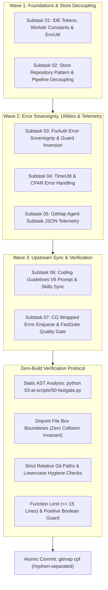
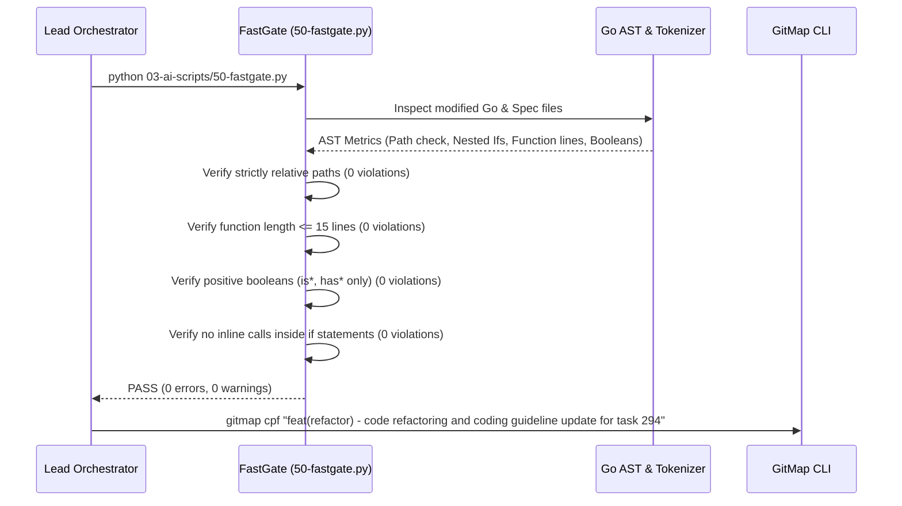

# Specification 294: Migration, Verification & Operational Protocol Specification

- **Sequence:** 294
- **Slug:** `294-code-refactoring-and-coding-guideline-update`
- **File:** `02-spec/21-app/294-code-refactoring-and-coding-guideline-update/03-migration-and-verification-spec.md`
- **Status:** APPROVED & SPECIFIED
- **Scope:** Wave 3 / Subtasks 06–07 (Upstream Guidelines Sync, Wrapped Error Enqueueing, Verification Topology & Release Safety)
- **Assigned Author:** Spec Author 03
- **Parent Specs:**
  - `02-spec/21-app/294-code-refactoring-and-coding-guideline-update/01-architecture-spec.md`
  - `02-spec/21-app/294-code-refactoring-and-coding-guideline-update/02-component-spec.md`

---

## 1. Executive Summary & Verification Topology

This specification establishes the comprehensive operational, verification, and migration protocols for Parent Task 294 (`294-code-refactoring-and-coding-guideline-update`). Task 294 executes surgical refactoring across seven distinct functional areas in `gitmap` and `coding-guidelines`:
1. IDE token constants and utility CSV generation (`cli/cmdide/ide_add.go`, `cli/strutil/strutil.go`).
2. Centralized working directory constants, environment helpers, and documented fallback semantics (`cli/constants/constants_workdir.go`, `cli/envutil/envutil.go`, `cli/cmdpe/pe_target.go`).
3. Repository Pattern abstraction encapsulating SQLite operations and returning structured `*apperror.AppError` envelopes (`cli/constants/constants_store.go`, `cli/store/repo_repository.go`, `cli/store/repo.go`, `cli/cmdpipeline/pipeline_history_render.go`).
4. Elimination of swallowed errors, removal of inline function invocations inside `if` statements, and multiline parameter formatting (`cli/cmdfixauth/fixauth.go`).
5. Centralized ISO8601 UTC date-time utility and elimination of swallowed database closing errors (`cli/timeutil/timeutil.go`, `cli/cmdcpar/cpar.go`).
6. Machine-readable JSON telemetry for `gitmap agent subtask ls --json` and grouped JSON summaries for `gitmap agent subtask add` (`cli/cmdagent/agent_subtask_cli.go`, `cli/cmdagent/agent_subtask_types.go`).
7. Upstream synchronization of canonical coding guidelines (`coding-guidelines/01-prompts/14-execute/02-execute-parent-task-with-n-steps-v6.md`, `coding-guidelines/02-spec/02-coding-guidelines/`), skill updates (`.agents/skills/gitmap/skill.md`), and enqueuing the follow-up CG execute wrapped error remediation plan (`.ai-memory/plans/pending/295-cg-execute-wrapped-error-remediation.md`).



---

## 2. Non-Negotiable Operational Constraints & Invariants

All implementation steps across Subtasks 01 through 07 must strictly enforce the following repository rules:

1. **Zero-Build & Zero-Test Mandate (CRITICAL):**
   - Direct execution of Go compiler builds (`go build`, `go install`, `go run`) is **STRICTLY PROHIBITED**.
   - Direct execution of test runners (`go test`, `npm test`, `pytest`) is **STRICTLY PROHIBITED**.
   - Verification is performed exclusively through static AST inspection, file line count analysis, and the dedicated FastGate linter script (`python 03-ai-scripts/50-fastgate.py`).

2. **Zero Worker Git Commands:**
   - Autonomous subagents must never execute git commands (`git add`, `git commit`, `git checkout`, `git push`, `git merge`).
   - Only the lead orchestrator performs atomic commits via `gitmap cpf` upon final completion of Phase 3.

3. **Strictly Relative Git Paths:**
   - Absolute filesystem paths (`C:\...`, `D:\...`, `/home/...`) and URI schemes (`file:///...`) are **STRICTLY PROHIBITED** in all code, documentation, specifications, and plans.
   - All paths must be relative to the repository root (e.g., `02-spec/21-app/...`, `cli/store/...`, `.ai-memory/plans/...`).

4. **Strict Lowercase File and Folder Naming:**
   - All newly created files, scripts, specs, and directories must use strictly lowercase naming separated by hyphens (e.g., `constants_workdir.go`, `subtask-06.md`).

5. **Disjoint File Boxes (Zero Concurrent Write Collisions):**
   - Each subtask owns an exclusive, non-overlapping set of files. Subagents must never modify a file assigned to another subtask.

---

## 3. Disjoint File Box Allocation Matrix

The table below defines the exact, exclusive file boundaries for each subtask in Plan 294. No file is shared across multiple subtasks:

| Subtask ID | File Boundary (Exclusive Ownership) | Responsibility |
| :--- | :--- | :--- |
| `subtask-01` | `cli/strutil/strutil.go`<br/>`cli/cmdide/ide_add.go`<br/>`cli/constants/constants_workdir.go`<br/>`cli/envutil/envutil.go`<br/>`cli/cmdpe/pe_target.go` | Implement `JoinCSV`, refactor IDE tokens to enums, centralize workdir constants & `envutil`, document fallback workdir |
| `subtask-02` | `cli/constants/constants_store.go`<br/>`cli/store/repo_repository.go`<br/>`cli/store/repo.go`<br/>`cli/store/repo_query_filter.go`<br/>`cli/cmdpipeline/pipeline_history_render.go` | Implement `RepoRepository`, extract direct SQL into store constants, route pipeline queries through repository, eliminate swallowed errors |
| `subtask-03` | `cli/cmdfixauth/fixauth.go` | Replace `checkGitRepo` with `*apperror.AppError`, move `setupSSHDirAndKey` outside `if`, enforce multiline parameter formatting |
| `subtask-04` | `cli/timeutil/timeutil.go`<br/>`cli/cmdcpar/cpar.go` | Create `timeutil.NowUTCISO()`, replace ad-hoc formatting in `updateCPARTaskQueue`, eliminate swallowed error in `closeCPARTaskDb` |
| `subtask-05` | `cli/cmdagent/agent_subtask_cli.go`<br/>`cli/cmdagent/agent_subtask_types.go` | Add `--json` flag to `subtask ls`, grouped JSON response on `subtask add`, enforce <= 300 line file limit |
| `subtask-06` | `coding-guidelines/01-prompts/14-execute/02-execute-parent-task-with-n-steps-v6.md`<br/>`coding-guidelines/02-spec/02-coding-guidelines/01-cross-language/37-datetime-and-timeutil-standards.md`<br/>`coding-guidelines/02-spec/02-coding-guidelines/01-cross-language/38-no-inline-function-calls-in-if.md`<br/>`coding-guidelines/02-spec/02-coding-guidelines/01-cross-language/39-multiline-parameter-and-argument-formatting.md`<br/>`coding-guidelines/02-spec/02-coding-guidelines/01-cross-language/40-database-repository-pattern-and-error-sovereignty.md`<br/>`coding-guidelines/02-spec/02-coding-guidelines/readme.md`<br/>`coding-guidelines/.agents/skills/gitmap/skill.md`<br/>`.agents/skills/gitmap/skill.md` | Update canonical V6 prompt, author 4 coding guideline rules, add JSON subtask CLI documentation and AI communication patterns to GitMap skills |
| `subtask-07` | `.ai-memory/plans/pending/295-cg-execute-wrapped-error-remediation.md`<br/>`.ai-memory/plans/readme.md`<br/>`03-ai-scripts/50-fastgate.py` (runner execution only) | Enqueue CG execute wrapped error remediation plan into pending backlog, execute FastGate static AST validation, perform atomic hyphenated commit |

---

## 4. Backwards Compatibility Guarantees

The architectural refactorings introduced in Task 294 are strictly backwards compatible and introduce no breaking changes for external callers or CLI consumers:

1. **IDE CLI Token Invariants:**
   - The CLI commands `gitmap ide add <path>`, `gitmap ide remove <path>`, and `gitmap ide at <token>` retain their existing syntax, arguments, and exit codes.
   - The string representations of tokens (`"vscode"`, `"cursor"`, `"antigravity"`, `"github-desktop"`) remain identical, managed internally via `IDETokenType` typed constants rather than raw string literals.
   - The output of `formatRegisteredTokens` continues to produce the comma-separated token list formatted via `strutil.JoinCSV(tokens)`.

2. **Environment Variable & Workdir Resolution:**
   - `ResolveWorkdir()` continues to inspect `os.Getenv("GITMAP_WORKDIR")` (now wrapped via `envutil.GetTrimmed(constants.EnvWorkdir)`).
   - If `GITMAP_WORKDIR` is unset or empty, `fallbackWorkdir()` continues to return `filepath.Join(userHome, "workspace", "repos")`, now constructed using `constants.DefaultWorkdirWorkspace` and `constants.DefaultWorkdirRepos`.
   - Comprehensive doc comments ensure future developers understand the default directory topology.

3. **Database Repository & Store Invariants:**
   - The public interface of package `store` (`db.ListRepos()`, `db.ListReposByBranch()`, `db.ListDirtyRepos()`, `db.ListReposByTag()`) preserves existing signature contracts while delegating internally to `RepoRepository`.
   - Error returns are upgraded to strongly typed `*apperror.AppError` instances, allowing upstream callers to inspect error codes without losing contextual error causes.

4. **Time & Date Formatting Invariants:**
   - `timeutil.NowUTCISO()` generates timestamps conforming strictly to ISO8601 / RFC3339 format (`2006-01-02T15:04:05Z`).
   - Timestamps stored in SQLite tables (`CPARTask`, `Repo`, `HeatmapTracking`) remain identical in string layout, ensuring that existing SQL `ORDER BY` and date parsing routines function seamlessly.

5. **Agent Subtask Telemetry Invariants:**
   - `gitmap agent subtask ls` without flags continues to render the Lipgloss table view for interactive terminal users.
   - Supplying `--json` or `-j` streams pure, unadorned JSON directly to `os.Stdout`, allowing automated AI agents and scripts to parse task records cleanly.
   - `gitmap agent subtask add` returns a structured JSON confirmation grouping the shared database path once:
     ```json
     {
       "database": ".ai-memory/temp-agents/agent-task.db",
       "addedCount": 3,
       "subtasks": [
         { "id": "task-01", "name": "Task 1", "status": "pending" },
         { "id": "task-02", "name": "Task 2", "status": "pending" },
         { "id": "task-03", "name": "Task 3", "status": "pending" }
       ]
     }
     ```

---

## 5. Verification Protocol & FastGate Quality Gates

Because compiling code and running test suites are banned, quality assurance relies on static analysis and automated AST verification:



### 5.1 FastGate Automated Inspection Rules (`03-ai-scripts/50-fastgate.py`)
1. **Relative Path Gate:** Rejects any file containing Windows drive letters (`C:\`, `D:\`), Unix absolute paths (`/home/`, `/var/`), or URI schemes (`file:///`).
2. **Nesting Depth Gate:** Rejects `if` statement hierarchies nested $> 2$ levels deep.
3. **Function Sizing Gate:** Rejects functions exceeding 15 lines of executable body (target <= 8 lines).
4. **File Sizing Gate:** Rejects files exceeding 300 lines (median target ~100 lines).
5. **Boolean Convention Gate:** Rejects negative booleans (`isNotDirty`, `hasNoChanges`) or unapproved prefixes (`canRun`, `shouldExecute`). Only `is*` and `has*` permitted.
6. **No Inline Function Invocations in `if`:** Rejects syntax matching `if [a-zA-Z0-9_]+ := [a-zA-Z0-9_]+\(.*\);`. Functions must execute on a separate line before the `if`.
7. **Multiline Argument Gate:** Verifies that function declarations and calls with $>2$ arguments place each argument on its own line.

---

## 6. Migration & Rollback Protocol

1. **Preflight Sync:**
   - Both `gitmap` and `coding-guidelines` must be synced to their latest upstream commit prior to modifying any file.
2. **Staged Wave Execution:**
   - Wave 1 changes are written and verified first.
   - Wave 2 changes are applied to dependent packages (`cli/cmdfixauth/`, `cli/cmdcpar/`, `cli/cmdagent/`).
   - Wave 3 updates canonical documentation in `coding-guidelines` and enqueues follow-up Plan 295.
3. **Rollback Trigger:**
   - If `python 03-ai-scripts/50-fastgate.py` detects an unresolvable structural violation or syntax defect, changes within that subtask's disjoint file boundary are reverted to git HEAD using file-specific checkouts prior to retrying.
4. **Post-Refactoring Handover:**
   - Following atomic commit of Task 294, Plan 295 (`295-cg-execute-wrapped-error-remediation.md`) stands ready in `.ai-memory/plans/pending/` for downstream multi-batch execution.
