# Migration, Verification & Stutter Elimination Specification (Task 296)

> **Spec ID:** `SPEC-21-296-MIGR`  
> **Subsystem:** `cli/prdb`, `cli/pipelinedb`, `cli/dbengine`, `cli/osuser`, `cli/osclean`, `cli/committransfer`, `03-ai-scripts`  
> **Status:** Approved / Specification  
> **Date:** 2026-10-23  
> **Task:** 296-result-wrapper-and-apperror-returns  
> **Scope:** Wave 3 / Subtasks 07–09 (Database & System Result Stutter Elimination, FastGate AST Quality Gate & Atomic Commit)  
> **Assigned Author:** Spec Author 03  
> **Related Architecture Spec:** `02-spec/21-app/296-result-wrapper-and-apperror-returns/01-architecture-spec.md`  
> **Related Component Spec:** `02-spec/21-app/296-result-wrapper-and-apperror-returns/02-component-spec.md`  
> **Related Master Plan:** `.ai-memory/plans/pending/296-result-wrapper-and-apperror-returns.md`  

---

## 1. Executive Summary & Verification Topology

This specification governs the migration strategy, verification protocol, and package stutter elimination for Parent Task 296 (`296-result-wrapper-and-apperror-returns`). While Waves 1 and 2 establish foundation types in `cli/store/` and migrate low-level git operations in `cli/gitutil/` and `cli/cmdpipeline/`, Wave 3 eradicates the legacy `result.Result[...]` package stutter across all remaining subsystems, guarantees strict backwards compatibility, and executes zero-build static AST verification via FastGate (`03-ai-scripts/50-fastgate.py`).

```mermaid
flowchart TD
    subgraph Wave1["Wave 1: Store & Heatmap Foundations"]
        W1A["Subtask 01: Centralize Store Types in cli/store/types.go"]
        W1B["Subtask 02: Heatmap Tracker AppError Sovereignty"]
        W1C["Subtask 03: Store Repository Monadic Result Returns"]
    end

    subgraph Wave2["Wave 2: GitUtil & CmdPipeline Monadic Migration"]
        W2A["Subtask 04: Centralize GitUtil Types & Query Migration"]
        W2B["Subtask 05: Git Command Execution & Utility Migration"]
        W2C["Subtask 06: CmdPipeline Result Types & Caller Inversion"]
    end

    subgraph Wave3["Wave 3: Stutter Elimination & Verification"]
        W3A["Subtask 07: Modernize Database Domain Types (PRDB, PipelineDB, DBEngine)"]
        W3B["Subtask 08: Modernize System Domain Types (OSUser, OSClean, CommitTransfer)"]
        W3C["Subtask 09: FastGate AST Verification & Atomic GitMap Commit"]
    end

    subgraph FastGateQuality["FastGate Quality Gate Engine"]
        FG1["python 03-ai-scripts/50-fastgate.py"]
        FG2["Strictly Relative Git Paths Gate (Zero Absolute / Zero file:/// URIs)"]
        FG3["Function Sizing Gate (<= 15 Executable Lines)"]
        FG4["Zero Nested If Gate (Guard Clauses & Early Returns Only)"]
        FG5["Positive Boolean Gate (is* / has* Only)"]
        FG6["No Inline Function Calls Inside if Statements"]
    end

    Wave1 --> Wave2
    Wave2 --> Wave3
    Wave3 --> FastGateQuality
    FastGateQuality --> AtomicCommit["Lead Orchestrator Atomic Commit: gitmap cpf"]
```



---

## 2. Non-Negotiable Operational Constraints & Invariants

All implementation steps across Subtasks 01 through 09 must strictly enforce the repository rules:

1. **Zero-Build & Zero-Test Mandate (CRITICAL):**
   - Direct execution of Go compiler builds (`go build`, `go install`, `go run`) is **STRICTLY PROHIBITED**.
   - Direct execution of test runners (`go test`, `npm test`, `pytest`) is **STRICTLY PROHIBITED**.
   - Verification is conducted exclusively through static AST inspection, line-length validation, and the FastGate AST engine (`python 03-ai-scripts/50-fastgate.py`).

2. **Zero Worker Git Commands:**
   - Autonomous subagents must never execute git commands (`git add`, `git commit`, `git checkout`, `git push`, `git merge`).
   - Only the lead orchestrator performs the final atomic commit via `gitmap cpf` upon full completion and green FastGate validation.

3. **Strictly Relative Git Paths:**
   - Absolute filesystem paths and URI schemes are **STRICTLY PROHIBITED** in all code, documentation, specifications, and plans.
   - Every file reference must use repository-relative forward-slash paths (e.g. `cli/prdb/types.go`, `02-spec/21-app/...`, `.ai-memory/plans/...`).

4. **Strict Lowercase File and Folder Naming:**
   - All newly created files, specs, subtasks, and scripts must strictly use lowercase naming separated by hyphens.

5. **Disjoint File Boxes (Zero Concurrent Write Collisions):**
   - Each subtask owns an exclusive, non-overlapping file box. No two subtasks may ever modify the same file.

---

## 3. Package Stutter Elimination & Monadic Types Standardization

### 3.1 The Package Stutter Problem (`result.Result[...]`)

In standard Go API design and repository coding guidelines (Rule R11, Prompt 19), referencing a type as `result.Result[...]` is considered package stutter because the package name `result` is redundantly repeated in the identifier `Result`. Furthermore:
- `result.Result[[]T]` exposes raw generic slice brackets inside domain signatures instead of leveraging canonical `result.WrapSlice[T]`.
- Direct usage of `result.Result[*T]` bypasses canonical `result.Wrap[*T]`.
- Scattered type declarations across packages lack consistency, with some files using `result.ResultSlice`, others using `result.Result[[]T]`, and others inventing custom unaliased tuples.

### 3.2 Canonical Monadic Type Aliases

All domain subsystems must use the canonical aliases provided by `cli/result/result.go`:

| Canonical Alias | Base Generic Container | Intended Semantic Payload |
| :--- | :--- | :--- |
| **`result.Wrap[T]`** | `result.Result[T]` | Single entity, struct pointer, or scalar value |
| **`result.WrapSlice[T]`** | `result.ResultSlice[T]` | Slice or collection of entities (`[]T`) |
| **`result.WrapMap[K, V]`** | `result.ResultMap[K, V]` | Keyed lookup table or index (`map[K]V`) |
| **`result.StringResult`** | `result.Result[string]` | Scalar string outcome |
| **`result.BoolResult`** | `result.Result[bool]` | Scalar boolean outcome |
| **`result.IntResult`** | `result.Result[int]` | Scalar integer outcome |
| **`result.ByteSliceResult`** | `result.Result[[]byte]` | Raw byte payload outcome |
| **`result.StringSliceResult`** | `result.ResultSlice[string]` | String slice outcome |

---

## 4. Subsystem Modernization Specifications

### 4.1 Modernizing `cli/prdb/types.go`

In `cli/prdb/types.go`, lines 52–57 currently define:
```go
// Legacy: Package stutter and raw generic slice brackets
type (
	PullRequestResult  = result.Result[*PullRequestRecord]
	PrBranchListResult = result.Result[[]PrBranchRecord]
	PrReleaseResult    = result.Result[*PrReleaseRecord]
)
```

#### Remediation Specification:
1. Replace `result.Result` with canonical `result.Wrap` and `result.WrapSlice`.
2. Define canonical domain aliases ending in `Wrap`:
   - `PullRequestWrap = result.Wrap[*PullRequestRecord]`
   - `PrBranchSliceWrap = result.WrapSlice[PrBranchRecord]`
   - `PrReleaseWrap = result.Wrap[*PrReleaseRecord]`
3. Preserve backward-compatibility aliases pointing to the new canonical types:
   - `PullRequestResult = PullRequestWrap`
   - `PrBranchListResult = PrBranchSliceWrap`
   - `PrReleaseResult = PrReleaseWrap`

```go
// Monadic Result wrappers for PR database operations (Spec 129 / Task 296).
type (
	// PullRequestWrap is the canonical single reusable result container for PullRequestRecord.
	PullRequestWrap = result.Wrap[*PullRequestRecord]

	// PrBranchSliceWrap is the canonical single reusable collection container for PrBranchRecord.
	PrBranchSliceWrap = result.WrapSlice[PrBranchRecord]

	// PrReleaseWrap is the canonical single reusable result container for PrReleaseRecord.
	PrReleaseWrap = result.Wrap[*PrReleaseRecord]

	// Backward-compatibility aliases for legacy callers.
	PullRequestResult  = PullRequestWrap
	PrBranchListResult = PrBranchSliceWrap
	PrReleaseResult    = PrReleaseWrap
)
```

---

### 4.2 Modernizing `cli/pipelinedb/types.go`

In `cli/pipelinedb/types.go`, lines 8–29 currently define:
```go
// Legacy: Package stutter across ResultSlice and Result aliases
type (
	PipelineRunSliceResult          = result.ResultSlice[PipelineRunRecord]
	PipelineErrorSliceResult        = result.ResultSlice[PipelineErrorRecord]
	PipelineCompactErrorSliceResult = result.ResultSlice[PipelineCompactErrorRecord]
	PipelineRunIdSliceResult        = result.ResultSlice[uint64]
	PipelineRunIdMapResult          = result.ResultMap[uint64, bool]
	PipelineDbStatsResult           = result.Result[PipelineDbStats]
	PipelineDatabaseInfoResult      = result.Result[PipelineDatabaseInfo]
)
```

#### Remediation Specification:
1. Introduce canonical aliases ending in `Wrap` using `result.WrapSlice`, `result.WrapMap`, and `result.Wrap`.
2. Preserve existing `*Result` aliases pointing directly to the new `*Wrap` definitions for seamless zero-defect backward compatibility.

```go
type (
	// Canonical single reusable monadic containers for pipeline records (Task 296).
	PipelineRunSliceWrap          = result.WrapSlice[PipelineRunRecord]
	PipelineErrorSliceWrap        = result.WrapSlice[PipelineErrorRecord]
	PipelineCompactErrorSliceWrap = result.WrapSlice[PipelineCompactErrorRecord]
	PipelineRunIdSliceWrap        = result.WrapSlice[uint64]
	PipelineRunIdMapWrap          = result.WrapMap[uint64, bool]
	PipelineDbStatsWrap           = result.Wrap[PipelineDbStats]
	PipelineDatabaseInfoWrap      = result.Wrap[PipelineDatabaseInfo]

	// Backward-compatibility aliases for legacy callers.
	PipelineRunSliceResult          = PipelineRunSliceWrap
	PipelineErrorSliceResult        = PipelineErrorSliceWrap
	PipelineCompactErrorSliceResult = PipelineCompactErrorSliceWrap
	PipelineRunIdSliceResult        = PipelineRunIdSliceWrap
	PipelineRunIdMapResult          = PipelineRunIdMapWrap
	PipelineDbStatsResult           = PipelineDbStatsWrap
	PipelineDatabaseInfoResult      = PipelineDatabaseInfoWrap
)
```

---

### 4.3 Modernizing `cli/dbengine/result_types.go`

In `cli/dbengine/result_types.go`, lines 8–16 and 94–96 currently define:
```go
// Legacy: Package stutter in EntityResult, ListResult, and CompiledQueryResult
type EntityResult[T any] = result.Result[*T]
type ListResult[T any] = result.Result[[]T]
type CompiledQueryResult = result.Result[CompiledQuery]
```

#### Remediation Specification:
1. Modernize generic aliases to eliminate stutter and raw slice brackets:
   - `type EntityResult[T any] = result.Wrap[*T]`
   - `type ListResult[T any] = result.WrapSlice[T]`
   - `type CompiledQueryWrap = result.Wrap[CompiledQuery]`
   - `type CompiledQueryResult = CompiledQueryWrap`
2. Ensure constructor functions (`SuccessEntity`, `FailureEntity`, `SuccessList`, `FailureList`, `SuccessCompiledQuery`) delegate directly to canonical constructors:
   - `result.Ok(val)` and `result.Fail[*T](err)`
   - `result.OkSlice(val)` and `result.FailSlice[T](err)`
   - `result.Ok(val)` and `result.Fail[CompiledQuery](err)`

```go
// Exact typed result envelopes wrapping canonical monadic result types (Task 296).
type (
	Uint64Result       = result.Uint64Result
	Int64Result        = result.Int64Result
	StringResult       = result.StringResult
	BoolResult         = result.BoolResult
	RowsAffectedResult = result.Int64Result
	EntityResult[T any] = result.Wrap[*T]
	ListResult[T any]   = result.WrapSlice[T]
	CompiledQueryWrap  = result.Wrap[CompiledQuery]
	CompiledQueryResult = CompiledQueryWrap
)

// SuccessEntity wraps an entity pointer in a successful result envelope.
func SuccessEntity[T any](val *T) EntityResult[T] {
	return result.Ok(val)
}

// FailureEntity wraps an AppError in a failed EntityResult envelope.
func FailureEntity[T any](err *apperror.AppError) EntityResult[T] {
	return result.Fail[*T](err)
}

// SuccessList wraps an entity slice in a successful result envelope.
func SuccessList[T any](val []T) ListResult[T] {
	return result.OkSlice(val)
}

// FailureList wraps an AppError in a failed ListResult envelope.
func FailureList[T any](err *apperror.AppError) ListResult[T] {
	return result.FailSlice[T](err)
}

// SuccessCompiledQuery wraps a CompiledQuery in a successful result envelope.
func SuccessCompiledQuery(val CompiledQuery) CompiledQueryResult {
	return result.Ok(val)
}
```

---

### 4.4 Modernizing `cli/osuser/types.go`

In `cli/osuser/types.go`, lines 67–79 currently define:
```go
type (
	UserResult = result.Result[UserInfo]
	UserBoolResult = result.BoolResult
	UserStringResult = result.StringResult
	UserStringsResult = result.StringSliceResult
)
```

#### Remediation Specification:
1. Replace `result.Result[UserInfo]` with canonical `result.Wrap[UserInfo]`.
2. Introduce `UserWrap = result.Wrap[UserInfo]` as the primary canonical alias.
3. Preserve `UserResult = UserWrap` for backward compatibility.

```go
type (
	// UserWrap is the canonical single reusable result container for UserInfo (Task 296).
	UserWrap = result.Wrap[UserInfo]

	// UserResult is preserved as a backward-compatibility alias for UserWrap.
	UserResult = UserWrap

	// UserBoolResult encapsulates a boolean outcome.
	UserBoolResult = result.BoolResult

	// UserStringResult encapsulates a string outcome.
	UserStringResult = result.StringResult

	// UserStringsResult encapsulates a slice of strings outcome.
	UserStringsResult = result.StringSliceResult
)
```

---

### 4.5 Modernizing `cli/osclean/types.go`

In `cli/osclean/types.go`, line 23 currently defines:
```go
// CleanResult encapsulates CleanStats result wrapper.
type CleanResult = result.Result[CleanStats]
```

#### Remediation Specification:
1. Replace `result.Result[CleanStats]` with canonical `result.Wrap[CleanStats]`.
2. Introduce `CleanWrap = result.Wrap[CleanStats]` as the primary canonical alias.
3. Preserve `CleanResult = CleanWrap` for backward compatibility.

```go
type (
	// CleanWrap is the canonical single reusable result container for CleanStats (Task 296).
	CleanWrap = result.Wrap[CleanStats]

	// CleanResult is preserved as a backward-compatibility alias for CleanWrap.
	CleanResult = CleanWrap
)
```

---

### 4.6 Modernizing `cli/committransfer/types.go`

In `cli/committransfer/types.go`, `ReplayResult` and `ReplayPlan` are declared without monadic Result container aliases, causing functions like `Replay` in `cli/committransfer/replay.go` to return legacy multi-value error tuples `(ReplayResult, error)`.

#### Remediation Specification:
1. Import `github.com/alimtvnetwork/gitmap-v28/cli/result`.
2. Define canonical monadic Result wrapper aliases for replay outcomes:
   - `ReplayResultWrap = result.Wrap[ReplayResult]`
   - `ReplayPlanWrap = result.Wrap[ReplayPlan]`

```go
type (
	// ReplayResultWrap is the canonical single reusable result container for ReplayResult (Task 296).
	ReplayResultWrap = result.Wrap[ReplayResult]

	// ReplayPlanWrap is the canonical single reusable result container for ReplayPlan (Task 296).
	ReplayPlanWrap = result.Wrap[ReplayPlan]
)
```

---

## 5. Disjoint File Box Allocation Matrix (All 9 Subtasks)

To ensure zero write collisions during parallel execution across the 3 waves, every file is assigned exclusively to one subtask:

| Subtask ID | Wave | Exclusive File Box (Assigned File Boundaries) | Ownership & Responsibility |
| :--- | :--- | :--- | :--- |
| `subtask-01` | Wave 1 | `cli/store/types.go`<br/>`cli/store/repository_types.go` | Centralize store types; remove banned `ScanRecordsResult` stutter |
| `subtask-02` | Wave 1 | `cli/heatmap/heatmap_tracker.go`<br/>`cli/heatmap/heatmap_tracker_agent.go` | Convert heatmap tracking to structured `*apperror.AppError` |
| `subtask-03` | Wave 1 | `cli/store/repo.go` | Refactor store query methods to return monadic `*Wrap` containers |
| `subtask-04` | Wave 2 | `cli/gitutil/types.go`<br/>`cli/gitutil/git_repo_query.go`<br/>`cli/gitutil/git_repo_commits.go` | Centralize git types; migrate query/commits to `StringResult`/`BoolResult` |
| `subtask-05` | Wave 2 | `cli/gitutil/git_cmd_exec.go`<br/>`cli/gitutil/gitutil.go` | Migrate git command execution to `ByteSliceResult` & `StringResult` |
| `subtask-06` | Wave 2 | `cli/cmdpipeline/types.go`<br/>`cli/cmdpipeline/pipeline_history_render.go`<br/>`cli/cmdpipeline/pipeline_fallback.go` | Centralize pipeline types; migrate caller sites to affirmative predicates |
| `subtask-07` | Wave 3 | `cli/prdb/types.go`<br/>`cli/pipelinedb/types.go`<br/>`cli/dbengine/result_types.go` | Eliminate `result.Result[` stutter in DB subsystems |
| `subtask-08` | Wave 3 | `cli/osuser/types.go`<br/>`cli/osclean/types.go`<br/>`cli/committransfer/types.go` | Eliminate stutter in OSUser/OSClean; add CommitTransfer wrappers |
| `subtask-09` | Wave 3 | `.ai-memory/plans/readme.md`<br/>`03-ai-scripts/50-fastgate.py` (runner execution only) | FastGate AST quality gate validation; update plan registry; atomic commit |

---

## 6. Backwards Compatibility & Caller Migration Matrix

All modernized types maintain 100% backwards compatibility through type alias forwarding:

```
┌─────────────────────────────────┬─────────────────────────────────┬─────────────────────────────────┐
│ Legacy Type Identifier          │ Modern Canonical Identifier     │ Backward Compatibility Status   │
├─────────────────────────────────┼─────────────────────────────────┼─────────────────────────────────┤
│ PullRequestResult               │ PullRequestWrap                 │ Preserved via type alias        │
│ PrBranchListResult              │ PrBranchSliceWrap               │ Preserved via type alias        │
│ PrReleaseResult                 │ PrReleaseWrap                   │ Preserved via type alias        │
│ PipelineRunSliceResult          │ PipelineRunSliceWrap            │ Preserved via type alias        │
│ PipelineErrorSliceResult        │ PipelineErrorSliceWrap          │ Preserved via type alias        │
│ PipelineCompactErrorSliceResult │ PipelineCompactErrorSliceWrap   │ Preserved via type alias        │
│ PipelineRunIdSliceResult        │ PipelineRunIdSliceWrap          │ Preserved via type alias        │
│ PipelineRunIdMapResult          │ PipelineRunIdMapWrap            │ Preserved via type alias        │
│ PipelineDbStatsResult           │ PipelineDbStatsWrap             │ Preserved via type alias        │
│ PipelineDatabaseInfoResult      │ PipelineDatabaseInfoWrap        │ Preserved via type alias        │
│ EntityResult[T]                 │ EntityResult[T] (Wrap[*T])      │ Direct alias signature upgrade  │
│ ListResult[T]                   │ ListResult[T] (WrapSlice[T])    │ Direct alias signature upgrade  │
│ CompiledQueryResult             │ CompiledQueryWrap               │ Preserved via type alias        │
│ UserResult                      │ UserWrap                        │ Preserved via type alias        │
│ CleanResult                     │ CleanWrap                       │ Preserved via type alias        │
└─────────────────────────────────┴─────────────────────────────────┴─────────────────────────────────┘
```

---

## 7. FastGate Static AST Verification Protocol

Because compiler builds (`go build`) and test suites (`go test`) are strictly banned by user mandate, verification is executed via Python-based static AST analysis through `03-ai-scripts/50-fastgate.py`.

### 7.1 FastGate Invariants & Rules

1. **Strictly Relative Git Paths:**
   - FastGate scans all staged/modified files for forbidden path patterns:
     - Absolute URI schemes with drive letters
     - Explicit filesystem paths outside repository boundaries
     - System user directories or absolute environment roots
   - Any violation triggers an immediate exit with code 1.

2. **Function Sizing Gate:**
   - Functions must not exceed 15 lines of executable body (target $\le 8$ lines).
   - Functions exceeding 15 lines must be decomposed into discrete private helpers.

3. **Zero Nested If Gate:**
   - No `if` block may be nested inside another `if` block.
   - All conditional branching must be flattened using inverted guard clauses and early returns.

4. **Positive Boolean Naming Gate:**
   - All booleans must begin strictly with `is*` or `has*`.
   - Banned prefixes (`can*`, `should*`, `was*`, `will*`) or negative polarity flags (`isNot*`, `hasNo*`) trigger rejection.

5. **No Inline Function Calls in `if` Statements:**
   - Banned: `if res := doAction(); res.IsFailure() { ... }`
   - Mandatory: Function call on a dedicated line, followed by a blank line, then `if res.IsFailure()`.

6. **Multiline Argument Gate:**
   - Function declarations or calls with $> 2$ parameters must place each argument on its own line.

---

## 8. Rollback & Handover Protocol

1. **Pre-Execution Check:** Verify all target files are in a clean git state before applying edits.
2. **Per-Wave Checkpoint:** After each wave completes, inspect the touched files against the Disjoint File Box Allocation Matrix.
3. **Automated Rollback:** If FastGate detects an unresolvable AST violation or path defect in any file, revert only the files in that subtask's disjoint boundary to git HEAD before re-applying the refactoring.
4. **Final Handover:** Upon 100% green FastGate pass across all 9 subtasks, the lead orchestrator records completion in `.ai-memory/plans/readme.md` and executes:
   ```bash
   gitmap cpf "Result - implement monadic result containers and types centralization across store gitutil and pipeline"
   ```
