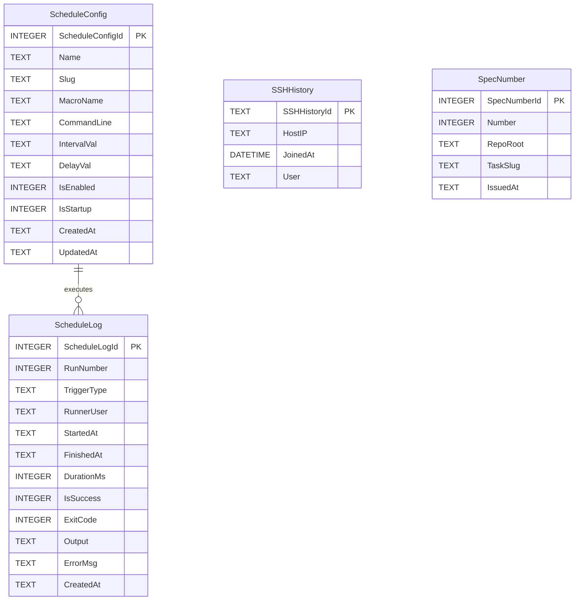

# Architecture Spec: 305 - Database Conventions & PascalCase Schema Views

## 1. Executive Summary & Intent
This specification formalizes compliance with `01-prompts/15-cg-execute/07-data-and-schema.md` and repository guidelines (`02-spec/04-database-conventions/`).
All database tables and views must follow PascalCase singular names with `{TableName}Id` primary keys, PascalCase column names, and positive boolean flags (`IsActive`, `IsEnabled`). For legacy tables (`schedule_config`, `schedule_logs`, `ssh_history`, `spec_numbers`), backward-compatible PascalCase views and schemas are created.

## 2. Mermaid Entity-Relationship Diagram (ERD)

## 3. Disjoint Micro-Batch Allocation
- **Worker 01 (Schedule Split DB):**
  - File: `cli/store/schedule_split_db.go`
  - Action: Add `ScheduleConfig` and `ScheduleLog` PascalCase singular views with `{TableName}Id` keys and positive boolean aliases.
- **Worker 02 (SSH History Migration):**
  - File: `cli/store/migrations_ssh_hist.go`
  - Action: Add `SSHHistory` PascalCase view definition and schema migration.
- **Worker 03 (Spec Numbers Schema):**
  - File: `cli/store/spec_numbers.go`
  - Action: Add `SpecNumber` PascalCase view definition and schema migration.

## 4. Verification Evidence Contract
- FastGate AST inspection: `python 03-ai-scripts/50-fastgate.py` exit 0.
- Forbidden strings check: `python linter-scripts/check-forbidden-strings.py` exit 0.
