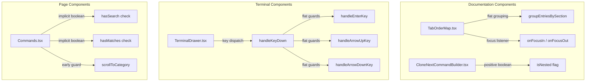

# Architecture Spec: 306 - React Frontend Architecture & Nested If Elimination

## 1. Executive Summary & Intent
This specification formalizes compliance with `01-prompts/15-cg-execute/08-react-frontend-guidelines.md` and repository guidelines (`02-spec/02-coding-guidelines/04-code-style/02-braces-and-nesting.md` and `02-spec/02-coding-guidelines/01-cross-language/02-boolean-principles/`).
React components and frontend TypeScript modules must adhere to:
1. Zero nested `if` statements (depth > 1) via condition inversion, early guard returns, and extracted handler functions.
2. Affirmative boolean naming (`is*`, `has*` only) and total ban on explicit boolean comparisons (`val === true`, `val === false`).
3. Positive naming without negative prefixes (banning `isNo*`, replacing with positive concepts such as `isNested`).
4. Proper hook return structures and clean event handling.

## 2. Component Interaction & Flow

## 3. Disjoint Micro-Batch Allocation
- **Worker 01 (TabOrderMap Refactor):**
  - File: `src/components/docs/TabOrderMap.tsx`
  - Action: Flatten nested conditionals in `groupEntriesBySection` and `onFocusOut`/`onFocusIn`, eliminate any nested conditionals in RAF callbacks, ensure affirmative boolean checks.
- **Worker 02 (TerminalDrawer Refactor):**
  - File: `src/components/terminal/TerminalDrawer.tsx`
  - Action: Flatten keyboard event handling in `handleKeyDown` by extracting specialized handlers (`handleEnterKey`, `handleArrowUpKey`, `handleArrowDownKey`), eliminate nested ifs in platform and theme rendering.
- **Worker 03 (Commands and CommandBuilder Refactor):**
  - Files: `src/pages/Commands.tsx`, `src/components/docs/CloneNextCommandBuilder.tsx`
  - Action: Eliminate explicit boolean equality comparisons (`=== false`) in `Commands.tsx`, rename negative boolean `isNoFlatten` to `isNested` in `CloneNextCommandBuilder.tsx`, add blank lines before returns.

## 4. Verification & Quality Gates
- `FastGate`: `python 03-ai-scripts/50-fastgate.py` must report clean.
- `Forbidden Strings`: `python linter-scripts/check-forbidden-strings.py` must report PASS.
- `AST Guidelines`: No nested if statements across modified frontend components.
