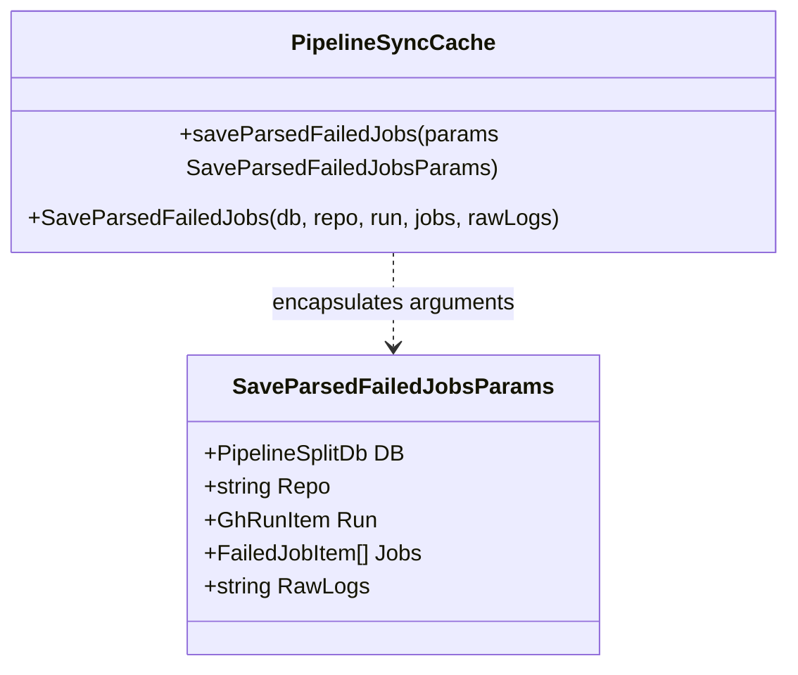

# Architecture Spec: 307 - Code Hygiene, Line Endings & Parameter Reduction

## 1. Executive Summary & Intent
This specification formalizes compliance with `01-prompts/15-cg-execute/09-code-hygiene.md` and repository guidelines (`02-spec/02-coding-guidelines/01-cross-language/04-code-style/`).
All source files across the codebase must adhere to:
1. Strict LF line endings (`\n`) and UTF-8 encoding (no BOM).
2. Proper newline rhythm: blank line before `return` statements and blank line after closing `}` when followed by further statements.
3. Clean parameter signatures (functions <= 3 parameters; >3 arguments grouped into structured parameter types).
4. Implicit affirmative boolean comparisons (zero `== false`).

## 2. Parameter Struct Architecture

## 3. Disjoint Micro-Batch Allocation
- **Worker 01 (Pipeline History Normalization):**
  - File: `cli/cmdpipeline/pipeline_history.go`
  - Action: Convert CRLF (`\r\n`) line endings to LF (`\n`), replace explicit boolean comparison `if hasEnoughParts == false` with `if !hasEnoughParts`.
- **Worker 02 (TerminalDrawer Newline Styling):**
  - File: `src/components/terminal/TerminalDrawer.tsx`
  - Action: Add required vertical blank lines before `return` (lines 72, 101) and after `}` (lines 240, 524) to satisfy `check-newline-styling.py`.
- **Worker 03 (Parameter Struct Encapsulation):**
  - Files: `cli/cmdpipeline/types.go`, `cli/cmdpipeline/pipeline_sync_cache.go`, `cli/cmdpipeline/exports.go`
  - Action: Define `SaveParsedFailedJobsParams` in `types.go`, refactor `saveParsedFailedJobs` to accept parameter struct, maintain backward-compatible delegating exports.

## 4. Verification & Quality Gates
- `FastGate`: `python 03-ai-scripts/50-fastgate.py` must report clean.
- `Newline Styling`: `python linter-scripts/check-newline-styling.py` must report PASS.
- `Forbidden Strings`: `python linter-scripts/check-forbidden-strings.py` must report PASS.
